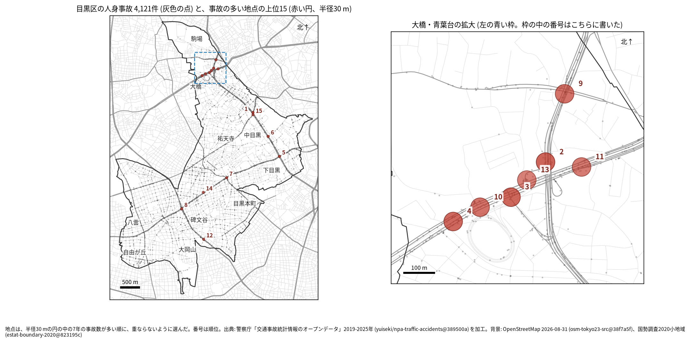
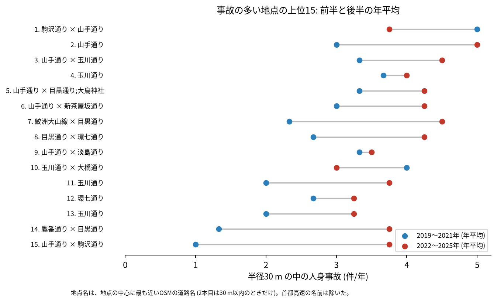
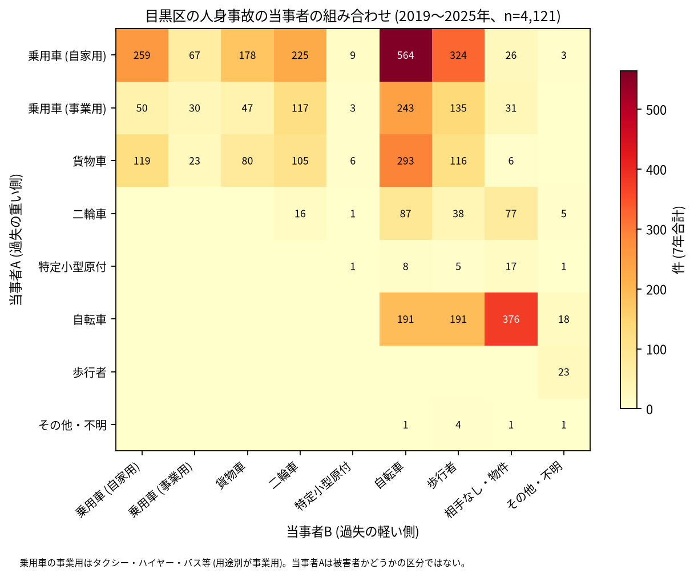

# 道路安全診断のための報告: 目黒区で事故の集まる地点

## 問い

目黒区で 2019〜2025 年の人身事故が集まる地点はどこで、そこでは誰と誰の事故が多いか。現地診断の候補を選ぶ材料にします。

## 結論

- 半径 30 m の円の中の 7 年の件数で選んだ上位 15 地点は、18〜30 件です。15 のうち 7 は大橋・青葉台 (山手通り、玉川通り、大橋ジャンクションの周り) にあり ([hotspots-map.json](../outputs/hotspots-map.json))、ほかは山手通り (上目黒一丁目、中目黒一丁目と二丁目、目黒二丁目)、目黒通り (目黒本町一丁目、碑文谷五丁目、鷹番一丁目)、環七通り (南一丁目) です。

| 順位 | 近い道路 (OSM) | 件数 | 前半 件/年 | 後半 件/年 | 交差点内 | 信号あり | 多い組み合わせ (A × B) |
|---:|---|---:|---:|---:|---:|---:|---|
| 1 | 駒沢通り × 山手通り | 30 | 5.00 | 3.75 | 24 | 24 | 乗用車 (自家用) × 乗用車 (事業用) |
| 2 | 山手通り | 29 | 3.00 | 5.00 | 12 | 15 | 乗用車 (自家用) × 乗用車 (自家用) |
| 3 | 山手通り × 玉川通り | 28 | 3.33 | 4.50 | 10 | 13 | 乗用車 (自家用) × 乗用車 (自家用) |
| 4 | 玉川通り | 27 | 3.67 | 4.00 | 3 | 9 | 貨物車 × 貨物車 |
| 5 | 山手通り × 目黒通り;大鳥神社 | 27 | 3.33 | 4.25 | 22 | 24 | 乗用車 (自家用) × 自転車 |
| 6 | 山手通り × 新茶屋坂通り | 26 | 3.00 | 4.25 | 16 | 19 | 乗用車 (自家用) × 貨物車 |
| 7 | 鮫洲大山線 × 目黒通り | 25 | 2.33 | 4.50 | 17 | 20 | 乗用車 (自家用) × 自転車 |
| 8 | 目黒通り × 環七通り | 25 | 2.67 | 4.25 | 19 | 17 | 乗用車 (自家用) × 乗用車 (自家用) |
| 9 | 山手通り × 淡島通り | 24 | 3.33 | 3.50 | 15 | 18 | 乗用車 (自家用) × 自転車 |
| 10 | 玉川通り × 大橋通り | 24 | 4.00 | 3.00 | 9 | 15 | 乗用車 (自家用) × 乗用車 (自家用) |

前半は 2019〜2021 年、後半は 2022〜2025 年。11〜15 位と、歩行者、自転車、夜の件数は [hotspots.csv](../outputs/hotspots.csv) にあります。道路名は地点の中心に最も近い OSM の道路名で、2 本目は 30 m 以内のときだけ書きました (首都高速の名前は除いた)。5 位の 2 本目は、OSM の名前に「目黒通り;大鳥神社」と 2 つの値が入っています。地点の座標と照らし、場所 (山手通りと目黒通りの交差点) は合っています。2 位と 4 位は 2 本目の道路が 30 m より遠いので、1 本だけを書きました。

- 首都高速: 上位 15 の事故のうち 33 件は首都高速の事故で、2 位 (29 件のうち 10 件)、4 位、10 位、11 位 (各 5 件) に多く含まれます ([analysis.json](../outputs/analysis.json))。大橋・青葉台の地点は、玉川通りの上の 3 号渋谷線と大橋ジャンクション (外の知識) の事故が、平面の座標で下の道路と同じ円に入っています。首都高速の事故を除いて選び直すと、上位 15 のうち 14 地点が 30 m 以内に残りました。地上の交差点を診断するときは、地点の件数から首都高速の分を引いて読んでください。
- 続いているか: 上位 15 は全て前半と後半の両方に事故があります。7 位 (2.33 から 4.50 件/年) と 14 位 (1.33 から 3.75 件/年) は後半に増え、1 位 (5.00 から 3.75 件/年) と 10 位 (4.00 から 3.00 件/年) は減りました。区全体の件数が後半に増えたことと、上位を 7 年合計で選んだこと (平均への回帰) が混ざるので、増減は細かく読まないでください。

- 組み合わせ: 当事者 A が乗用車か貨物車で B が自転車の事故は 1,100 件です。自転車の単独 (相手なし・物件) が 376 件、自転車どうしが 191 件、自転車と歩行者 (自転車が A) が 191 件ありました。事業用の乗用車 (タクシー、ハイヤー、バスなど) は 656 件で当事者 A です ([summary.txt](../outputs/summary.txt))。

- 半径を変えると: 20 m の上位 15 の中心が、30 m の上位 15 の中心から 30 m 以内にあるのは 14 地点、50 m では 13 地点でした。上位に入る交差点は半径を変えてもほぼ保たれます。ただし大橋・青葉台では地点が 100 m ほどの間隔で並んでいて、同じ交差点の事故が 2 つの地点に分かれている可能性があります。

## データ

警察庁「交通事故統計情報のオープンデータ」を加工した `yuiseki/npa-traffic-accidents` 版 `389500a` の本票、目黒区 (`市区町村コード` 110) の 4,121 件。道路名は OpenStreetMap 2026-08-31 (`osm-tokyo23-src-2026-08` 版 `38f7a5f`)。詳しくは [共通の報告](../report.md)。

## 方法

事故の点を EPSG:6677 (メートル) に変換し、半径 30 m の円の中の件数が最も多い事故の点を中心に選び、その円の事故を除いて次を選ぶ手順を 15 回くり返しました。30 m はコード表の「交差点付近」(交差点の側端から 30 m 以内) の幅です。首都高速は `路線コード` 5000〜5499 です。信号ありは `信号機` が 3 灯式、押ボタン式、歩車分式の点灯。組み合わせは当事者 A (過失の重い側) と B の種別で、乗用車は `用途別` で事業用と自家用に分けました。

## 確かめていないこと

- 交通量で割っていません。件数の多い交差点が、車の多さに比べて危険かは分かりません。
- 事故の型 (出会い頭、右折、追突)、違反の種類、重傷と軽傷の区別は、このデータにありません。現地で確かめてください。
- 位置の精度は分かりません。数十 m のずれで地点の件数は変わります。首都高速の事故の位置が高架の上かトンネルの中かは、平面の座標では分かりません。
- 偶然でもこの程度の集まりが生まれるか (順位の有意さ) は調べていません。
