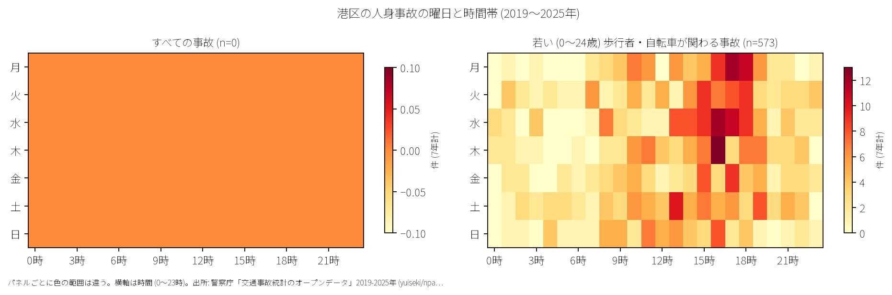

# 港区の交通事故 2019〜2025 年: 図で読む要点

## 問い

2019〜2025 年の警察記録の人身事故で、港区の事故はいつ、どこで、誰が関わって起きているか。

## 結論

### 要点

| # | 要点 | 数字 | 図 |
|---:|---|---|---|
| 1 | 件数は 2020 年に大きく減少し、その後緩やかに回復傾向 | 7 年で 7,831 件、死者 28 人、負傷者 8,908 人。指数 (2019 年=100) は 2020 年 72.6、2025 年 80.2 ([yearly.csv](outputs/yearly.csv)、[summary.txt](outputs/summary.txt)) | [図 1](#図-1-件数の推移) |
| 2 | 住民千人あたり事故率は 23 区で 3 位、夜間事故割合は突出して 2 位だが、高齢歩行者の割合は最下位 | 住民千人あたり年 4.29 件 (23 区中 3 位)。夜間事故割合 38.1% (2 位)、生活道路事故割合 15.1% (20 位)、自転車関与 30.6% (22 位)、高齢歩行者関与 2.8% (23 位) ([wards.csv](outputs/wards.csv)、[summary.txt](outputs/summary.txt)) | [図 2](#図-2-23-区の中の港区) |
| 3 | 集まる場所は青山通り・六本木通り・外苑東通り・桜田通り等の主要幹線交差点 | 事故多発地点 1 位は青山一丁目交差点 (青山通り×外苑東通り、44 件)。2 位は西麻布交差点 (霞ヶ関渋谷線×外苑西通り、41 件)、3 位は東麻布 (環状三号線×桜田通り、41 件) ([hotspots.csv](outputs/hotspots.csv)) | [図 3](#図-3-事故の集まる地点)、[図 4](#図-4-町丁ごとの事故) |
| 4 | 乗用車（事業用・自家用）と二輪車・自転車の交錯が主体 | 事業用乗用車 (タクシー等) と自転車の衝突が 625 件、自家用車同士が 545 件、事業用乗用車と歩行者が 499 件、自家用車と自転車が 497 件。事業用車両が過失の重い当事者 A となる事故が全体の 3 割以上 ([party_matrix.csv](outputs/party_matrix.csv)) | [図 6](#図-6-誰と誰の事故か) |
| 5 | 死亡事故は二輪車乗車中と歩行者に集中 | 死者 28 人のうち二輪車 20 人、歩行者 6 人、自転車 1 人、補充票の人 1 人 ([summary.txt](outputs/summary.txt)) | [表 1](#表-1-死亡事故) |

### 読み手ごとに知るべきこと

| 読み手 | 結論 | 検討する材料 | 詳しく |
|---|---|---|---|
| 区の交通安全担当 | 生活道路 30 km/h 規制の対象となる事故は 15.1〜24.4% と少ない。夜間事故が 38.1% (23 区中 2 位) と高く、タクシー等事業用自動車と二輪・自転車の交錯防止が中心課題 | 青山通り、六本木通り、第一京浜、新橋・六本木・赤坂地区 | [municipality.md](reports/municipality.md) |
| 学校と PTA | 若い (0〜24 歳) 歩行者・自転車の事故は 573 件 (区内全体の 7.3%、23 区中 21 位)。平日の登下校時間帯 (7〜8 時、14〜17 時) に 178 件が発生 | 学校から 500 m 圏内の幹線道路交差点・横断歩道 | [school-pta.md](reports/school-pta.md) |
| 道路安全診断 | 上位は青山通り×外苑東通り (44 件)、霞ヶ関渋谷線×外苑西通り (41 件)、環状三号線×桜田通り (41 件)。多車線交差点での右左折時交錯および横断歩道巻き込み対策 | 幹線道路交差点の信号現示、右折矢印、夜間照明、横断歩行者感知 | [road-safety-auditor.md](reports/road-safety-auditor.md) |
| 住民・来訪者 | 道路延長あたり事故率が高いのは北青山三丁目 (年 6.46 件/道路 km)、新橋一丁目 (6.29 件)、麻布十番一丁目 (5.82 件)、新橋二丁目 (5.57 件)、三田三丁目 (5.05 件) | 大通り横断時の夜間視認性、平日夕方・夜間のタクシー・二輪車との交錯 | [resident.md](reports/resident.md) |

### 図 1: 件数の推移

2020 年はコロナ禍による通勤・来訪自粛等の影響で指数 72.6 まで大幅に落ち込みました。2025 年は 1,052 件（指数 80.2）となり、2019 年（1,312 件）に比べると 2 割程度少ない水準で推移しています。

### 図 2: 23 区の中の港区

赤い点が港区。住民千人あたり年間事故件数は 4.29 件で 23 区中第 3 位ですが、分母は夜間人口 (260,486 人) であり、区外から通勤・来訪する昼間人口の多さは入っていません。夜間事故の割合が 38.1% (23 区中 2 位) と極めて高いのが特徴です。一方、生活道路割合 (15.1%、20 位)、自転車関与割合 (30.6%、22 位)、高齢歩行者割合 (2.8%、23 位) は低く、幹線道路を中心とした自動車・二輪車・タクシー主体の交通特性を示しています。

### 図 3: 事故の集まる地点

半径 30 m の円でクラスタリングした事故多発地点上位 15 です。

| 順位 | 交差点 / 近い道路 (OSM) | 町丁 | 件数 | 前半 件/年 | 後半 件/年 |
|---:|---|---|---:|---:|---:|
| 1 | 青山通り × 外苑東通り | 北青山一丁目 | 44 | 7.67 | 5.25 |
| 2 | 霞ヶ関渋谷線(霞町陸橋) × 外苑西通り | 西麻布一丁目 | 41 | 6.00 | 5.75 |
| 3 | 環状三号線 × 桜田通り | 東麻布一丁目 | 41 | 6.00 | 5.75 |
| 4 | 海岸通り × なぎさ通り | 海岸三丁目 | 35 | 4.33 | 5.50 |
| 5 | 青山通り × 表参道 | 北青山三丁目 | 34 | 4.33 | 5.25 |

前半は 2019〜2021 年、後半は 2022〜2025 年。青山通り・六本木通り・外苑東通り・桜田通り・海岸通り等の主要幹線道路沿いの交差点に集中しています。

### 図 4: 町丁ごとの事故

町丁内の事故件数を OSM 車道延長と 7 年で割った事故密度 (件/道路 km/年) です。上位 5 町丁は北青山三丁目 (6.46 件)、新橋一丁目 (6.29 件)、麻布十番一丁目 (5.82 件)、新橋二丁目 (5.57 件)、三田三丁目 (5.05 件) となっています。

### 図 5: いつ起きるか

事故は平日の朝夕から夜間にかけて広く多発し、特に 17 時台 (539 件) や 18 時台 (508 件) の夕方に高い山があります。

1 日の時刻別分布では、夕方 17 時台にピークがあるほか、深夜・未明帯にも 23 区平均と比べて高い発生水準が持続します。

### 図 6: 誰と誰の事故か

事業用乗用車 (タクシー等) と自転車の事故が最多 (625 件) で、自家用乗用車同士 (545 件)、事業用乗用車と歩行者 (499 件)、自家用乗用車と自転車 (497 件) が続きます。

### 表 1: 死亡事故

7 年間で発生した 28 件の死亡事故の内訳：

| 亡くなった当事者 | 人数 | 主な傾向 |
|---|---:|---|
| 二輪車 (バイク) | 20 | 幹線道路交差点や単路での衝突・単独事故 ([summary.txt](outputs/summary.txt)) |
| 歩行者 | 6 | 65 歳以上が 1 人、夜間帯の横断中など |
| 自転車 | 1 | 幹線道路での交錯 |
| 補充票の人 (同乗者等) | 1 | 車両相互等の重大衝突 |

## データ

- 人身事故: 警察庁「交通事故統計情報のオープンデータ」を加工した `yuiseki/npa-traffic-accidents` 版 `389500aae5cec45f1311163f70db6a5f05867838` の本票。年はファイルの年。港区 7,831 件、23 区 144,716 件。位置の無い行は 1 件。物損事故は含まない。
- 区の面と人口: `yuiseki/jp-admin-2026-09` 版 `e6c87b1d7095c17422147962185071a986e13135`。町丁: 2020 年国勢調査の小地域 `yuiseki/estat-boundary-2020` 版 `823195c40e1055e2c1b3c0a635369f8c82b6c3fb` (118 町丁、260,486 人)。学校 31 校と道路: OpenStreetMap 2026-08-31、`yuiseki/osm-tokyo23-src-2026-08` 版 `38f7a5f961b6e33343d82a11152e768c37d22664`。
- 道具: DuckDB (spatial)、matplotlib、`analysis-visualize`。

## 方法

- 生活道路は車道幅員 01、02、11 (狭い読み)、広い読みは 14、17 を足す。
- 距離は EPSG:6677 (メートル) で計測。
- 地点は半径 30 m の円の中の件数が多い順に選定。
- 地図は `analysis-visualize` の map-context に準拠。

## 確かめていないこと

- 交通量や昼間滞在人口で割った真の曝露量あたり事故率は計算していない。
- 位置の精度は数十メートルのブレがありうる。
- ヒヤリハットや物損事故は含んでいない。
