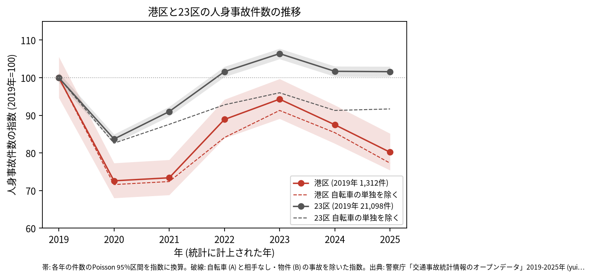
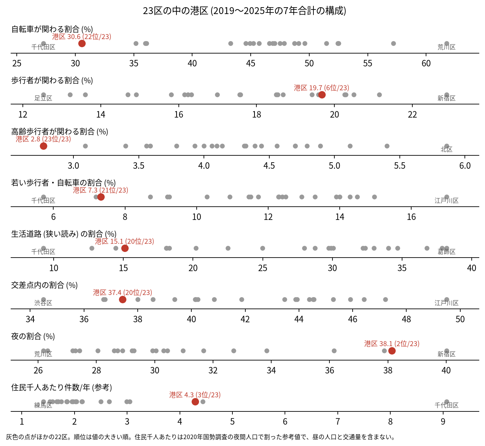
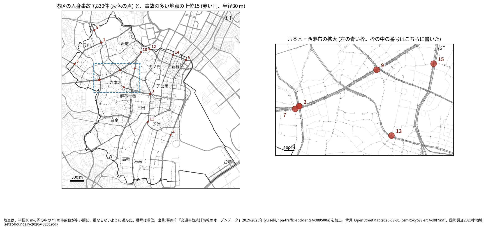
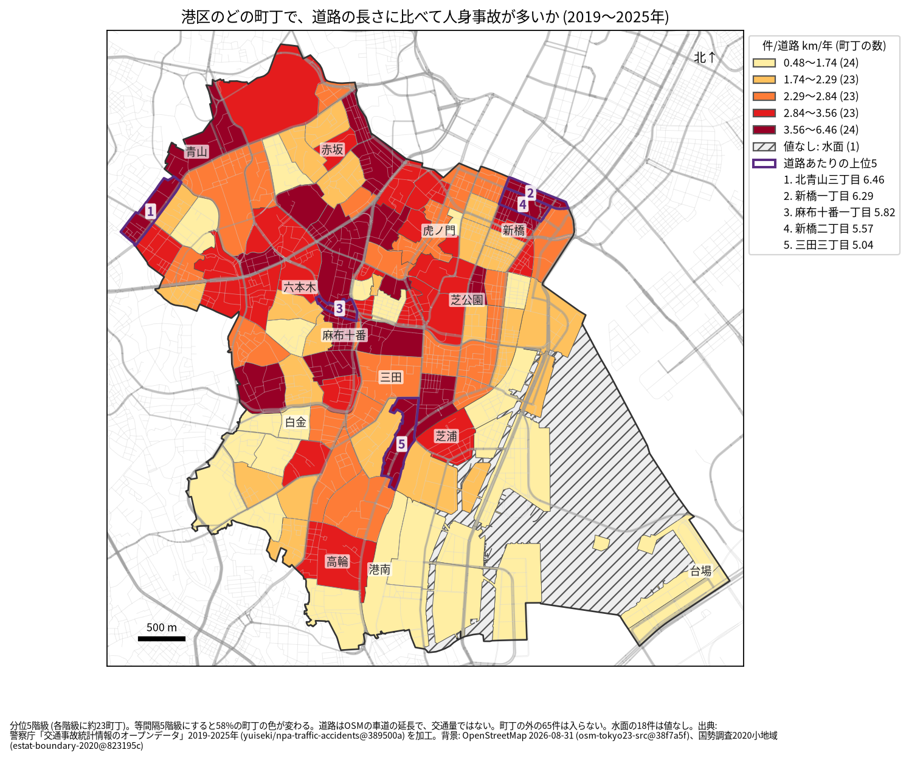
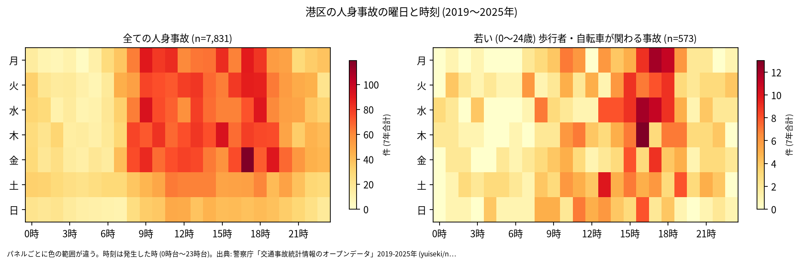
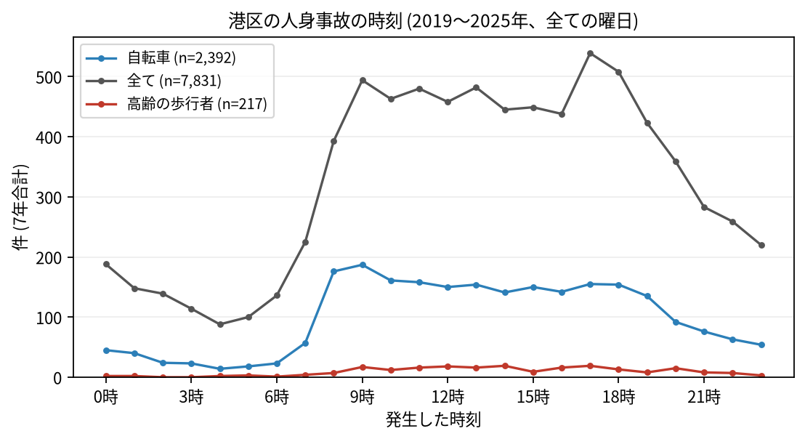
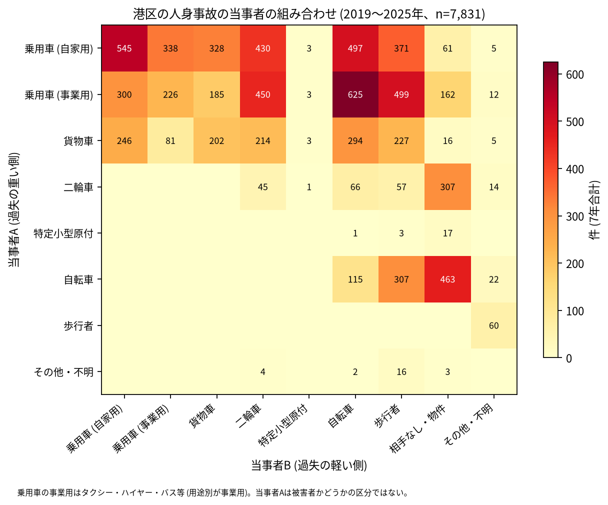

# 港区の交通事故 2019〜2025 年: 図で読む要点

## 問い

2019〜2025 年の警察記録の人身事故で、港区の事故はいつ、どこで、誰が関わって起きているか。

## 結論

### 要点

| # | 要点 | 数字 | 図 |
|---:|---|---|---|
| 1 | 件数は 2020 年に大きく減り、2023 年にかけて戻ったが、2025 年は 2019 年より少ない | 7 年で 7,831 件、死者 28 人、負傷者 8,908 人。指数 (2019 年=100) は 2020 年 72.6、2025 年 80.2。23 区全体の 2025 年は 101.6 ([yearly.csv](outputs/yearly.csv)、[summary.txt](outputs/summary.txt)) | [図 1](#図-1-件数の推移) |
| 2 | 夜の事故が多く、自転車と高齢の歩行者の関わる事故は少ない | 夜 38.1% (23 区の 2 位)、自転車 30.6% (22 位)、高齢の歩行者 2.8% (23 位) ([wards.csv](outputs/wards.csv)、[analysis.json](outputs/analysis.json)) | [図 2](#図-2-23-区の中の港区) |
| 3 | 集まる場所は青山、六本木・西麻布、新橋 | 事故の多い地点の 1 位は青山通り × 外苑東通り (44 件)。道路あたりの上位 5 町丁は北青山三丁目 (6.46)、新橋一丁目、麻布十番一丁目、新橋二丁目、三田三丁目 ([hotspots.csv](outputs/hotspots.csv)、[towns.csv](outputs/towns.csv)) | [図 3](#図-3-事故の集まる地点)、[図 4](#図-4-町丁ごとの事故) |
| 4 | 事業用の乗用車 (タクシー、ハイヤー、バスなど) が当事者 A の事故が多い | 事業用の乗用車が当事者 A の事故 2,462 件 (自家用 2,578 件)。最も多い組は事業用の乗用車 (A) と自転車 (B) の 625 件 ([summary.txt](outputs/summary.txt)) | [図 6](#図-6-誰と誰の事故か) |
| 5 | 死亡事故は二輪車に偏る | 死者 28 人のうち二輪車の人が 20 人。当事者 A が二輪車の事故が 16 件。19〜5 時台が 13 件 ([summary.txt](outputs/summary.txt)) | [表 1](#表-1-死亡事故) |

### 読み手ごとに知るべきこと

| 読み手 | 結論 | 検討する材料 | 詳しく |
|---|---|---|---|
| 区の交通安全担当 | 生活道路の法定速度 30 km/h (2026-09-01 から) が当たるのは事故の 15.1〜24.4% (読み方による)。件数の多くは青山通り、六本木通り、外苑東通り、桜田通り、第一京浜などの幹線の交差点 | 夜の事故、二輪車の死亡事故、事業用の乗用車 | [municipality.md](reports/municipality.md) |
| 学校と PTA | 若い (0〜24 歳) 歩行者と自転車の事故は 573 件。最も多いのは 16 時台で、朝より下校から夕方が多い | 学校の円の中で、平日 14〜17 時台の点が並ぶ道 | [school-pta.md](reports/school-pta.md) |
| 道路安全診断 | 上位は青山通り × 外苑東通り (44 件)、霞町陸橋 (六本木通り) × 外苑西通り (41 件)、環状三号線 × 桜田通り (41 件) | 後半に増えた 4 位、6 位、13 位と、隣り合う 2 位と 7 位 | [road-safety-auditor.md](reports/road-safety-auditor.md) |
| 住民 | 道路あたりで多いのは北青山三丁目 (年 6.46 件/道路 km)、新橋一丁目 (6.29 件)。事故は 8 時台から 19 時台まで多く、17 時台が最多 | 自分の町の色、夜と深夜の事故、二輪車 | [resident.md](reports/resident.md) |

### 図 1: 件数の推移

2020 年の落ち込み (72.6) は 23 区全体 (83.7) より深く、23 区が 2022 年に 2019 年の水準に戻った (101.6) のに対し、港区は 2023 年の 94.3 が最も高い。2025 年の 95% 区間 (989.4〜1117.5 件) は 2019 年 (1242.0〜1385.0 件) と重ならないので、2019 年より減ったと書ける。

### 図 2: 23 区の中の港区

赤い点が港区。夜 (2 位) と歩行者 (19.7%、6 位) が高く、自転車 (22 位)、高齢の歩行者 (23 位)、若い歩行者・自転車 (7.3%、21 位)、交差点内 (37.4%、20 位)、生活道路 (20 位) が低い。住民千人あたり (4.29 件/年、3 位) は昼の人口を含まない参考値。

### 図 3: 事故の集まる地点

半径 30 m の円の中の 7 年の件数で選んだ上位 15 (24〜44 件)。番号は順位で、六本木・西麻布の 5 地点 (2、7、9、13、15 位) は右の拡大図に番号を書いた。

| 順位 | 近い道路 (OSM) | 町丁 | 件数 | 前半 件/年 | 後半 件/年 |
|---:|---|---|---:|---:|---:|
| 1 | 青山通り × 外苑東通り | 北青山一丁目 | 44 | 7.67 | 5.25 |
| 2 | 霞ヶ関渋谷線(霞町陸橋) × 外苑西通り | 西麻布一丁目 | 41 | 6.00 | 5.75 |
| 3 | 環状三号線 × 桜田通り | 東麻布一丁目 | 41 | 6.00 | 5.75 |
| 4 | 海岸通り × なぎさ通り | 海岸三丁目 | 35 | 4.33 | 5.50 |
| 5 | 青山通り × 表参道 | 北青山三丁目 | 34 | 4.33 | 5.25 |

前半は 2019〜2021 年、後半は 2022〜2025 年。半径を 20 m にすると上位 15 のうち 14 地点、50 m では 10 地点が残る。2 位と 7 位は西麻布で隣り合い、同じ交差点の事故が 2 つの地点に分かれている可能性がある。6〜15 位は [hotspots.csv](outputs/hotspots.csv)。

### 図 4: 町丁ごとの事故

町丁の事故数を、OSM の車道の延長と 7 年で割った値。紫の枠が上位 5 (北青山三丁目、新橋一丁目、麻布十番一丁目、新橋二丁目、三田三丁目)。分位と等間隔で 58% の町丁の色が変わるので、色の細かい差は読まない。斜線は水面調査区で、そこに落ちた 18 件 (レインボーブリッジの上などとみられるが、地点ごとには確かめていない) は値にしていない。道路の長さは交通量ではない。

### 図 5: いつ起きるか

全体は平日の 8〜19 時台に広く多く、最多は 17 時台 (539 件)。若い歩行者と自転車は 15〜18 時台に寄り、最多は 16 時台 (57 件)。

自転車は 9 時台 (187 件) と 8 時台 (176 件)、高齢の歩行者は 14 時台と 17 時台 (19 件) が最多。

### 図 6: 誰と誰の事故か

最も多いのは事業用の乗用車 (A) と自転車 (B) の 625 件、次が自家用の乗用車どうしの 545 件、事業用の乗用車と歩行者の 499 件。自転車の単独 (相手なし・物件) は 463 件、二輪車の単独は 307 件。当事者 A は過失の重い側で、被害者とは限らない。

### 表 1: 死亡事故

| 亡くなった人 | 人数 | 特徴 |
|---|---:|---|
| 二輪車 | 20 | 当事者 A が二輪車の事故が 16 件 |
| 歩行者 | 6 | 65 歳以上は 1 人 |
| 自転車 | 1 | |
| 補充票の人 | 1 | 当事者 A と B のどちらでもない人 |

28 件のうち 19〜5 時台が 13 件、0〜5 時台が 5 件。数が少ないので傾向とは断定しない。全件は [deaths.csv](outputs/deaths.csv) で、当事者 A が二輪車の事故の多くは、相手が相手なし・物件 (単独) である。

### 読み方で変わる答え

| 読み方 | 主 | 別の読み方 |
|---|---|---|
| 港区の事故 | `市区町村コード` 103 の 7,831 件 | 点が区の面に入る事故。両方に当てはまるのは 7,765 件 ([wards.csv](outputs/wards.csv)、[analysis.json](outputs/analysis.json)) |
| 生活道路 | 狭い読み 15.1% (20 位) | 広い読み 24.4% (21 位) ([wards.csv](outputs/wards.csv)、[analysis.json](outputs/analysis.json)) |
| 件数の推移 (台東区の R019 で型に入った読み) | 全ての人身事故 | 自転車 (A) と相手なし・物件 (B) の事故を除くと、2025 年の指数は港区 77.3、23 区 91.7。この事故は港区で 2019 年 46 件から 2022 年 102 件、2025 年 74 件 (記録のされ方の変化かは確かめていない) ([yearly.csv](outputs/yearly.csv)、[analysis.json](outputs/analysis.json)) |
| 地点の半径 | 30 m | 20 m で 14 地点、50 m で 10 地点が残る ([analysis.json](outputs/analysis.json)) |
| 高速道路の事故 (型が毎回並べる読み) | 含める | 除いても 15 地点が全部残る。高速道路 (首都高速) の事故は区で 309 件、上位 15 の円には 9 件 ([analysis.json](outputs/analysis.json)) |
| 町丁の階級 | 分位 5 階級 | 等間隔で 58% の町丁の色が変わる ([town-rate-quantile.json](outputs/town-rate-quantile.json)) |

## データ

- 人身事故: 警察庁「交通事故統計情報のオープンデータ」を加工した `yuiseki/npa-traffic-accidents` 版 `389500aae5cec45f1311163f70db6a5f05867838` (配布元の取得 2026-10-02) の本票。年はファイルの年 (統計に計上された年)。港区 7,831 件、23 区 144,716 件。位置の無い行は 1。物損事故は含まない。
- 区の面と人口: `yuiseki/jp-admin-2026-09` 版 `e6c87b1`。町丁: 2020 年国勢調査の小地域 `yuiseki/estat-boundary-2020` 版 `823195c` (境界ファイルの 140 行を KEY_CODE でまとめた 118 単位、260,486 人。水面調査区 1 単位を含む)。学校 29 校と道路: OpenStreetMap 2026-08-31、`yuiseki/osm-tokyo23-src-2026-08` 版 `38f7a5f`。
- 道具: DuckDB 2.0.0 (spatial)、matplotlib、`analysis-visualize` の `cjk_font.py`、`classify_map.py`、`context_map.py`。
- 出典の表示: 警察庁ウェブサイト (https://www.npa.go.jp/publications/statistics/koutsuu/opendata/index_opendata.html) の交通事故統計情報のオープンデータを加工して作成。国勢調査の小地域境界と人口、OpenStreetMap (© OpenStreetMap contributors) を加工して使用。

## 方法

- 読み方は結果を見る前に [計画](EXPERIMENT_PLAN.md) で固定し、実行は [記録](EXPERIMENT_TRACKER.md) に残した。台東区の型 (2026-11-03) をそのまま写し、区のコード、区の名前、検査値、図の地名と位置だけを変えた。生活道路は `車道幅員` が 01、02、11 (狭い読み)、広い読みは 14、17 を足す。歩行者や自転車が関わるかは当事者 A と B の両方で見て、1 件を 1 回数えた。
- 年齢はデータの年齢層で読む。若い人は 01 (0〜24 歳)、高齢の人は 65 (65〜74 歳) と 75 (75 歳以上)。
- 距離は EPSG:6677 (メートル) で測った。町丁の道路あたりの上位 5 には、道路が 0.5 km より短い町丁を数えない (港区では愛宕二丁目と麻布狸穴町。どちらも 5 位より値が小さい)。水面調査区は道路あたりの値を付けない。地点は、半径 30 m の中の件数が最も多い点を中心に選び、その円の事故を除いて次を選ぶ手順を 15 回くり返した。地点の名前は、中心に最も近い道と、それと 30 度以上の向きで交わる道のうち最も近い道 (どちらも 30 m 以内のときだけ)。
- 地図は `analysis-visualize` の map-context に合わせ、地名と道路を重ね、凡例を地図の外に置き、強調した単位に番号を付けた。描いた町丁の数 (118) を分析の数と照らし、文字の重なりと、地名や番号が円や学校の印を隠す重なりは、3 枚の地図で 0 件 (1 回目に見つかった 3 件を、地名 3 つと番号 1 つの位置で直した)。背景の道路 (OGC:CRS84) と町丁 (JGD2000) の差は、線の幅より小さいとして変換せずに重ねた。
- 関門: 予測と回帰をしないので、評価の分け方と残差の確認は要らない。単位の間の相関を結論にしないので、Moran's I と格子の掃引は省いた。推移は 23 区全体を基準にし、年の件数に Poisson の 95% 区間を付けた。対策の効果は推定していない。
- 再実行は [README.md](README.md)。数値は [outputs/](outputs/) の CSV、来歴は [analysis.json](outputs/analysis.json)。

## 確かめていないこと

- 交通量、昼の人口、来訪者の数で割っていない。青山、六本木、新橋の件数の多さは、人と車の多さかもしれない。
- 夜の割合の高さ (23 区の 2 位) の理由 (繁華街、タクシーの多さなど) は調べていない。
- 位置の精度は分からない。30 m の地点と町丁の境界の近くの事故は、数十 m のずれで入れ替わる。
- 事故の型 (出会い頭、追突)、重傷と軽傷の区別、物損事故、ヒヤリハットは、このデータに無い。
- 二輪車の死亡事故が、どの路線 (首都高速か一般道か) で起きたかは数えていない。
- 0〜24 歳より細かい年齢は無く、小学生だけは数えられない。
- 地点の上位は 7 年で選び、同じ 7 年で前半と後半を比べたので、後半が下がって見えやすい (平均への回帰)。
