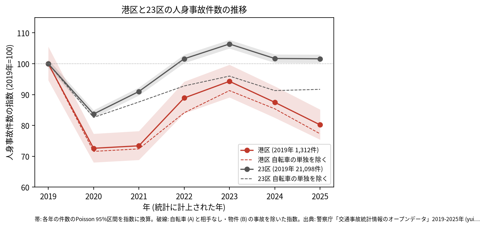
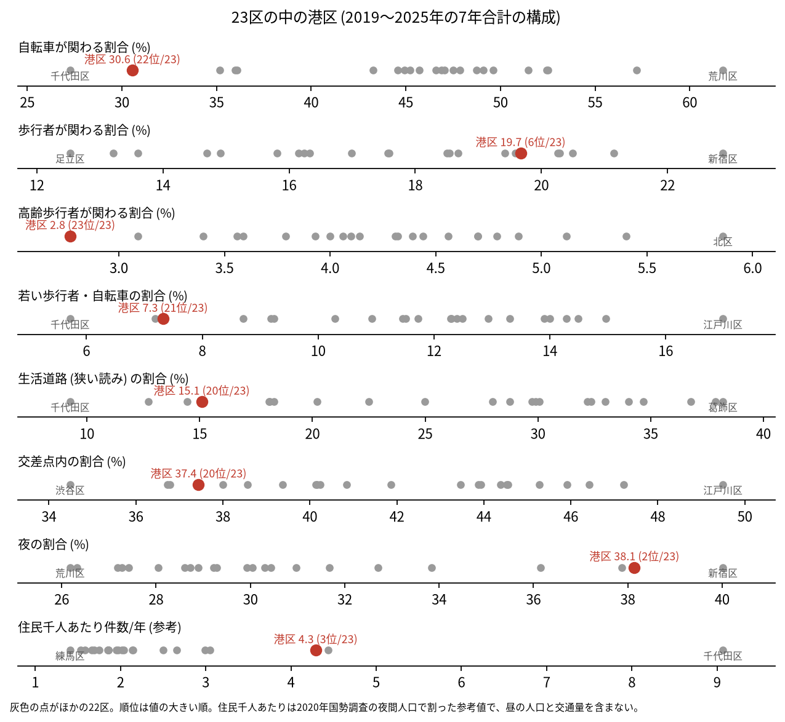
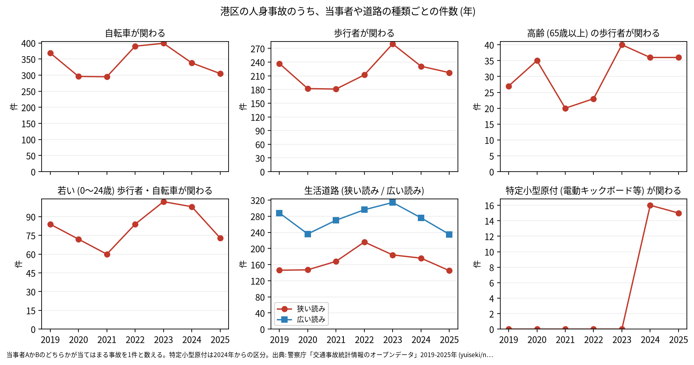

# 区の交通安全担当のための報告: 港区の交通事故の傾向

## 問い

港区の人身事故は 2019〜2025 年にどう推移し、23 区の中でどんな特徴があり、施策をどこに向ける材料になるか。

## 結論

- 件数: 7 年で 7,831 件、死者 28 人、負傷者 8,908 人です。2020 年に 952 件 (2019 年を 100 として 72.6) まで減り、23 区全体 (83.7) より大きく下がりました。2023 年に 1,237 件 (94.3) まで戻りましたが、2025 年は 1,052 件 (80.2) です。2025 年の 95% 区間 (989.4〜1117.5 件) は 2019 年の区間 (1242.0〜1385.0 件) と重ならないので、2019 年より減ったと言えます。23 区全体の 2025 年は 101.6 で、2019 年とほぼ同じです。

- 23 区の中の位置: 港区の事故は、夜に多く、自転車と高齢の歩行者が少ない構成です。夜の割合は 38.1% で 23 区の 2 位、歩行者が関わる割合は 19.7% で 6 位です。自転車が関わる割合は 30.6% で 22 位、高齢の歩行者は 2.8% で 23 位、若い歩行者と自転車は 7.3% で 21 位です。交差点内の割合は 37.4% で 20 位、生活道路 (狭い読み) は 15.1% で 20 位、広い読みでも 24.4% で 21 位です。

- 施策への読み方: 2026-09-01 からの生活道路の法定速度 30 km/h は、港区の事故のうち 15.1〜24.4% (読み方による) にしか当たりません。港区で事故の集まる地点は、青山通り、六本木通り、外苑東通り、桜田通り、第一京浜などの幹線の交差点です (地点は [道路安全診断の報告](road-safety-auditor.md))。これは効果の予測ではなく、どの道路で事故が起きているかの構成です。
- 当事者: 事業用の乗用車 (タクシー、ハイヤー、バスなど) が当事者 A の事故は 2,462 件で、自家用の乗用車 (2,578 件) とほぼ同じです。最も多い組み合わせは事業用の乗用車と自転車 (625 件) で、事業用の乗用車と歩行者 (499 件) が続きます。
- 区分ごとの推移: 自転車が関わる事故は 2022 年 390 件、2023 年 399 件と、2019 年 (369 件) を上回った後、2025 年は 305 件です。特定小型原付 (電動キックボードなど) が関わる事故は、区分のできた 2024 年に 16 件、2025 年に 15 件でした。

- 死亡事故: 28 件のうち、亡くなったのは二輪車の人 20 人、歩行者 6 人、自転車 1 人、補充票の人 (当事者 A と B のどちらでもない人) 1 人です。当事者 A が二輪車の事故が 16 件で、その多くは相手が相手なし・物件 (単独) です。19〜5 時台に起きた事故が 13 件です。28 件は少なく、偏りを傾向と断定できる数ではありません。

| 年 | 当事者 A | 当事者 B | 亡くなった人 | 時 |
|---|---|---|---|---:|
| 2020 | 貨物車 | 歩行者 (0〜24 歳) | 歩行者 | 7 |
| 2020 | 貨物車 | 歩行者 (75 歳以上) | 歩行者 | 11 |
| 2023 | 乗用車 (自家用) | 歩行者 (35〜44 歳) | 歩行者 | 21 |
| 2025 | 乗用車 (自家用) | 歩行者 (45〜54 歳) | 歩行者 | 21 |
| 2025 | 二輪車 | 歩行者 (55〜64 歳) | 歩行者 | 22 |
| 2025 | 乗用車 (事業用) | 歩行者 (25〜34 歳) | 歩行者 | 2 |

表は、歩行者が亡くなった 6 件の抜き出しです。28 件 ([summary.txt](../outputs/summary.txt)) の全ては [deaths.csv](../outputs/deaths.csv) にあります。

- 人口あたり: 2020 年の住民千人あたりの年の件数は 4.29 件で 23 区の 3 位ですが、分母に昼の人口、来訪者、通過する車が入らないため、区の比較の主な指標にしていません。

## データ

警察庁「交通事故統計情報のオープンデータ」を加工した `yuiseki/npa-traffic-accidents` 版 `389500a` の本票。港区は `市区町村コード` 103 の 7,831 件、23 区は 144,716 件。年はファイルの年 (統計に計上された年)。区の人口は 2020 年国勢調査 (`jp-admin-2026-09` 版 `e6c87b1`)。詳しくは [共通の報告](../report.md)。

## 方法

区分は、当事者 A か B のどちらかが当てはまる事故を 1 件と数えました。生活道路は `車道幅員` で決め、狭い読み (5.5 m 未満の単路と、小と小の交差点) と、広い読み (5.5 m 未満の道とより広い道の交差点も含む) を並べました。年の区間は件数の Poisson の 95% 区間 (Garwood) です。23 区の順位は 7 年合計の割合の大きい順です。

## 確かめていないこと

- 2020 年の減り方が 23 区より大きく、戻り方が小さい理由 (人出や在宅勤務の変化など) は調べていません。
- 夜の割合が高い理由 (繁華街、タクシーの多さなど) は調べていません。
- 二輪車の死亡事故が首都高速と一般道のどちらで起きたかは数えていません。
- 区の施策 (ゾーン 30、自転車の通行帯など) の効果は推定していません。割合の順位は施策の評価ではありません。
- 重傷と軽傷の区別、物損事故は、このデータにありません。
