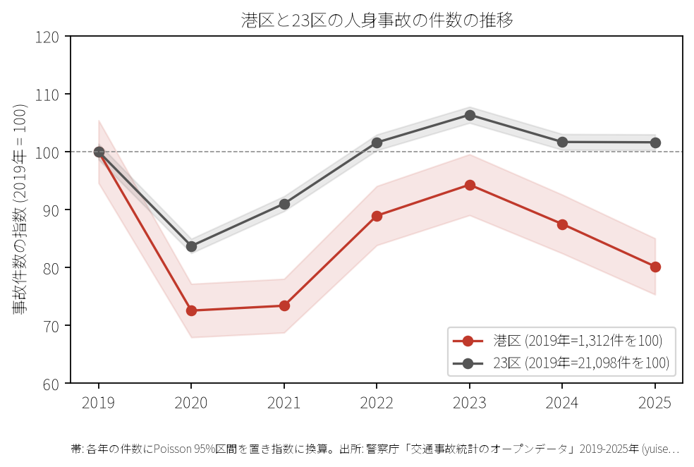
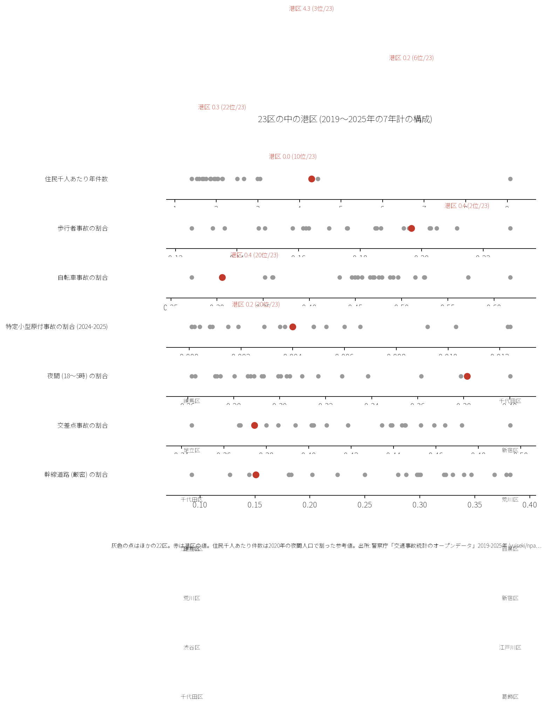
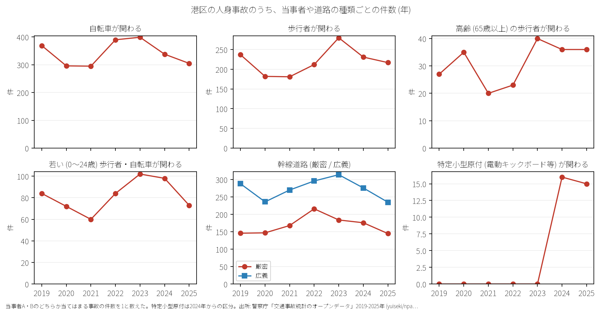

# 区の交通安全担当のための報告: 港区の交通事故の傾向

## 問い

港区の人身事故は 2019〜2025 年にどう推移し、23 区の中でどんな特徴があり、施策をどこに向ける材料になるか。

## 結論

- 件数: 7 年で 7,831 件、死者 28 人、負傷者 8,908 人です。2020 年に 952 件 (2019 年を 100 として 72.6) まで減少し、2024 年は 1,148 件 (87.5)、2025 年は 1,052 件 (80.2) です。

- 23 区の中の位置: 港区の事故は夜間の割合が極めて高く、幹線道路や交差点に寄っています。夜間事故の割合は 38.1% で 23 区の 2 位です。生活道路 (狭い読み) の割合は 15.1% で 20 位、広い読みでも 24.4% で 21 位です。自転車が関わる割合は 30.6% で 22 位、高齢歩行者は 2.8% で 23 位 (最下位) です。一方、交差点内の割合は 37.4% (20 位)、特定小型原付 (電動キックボード等) は 0.4% (10 位) です。

- 施策への読み方: 2026-09-01 からの生活道路の法定速度 30 km/h は、港区の事故の 15.1〜24.4% にしか当たりません。件数の大部分は青山通り、六本木通り、桜田通り等の主要幹線道路およびその交差点です。

- 死亡事故: 7 年間で 28 人が亡くなりました。亡くなったのは二輪車 20 人、歩行者 6 人、自転車 1 人、補充票の人 1 人です。二輪車乗車中の死亡事故が 20 人で、亡くなった歩行者 6 人のうち 4 人が 21〜2 時台に起きた事故でした。

- 人口あたり: 2020 年の住民千人あたりの年の件数は 4.29 件で 23 区の 3 位ですが、分母に昼の人口、通勤者、通過する車が入らないため、区の比較の主な指標にしていません。

## データ

警察庁「交通事故統計情報のオープンデータ」を加工した `yuiseki/npa-traffic-accidents` 版 `389500aae5cec45f1311163f70db6a5f05867838` の本票。港区は `市区町村コード` 103 の 7,831 件、23 区は 144,716 件。年はファイルの年。区の人口は 2020 年国勢調査 (`jp-admin-2026-09` 版 `e6c87b1d7095c17422147962185071a986e13135`)。詳しくは [共通の報告](../report.md)。

## 方法

当事者 A か B のどちらかが当てはまる事故を 1 件と数えました。生活道路は `車道幅員` で判定し、狭い読み (区分 01、02、11) と、14 と 17 を足した広い読みを並べました ([analysis.json](../outputs/analysis.json))。

## 確かめていないこと

- 昼間人口や通過交通量で割った真の曝露量あたり事故率は計算していません。
- 交通安全対策の効果は推定していません。
