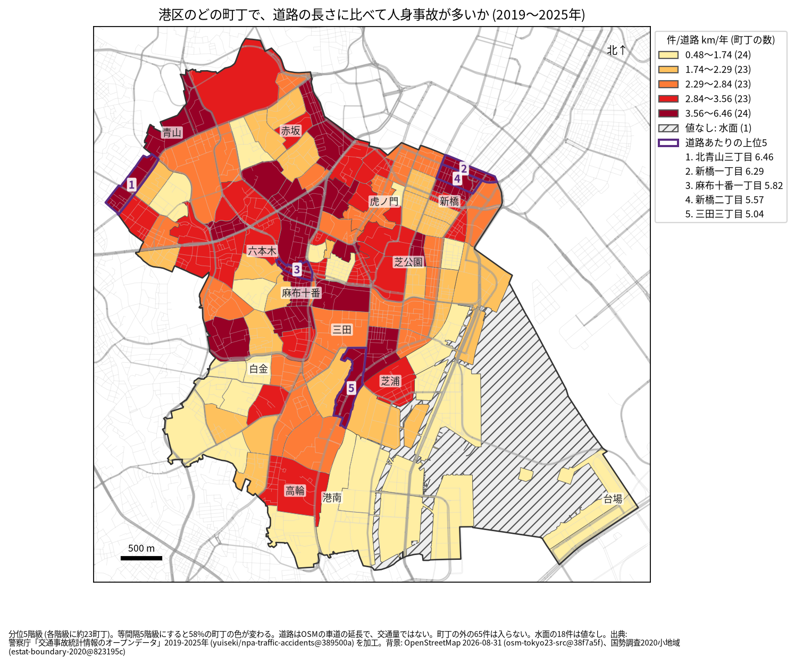
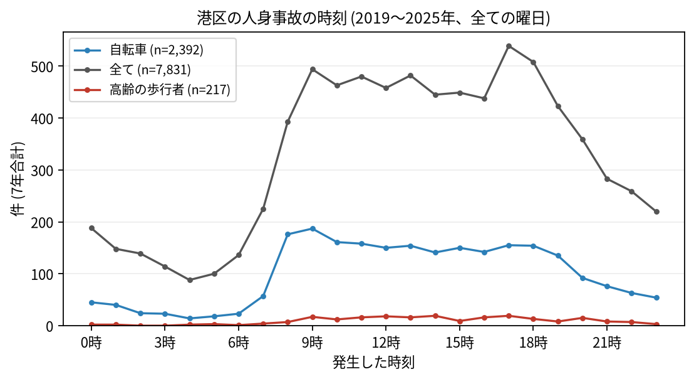

# 住民のための報告: 港区で、いつ、どこで事故が起きているか

## 問い

港区に住む人が、自分の町で、いつ、どんな事故に気をつければよいか。2019〜2025 年の警察記録の人身事故から調べました。

## 結論

- 港区では 7 年で 7,831 件の人身事故があり、28 人が亡くなりました。年に 952〜1,312 件です。
- 町ごと: 道路 1 km あたりの事故が多いのは、北青山三丁目 (年 6.46 件)、新橋一丁目 (6.29 件)、麻布十番一丁目 (5.82 件)、新橋二丁目 (5.57 件) です。件数そのものが最も多いのは六本木三丁目 (7 年で 202 件) でした。青山、六本木、麻布十番、新橋、三田に色の濃い町が並び、港南と台場の海側と白金の町は色が薄くなっています。

色は分位 5 階級で、各色に約 23 の町が入ります。等間隔の階級にすると 58% の町の色が変わるので、色の差より、自分の町が上の階級か下の階級かを見てください。

- 時間: 事故は朝 8 時台から増え、夕方 19 時台まで高い水準が続きます。最も多いのは 17 時台 (539 件)、次が 18 時台 (508 件) です。夜の事故の割合は 38.1% で、23 区で 2 番目に高い区です。自転車が関わる事故は 9 時台 (187 件) と 8 時台 (176 件) に多く、高齢の歩行者が関わる事故は 14 時台と 17 時台 (19 件) が最も多い時間でした。

- 誰が: 自転車が関わる事故は全体の 30.6% で、23 区の中では少ない方 (22 位) ですが、自転車に乗る人は、車やトラックとの事故 (1,416 件) と、自転車だけの事故 (転倒や物への衝突、463 件) に気をつけてください。歩行者が関わる事故は 19.7% です。
- 亡くなった人: 28 人のうち 20 人が二輪車 (オートバイなど) に乗っていた人で、歩行者は 6 人でした。死亡事故の 13 件は 19〜5 時台に起きています。

## データ

警察庁「交通事故統計情報のオープンデータ」を加工した `yuiseki/npa-traffic-accidents` 版 `389500a` の本票、港区の 7,831 件 (2019〜2025 年のファイル)。町の境界は 2020 年国勢調査の小地域 (118 単位、うち水面 1)、道路は OpenStreetMap 2026-08-31。詳しくは [共通の報告](../report.md)。

## 方法

事故の地点を町丁の境界に入れて数え、町丁の中の車道の長さ (OSM) と 7 年で割りました。区の境界の近くで町丁の外に落ちた 65 件と、水面 (運河や海の上、橋の上など) に落ちた 18 件は町の値に入っていません。時刻は事故の起きた時で、7 年の合計です。夜は本票の昼夜の区分の夜 (コード 21〜23) です。

## 確かめていないこと

- 道路の長さは、通る車や人の数ではありません。青山、六本木、新橋の値が高いのは、人と車が多いためかもしれません。
- 自分の町の事故が少なくても、物損事故やヒヤリハットはこのデータにありません。
- 事故の位置の精度は分かりません。町の境界の近くの事故は、隣の町に数えられている可能性があります。
