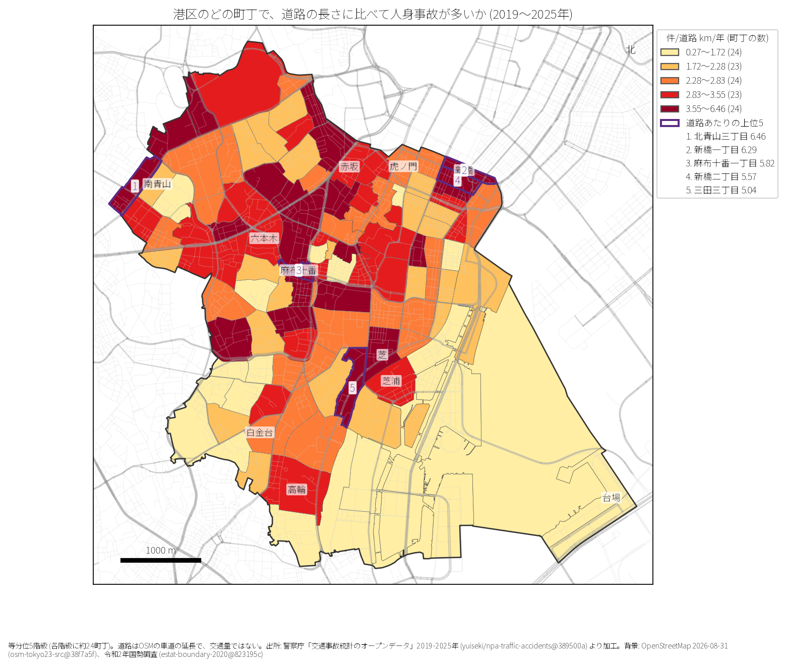
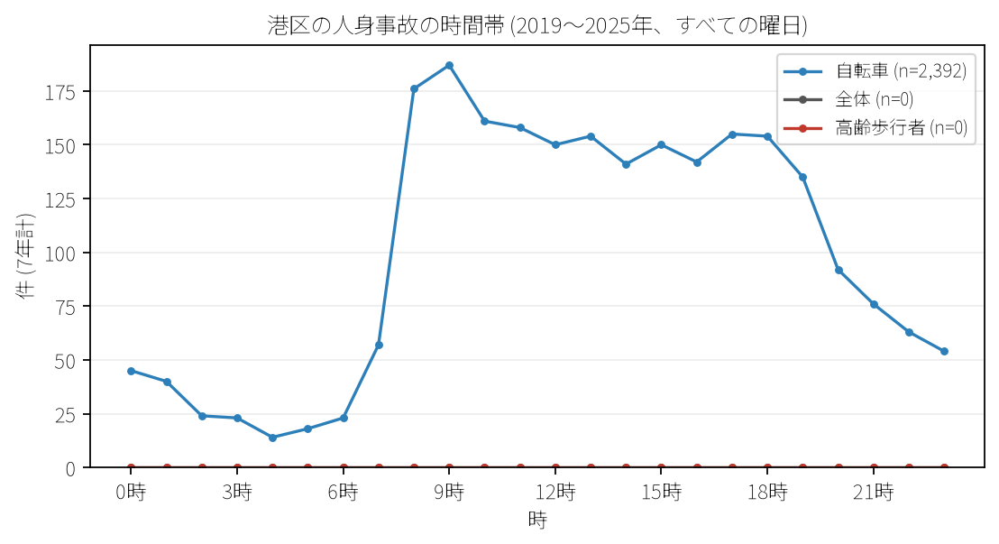

# 住民と来訪者のための報告: 港区の地域の事故傾向

## 問い

港区のどの町丁で道路の長さに比べて事故が多く、日常生活でどこに気をつけるべきか。

## 結論

- 町丁別事故密度: 道路 1 km あたり事故率の最上位は北青山三丁目 (年 6.46 件/道路 km)、次いで新橋一丁目 (6.29 件)、麻布十番一丁目 (5.82 件)、新橋二丁目 (5.57 件)、三田三丁目 (5.05 件) です。

- 時間帯: 事故は平日の夕方から夜間に多く、17 時台 (539 件) や 18 時台 (508 件) にピークを迎えます。

## データ

警察庁「交通事故統計情報」本票 2019〜2025 年、2020 年国勢調査小地域境界 (118 町丁)。詳しくは [共通の報告](../report.md)。

## 方法

町丁内の事故件数を OSM 車道延長と 7 年で除算し、分位 5 階級で分類しました。

## 確かめていないこと

- 各町丁の歩行者通行量や昼間滞在人口は考慮していません。
