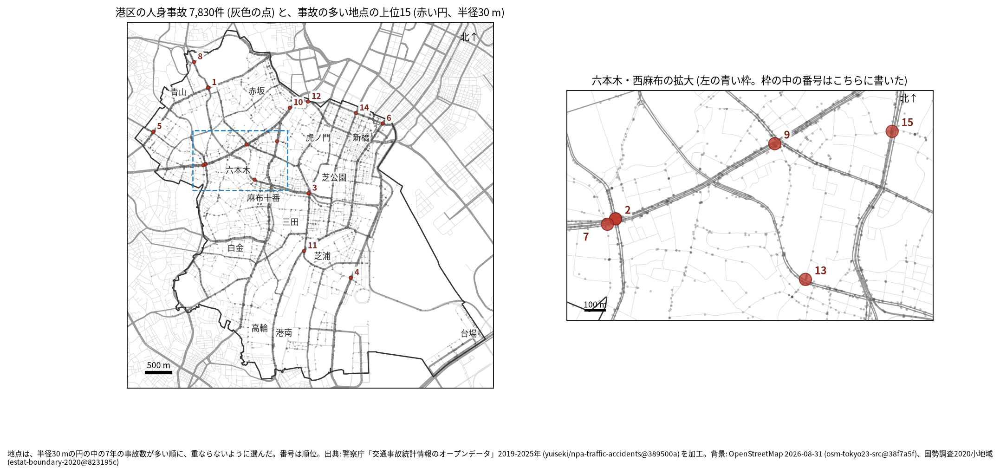
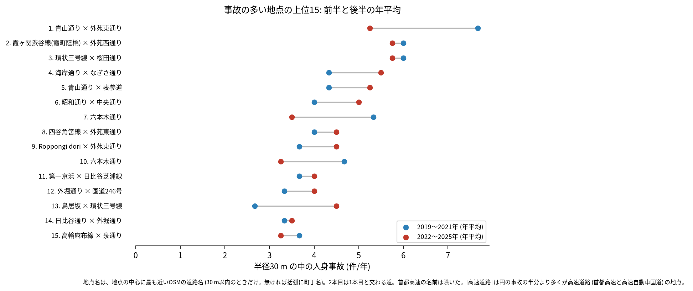
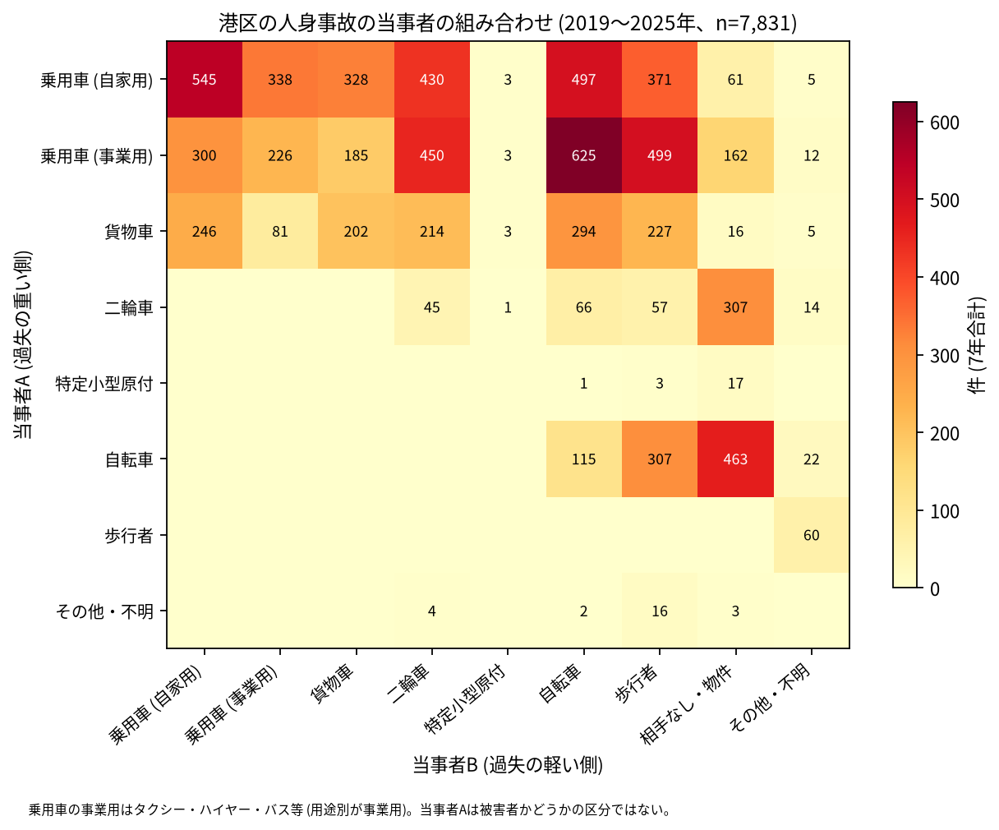

# 道路安全診断のための報告: 港区で事故の集まる地点

## 問い

港区で 2019〜2025 年の人身事故が集まる地点はどこで、そこでは誰と誰の事故が多いか。現地診断の候補を選ぶ材料にします。

## 結論

- 半径 30 m の円の中の 7 年の件数で選んだ上位 15 地点は、24〜44 件です。地点は区の北と西の幹線に多く、青山 (青山通りと外苑東通り、表参道)、六本木と西麻布 (六本木通り、外苑西通り、外苑東通り)、赤坂、新橋 (昭和通り、外堀通り)、東麻布 (環状三号線と桜田通り)、三田 (第一京浜)、海岸 (海岸通り) にあります。

| 順位 | 近い道路 (OSM) | 件数 | 前半 件/年 | 後半 件/年 | 交差点内 | 信号あり | 多い組み合わせ (A × B) |
|---:|---|---:|---:|---:|---:|---:|---|
| 1 | 青山通り × 外苑東通り | 44 | 7.67 | 5.25 | 33 | 38 | 乗用車 (事業用) × 乗用車 (自家用) |
| 2 | 霞ヶ関渋谷線(霞町陸橋) × 外苑西通り | 41 | 6.00 | 5.75 | 33 | 33 | 乗用車 (事業用) × 自転車 |
| 3 | 環状三号線 × 桜田通り | 41 | 6.00 | 5.75 | 27 | 36 | 乗用車 (自家用) × 貨物車 |
| 4 | 海岸通り × なぎさ通り | 35 | 4.33 | 5.50 | 26 | 28 | 乗用車 (自家用) × 二輪車 |
| 5 | 青山通り × 表参道 | 34 | 4.33 | 5.25 | 26 | 27 | 乗用車 (自家用) × 自転車 |
| 6 | 昭和通り × 中央通り | 32 | 4.00 | 5.00 | 27 | 26 | 乗用車 (事業用) × 自転車 |
| 7 | 六本木通り | 30 | 5.33 | 3.50 | 14 | 1 | 乗用車 (事業用) × 自転車 |
| 8 | 四谷角筈線 × 外苑東通り | 30 | 4.00 | 4.50 | 24 | 29 | 乗用車 (自家用) × 二輪車 |
| 9 | Roppongi dori × 外苑東通り | 29 | 3.67 | 4.50 | 18 | 21 | 乗用車 (自家用) × 歩行者 |
| 10 | 六本木通り | 27 | 4.67 | 3.25 | 21 | 23 | 乗用車 (事業用) × 自転車 |

前半は 2019〜2021 年、後半は 2022〜2025 年。11〜15 位と、歩行者、自転車、夜の件数は [hotspots.csv](../outputs/hotspots.csv) にあります。道路名は地点の中心に最も近い OSM の道路名 (30 m 以内のときだけ) で、2 本目は 1 本目と交わる向き (30 度以上) の道のうち最も近いもので、30 m 以内のときだけ書きました (首都高速の名前は除いた)。9 位の「Roppongi dori」は OSM の名前のままで、六本木通りを指すとみられます。7 位と 10 位は交わる道が 30 m 以内に無く、1 本だけです。

- 続いているか: 上位 15 は全て前半と後半の両方に事故があります。1 位 (7.67 から 5.25 件/年)、7 位 (5.33 から 3.50 件/年)、10 位 (4.67 から 3.25 件/年) は後半に減り、13 位の鳥居坂 × 環状三号線 (2.67 から 4.50 件/年)、4 位 (4.33 から 5.50 件/年)、6 位 (4.00 から 5.00 件/年) は増えました。上位は 7 年合計で選んだので、後半が下がって見えやすい (平均への回帰) ことに注意してください。

- 組み合わせ: 当事者 A が乗用車か貨物車で B が自転車の事故は 1,416 件です。最も多い組は事業用の乗用車と自転車 (625 件) で、上位 15 のうち 2、6、7、10 位でも最も多い組でした。事業用の乗用車 (タクシー、ハイヤー、バスなど) は 2,462 件で当事者 A です。自転車の単独 (相手なし・物件) が 463 件、二輪車の単独が 307 件、自転車と歩行者 (自転車が A) が 307 件ありました。

- 半径を変えると: 20 m の上位 15 の中心が、30 m の上位 15 の中心から 30 m 以内にあるのは 14 地点、50 m では 10 地点でした。2 位と 7 位は西麻布で隣り合い、同じ交差点の事故が 2 つの地点に分かれている可能性があります。
- 高速道路: 首都高速の事故は区で 309 件あり、上位 15 の円には 9 件 (4 位に 3 件、7 位に 2 件など) が入ります。高速道路の事故を除いて選び直しても、15 地点は全て 30 m 以内に残ります。

## データ

警察庁「交通事故統計情報のオープンデータ」を加工した `yuiseki/npa-traffic-accidents` 版 `389500a` の本票、港区 (`市区町村コード` 103) の 7,831 件。道路名は OpenStreetMap 2026-08-31 (`osm-tokyo23-src-2026-08` 版 `38f7a5f`)。詳しくは [共通の報告](../report.md)。

## 方法

事故の点を EPSG:6677 (メートル) に変換し、半径 30 m の円の中の件数が最も多い事故の点を中心に選び、その円の事故を除いて次を選ぶ手順を 15 回くり返しました。30 m はコード表の「交差点付近」(交差点の側端から 30 m 以内) の幅です。信号ありは `信号機` が 3 灯式、押ボタン式、歩車分式の点灯。組み合わせは当事者 A (過失の重い側) と B の種別で、乗用車は `用途別` で事業用と自家用に分けました。高速道路は `路線コード` 4000〜5499 です。

## 確かめていないこと

- 交通量で割っていません。件数の多い交差点が、車の多さに比べて危険かは分かりません。
- 事故の型 (出会い頭、右折、追突)、違反の種類、重傷と軽傷の区別は、このデータにありません。現地で確かめてください。
- 位置の精度は分かりません。数十 m のずれで地点の件数は変わります。
- 7 位の信号ありが 1 件と少ない理由 (交差点から離れた単路か) は、現地で確かめていません。
- 偶然でもこの程度の集まりが生まれるか (順位の有意さ) は調べていません。
