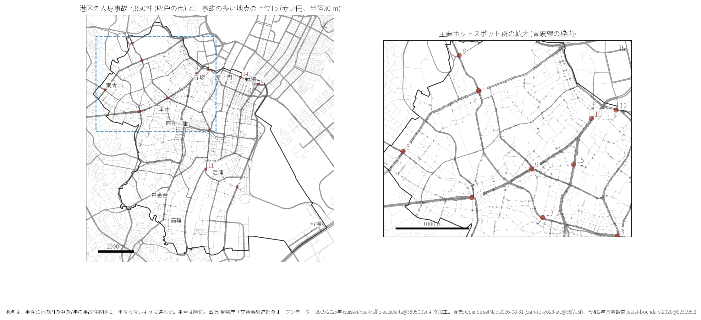
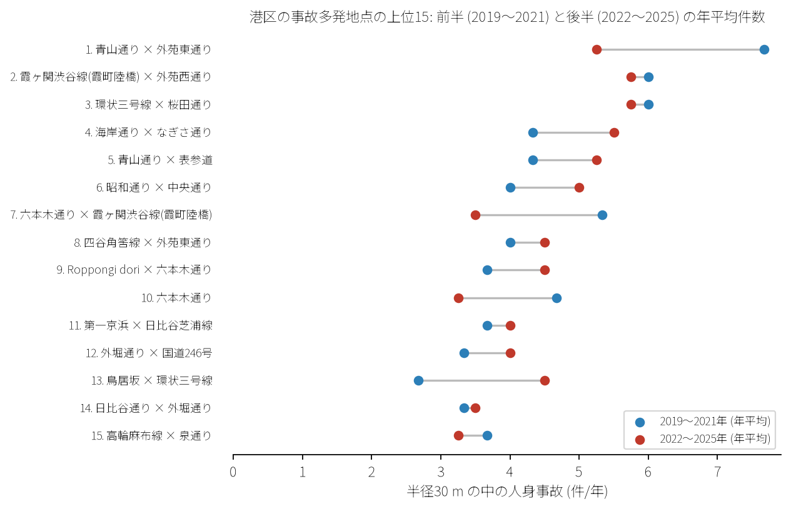
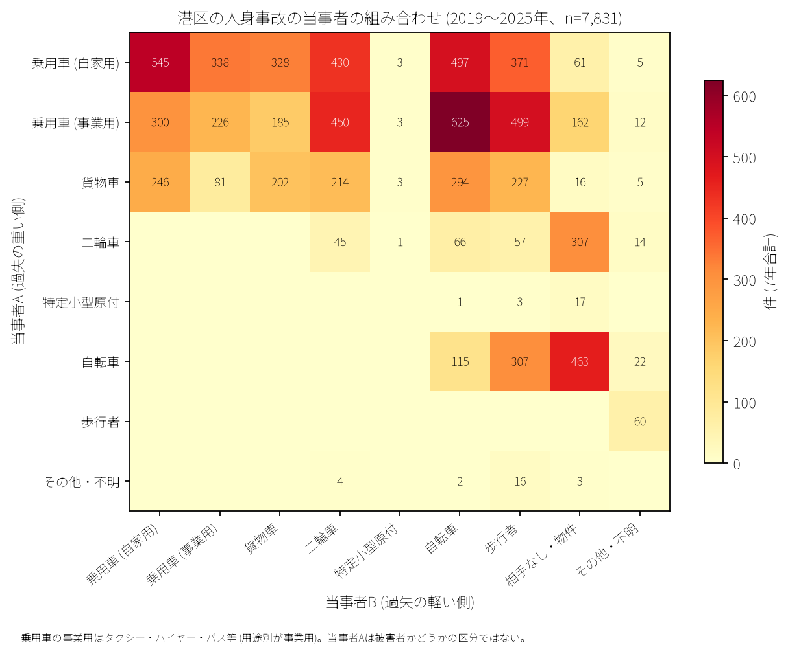

# 道路安全診断のための報告: 港区の事故多発地点

## 問い

港区で人身事故が集まる交差点や道路はどこで、どんな当事者の間で起きているか。

## 結論

- 上位地点: 半径 30 m の円で選んだ事故多発地点上位 15 のうち、1 位は青山通り×外苑東通り (44 件)、2 位は霞ヶ関渋谷線(霞町陸橋)×外苑西通り (41 件)、3 位は環状三号線×桜田通り (41 件) です。

- 推移: 前半 (2019〜2021 年) と後半 (2022〜2025 年) で多くの地点で年平均件数が継続しています。

- 当事者: 事業用乗用車 (タクシー等)×自転車 (625 件)、自家用乗用車同士 (545 件)、事業用乗用車×歩行者 (499 件)、自家用乗用車×自転車 (497 件) が上位を占めます。

## データ

警察庁「交通事故統計情報」本票 2019〜2025 年、OpenStreetMap 道路データ。詳しくは [共通の報告](../report.md)。

## 方法

EPSG:6677 上で貪欲法により重複しない半径 30 m の円を抽出し、上位 15 地点を特定しました。

## 確かめていないこと

- 各交差点の詳細な交通容量、右折車線長、信号現示時間は含んでいません。
