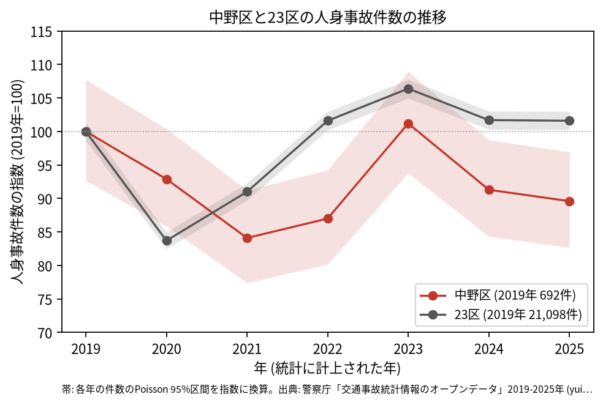
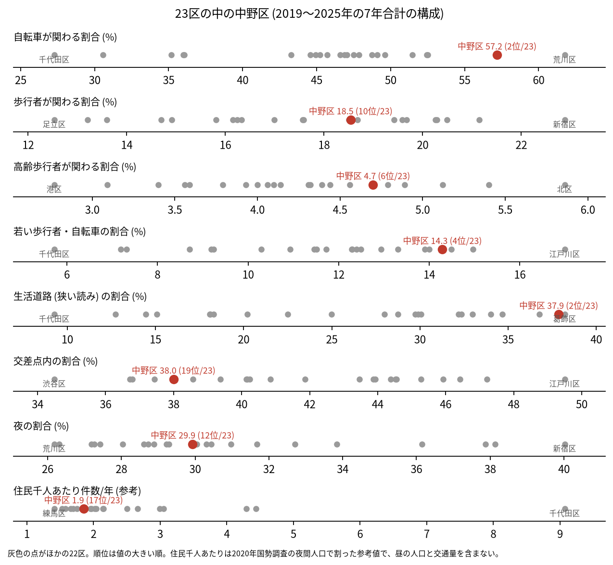
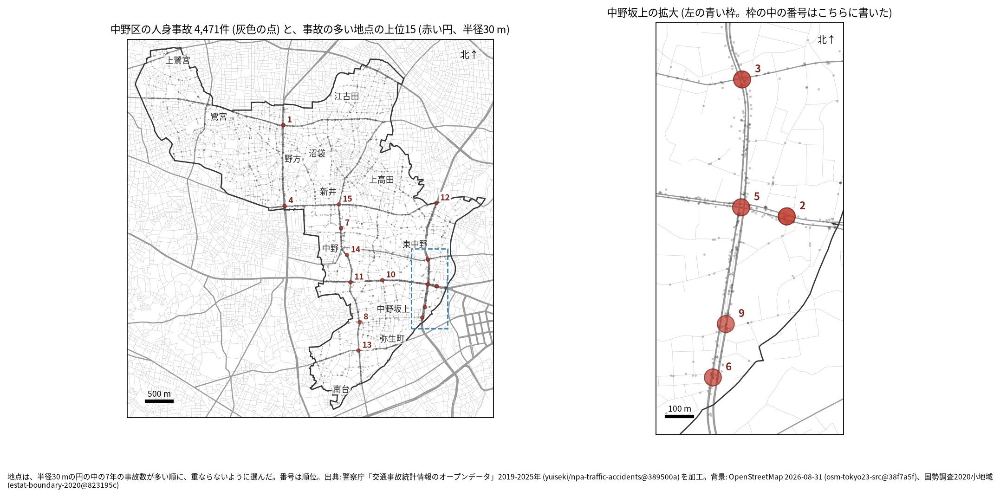
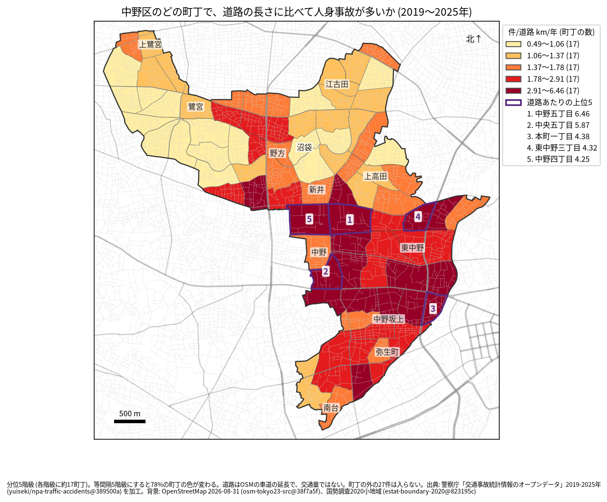
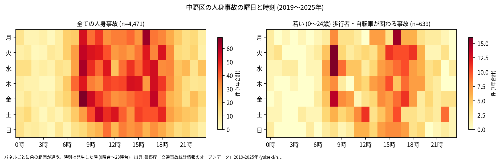
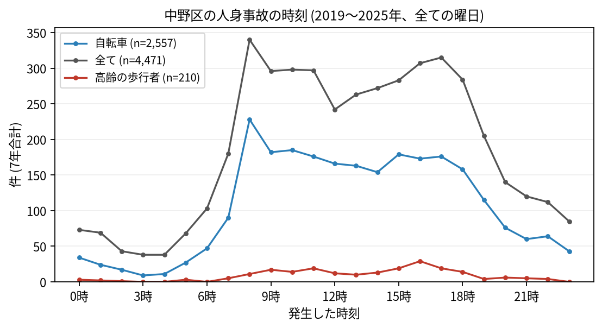
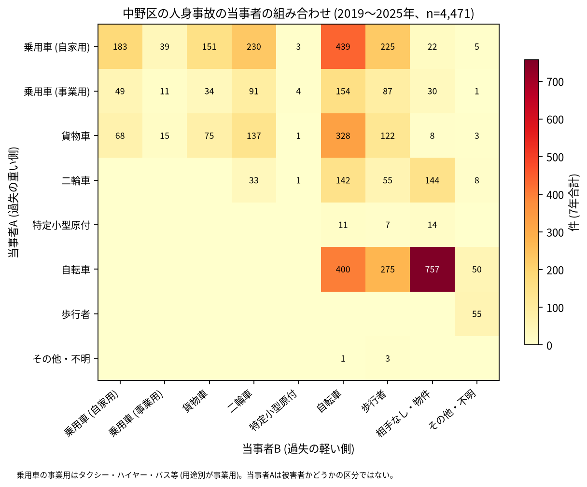

# 中野区の交通事故 2019〜2025 年: 図で読む要点

## 問い

2019〜2025 年の警察記録の人身事故で、中野区の事故はいつ、どこで、誰が関わって起きているか。

## 結論

### 要点

| # | 要点 | 数字 | 図 |
|---:|---|---|---|
| 1 | 件数は 2021 年に 2019 年より減り、2023 年にほぼ戻った。2025 年は 2019 年より減ったとは言えない | 7 年で 4,471 件、死者 16 人、負傷者 4,801 人。指数 (2019 年=100) は 2021 年 84.1、2023 年 101.2、2025 年 89.6 ([yearly.csv](outputs/yearly.csv)、[summary.txt](outputs/summary.txt)) | [図 1](#図-1-件数の推移) |
| 2 | 自転車と生活道路の事故の割合が 23 区で最も高い側にある | 自転車が関わる 57.2% (23 区の 2 位)、生活道路 37.9% (2 位)、交差点内 38.0% (19 位) ([wards.csv](outputs/wards.csv)、[analysis.json](outputs/analysis.json)) | [図 2](#図-2-23-区の中の中野区) |
| 3 | 事故の多い地点は幹線の交差点で、中野坂上の周りに集まる | 上位は新青梅街道 × 環七通り (36 件)、青梅街道 (34 件)、大久保通り × 山手通り (31 件)。上位 15 のうち 2、3、5、6、9 位が中野坂上の周り ([hotspots.csv](outputs/hotspots.csv)、[hotspots-map.json](outputs/hotspots-map.json)) | [図 3](#図-3-事故の集まる地点) |
| 4 | 最も多い組み合わせは自転車の単独の事故 | 自転車 (A) と相手なし・物件の 757 件。次が自家用の乗用車 (A) と自転車 (B) の 439 件 ([summary.txt](outputs/summary.txt)、[party_matrix.csv](outputs/party_matrix.csv)) | [図 6](#図-6-誰と誰の事故か) |
| 5 | 亡くなった人の多くは歩行者 | 死亡事故 16 件で、亡くなった歩行者 13 人 (65 歳以上が 6 人)。当事者 A が貨物車の事故が 6 件 ([summary.txt](outputs/summary.txt)) | [表 1](#表-1-死亡事故) |

### 読み手ごとに知るべきこと

| 読み手 | 結論 | 検討する材料 | 詳しく |
|---|---|---|---|
| 区の交通安全担当 | 生活道路の法定速度 30 km/h (2026-09-01 から) が当たるのは事故の 37.9〜49.4% (読み方による) で、23 区の 2〜3 位。自転車が関わる事故は 57.2% (2 位) | 生活道路、自転車の単独の事故、2024 年からの特定小型原付 | [municipality.md](reports/municipality.md) |
| 学校と PTA | 若い (0〜24 歳) 歩行者と自転車の事故は 639 件 (14.3%、23 区の 4 位)。最も多いのは 8 時台 (71 件) で、登校の時間に多い | 学校の円の中で、平日 8 時台と 15〜17 時台の点が並ぶ道 | [school-pta.md](reports/school-pta.md) |
| 道路安全診断 | 上位は新青梅街道 × 環七通り (36 件)、青梅街道 (34 件)、大久保通り × 山手通り (31 件)。中野坂上の周りに 5 地点 | 後半に増えた 6 位と 12 位、首都高速の事故が 6 件入る 9 位 | [road-safety-auditor.md](reports/road-safety-auditor.md) |
| 住民 | 道路あたりで多いのは中野五丁目 (年 6.46 件/道路 km)、中央五丁目 (5.87 件)。区の南東 (中野駅の周りから中野坂上、東中野) の色が濃い | 自分の町の色、朝 8 時台の自転車、自転車だけの事故 | [resident.md](reports/resident.md) |

### 図 1: 件数の推移

2020 年の落ち込み (92.9) は 23 区全体 (83.7) より浅く、中野区は 2021 年 (84.1) が最も低い。2021 年の 95% 区間 (535.7〜631.3 件) は 2019 年 (641.4〜745.5 件) と重ならない。2025 年の区間 (572.2〜670.8 件) は 2019 年と重なるので、減少とは書かない。

### 図 2: 23 区の中の中野区

赤い点が中野区。自転車 (2 位)、生活道路 (2 位)、若い歩行者・自転車 (14.3%、4 位) が高く、交差点内 (19 位) が低い。住民千人あたり (1.85 件/年、17 位) は昼の人口を含まない参考値。

### 図 3: 事故の集まる地点

半径 30 m の円の中の 7 年の件数で選んだ上位 15 (19〜36 件)。番号は順位で、中野坂上の 5 地点は右の拡大図に番号を書いた。

| 順位 | 近い道路 (OSM) | 町丁 | 件数 | 前半 件/年 | 後半 件/年 |
|---:|---|---|---:|---:|---:|
| 1 | 新青梅街道 × 環七通り | 丸山一丁目 | 36 | 5.33 | 5.00 |
| 2 | 青梅街道 (本一通りの近く) | 中央一丁目 | 34 | 6.00 | 4.00 |
| 3 | 大久保通り × 山手通り | 中央二丁目 | 31 | 6.33 | 3.00 |
| 4 | 環七通り × 早稲田通り | 大和町一丁目 | 30 | 5.00 | 3.75 |
| 5 | 青梅街道 × 山手通り | 本町二丁目 | 28 | 4.33 | 3.75 |

前半は 2019〜2021 年、後半は 2022〜2025 年。半径を 20 m にすると上位 15 のうち 11 地点、50 m では 12 地点、首都高速の事故を除くと 14 地点が残る。6〜15 位は [hotspots.csv](outputs/hotspots.csv)。

### 図 4: 町丁ごとの事故

町丁の事故数を、OSM の車道の延長と 7 年で割った値。紫の枠が上位 5 (中野五丁目、中央五丁目、本町一丁目、東中野三丁目、中野四丁目)。分位と等間隔で 78% の町丁の色が変わるので、色の細かい差は読まない。道路の長さは交通量ではない。

### 図 5: いつ起きるか

全体は平日の 8 時台が最も濃く (340 件、平日 294 件)、16〜17 時台が続く。若い歩行者と自転車も 8 時台が最多 (71 件) で、次が 16 時台 (66 件)。

自転車は 8 時台 (228 件)、高齢の歩行者は 16 時台 (29 件) が最多。

### 図 6: 誰と誰の事故か

最も多いのは自転車の単独 (相手なし・物件) の 757 件、次が自家用の乗用車 (A) と自転車 (B) の 439 件、自転車どうしの 400 件。車やトラックが当事者 A で自転車が B の事故は 921 件。当事者 A は過失の重い側で、被害者とは限らない。

### 表 1: 死亡事故

| 亡くなった人 | 人数 | 特徴 |
|---|---:|---|
| 歩行者 | 13 | 65 歳以上が 6 人 |
| 自転車 | 2 | |
| 二輪車 | 1 | |

16 件のうち、当事者 A が貨物車の事故が 6 件、自転車の事故が 3 件。0〜5 時台は 4 件、19〜5 時台は 7 件。数が少ないので傾向とは断定しない。全件は [deaths.csv](outputs/deaths.csv)。

### 読み方で変わる答え

| 読み方 | 主 | 別の読み方 |
|---|---|---|
| 中野区の事故 | `市区町村コード` 114 の 4,471 件 | 点が区の面に入る事故。両方に当てはまるのは 4,444 件 |
| 生活道路 | 狭い読み 37.9% (2 位) | 広い読み 49.4% (3 位) |
| 地点の半径 | 30 m | 20 m で 11 地点、50 m で 12 地点が残る |
| 首都高速の事故 (中野区で足した読み) | 含める | 除くと上位 15 のうち 14 地点が残る。首都高速の事故は 80 件 |
| 町丁の階級 | 分位 5 階級 | 等間隔で 78% の町丁の色が変わる |

## データ

- 人身事故: 警察庁「交通事故統計情報のオープンデータ」を加工した `yuiseki/npa-traffic-accidents` 版 `389500aae5cec45f1311163f70db6a5f05867838` (配布元の取得 2026-10-02) の本票。年はファイルの年 (統計に計上された年)。中野区 4,471 件、23 区 144,716 件。位置の無い行は 0。物損事故は含まない。
- 区の面と人口: `yuiseki/jp-admin-2026-09` 版 `e6c87b1`。町丁: 2020 年国勢調査の小地域 `yuiseki/estat-boundary-2020` 版 `823195c` (85 町丁、344,880 人)。学校 35 校と道路: OpenStreetMap 2026-08-31、`yuiseki/osm-tokyo23-src-2026-08` 版 `38f7a5f`。
- 道具: DuckDB 2.0.0 (spatial)、matplotlib、`analysis-visualize` の `cjk_font.py`、`classify_map.py`、`context_map.py` (2026-11-03)。
- 出典の表示: 警察庁ウェブサイト (https://www.npa.go.jp/publications/statistics/koutsuu/opendata/index_opendata.html) の交通事故統計情報のオープンデータを加工して作成。国勢調査の小地域境界と人口、OpenStreetMap (© OpenStreetMap contributors) を加工して使用。

## 方法

- 読み方は結果を見る前に [計画](EXPERIMENT_PLAN.md) で固定し、実行は [記録](EXPERIMENT_TRACKER.md) に残した。読み方、区画、判断の規則は台東区 ([taito-accident-trends-by-role](../taito-accident-trends-by-role/report.md)) と同じ。生活道路は `車道幅員` が 01、02、11 (狭い読み)、広い読みは 14、17 を足す。歩行者や自転車が関わるかは当事者 A と B の両方で見て、1 件を 1 回数えた。
- 距離は EPSG:6677 (メートル) で測った。地点は、半径 30 m の中の件数が最も多い点を中心に選び、その円の事故を除いて次を選ぶ手順を 15 回くり返した。地点の名前は、中心に最も近い道と、それと 30 度以上の向きで交わる道のうち最も近い道で、2 本目は 30 m 以内のときだけ書いた。
- 中野区で足した読み: 区の東の端で首都高速の中央環状線 (山手トンネル) が山手通りの下を通るので (外の知識)、`路線コード` 5000〜5499 の事故を除いて同じ手順で上位 15 を選び、主の上位 15 と比べた (渋谷区と目黒区と同じ形)。
- 地図は `analysis-visualize` の map-context に合わせ、地名と道路を重ね、凡例を地図の外に置き、強調した単位に番号を付けた。描いた町丁の数 (85) を分析の数と照らし、文字の重なりと、地名が円や学校の印を隠す重なりは、3 枚の地図で 0 件 (1 回目の図で重なった地名 3 つの位置を直した)。背景の道路 (OGC:CRS84) と町丁 (JGD2000) の差は、線の幅より小さいとして変換せずに重ねた。
- 関門: 予測と回帰をしないので、評価の分け方と残差の確認は要らない。単位の間の相関を結論にしないので、Moran's I と格子の掃引は省いた。推移は 23 区全体を基準にし、年の件数に Poisson の 95% 区間を付けた。対策の効果は推定していない。
- 再実行は [README.md](README.md)。数値は [outputs/](outputs/) の CSV、来歴は [analysis.json](outputs/analysis.json)。

## 確かめていないこと

- 交通量、昼の人口、来訪者の数で割っていない。中野駅の周りや中野坂上の件数の多さは、人と車の多さかもしれない。
- 位置の精度は分からない。30 m の地点と町丁の境界の近くの事故は、数十 m のずれで入れ替わる。
- 事故の型 (出会い頭、追突)、重傷と軽傷の区別、物損事故、ヒヤリハットは、このデータに無い。自転車の単独の事故が何によるか (転倒、段差、物への衝突) は分からない。
- 0〜24 歳より細かい年齢は無く、小学生だけは数えられない。
- 地点の上位は 7 年で選び、同じ 7 年で前半と後半を比べたので、後半が下がって見えやすい (平均への回帰)。
- 首都高速の事故が地上の地点に入るのは、平面の座標で同じ円に入るため。トンネルの中か出入口かは確かめていない。
