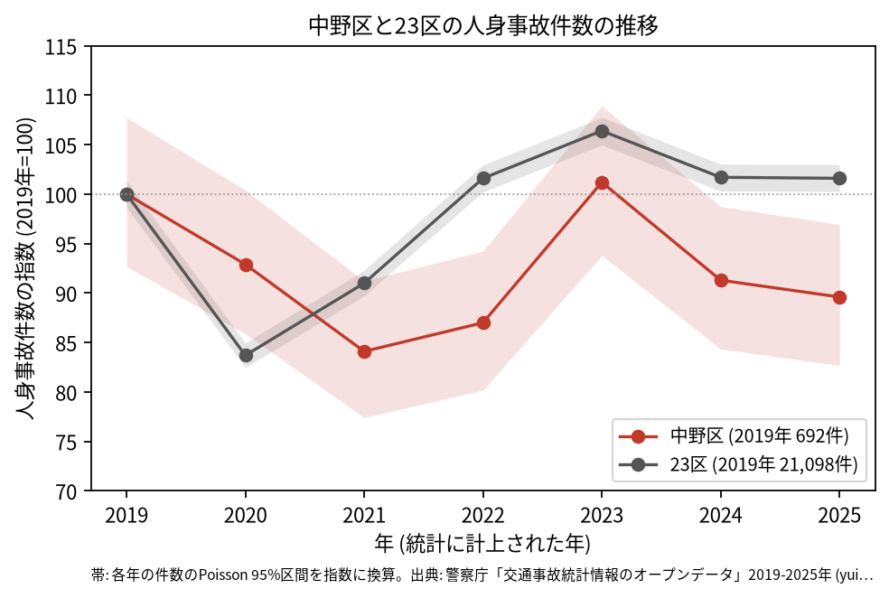
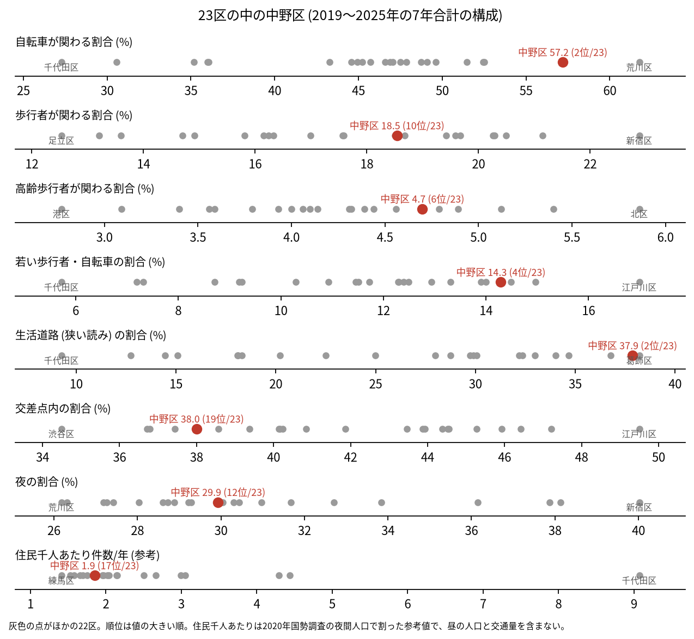
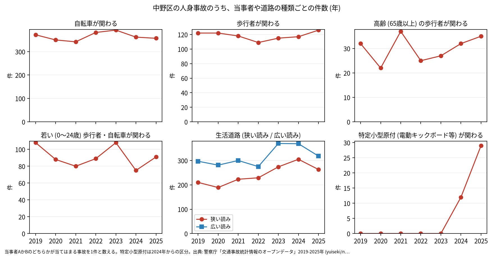

# 区の交通安全担当のための報告: 中野区の交通事故の傾向

## 問い

中野区の人身事故は 2019〜2025 年にどう推移し、23 区の中でどんな特徴があり、施策をどこに向ける材料になるか。

## 結論

- 件数: 7 年で 4,471 件、死者 16 人、負傷者 4,801 人です。2019 年の 692 件から 2021 年に 582 件 (2019 年を 100 として 84.1) まで減りました。2021 年の 95% 区間 (535.7〜631.3 件) は 2019 年の区間 (641.4〜745.5 件) と重ならないので、2021 年は 2019 年より減ったと言えます。2020 年の下がり方 (92.9) は 23 区全体 (83.7) より小さいものでした。2023 年は 700 件 (101.2) まで戻り、2025 年は 620 件 (89.6) です。2025 年の区間 (572.2〜670.8 件) は 2019 年と重なるので、2019 年より減ったとは言えません。

- 23 区の中の位置: 中野区の事故は、自転車と生活道路に寄っています。自転車が関わる割合は 57.2% で 23 区の 2 位、生活道路 (狭い読み) の割合は 37.9% で 2 位、広い読みでも 49.4% で 3 位です。若い歩行者と自転車は 14.3% で 4 位、特定小型原付は 0.9% で 4 位です。交差点内の割合は 38.0% で 19 位と低く、歩行者が関わる割合 (18.5%) は 10 位、高齢の歩行者 (4.7%) は 6 位です。

- 施策への読み方: 2026-09-01 からの生活道路の法定速度 30 km/h は、中野区の事故のうち 37.9〜49.4% (読み方による) に当たり、23 区の中で当たる割合が大きい区です。台東区では同じ読みで 14.5% でした ([台東区の wards.csv](../../taito-accident-trends-by-role/outputs/wards.csv) の 0.1446)。これは効果の予測ではなく、どの道路で事故が起きているかの構成です。
- 区分ごとの推移: 自転車が関わる事故は年 342〜392 件で、2019 年 (372 件) から大きくは動いていません。特定小型原付 (電動キックボードなど) が関わる事故は、区分のできた 2024 年に 12 件、2025 年に 29 件でした。

- 自転車の単独の事故: 当事者 A が自転車で、相手なし・物件の事故が 757 件あり、組み合わせの中で最も多い組です ([summary.txt](../outputs/summary.txt))。事故の型の区別がデータに無いので、転倒か物への衝突かは分かりません。
- 死亡事故: 16 件のうち、亡くなったのは歩行者 13 人、自転車 2 人、二輪車 1 人です。亡くなった歩行者 13 人のうち 6 人が 65 歳以上でした。当事者 A (過失の重い側) は、貨物車が 6 件、自家用の乗用車が 4 件、自転車が 3 件です。0〜5 時台に起きた事故は 4 件です。16 件は少なく、偏りを傾向と断定できる数ではありません。

| 年 | 当事者 A | 当事者 B | 亡くなった人 | 時 |
|---|---|---|---|---:|
| 2020 | 自転車 | 歩行者 (65〜74 歳) | 歩行者 | 13 |
| 2022 | 自転車 | 歩行者 (35〜44 歳) | 歩行者 | 18 |
| 2022 | 自転車 | 歩行者 (75 歳以上) | 歩行者 | 8 |

表は、当事者 A が自転車の死亡事故 3 件の抜き出しです。16 件 ([summary.txt](../outputs/summary.txt)) の全ては [deaths.csv](../outputs/deaths.csv) にあります。

- 人口あたり: 2020 年の住民千人あたりの年の件数は 1.85 件で 23 区の 17 位ですが、分母に昼の人口、来訪者、通過する車が入らないため、区の比較の主な指標にしていません。

## データ

警察庁「交通事故統計情報のオープンデータ」を加工した `yuiseki/npa-traffic-accidents` 版 `389500a` の本票。中野区は `市区町村コード` 114 の 4,471 件、23 区は 144,716 件。年はファイルの年 (統計に計上された年)。区の人口は 2020 年国勢調査 (`jp-admin-2026-09` 版 `e6c87b1`)。詳しくは [共通の報告](../report.md)。

## 方法

区分は、当事者 A か B のどちらかが当てはまる事故を 1 件と数えました。生活道路は `車道幅員` で決め、狭い読み (5.5 m 未満の単路と、小と小の交差点) と、広い読み (5.5 m 未満の道とより広い道の交差点も含む) を並べました。年の区間は件数の Poisson の 95% 区間 (Garwood) です。23 区の順位は 7 年合計の割合の大きい順です。

## 確かめていないこと

- 2021 年に減った理由 (人出の減少など) は調べていません。
- 区の施策 (ゾーン 30、自転車の通行帯など) の効果は推定していません。割合の順位は施策の評価ではありません。
- 重傷と軽傷の区別、物損事故は、このデータにありません。
