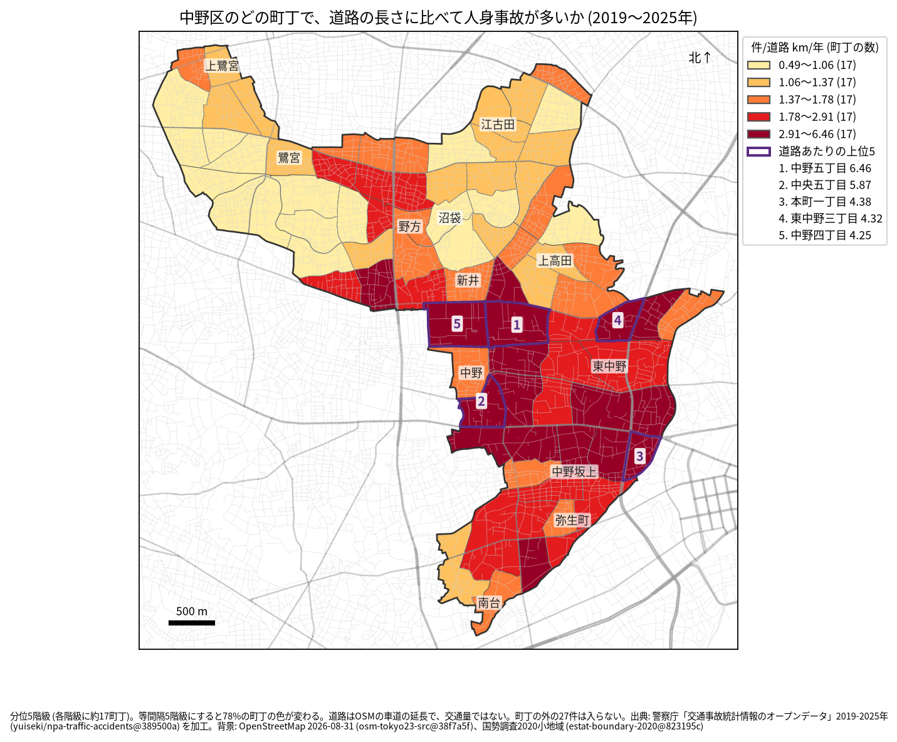
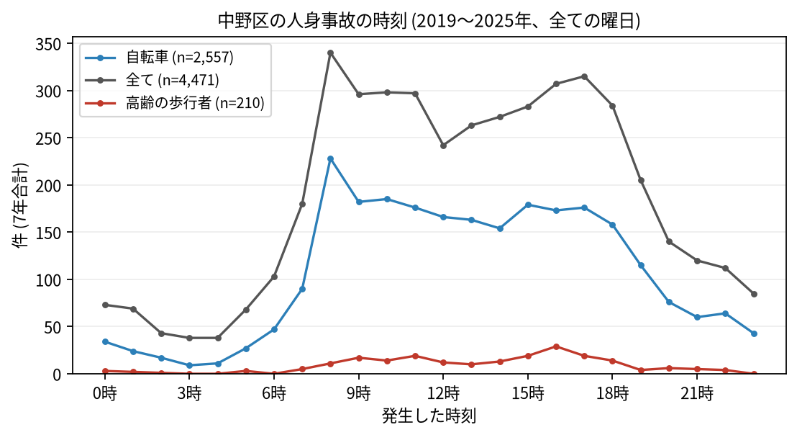

# 住民のための報告: 中野区で、いつ、どこで事故が起きているか

## 問い

中野区に住む人が、自分の町で、いつ、どんな事故に気をつければよいか。2019〜2025 年の警察記録の人身事故から調べました。

## 結論

- 中野区では 7 年で 4,471 件の人身事故があり、16 人が亡くなりました。年に 582〜700 件です。
- 町ごと: 道路 1 km あたりの事故が多いのは、中野五丁目 (年 6.46 件)、中央五丁目 (5.87 件)、本町一丁目 (4.38 件)、東中野三丁目 (4.32 件)、中野四丁目 (4.25 件) です。件数そのものが最も多いのも中野五丁目 (7 年で 144 件) でした。中野四丁目と中野五丁目から南の、中央、本町、東中野に色の濃い町が並び、北西の鷺宮や上鷺宮は色が薄い町が多くなっています。

色は分位 5 階級で、各色に 17 の町が入ります。等間隔の階級にすると 78% の町の色が変わるので、色の差より、自分の町が上の階級か下の階級かを見てください。

- 時間: 事故は朝 8 時台が最も多く (340 件)、夕方の 16 時台 (307 件) と 17 時台 (315 件) が続きます。自転車が関わる事故も 8 時台 (228 件) が最多です。高齢の歩行者が関わる事故は 16 時台 (29 件) が最も多い時間でした。

- 誰が: 自転車が関わる事故が全体の 57.2% で、23 区で 2 番目に高い割合です。自転車に乗る人は、車やトラックとの事故 (921 件) に加え、自転車だけの事故 (転倒や物への衝突、757 件) と、自転車どうしの事故 (400 件) にも気をつけてください。歩行者が関わる事故は 18.5% です。
- 生活道路: 幅 5.5 m 未満の道で起きた事故が 37.9% で、23 区で 2 番目に高い割合です。家の近くの細い道でも事故は起きています。
- 亡くなった人: 16 人のうち 13 人が歩行者で、そのうち 6 人が 65 歳以上でした。

## データ

警察庁「交通事故統計情報のオープンデータ」を加工した `yuiseki/npa-traffic-accidents` 版 `389500a` の本票、中野区の 4,471 件 (2019〜2025 年のファイル)。町の境界は 2020 年国勢調査の小地域 (85 町丁)、道路は OpenStreetMap 2026-08-31。詳しくは [共通の報告](../report.md)。

## 方法

事故の地点を町丁の境界に入れて数え、町丁の中の車道の長さ (OSM) と 7 年で割りました。区の境界の近くで町丁の外に落ちた 27 件は町の値に入っていません。時刻は事故の起きた時で、7 年の合計です。生活道路は、警察が記録した車道の幅 (5.5 m 未満の単路と、狭い道どうしの交差点) で数えました。

## 確かめていないこと

- 道路の長さは、通る車や人の数ではありません。中野駅の周りや中野坂上の値が高いのは、人と車が多いためかもしれません。
- 自分の町の事故が少なくても、物損事故やヒヤリハットはこのデータにありません。
- 事故の位置の精度は分かりません。町の境界の近くの事故は、隣の町に数えられている可能性があります。
