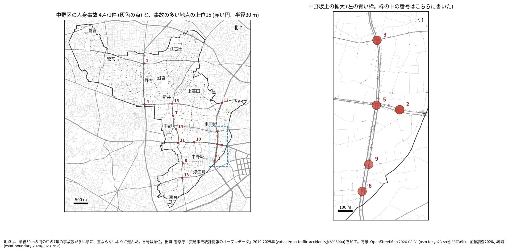
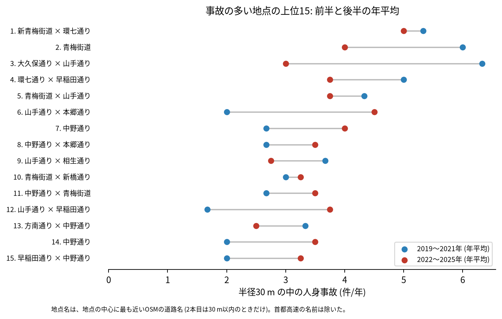
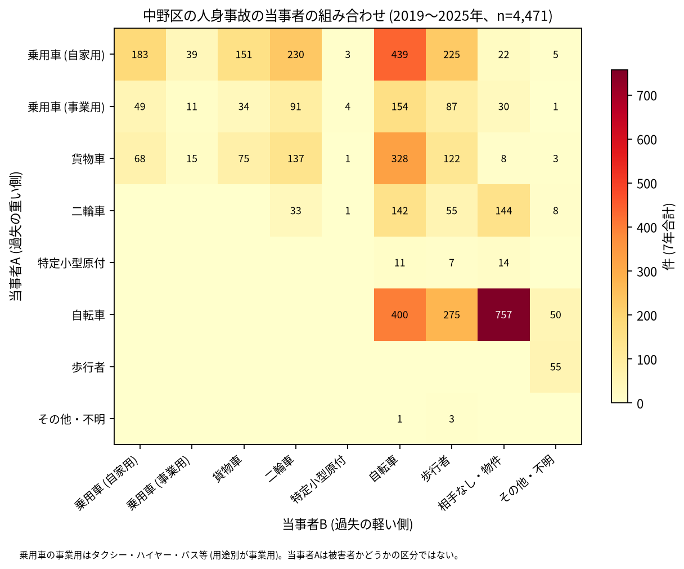

# 道路安全診断のための報告: 中野区で事故の集まる地点

## 問い

中野区で 2019〜2025 年の人身事故が集まる地点はどこで、そこでは誰と誰の事故が多いか。現地診断の候補を選ぶ材料にします。

## 結論

- 半径 30 m の円の中の 7 年の件数で選んだ上位 15 地点は、19〜36 件です。15 のうち 5 つ (2、3、5、6、9 位) は中野坂上の周りの山手通りと青梅街道にあり、ほかは環七通り (新青梅街道、早稲田通りとの交差点)、中野通り (中野五丁目から南台三丁目まで) です。

| 順位 | 近い道路 (OSM) | 件数 | 前半 件/年 | 後半 件/年 | 交差点内 | 信号あり | 多い組み合わせ (A × B) |
|---:|---|---:|---:|---:|---:|---:|---|
| 1 | 新青梅街道 × 環七通り | 36 | 5.33 | 5.00 | 27 | 28 | 乗用車 (自家用) × 二輪車 |
| 2 | 青梅街道 (本一通りの近く) | 34 | 6.00 | 4.00 | 13 | 19 | 乗用車 (自家用) × 自転車 |
| 3 | 大久保通り × 山手通り | 31 | 6.33 | 3.00 | 15 | 25 | 自転車 × 相手なし・物件 |
| 4 | 環七通り × 早稲田通り | 30 | 5.00 | 3.75 | 19 | 25 | 乗用車 (自家用) × 二輪車 |
| 5 | 青梅街道 × 山手通り | 28 | 4.33 | 3.75 | 22 | 25 | 乗用車 (自家用) × 乗用車 (自家用) |
| 6 | 山手通り × 本郷通り | 24 | 2.00 | 4.50 | 14 | 15 | 乗用車 (自家用) × 乗用車 (自家用) |
| 7 | 中野通り (中野五丁目) | 24 | 2.67 | 4.00 | 2 | 9 | 自転車 × 相手なし・物件 |
| 8 | 中野通り × 本郷通り | 22 | 2.67 | 3.50 | 13 | 15 | 乗用車 (自家用) × 自転車 |
| 9 | 山手通り × 相生通り | 22 | 3.67 | 2.75 | 6 | 8 | 乗用車 (自家用) × 乗用車 (自家用) |
| 10 | 青梅街道 × 新橋通り | 22 | 3.00 | 3.25 | 10 | 15 | 自転車 × 相手なし・物件 |

前半は 2019〜2021 年、後半は 2022〜2025 年。11〜15 位と、歩行者、自転車、夜の件数は [hotspots.csv](../outputs/hotspots.csv) にあります。道路名は地点の中心に最も近い OSM の道路名で、2 本目は 1 本目と交わる向き (30 度以上) の道のうち最も近いもので、30 m 以内のときだけ書きました (首都高速の名前は除いた)。2 位の 2 本目 (本一通り) は中心から 48.6 m、7 位は交わる道が 30 m 以内に無く、1 本だけを書きました。

- 続いているか: 上位 15 は全て前半と後半の両方に事故があります。3 位 (6.33 から 3.00 件/年) と 2 位 (6.00 から 4.00 件/年) は後半に減り、6 位 (2.00 から 4.50 件/年) と 12 位 (1.67 から 3.75 件/年) は増えました。上位は 7 年合計で選んだので、後半が下がって見えやすい (平均への回帰) ことに注意してください。

- 組み合わせ: 当事者 A が乗用車か貨物車で B が自転車の事故は 921 件です。自転車の単独 (相手なし・物件) が 757 件、自転車どうしが 400 件、自転車と歩行者 (自転車が A) が 275 件ありました。上位 1 位と 4 位 (環七通り) では、乗用車と二輪車の組み合わせが最も多い組でした。事業用の乗用車 (タクシー、ハイヤー、バスなど) は 461 件で当事者 A です。

- 半径を変えると: 20 m の上位 15 の中心が、30 m の上位 15 の中心から 30 m 以内にあるのは 11 地点、50 m では 12 地点でした。中野坂上では 2 位と 5 位が青梅街道の上で隣り合っていて、半径で 1 つにまとまったり分かれたりしえます。順位は細かく読まないでください。
- 首都高速の事故: 中野区の事故のうち 80 件は `路線コード` が首都高速です。上位 15 の円の中には 11 件あり、9 位 (山手通り × 相生通り) に 6 件、6 位に 3 件です。首都高速の事故を除いて選び直すと、上位 15 のうち 14 地点が 30 m 以内に残ります。地上の交差点の診断では、9 位の 22 件のうち 6 件は上の道路か下のトンネルの事故として読んでください。

## データ

警察庁「交通事故統計情報のオープンデータ」を加工した `yuiseki/npa-traffic-accidents` 版 `389500a` の本票、中野区 (`市区町村コード` 114) の 4,471 件。道路名は OpenStreetMap 2026-08-31 (`osm-tokyo23-src-2026-08` 版 `38f7a5f`)。詳しくは [共通の報告](../report.md)。

## 方法

事故の点を EPSG:6677 (メートル) に変換し、半径 30 m の円の中の件数が最も多い事故の点を中心に選び、その円の事故を除いて次を選ぶ手順を 15 回くり返しました。30 m はコード表の「交差点付近」(交差点の側端から 30 m 以内) の幅です。信号ありは `信号機` が 3 灯式、押ボタン式、歩車分式の点灯。組み合わせは当事者 A (過失の重い側) と B の種別で、乗用車は `用途別` で事業用と自家用に分けました。首都高速は `路線コード` 5000〜5499 です。

## 確かめていないこと

- 交通量で割っていません。件数の多い交差点が、車の多さに比べて危険かは分かりません。
- 事故の型 (出会い頭、右折、追突)、違反の種類、重傷と軽傷の区別は、このデータにありません。現地で確かめてください。
- 位置の精度は分かりません。数十 m のずれで地点の件数は変わります。
- 首都高速の事故が、山手トンネルの中か、出入口か、別の路線かは確かめていません。
- 偶然でもこの程度の集まりが生まれるか (順位の有意さ) は調べていません。
