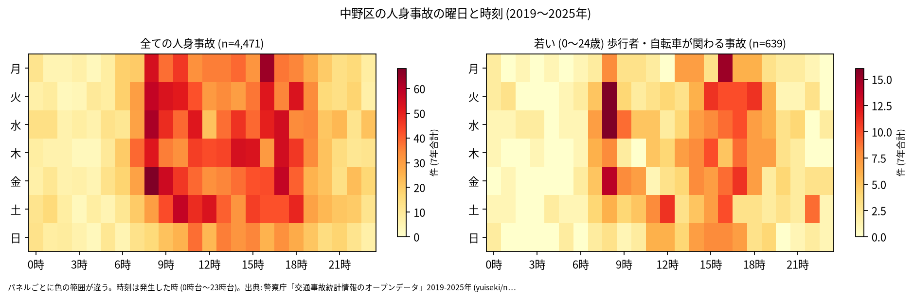
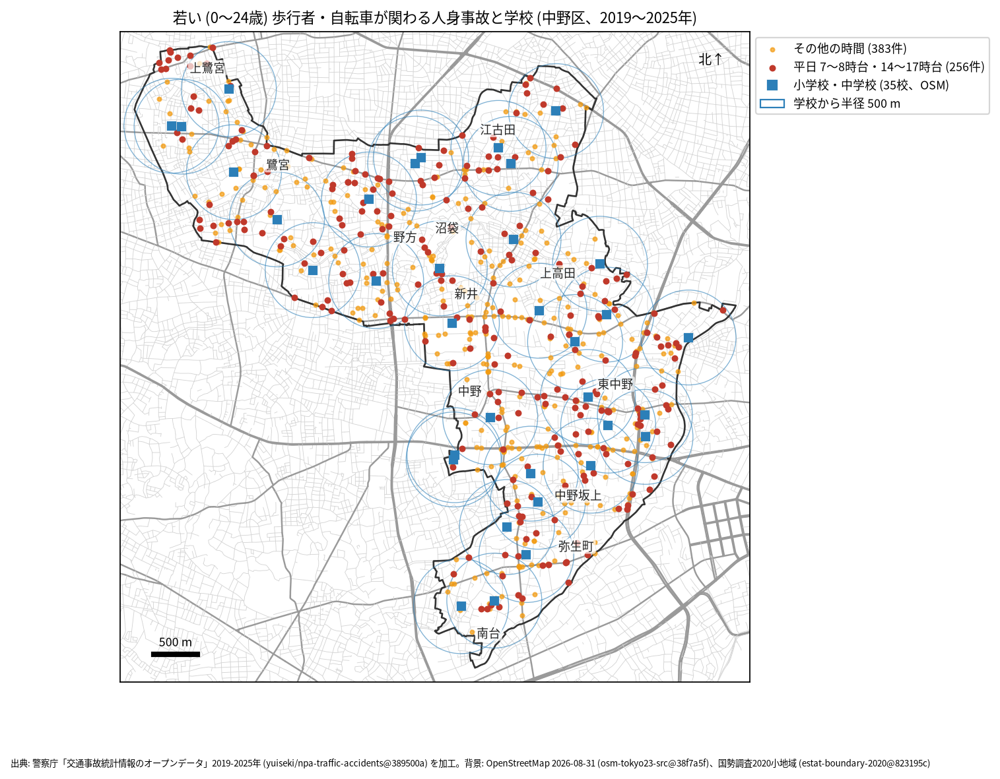

# 学校と PTA のための報告: 学校の周りの若い歩行者と自転車の事故

## 問い

中野区の学校の周り (半径 500 m) で、若い歩行者と自転車が関わる人身事故は、いつ、どこで起きているか。通学路の合同点検で見る場所と時間を選ぶ材料にします。

## 結論

- このデータで子どもだけを数えることはできません。年齢は年齢層で、最も若い区分が 0〜24 歳です。この報告の「若い」は 0〜24 歳で、大学生や若い社会人を含みます。
- 中野区で、若い歩行者か自転車が関わる人身事故は 7 年で 639 件 (全体の 14.3%、23 区で 4 位) でした。年では 75 件 (2024 年) から 108 件 (2019 年と 2023 年) です。
- 時間: 曜日を問わず多いのは 8 時台 (71 件)、16 時台 (66 件)、17 時台 (56 件) です。平日 (月〜金) に限ると、8 時台 62 件、16 時台 48 件、17 時台 46 件、15 時台 39 件でした。台東区では下校から夕方に多かったのに対し、中野区では登校の朝 8 時台が最も多い時間です ([台東区の summary.txt](../../taito-accident-trends-by-role/outputs/summary.txt) では 17 時台が最多の 45 件)。

- 場所: 学校から 500 m の円の中の件数が多いのは、宝仙学園小学校 49 件、中野中学校 45 件、中野本郷小学校 44 件、中野第一小学校 42 件、北原小学校 40 件です。円は重なるので、学校ごとの件数は足せません。中野坂上や中野駅に近い学校は、区全体の事故が多い場所に円がかかるため、件数が大きくなります。

| 学校 (OSM の名前) | 500 m 以内の若い歩行者・自転車 | うち平日 7〜8 時台 | うち平日 14〜17 時台 |
|---|---:|---:|---:|
| 私立 宝仙学園小学校 | 49 | 7 | 15 |
| 中野区立 中野中学校 | 45 | 8 | 4 |
| 中野区立中野本郷小学校 | 44 | 3 | 9 |
| 中野区立 中野第一小学校 | 42 | 3 | 10 |
| 中野区立 北原小学校 | 40 | 6 | 16 |
| 中野東中学校 | 39 | 4 | 14 |
| 中野区立 白桜小学校 | 38 | 2 | 13 |

35 校の全ては [schools.csv](../outputs/schools.csv) にあります。

赤い点 (平日の 7〜8 時台と 14〜17 時台、256 件) が、通学の時間に近い事故です。点検では、学校の円の中で赤い点が並ぶ道を、通学路の地図と重ねて見ることを勧めます。

- 7 年で、平日の朝 (7〜8 時台) に 1 つの学校の円の中で起きた若い人の事故は 0〜8 件です。件数が少ないので、学校の順位より、点の位置を手がかりにしてください。

## データ

警察庁「交通事故統計情報のオープンデータ」を加工した `yuiseki/npa-traffic-accidents` 版 `389500a` の本票、中野区の 4,471 件 (2019〜2025 年のファイル)。学校は OpenStreetMap 2026-08-31 (`osm-tokyo23-src-2026-08` 版 `38f7a5f`) の、名前が「小学校」「中学校」で終わる 35 校 (「旧」で始まる閉校した学校は除く。中野区には無い)。私立の学校と高校の附属中学校を含みます。OSM には「中野東中学校」と「中野区立 東中学校」が別の点としてあり、同じ学校か、どちらかが古い名前かは確かめていません。詳しくは [共通の報告](../report.md)。

## 方法

当事者 A か B が歩行者か自転車 (駆動補助機付を含む) で、その同じ当事者の年齢層が 0〜24 歳の事故を数えました。学校の位置は OSM の面の重心 (名前ごとに平均) で、円は直線 500 m (EPSG:6677 で測った) です。時刻は発生した時、平日は月曜から金曜で、祝日は分けていません。

## 確かめていないこと

- 小学生か、通学中かは分かりません。被害者か加害者かも区別していません (当事者 A は過失の重い側)。
- 学校の位置は校門ではなく、500 m は道のりではありません。通学路の線とは重ねていません。
- OSM の学校の一覧が今の学校と合っているか (統合や改名) は確かめていません。
- ヒヤリハットと物損事故は入っていません。点検では、学校が集めている危険な場所の情報と合わせて使ってください。
