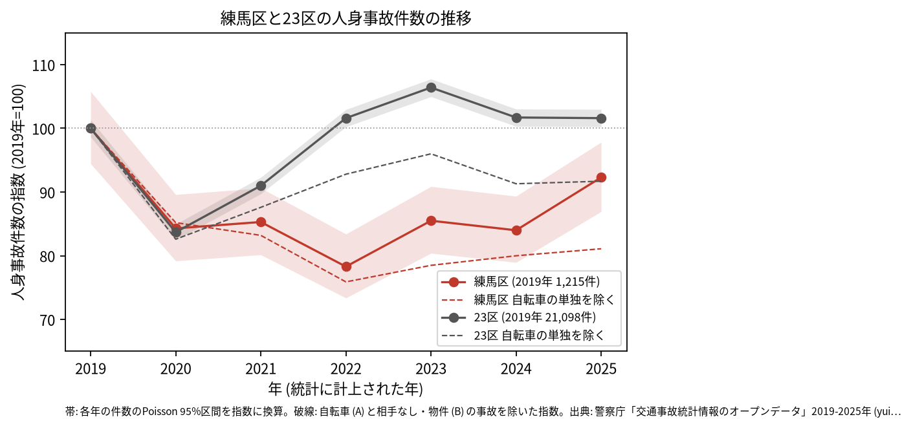
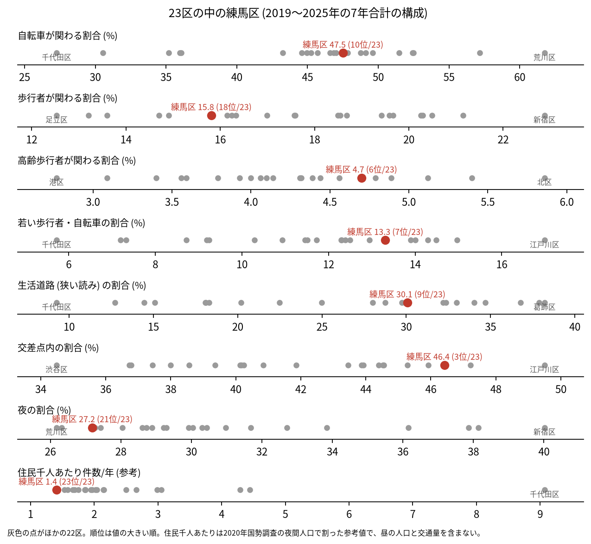
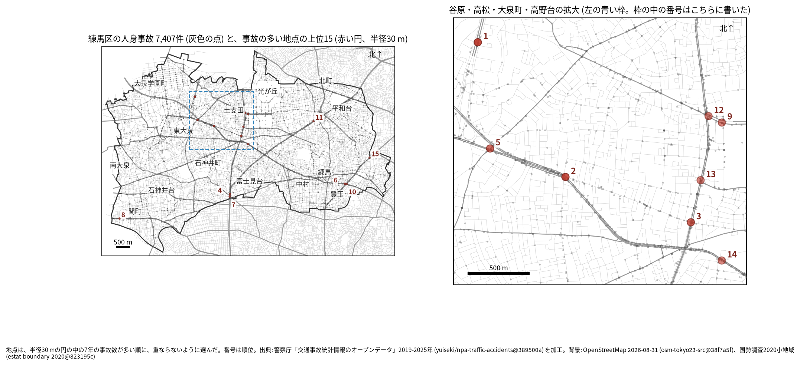
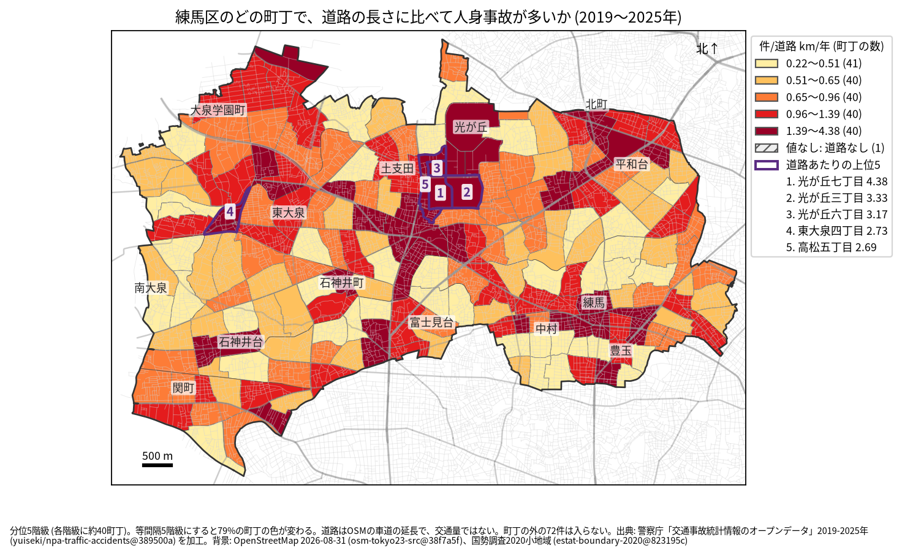
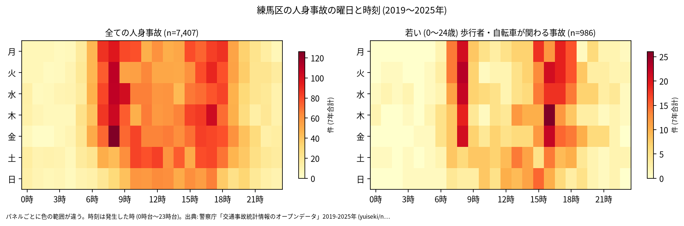
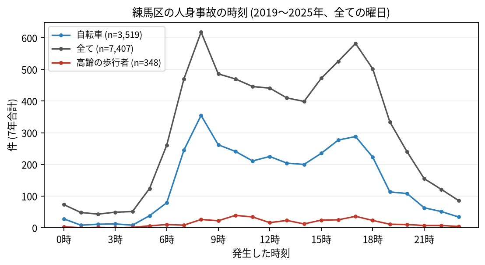
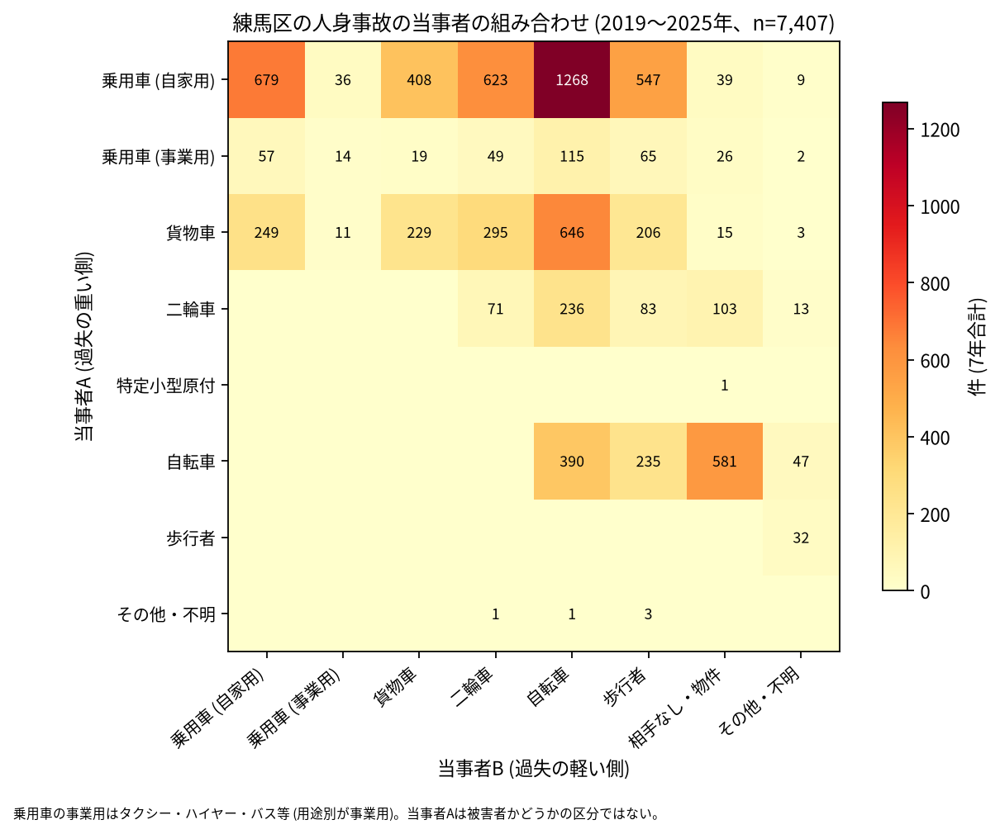

# 練馬区の交通事故 2019〜2025 年: 図で読む要点

## 問い

2019〜2025 年の警察記録の人身事故で、練馬区の事故はいつ、どこで、誰が関わって起きているか。

## 結論

### 要点

| # | 要点 | 数字 | 図 |
|---:|---|---|---|
| 1 | 件数は 2020 年に減り、2020〜2024 年は 2019 年より少なかった。2025 年は 2019 年と区別できない | 7 年で 7,407 件、死者 50 人、負傷者 8,360 人。指数 (2019 年=100) は 2022 年 78.3、2025 年 92.3。23 区全体の 2025 年は 101.6 ([yearly.csv](outputs/yearly.csv)、[summary.txt](outputs/summary.txt)) | [図 1](#図-1-件数の推移) |
| 2 | 交差点の事故の割合が高く、生活道路と若い歩行者・自転車の割合も 23 区の上位 | 交差点内 46.4% (23 区の 3 位)、生活道路 30.1% (9 位)、若い歩行者・自転車 13.3% (7 位) ([wards.csv](outputs/wards.csv)、[analysis.json](outputs/analysis.json)) | [図 2](#図-2-23-区の中の練馬区) |
| 3 | 集まる場所は谷原・高松・大泉町・高野台の目白通りと笹目通りの周り | 事故の多い地点の上位 15 のうち 8 が谷原・高松・大泉町・高野台。道路あたりの上位 5 町丁のうち 3 つが光が丘 ([hotspots-map.json](outputs/hotspots-map.json)、[towns.csv](outputs/towns.csv)) | [図 3](#図-3-事故の集まる地点)、[図 4](#図-4-町丁ごとの事故) |
| 4 | 事故の半分に自転車が関わる | 47.5% (10 位)。車やトラックが当事者 A で自転車が B の事故が 2,029 件 ([summary.txt](outputs/summary.txt)) | [図 6](#図-6-誰と誰の事故か) |
| 5 | 亡くなった人で最も多いのは自転車の人 | 死者のある事故 49 件のうち、亡くなったのは自転車 20、歩行者 14 (65 歳以上が 9 人)、二輪車 10。当事者 A が貨物車の事故が 22 件 ([summary.txt](outputs/summary.txt)) | [表 1](#表-1-死亡事故) |

### 読み手ごとに知るべきこと

| 読み手 | 結論 | 検討する材料 | 詳しく |
|---|---|---|---|
| 区の交通安全担当 | 生活道路の法定速度 30 km/h (2026-09-01 から) が当たるのは事故の 30.1〜44.4% (読み方による)。死亡事故では自転車の人が最も多く亡くなっている | 目白通り、笹目通り、環八通りの交差点、貨物車と自転車、自転車の単独事故の増え方 | [municipality.md](reports/municipality.md) |
| 学校と PTA | 若い (0〜24 歳) 歩行者と自転車の事故は 986 件。最も多いのは 16 時台で、平日に限ると 8 時台が最多 | 学校の円の中で、平日の朝と 14〜17 時台の点が並ぶ道 | [school-pta.md](reports/school-pta.md) |
| 道路安全診断 | 上位は大泉町三丁目の高速自動車国道 (関越自動車道とみられる) の地点 (37 件)、目白通り (34 件)、笹目通り (28 件)。2 位と 3 位で多い組み合わせは自家用の乗用車と自転車 | 谷原・高松の目白通りと笹目通りの地点、前半から後半に増えた 5 位と 15 位 | [road-safety-auditor.md](reports/road-safety-auditor.md) |
| 住民 | 道路あたりで多いのは光が丘七丁目 (年 4.38 件/道路 km)、光が丘三丁目 (3.33 件)。事故は 8 時台と 17 時台に山がある | 自分の町の色、朝の通勤と通学の時間、自転車に乗るとき | [resident.md](reports/resident.md) |

### 図 1: 件数の推移

2020 年に 84.3 まで下がり、23 区全体 (83.7) とほぼ同じだった。23 区全体は 2022 年から 2019 年の水準を超えたが、練馬区は 2022 年に 78.3 まで下がった。2020〜2024 年の 95% 区間は、どの年も 2019 年の区間 (1,147.6〜1,285.3 件) と重ならない。2025 年の区間 (1,056.3〜1,188.6 件) は 2019 年と重なるので、減少とは書かない。

### 図 2: 23 区の中の練馬区

赤い点が練馬区。交差点内 (3 位)、若い歩行者・自転車 (7 位)、高齢の歩行者 (4.7%、6 位) が高く、夜 (27.2%、21 位) と歩行者 (15.8%、18 位) が低い。住民千人あたり (1.41 件/年、23 位) は昼の人口を含まない参考値。

### 図 3: 事故の集まる地点

半径 30 m の円の中の 7 年の件数で選んだ上位 15 (16〜37 件)。番号は順位で、谷原・高松・大泉町・高野台の 8 地点は右の拡大図に番号を書いた。

| 順位 | 近い道路 (OSM) | 町丁 | 件数 | 前半 件/年 | 後半 件/年 |
|---:|---|---|---:|---:|---:|
| 1 | (30 m 以内に名前のある一般の道なし。路線は全て高速自動車国道) | 大泉町三丁目 | 37 | 10.00 | 1.75 |
| 2 | 目白通り | 谷原六丁目 | 34 | 6.00 | 4.00 |
| 3 | 笹目通り | 谷原三丁目 | 28 | 5.33 | 3.00 |
| 4 | 環八通り | 南田中四丁目 | 27 | 4.33 | 3.50 |
| 5 | 練馬川口線 × 練馬所沢線 | 大泉町二丁目 | 25 | 2.33 | 4.50 |

前半は 2019〜2021 年、後半は 2022〜2025 年。1 位の 37 件は、交差点内が 0 件、歩行者と自転車が 0 件で、多い組み合わせは貨物車どうし (11 件)。路線の区分は 37 件とも高速自動車国道 (`路線コード` 4000 番台) で、地図では関越自動車道の線の上にある。高速道路 (首都高速と高速自動車国道) を除くと 1 位は外れ、上位 15 のうち 14 地点が残る (下の表)。半径を 20 m にすると上位 15 のうち 11 地点、50 m では 10 地点が残る。6〜15 位は [hotspots.csv](outputs/hotspots.csv)。

### 図 4: 町丁ごとの事故

町丁の事故数を、OSM の車道の延長と 7 年で割った値。紫の枠が上位 5 (光が丘七丁目、光が丘三丁目、光が丘六丁目、東大泉四丁目、高松五丁目)。分位と等間隔で 79% の町丁の色が変わるので、色の細かい差は読まない。道路の長さは交通量ではない。光が丘の 3 町丁は道路が 0.586〜3.217 km と短く、値が大きくなりやすい。件数そのものが最も多い町丁は南田中四丁目 (115 件)。西大泉町は道路が無く、値なし (事故 0 件)。

### 図 5: いつ起きるか

全体は平日の 8 時台 (7 年で 618 件) と 16〜18 時台に山がある。若い歩行者と自転車は 16 時台 (123 件) と 8 時台 (115 件) が多く、平日に限ると 8 時台 (106 件) が最多。

自転車は 8 時台 (355 件)、高齢の歩行者は 10 時台 (39 件) が最多。

### 図 6: 誰と誰の事故か

最も多いのは自家用の乗用車 (A) と自転車 (B) の 1,268 件、次が自家用の乗用車どうしの 679 件、貨物車と自転車の 646 件。自転車の単独 (相手なし・物件) は 581 件。当事者 A は過失の重い側で、被害者とは限らない。

### 表 1: 死亡事故

| 亡くなった人 | 事故の件数 | 特徴 |
|---|---:|---|
| 自転車 | 20 | |
| 歩行者 | 14 | 65 歳以上が 9 人 |
| 二輪車 | 10 | |
| 貨物車、乗用車 (自家用) | 各 2 | 相手なしの事故など |
| 補充票の人 (A と B 以外) | 1 | |

死者のある事故 49 件 (死者 50 人) のうち、当事者 A が貨物車の事故が 22 件、自家用の乗用車が 20 件。19〜5 時台に起きたのは 20 件。全件は [deaths.csv](outputs/deaths.csv)。1 件で 2 人が亡くなった事故は、亡くなった当事者の欄で 1 件と数えた。

### 読み方で変わる答え

| 読み方 | 主 | 別の読み方 |
|---|---|---|
| 練馬区の事故 | `市区町村コード` 120 の 7,407 件 | 点が区の面に入る事故。両方に当てはまるのは 7,335 件 |
| 生活道路 | 狭い読み 30.1% (9 位) | 広い読み 44.4% (7 位) |
| 地点の半径 | 30 m | 20 m で 11 地点、50 m で 10 地点が残る |
| 高速道路の事故 (型に後から入った読み) | 含める | 練馬区の高速道路の事故は 122 件で、全て高速自動車国道 (首都高速は 0 件)。上位 15 の円には 37 件 (全て 1 位)。除くと 1 位が外れ、14 地点が残る ([analysis.json](outputs/analysis.json)、[summary.txt](outputs/summary.txt)) |
| 件数の推移 (型に後から入った読み) | 全ての人身事故 | 自転車 (A) と相手なし・物件 (B) の事故を除くと、2025 年の指数は練馬区 81.1、23 区 91.7。練馬区のこの事故は 2019 年 46 件から 2025 年 173 件 (記録のされ方の変化かは確かめていない) ([yearly.csv](outputs/yearly.csv)、[analysis.json](outputs/analysis.json)) |
| 町丁の階級 | 分位 5 階級 | 等間隔で 79% の町丁の色が変わる |

## データ

- 人身事故: 警察庁「交通事故統計情報のオープンデータ」を加工した `yuiseki/npa-traffic-accidents` 版 `389500aae5cec45f1311163f70db6a5f05867838` (配布元の取得 2026-10-02) の本票。年はファイルの年 (統計に計上された年)。練馬区 7,407 件、23 区 144,716 件。位置の無い行は 0。物損事故は含まない。東京の本票と 23 区の面は、台東区の prepare.py と同じ SQL と版で 2026-11-03 に取った共有のファイルを使った。
- 区の面と人口: `yuiseki/jp-admin-2026-09` 版 `e6c87b1`。町丁: 2020 年国勢調査の小地域 `yuiseki/estat-boundary-2020` 版 `823195c` (202 町丁、752,608 人)。学校 101 校と道路: OpenStreetMap 2026-08-31、`yuiseki/osm-tokyo23-src-2026-08` 版 `38f7a5f`。
- 道具: DuckDB 2.0.0 (spatial)、matplotlib、`analysis-visualize` の `cjk_font.py`、`classify_map.py`、`context_map.py`。スクリプトは台東区の型 (2026-11-03、記録の R019 までを直した版) を写し、区に固有の定数だけを直した。
- 出典の表示: 警察庁ウェブサイト (https://www.npa.go.jp/publications/statistics/koutsuu/opendata/index_opendata.html) の交通事故統計情報のオープンデータを加工して作成。国勢調査の小地域境界と人口、OpenStreetMap (© OpenStreetMap contributors) を加工して使用。

## 方法

- 読み方は結果を見る前に [計画](EXPERIMENT_PLAN.md) で固定し (台東区と同じ読み方)、実行は [記録](EXPERIMENT_TRACKER.md) に残した。生活道路は `車道幅員` が 01、02、11 (狭い読み)、広い読みは 14、17 を足す。歩行者や自転車が関わるかは当事者 A と B の両方で見て、1 件を 1 回数えた。
- 年齢はデータの年齢層で読む。若い人は 01 (0〜24 歳)、高齢の人は 65 (65〜74 歳) と 75 (75 歳以上)。
- 距離は EPSG:6677 (メートル) で測った。町丁の道路あたりの上位 5 には、道路が 0.5 km より短い町丁を数えない (練馬区には無い)。地点は、半径 30 m の中の件数が最も多い点を中心に選び、その円の事故を除いて次を選ぶ手順を 15 回くり返した。地点の名前は、中心から 30 m 以内で最も近い道と、それと 30 度以上の向きで交わる道のうち最も近い道。首都高速と高速自動車国道の名前 (OSM の motorway) は名前に使わない。高速道路は `路線コード` 4000〜5499 (高速自動車国道と首都高速)。
- 地図は `analysis-visualize` の map-context に合わせ、地名と道路を重ね、凡例を地図の外に置き、強調した単位に番号を付けた。描いた町丁の数 (202) を分析の数と照らした。文字の重なりと、地名や番号が円や学校の印を隠す重なりは、1 回目に学校の地図で 5 件、地点の地図で 2 件あり、地名 5 つと番号 4 つの位置を直して 3 枚とも 0 件にした。背景の道路 (OGC:CRS84) と町丁 (JGD2000) の差は、線の幅より小さいとして変換せずに重ねた。
- 関門: 予測と回帰をしないので、評価の分け方と残差の確認は要らない。単位の間の相関を結論にしないので、Moran's I と格子の掃引は省いた。推移は 23 区全体を基準にし、年の件数に Poisson の 95% 区間を付けた。対策の効果は推定していない。
- 再実行は [README.md](README.md)。数値は [outputs/](outputs/) の CSV、来歴は [analysis.json](outputs/analysis.json)。

## 確かめていないこと

- 交通量、昼の人口で割っていない。目白通りや笹目通りの件数の多さは、車と人の多さかもしれない。
- 1 位の地点の高速自動車国道が関越自動車道であることは、地図の位置から読んだ (路線コードと路線名の対応は確かめていない)。高速道路を除いた地点の 2 位以下の順位は [analysis.json](outputs/analysis.json) の件数だけで、地点ごとの表は出していない。
- 光が丘の町丁の値が高い理由 (団地の中の道が OSM の車道に入らないためか、縁の幹線の事故か) は、地点ごとには確かめていない。
- 位置の精度は分からない。30 m の地点と町丁の境界の近くの事故は、数十 m のずれで入れ替わる。
- 事故の型 (出会い頭、追突)、重傷と軽傷の区別、物損事故、ヒヤリハットは、このデータに無い。
- 0〜24 歳より細かい年齢は無く、小学生だけは数えられない。
- 地点の上位は 7 年で選び、同じ 7 年で前半と後半を比べたので、後半が下がって見えやすい (平均への回帰)。
