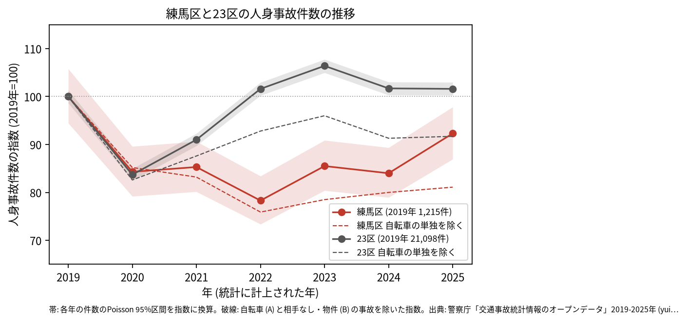
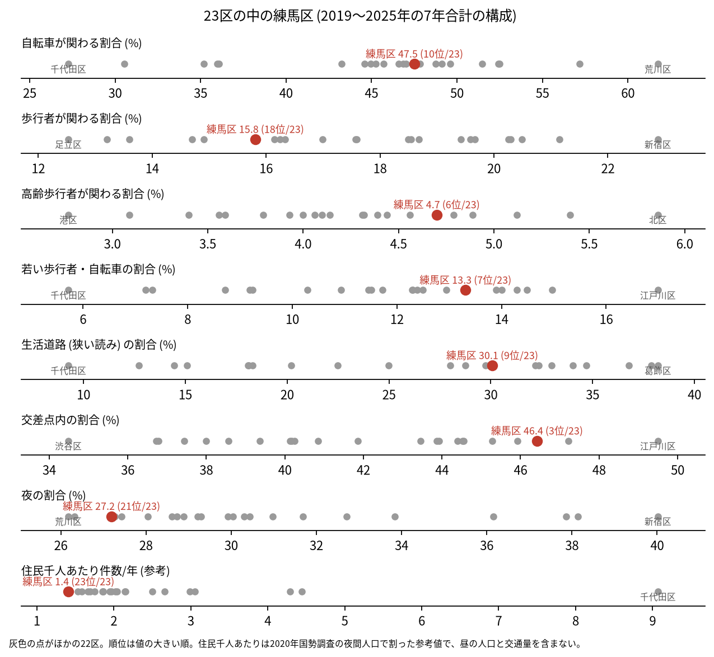
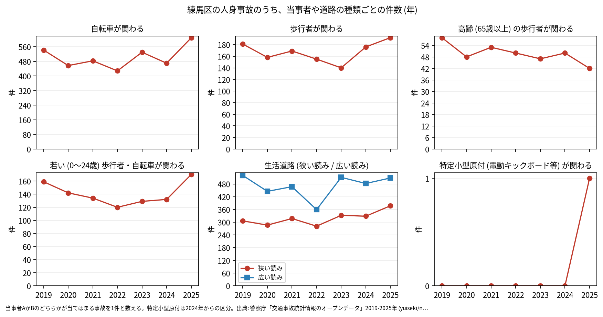

# 区の交通安全担当のための報告: 練馬区の交通事故の傾向

## 問い

練馬区の人身事故は 2019〜2025 年にどう推移し、23 区の中でどんな特徴があり、施策をどこに向ける材料になるか。

## 結論

- 件数: 7 年で 7,407 件、死者 50 人、負傷者 8,360 人です。2020 年に 1,024 件 (2019 年を 100 として 84.3) まで減り、2022 年は 951 件 (78.3) でした。23 区全体は 2022 年から 2019 年の水準を超えましたが (2025 年 101.6)、練馬区は 2020〜2024 年のどの年も、95% 区間が 2019 年の区間 (1,147.6〜1,285.3 件) と重なりません。2025 年は 1,121 件 (92.3) で、区間 (1,056.3〜1,188.6 件) が 2019 年と重なるので、2019 年より減ったとは言えません。

- 自転車の単独の事故: 自転車 (当事者 A) と相手なし・物件 (B) の事故は、2019 年の 46 件から 2025 年の 173 件に増えました。23 区でも 1,035 件から 3,039 件に増えています。これを除くと 2025 年の指数は 81.1 (23 区は 91.7) です。記録のされ方が変わったのか、事故が増えたのかは確かめていません。
- 23 区の中の位置: 交差点内の割合は 46.4% で 23 区の 3 位です。生活道路 (狭い読み) の割合は 30.1% で 9 位、広い読みでは 44.4% で 7 位です。若い歩行者と自転車が関わる割合は 13.3% で 7 位、高齢の歩行者は 4.7% で 6 位です。夜の割合 (27.2%、21 位) と歩行者が関わる割合 (15.8%、18 位) は低い側です。自転車が関わる割合 (47.5%) は 10 位です。

- 施策への読み方: 2026-09-01 からの生活道路の法定速度 30 km/h は、練馬区の事故のうち 30.1〜44.4% (読み方による) に当たります。件数の多い地点は、目白通り、笹目通り、環八通りの上にあります (地点は [道路安全診断の報告](road-safety-auditor.md))。これは効果の予測ではなく、どの道路で事故が起きているかの構成です。
- 区分ごとの推移: 自転車が関わる事故は 2022 年の 428 件から 2025 年の 609 件に増え、2019 年 (542 件) を上回りました。若い歩行者と自転車は 2025 年に 170 件、歩行者は 192 件で、どちらも 7 年で最も多い年でした。特定小型原付 (電動キックボードなど) が関わる事故は、区分のできた 2024 年に 0 件、2025 年に 1 件です。

- 死亡事故: 死者のある事故は 49 件で、亡くなったのは自転車の人 20、歩行者 14、二輪車 10 です。亡くなった歩行者 14 人のうち 9 人が 65 歳以上でした。当事者 A (過失の重い側) が貨物車の事故が 22 件、自家用の乗用車が 20 件です。

| 年 | 当事者 A | 当事者 B | 亡くなった人 | 時 |
|---|---|---|---|---:|
| 2019 | 貨物車 | 自転車 (75 歳以上) | 自転車 | 17 |
| 2020 | 貨物車 | 自転車 (75 歳以上) | 自転車 | 17 |
| 2022 | 貨物車 | 自転車 (75 歳以上) | 自転車 | 15 |
| 2023 | 貨物車 | 自転車 (75 歳以上) | 自転車 | 2 |
| 2023 | 貨物車 | 自転車 (75 歳以上) | 自転車 | 10 |
| 2024 | 貨物車 | 自転車 (75 歳以上) | 自転車 | 13 |

表は、貨物車と 75 歳以上の自転車の人の死亡事故の抜き出しです。49 件 ([summary.txt](../outputs/summary.txt)) の全ては [deaths.csv](../outputs/deaths.csv) にあります。

- 人口あたり: 2020 年の住民千人あたりの年の件数は 1.41 件で 23 区の 23 位 (最も少ない) ですが、分母に昼の人口と通過する車が入らないため、区の比較の主な指標にしていません。

## データ

警察庁「交通事故統計情報のオープンデータ」を加工した `yuiseki/npa-traffic-accidents` 版 `389500a` の本票。練馬区は `市区町村コード` 120 の 7,407 件、23 区は 144,716 件。年はファイルの年 (統計に計上された年)。区の人口は 2020 年国勢調査 (`jp-admin-2026-09` 版 `e6c87b1`)。詳しくは [共通の報告](../report.md)。

## 方法

区分は、当事者 A か B のどちらかが当てはまる事故を 1 件と数えました。生活道路は `車道幅員` で決め、狭い読み (5.5 m 未満の単路と、小と小の交差点) と、広い読み (5.5 m 未満の道とより広い道の交差点も含む) を並べました。年の区間は件数の Poisson の 95% 区間 (Garwood) です。23 区の順位は 7 年合計の割合の大きい順です。

## 確かめていないこと

- 2020〜2024 年に 23 区全体より低く推移した理由は調べていません。
- 区の施策 (ゾーン 30、自転車の通行帯など) の効果は推定していません。割合の順位は施策の評価ではありません。
- 重傷と軽傷の区別、物損事故は、このデータにありません。
