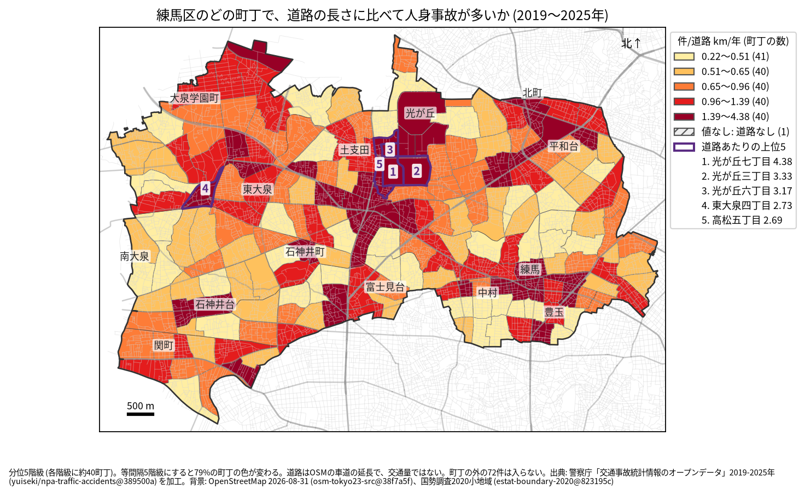
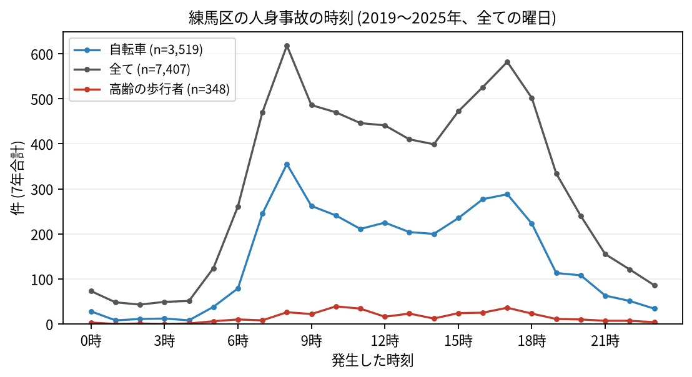

# 住民のための報告: 練馬区で、いつ、どこで事故が起きているか

## 問い

練馬区に住む人が、自分の町で、いつ、どんな事故に気をつければよいか。2019〜2025 年の警察記録の人身事故から調べました。

## 結論

- 練馬区では 7 年で 7,407 件の人身事故があり、50 人が亡くなりました。年に 951〜1,215 件です。
- 町ごと: 道路 1 km あたりの事故が多いのは、光が丘七丁目 (年 4.38 件)、光が丘三丁目 (3.33 件)、光が丘六丁目 (3.17 件)、東大泉四丁目 (2.73 件)、高松五丁目 (2.69 件) です。件数そのものが最も多いのは南田中四丁目 (7 年で 115 件)、次が谷原一丁目 (96 件) でした。

色は分位 5 階級で、各色に約 40 の町が入ります。等間隔の階級にすると 79% の町の色が変わるので、色の差より、自分の町が上の階級か下の階級かを見てください。光が丘の町は、OSM の車道の延長が短い (光が丘六丁目は 0.586 km) ため、値が大きくなりやすい町です。団地の中の通路は車道に入っていないとみられます (確かめていません)。

- 時間: 事故は朝 8 時台 (618 件) と夕方 17 時台 (582 件) に山があります。自転車が関わる事故は 8 時台 (355 件) が最も多く、高齢の歩行者が関わる事故は 10 時台 (39 件) が最も多い時間でした。

- 誰が: 自転車が関わる事故が全体の 47.5% で、最も多い区分です。自転車に乗る人は、車やトラックとの事故 (2,029 件) に加え、自転車だけの事故 (転倒や物への衝突、581 件) にも気をつけてください。歩行者が関わる事故は 15.8% です。
- 亡くなった人: 死者のある事故 49 件で、亡くなったのは自転車の人 20、歩行者 14 (そのうち 65 歳以上が 9 人)、二輪車 10 でした。

## データ

警察庁「交通事故統計情報のオープンデータ」を加工した `yuiseki/npa-traffic-accidents` 版 `389500a` の本票、練馬区の 7,407 件 (2019〜2025 年のファイル)。町の境界は 2020 年国勢調査の小地域 (202 町丁)、道路は OpenStreetMap 2026-08-31。詳しくは [共通の報告](../report.md)。

## 方法

事故の地点を町丁の境界に入れて数え、町丁の中の車道の長さ (OSM) と 7 年で割りました。区の境界の近くで町丁の外に落ちた 72 件は町の値に入っていません。西大泉町は道路が無いため値がありません (事故は 0 件)。時刻は事故の起きた時で、7 年の合計です。

## 確かめていないこと

- 道路の長さは、通る車や人の数ではありません。光が丘の値が高いのは、道路が短いことと、人の多さのためかもしれません。
- 自分の町の事故が少なくても、物損事故やヒヤリハットはこのデータにありません。
- 事故の位置の精度は分かりません。町の境界の近くの事故は、隣の町に数えられている可能性があります。
