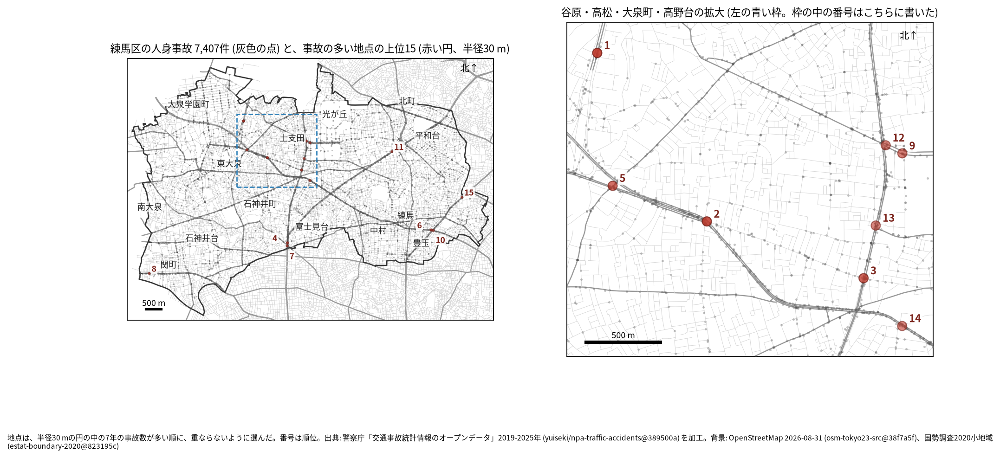
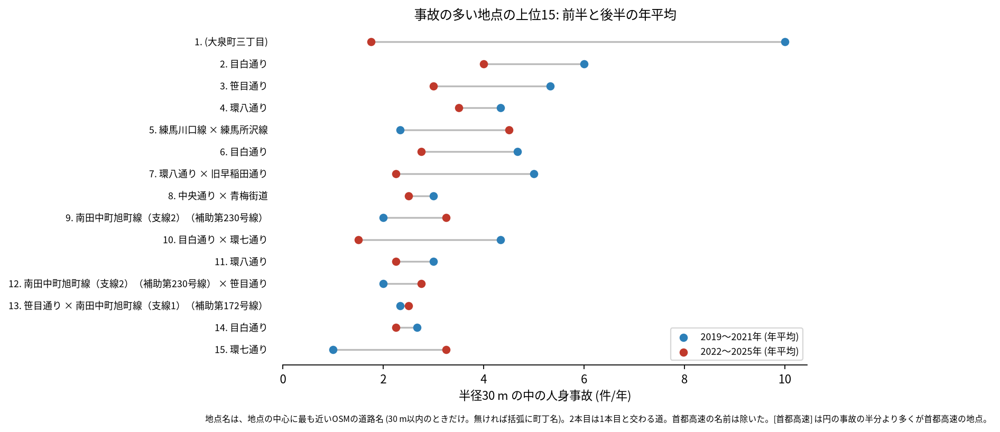
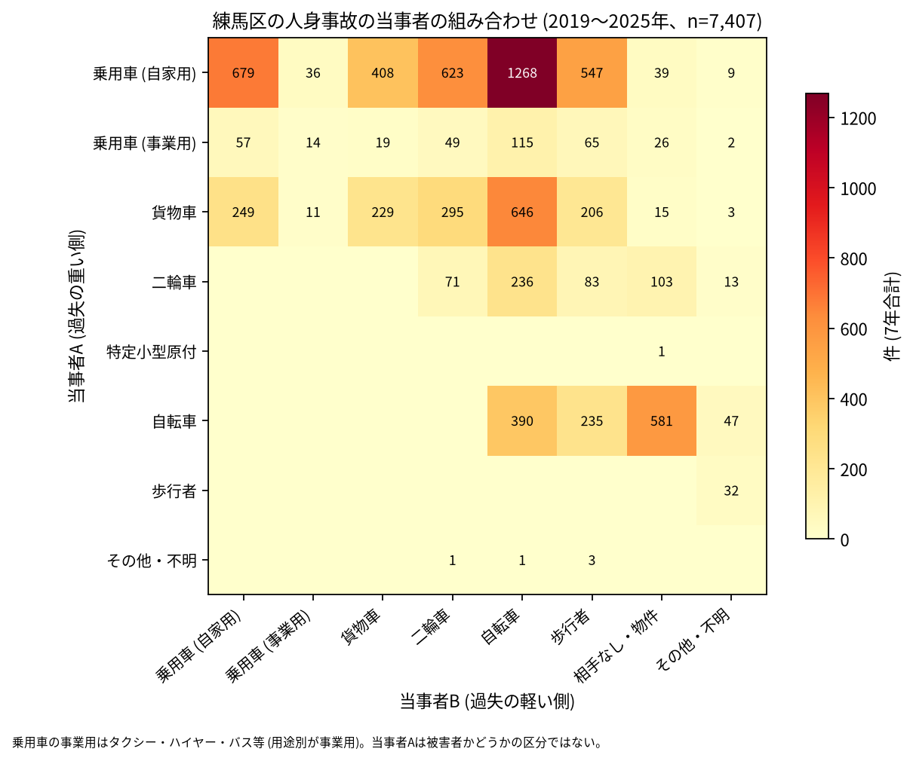

# 道路安全診断のための報告: 練馬区で事故の集まる地点

## 問い

練馬区で 2019〜2025 年の人身事故が集まる地点はどこで、そこでは誰と誰の事故が多いか。現地診断の候補を選ぶ材料にします。

## 結論

- 半径 30 m の円の中の 7 年の件数で選んだ上位 15 地点は、16〜37 件です。15 のうち 8 は谷原、高松、大泉町、高野台 (目白通り、笹目通り、関越自動車道の周り) にあり、ほかは環八通りの南田中と下石神井、目白通りと環七通りの豊玉北、関町北、春日町、羽沢です。

| 順位 | 近い道路 (OSM) | 件数 | 前半 件/年 | 後半 件/年 | 交差点内 | 信号あり | 多い組み合わせ (A × B) |
|---:|---|---:|---:|---:|---:|---:|---|
| 1 | (大泉町三丁目。名前のある一般の道は 30 m 以内に無い) | 37 | 10.00 | 1.75 | 0 | 0 | 貨物車 × 貨物車 |
| 2 | 目白通り | 34 | 6.00 | 4.00 | 31 | 34 | 乗用車 (自家用) × 自転車 |
| 3 | 笹目通り | 28 | 5.33 | 3.00 | 18 | 26 | 乗用車 (自家用) × 自転車 |
| 4 | 環八通り | 27 | 4.33 | 3.50 | 0 | 0 | 乗用車 (自家用) × 乗用車 (自家用) |
| 5 | 練馬川口線 × 練馬所沢線 | 25 | 2.33 | 4.50 | 21 | 18 | 貨物車 × 自転車 |
| 6 | 目白通り | 25 | 4.67 | 2.75 | 18 | 22 | 乗用車 (自家用) × 自転車 |
| 7 | 環八通り × 旧早稲田通り | 24 | 5.00 | 2.25 | 3 | 3 | 乗用車 (自家用) × 乗用車 (自家用) |
| 8 | 中央通り × 青梅街道 | 19 | 3.00 | 2.50 | 12 | 17 | 自転車 × 自転車 |
| 9 | 南田中町旭町線（支線2）（補助第230号線） | 19 | 2.00 | 3.25 | 18 | 18 | 乗用車 (自家用) × 自転車 |
| 10 | 目白通り × 環七通り | 19 | 4.33 | 1.50 | 15 | 15 | 乗用車 (自家用) × 自転車 |

前半は 2019〜2021 年、後半は 2022〜2025 年。11〜15 位と、歩行者、自転車、夜の件数は [hotspots.csv](../outputs/hotspots.csv) にあります。道路名は地点の中心に最も近い OSM の道路名 (30 m 以内のときだけ) で、2 本目は 1 本目と交わる向き (30 度以上) の道のうち最も近いもので、30 m 以内のときだけ書きました (首都高速と高速自動車国道の名前は除いた)。

- 1 位の地点: 37 件の全てが路線の区分「その他」(国道、都道、区道、首都高速のどれでもない) で、交差点内も歩行者と自転車も 0 件です。地図では関越自動車道の線の上にあり、高速道路の上の事故とみられます。料金所などの施設との関係は外の知識で、確かめていません。区の道路の診断の対象とは別に扱ってください。
- 4 位と 7 位: 環八通りの上で、交差点内は 27 件のうち 0 件と、24 件のうち 3 件です。乗用車どうしの組み合わせが最も多く、交差点でない区間の事故が集まっています。
- 続いているか: 上位 15 は全て前半と後半の両方に事故があります。1 位 (10.00 から 1.75 件/年) と 10 位 (4.33 から 1.50 件/年) は後半に減り、5 位 (2.33 から 4.50 件/年) と 15 位 (1.00 から 3.25 件/年) は増えました。上位は 7 年合計で選んだので、後半が下がって見えやすい (平均への回帰) ことに注意してください。

- 組み合わせ: 当事者 A が乗用車か貨物車で B が自転車の事故は 2,029 件です。自転車の単独 (相手なし・物件) が 581 件、自転車どうしが 390 件、自転車と歩行者 (自転車が A) が 235 件ありました。事業用の乗用車 (タクシー、ハイヤー、バスなど) は 347 件で当事者 A です。

- 半径を変えると: 20 m の上位 15 の中心が、30 m の上位 15 の中心から 30 m 以内にあるのは 11 地点、50 m では 10 地点でした。上位の地点の組み替わりは半径で起きるので、順位は細かく読まないでください。目白通りの 6 位と 10 位 (どちらも豊玉北三丁目) と、高松五丁目の 9 位と 12 位は中心が近く、同じ交差点の事故が 2 つの地点に分かれている可能性があります。

## データ

警察庁「交通事故統計情報のオープンデータ」を加工した `yuiseki/npa-traffic-accidents` 版 `389500a` の本票、練馬区 (`市区町村コード` 120) の 7,407 件。道路名は OpenStreetMap 2026-08-31 (`osm-tokyo23-src-2026-08` 版 `38f7a5f`)。詳しくは [共通の報告](../report.md)。

## 方法

事故の点を EPSG:6677 (メートル) に変換し、半径 30 m の円の中の件数が最も多い事故の点を中心に選び、その円の事故を除いて次を選ぶ手順を 15 回くり返しました。30 m はコード表の「交差点付近」(交差点の側端から 30 m 以内) の幅です。信号ありは `信号機` が 3 灯式、押ボタン式、歩車分式の点灯。組み合わせは当事者 A (過失の重い側) と B の種別で、乗用車は `用途別` で事業用と自家用に分けました。

## 確かめていないこと

- 交通量で割っていません。件数の多い交差点が、車の多さに比べて危険かは分かりません。
- 高速道路 (関越自動車道、東京外環自動車道) の事故を除いた地点の順位は出していません。型の路線の区分が高速自動車国道を分けないためです。
- 事故の型 (出会い頭、右折、追突)、違反の種類、重傷と軽傷の区別は、このデータにありません。現地で確かめてください。
- 位置の精度は分かりません。数十 m のずれで地点の件数は変わります。
- 偶然でもこの程度の集まりが生まれるか (順位の有意さ) は調べていません。
