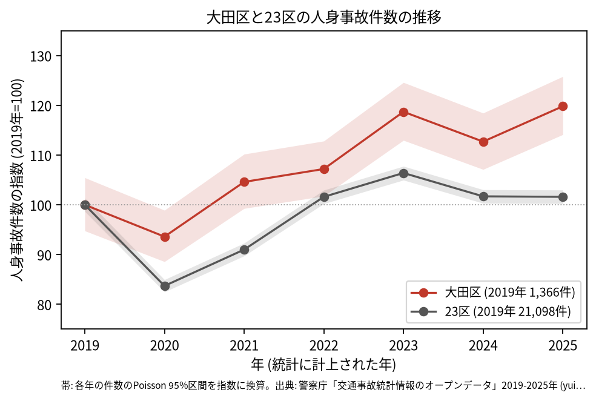
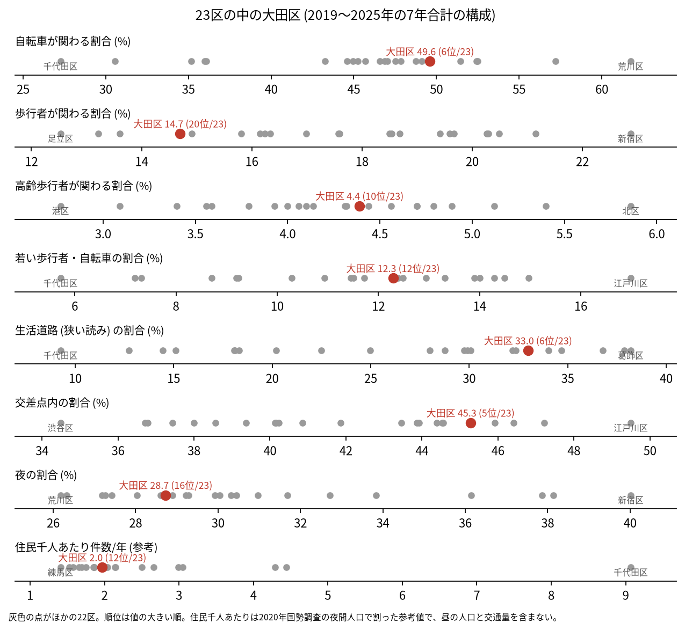
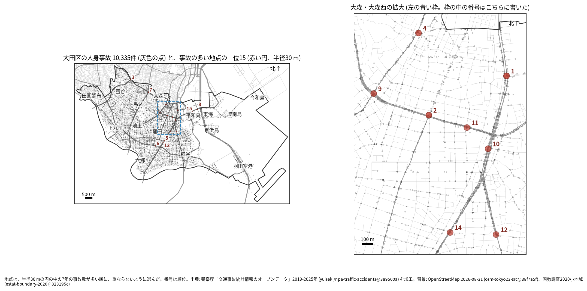
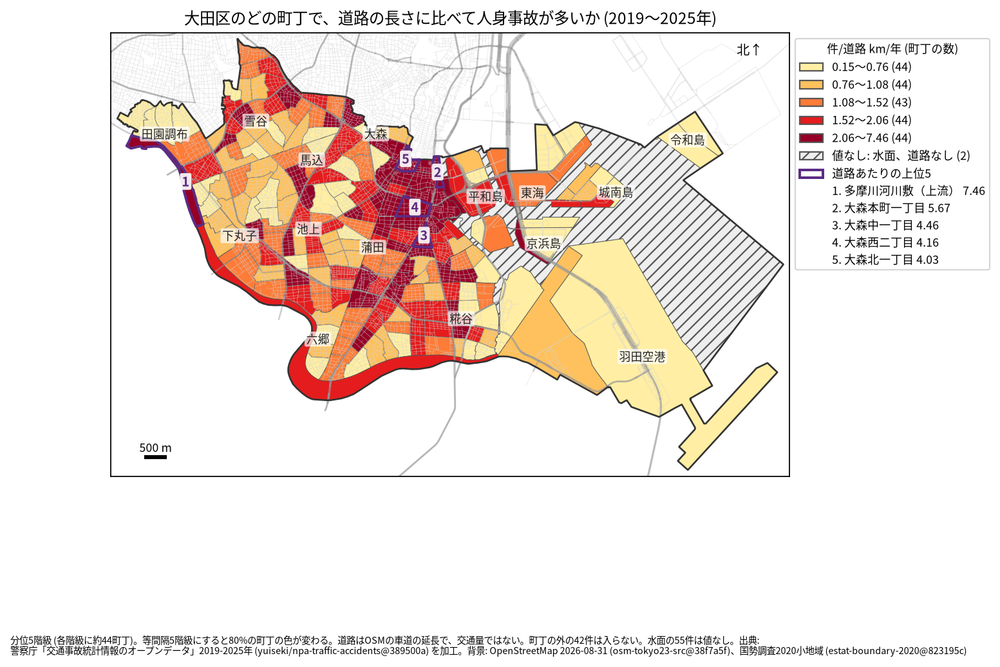
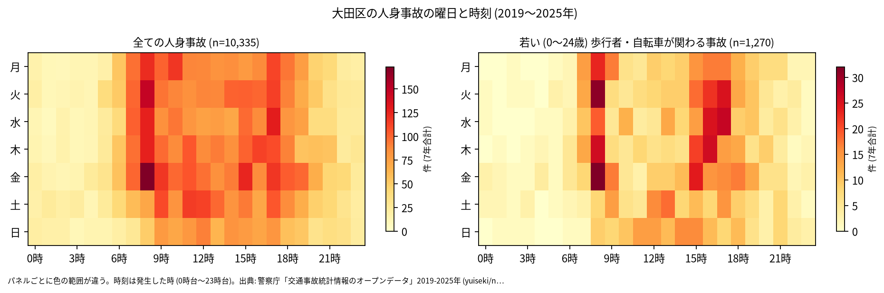
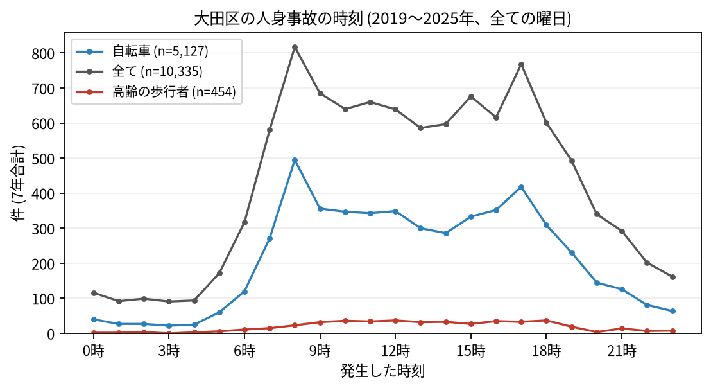
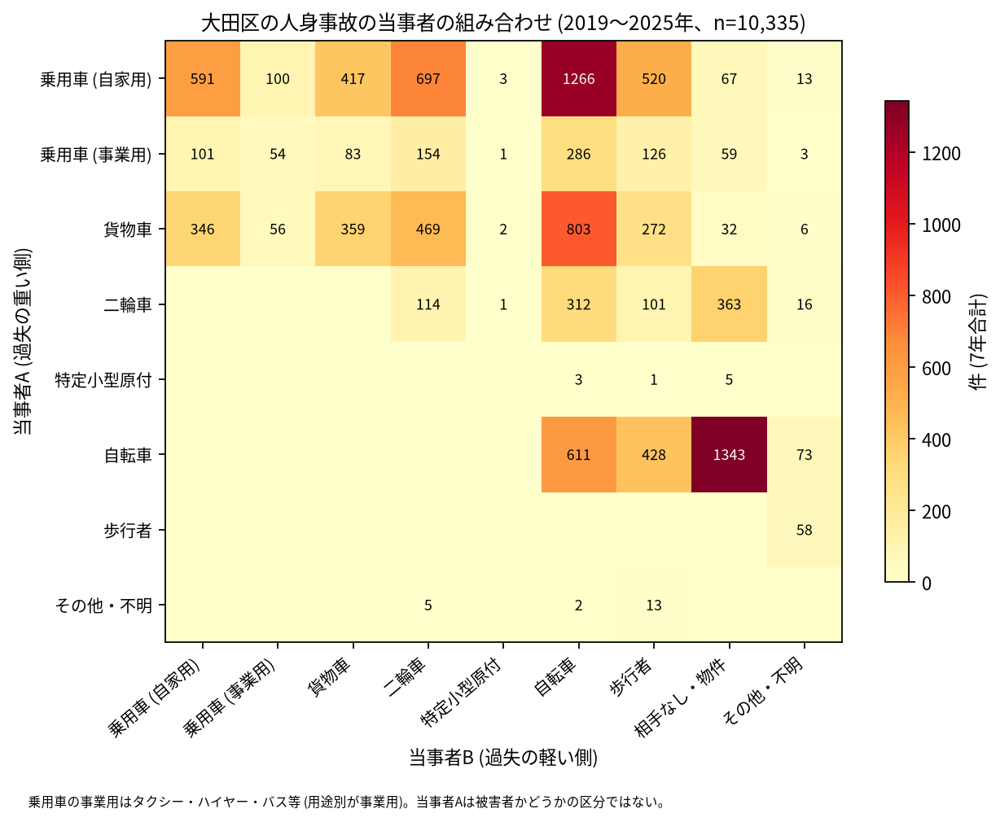

# 大田区の交通事故 2019〜2025 年: 図で読む要点

## 問い

2019〜2025 年の警察記録の人身事故で、大田区の事故はいつ、どこで、誰が関わって起きているか。

## 結論

### 要点

| # | 要点 | 数字 | 図 |
|---:|---|---|---|
| 1 | 件数は 2020 年に少し減った後に増え、2023 年と 2025 年は 2019 年より多い | 7 年で 10,335 件、死者 72 人、負傷者 11,482 人。指数 (2019 年=100) は 2020 年 93.6、2025 年 119.8 ([yearly.csv](outputs/yearly.csv)、[summary.txt](outputs/summary.txt)) | [図 1](#図-1-件数の推移) |
| 2 | 事故の半分に自転車が関わり、生活道路の事故も 23 区の中で多い | 自転車 49.6% (23 区の 6 位)、生活道路 33.0% (6 位)、交差点内 45.3% (5 位) ([wards.csv](outputs/wards.csv)、[analysis.json](outputs/analysis.json)) | [図 2](#図-2-23-区の中の大田区) |
| 3 | 集まる場所は大森の第一京浜、環七通り、池上通り | 事故の多い地点の上位 15 のうち 8 が大森・大森西の拡大図の中。道路あたりの上位 5 町丁のうち 4 つが大森 ([hotspots.csv](outputs/hotspots.csv)、[towns.csv](outputs/towns.csv)) | [図 3](#図-3-事故の集まる地点)、[図 4](#図-4-町丁ごとの事故) |
| 4 | 最も多い組み合わせは自転車の単独の事故 | 自転車 (A) と相手なし・物件の 1,343 件。車やトラックが当事者 A で自転車が B の事故が 2,355 件 ([summary.txt](outputs/summary.txt)) | [図 6](#図-6-誰と誰の事故か) |
| 5 | 死亡事故は歩行者、とくに高齢の歩行者と、貨物車に偏る | 71 件で 72 人。亡くなった歩行者 31 人のうち 65 歳以上が 23 人。当事者 A が貨物車の事故が 31 件 ([summary.txt](outputs/summary.txt)) | [表 1](#表-1-死亡事故) |

### 読み手ごとに知るべきこと

| 読み手 | 結論 | 検討する材料 | 詳しく |
|---|---|---|---|
| 区の交通安全担当 | 件数は 2019 年より増えた。生活道路の法定速度 30 km/h (2026-09-01 から) が当たるのは事故の 33.0〜45.6% (読み方による) | 自転車、生活道路、大森の幹線の交差点、貨物車と高齢の歩行者 | [municipality.md](reports/municipality.md) |
| 学校と PTA | 若い (0〜24 歳) 歩行者と自転車の事故は 1,270 件。最も多いのは 8 時台 (148 件) で、登校の時間に重なる | 学校の円の中で、平日 7〜8 時台と 14〜17 時台の点が並ぶ道 | [school-pta.md](reports/school-pta.md) |
| 道路安全診断 | 上位は第一京浜 (大森本町一丁目、31 件)、桜新道 × 環七通り (28 件)、環七通り × 中原街道 (27 件)。上位 1〜3 位で多い組み合わせには、どれも自転車が入る | 大森西二丁目に 3 地点が並ぶ環七通りと第一京浜、後半に減った 3、5、6、11 位 | [road-safety-auditor.md](reports/road-safety-auditor.md) |
| 住民 | 道路あたりで多いのは大森本町一丁目 (年 5.675 件/道路 km)、大森中一丁目 (4.464 件)。事故は 8 時台と 17 時台に山がある | 自分の町の色、朝と夕方の自転車、夜の大通りを渡るとき | [resident.md](reports/resident.md) |

### 図 1: 件数の推移

2020 年の落ち込み (93.6) は 23 区全体 (83.7) より浅い。2025 年の 95% 区間 (1,558.7〜1,718.3 件) は 2019 年 (1,294.5〜1,440.4 件) と重ならないので、規則により増えたと書く。23 区全体の 2025 年は 101.6。年ごとのコードと面の件数の差は最大 4 件で ([analysis.json](outputs/analysis.json))、増え方は区の付け方の変化では説明できない。

### 図 2: 23 区の中の大田区

赤い点が大田区。自転車 (6 位)、生活道路 (狭い読み 6 位、広い読み 45.6% で 6 位)、交差点内 (5 位) が高く、歩行者 (14.7%、20 位) と夜 (28.7%、16 位) が低い。若い歩行者・自転車 (12.3%) と住民千人あたり (1.97 件/年) はともに 12 位で、23 区の中ほど。

### 図 3: 事故の集まる地点

半径 30 m の円の中の 7 年の件数で選んだ上位 15 (20〜31 件)。番号は順位で、大森・大森西の 8 地点は右の拡大図に番号を書いた。

| 順位 | 近い道路 (OSM) | 町丁 | 件数 | 前半 件/年 | 後半 件/年 |
|---:|---|---|---:|---:|---:|
| 1 | 第一京浜 | 大森本町一丁目 | 31 | 4.67 | 4.25 |
| 2 | 桜新道 × 環七通り | 大森西二丁目 | 28 | 4.33 | 3.75 |
| 3 | 環七通り × 中原街道 | 上池台一丁目 | 27 | 5.00 | 3.00 |
| 4 | 池上通り | 大森北一丁目 | 26 | 4.00 | 3.50 |
| 5 | 多摩堤通り × 第一京浜 | 東蒲田二丁目 | 26 | 5.33 | 2.50 |

前半は 2019〜2021 年、後半は 2022〜2025 年。半径を 20 m にすると上位 15 のうち 12 地点、50 m では 10 地点が残る。首都高速の事故 (区の点の 216 件) を除いても 15 地点とも残り、上位 15 の円の中に首都高速の事故は 0 件 ([analysis.json](outputs/analysis.json))。6〜15 位は [hotspots.csv](outputs/hotspots.csv)。

### 図 4: 町丁ごとの事故

町丁の事故数を、OSM の車道の延長と 7 年で割った値。紫の枠が上位 5 (多摩川河川敷（上流）、大森本町一丁目、大森中一丁目、大森西二丁目、大森北一丁目)。1 位の多摩川河川敷（上流） は道路が 0.134 km しかなく、7 件で 7.46 件/道路 km/年になった ([towns.csv](outputs/towns.csv))。分母が小さい単位の値で、計画どおり外していない。羽田空港三丁目は件数が 189 件と区で 2 番目に多いが、道路も 47.686 km と長く、道路あたりでは 0.566 件。分位と等間隔で 79.5% の町丁の色が変わるので ([town-rate-quantile.json](outputs/town-rate-quantile.json))、色の細かい差は読まない。水面調査区 (事故 55 件) と道路の無いふるさとの浜辺公園は値なし。道路の長さは交通量ではない。

### 図 5: いつ起きるか

全体は平日の 8 時台が最も濃く (7 年で 817 件)、17 時台 (768 件) が次ぐ。若い歩行者と自転車も 8 時台 (148 件) が最多で、15〜17 時台にも山がある。

自転車は 8 時台 (495 件) と 17 時台 (418 件)、高齢の歩行者は 12 時台と 18 時台 (各 37 件) が最多。

### 図 6: 誰と誰の事故か

最も多いのは自転車の単独 (相手なし・物件) の 1,343 件、次が自家用の乗用車 (A) と自転車 (B) の 1,266 件、貨物車と自転車の 803 件。当事者 A は過失の重い側で、被害者とは限らない。

### 表 1: 死亡事故

| 亡くなった人 | 人数 | 特徴 |
|---|---:|---|
| 歩行者 | 31 | 65 歳以上が 23 人 |
| 二輪車 | 18 | |
| 自転車 | 12 | |
| 補充票の人 | 6 | 当事者 A と B のどちらでもない |

ほかに貨物車 3 人、自家用の乗用車 1 人。71 件のうち 19〜5 時台が 28 件、0〜5 時台が 11 件、当事者 A が貨物車の事故が 31 件。全件は [deaths.csv](outputs/deaths.csv)。

### 読み方で変わる答え

| 読み方 | 主 | 別の読み方 |
|---|---|---|
| 大田区の事故 | `市区町村コード` 111 の 10,335 件 | 点が区の面に入る事故。両方に当てはまるのは 10,293 件 |
| 生活道路 | 狭い読み 33.0% (6 位) | 広い読み 45.6% (6 位) |
| 地点の半径 | 30 m | 20 m で 12 地点、50 m で 10 地点が残る |
| 首都高速 | 含める | 除いても 15 地点とも残る |
| 町丁の階級 | 分位 5 階級 | 等間隔で 79.5% の町丁の色が変わる |

## データ

- 人身事故: 警察庁「交通事故統計情報のオープンデータ」を加工した `yuiseki/npa-traffic-accidents` 版 `389500aae5cec45f1311163f70db6a5f05867838` (配布元の取得 2026-10-02) の本票。年はファイルの年 (統計に計上された年)。大田区 10,335 件、23 区 144,716 件。位置の無い行は 0。物損事故は含まない。
- 区の面と人口: `yuiseki/jp-admin-2026-09` 版 `e6c87b1`。町丁: 2020 年国勢調査の小地域 `yuiseki/estat-boundary-2020` 版 `823195c` (221 単位、748,081 人。うち水面調査区 1)。学校 90 校と道路: OpenStreetMap 2026-08-31、`yuiseki/osm-tokyo23-src-2026-08` 版 `38f7a5f`。
- 道具: DuckDB 2.0.0 (spatial)、matplotlib、`analysis-visualize` の `cjk_font.py`、`classify_map.py`、`context_map.py`。
- 出典の表示: 警察庁ウェブサイト (https://www.npa.go.jp/publications/statistics/koutsuu/opendata/index_opendata.html) の交通事故統計情報のオープンデータを加工して作成。国勢調査の小地域境界と人口、OpenStreetMap (© OpenStreetMap contributors) を加工して使用。

## 方法

- 読み方は結果を見る前に [計画](EXPERIMENT_PLAN.md) で固定し、実行は [記録](EXPERIMENT_TRACKER.md) に残した。台東区の分析 ([taito](../taito-accident-trends-by-role/report.md)) と同じスクリプトを区のコードと名前だけ変えて流し、首都高速を除いた地点の読みを足した (計画で決めた)。生活道路は `車道幅員` が 01、02、11 (狭い読み)、広い読みは 14、17 を足す。歩行者や自転車が関わるかは当事者 A と B の両方で見て、1 件を 1 回数えた。
- 距離は EPSG:6677 (メートル) で測った。地点は、半径 30 m の中の件数が最も多い点を中心に選び、その円の事故を除いて次を選ぶ手順を 15 回くり返した。地点の名前は、中心に最も近い道と、それと 30 度以上の向きで交わる道のうち最も近い道 (30 m 以内のときだけ書いた)。
- 地図は `analysis-visualize` の map-context に合わせ、地名と道路を重ね、凡例を地図の外に置き、強調した単位に番号を付けた。描いた町丁の数 (221) を分析の数と照らし、文字の重なりと、地名が円や学校の印を隠す重なりは、3 枚の地図で 0 件 (地名の位置を区に合わせて直した後)。背景の道路 (OGC:CRS84) と町丁 (JGD2000) の差は、線の幅より小さいとして変換せずに重ねた。
- 関門: 予測と回帰をしないので、評価の分け方と残差の確認は要らない。単位の間の相関を結論にしないので、Moran's I と格子の掃引は省いた。推移は 23 区全体を基準にし、年の件数に Poisson の 95% 区間を付けた。対策の効果は推定していない。
- 再実行は [README.md](README.md)。数値は [outputs/](outputs/) の CSV、来歴は [analysis.json](outputs/analysis.json)。

## 確かめていないこと

- 交通量、昼の人口、空港の利用者の数で割っていない。大森の件数の多さは、人と車の多さかもしれない。
- 2019 年から増えた理由は調べていない。自転車が関わる事故の増え方 (2019 年 612 件、2025 年 860 件) と重なるが、原因は分からない。
- 位置の精度は分からない。30 m の地点と町丁の境界の近くの事故は、数十 m のずれで入れ替わる。
- 道路あたりの値は、道路の短い単位 (多摩川河川敷（上流）) で大きく振れる。羽田空港や埋立地の町丁は人が住まず、道路の長さも交通の性質も住宅地と違う。
- 事故の型 (出会い頭、追突)、重傷と軽傷の区別、物損事故、ヒヤリハットは、このデータに無い。0〜24 歳より細かい年齢は無く、小学生だけは数えられない。
- 地点の上位は 7 年で選び、同じ 7 年で前半と後半を比べたので、後半が下がって見えやすい (平均への回帰)。
