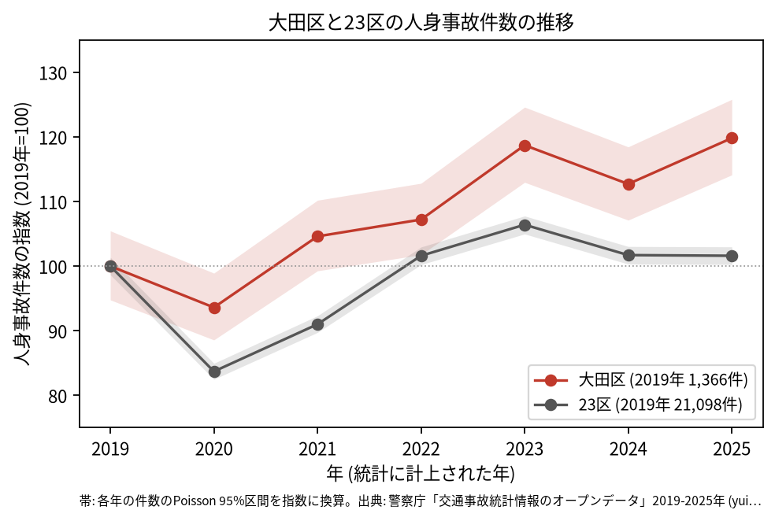
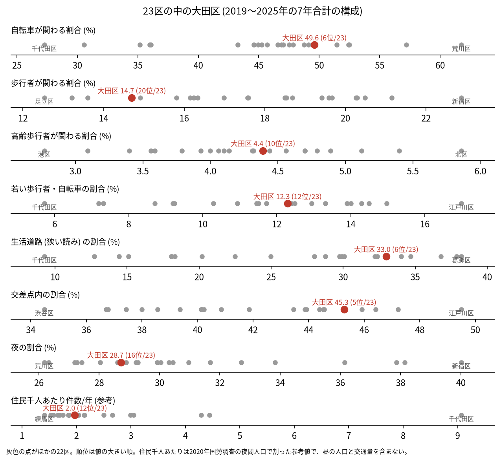
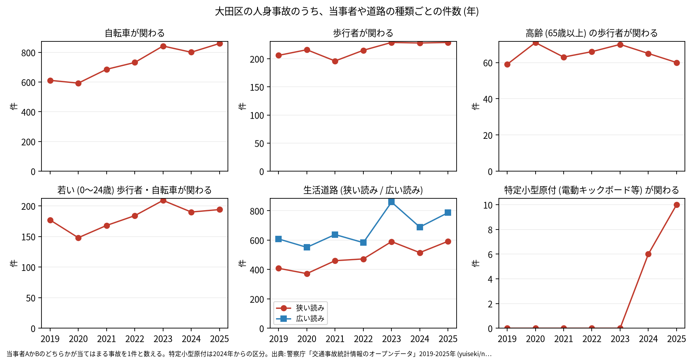

# 区の交通安全担当のための報告: 大田区の交通事故の傾向

## 問い

大田区の人身事故は 2019〜2025 年にどう推移し、23 区の中でどんな特徴があり、施策をどこに向ける材料になるか。

## 結論

- 件数: 7 年で 10,335 件、死者 72 人、負傷者 11,482 人です。2020 年は 1,279 件 (2019 年を 100 として 93.6) で、23 区全体 (83.7) ほどは下がりませんでした。その後は増え、2023 年は 1,621 件 (118.7)、2025 年は 1,637 件 (119.8) です。2025 年の 95% 区間 (1,558.7〜1,718.3 件) は 2019 年の区間 (1,294.5〜1,440.4 件) と重ならないので、2019 年より増えたと言えます。23 区全体の 2025 年は 101.6 で、2019 年とほぼ同じです。

- 年ごとに、区のコードで数えた件数と、点が区の面に入る件数の差は最大 4 件です ([analysis.json](../outputs/analysis.json))。増え方は、警察が区を付ける仕方の変化では説明できません。
- 23 区の中の位置: 自転車が関わる割合は 49.6% で 23 区の 6 位、生活道路 (狭い読み) の割合は 33.0% で 6 位、広い読みでも 45.6% で 6 位です。交差点内の割合は 45.3% で 5 位です。歩行者が関わる割合は 14.7% で 20 位、高齢の歩行者は 4.4% で 10 位、若い歩行者と自転車は 12.3% で 12 位でした。

- 施策への読み方: 2026-09-01 からの生活道路の法定速度 30 km/h は、大田区の事故のうち 33.0〜45.6% (読み方による) に当たります。件数の集まる地点は、大森の第一京浜、環七通り、池上通りの交差点です (地点は [道路安全診断の報告](road-safety-auditor.md))。これは効果の予測ではなく、どの道路で事故が起きているかの構成です。
- 区分ごとの推移: 自転車が関わる事故は 2019 年の 612 件から 2025 年の 860 件に増えました。特定小型原付 (電動キックボードなど) が関わる事故は、区分のできた 2024 年に 6 件、2025 年に 10 件でした。

- 死亡事故: 71 件で 72 人が亡くなりました。亡くなったのは歩行者 31 人、二輪車 18 人、自転車 12 人などです。亡くなった歩行者 31 人のうち 23 人が 65 歳以上でした。当事者 A (過失の重い側) が貨物車の事故が 31 件、19〜5 時台に起きた事故が 28 件です ([summary.txt](../outputs/summary.txt))。全件は [deaths.csv](../outputs/deaths.csv) にあります。
- 人口あたり: 2020 年の住民千人あたりの年の件数は 1.97 件で 23 区の 12 位ですが、分母に昼の人口、通過する車、空港の利用者が入らないため、区の比較の主な指標にしていません。

## データ

警察庁「交通事故統計情報のオープンデータ」を加工した `yuiseki/npa-traffic-accidents` 版 `389500a` の本票。大田区は `市区町村コード` 111 の 10,335 件、23 区は 144,716 件。年はファイルの年 (統計に計上された年)。区の人口は 2020 年国勢調査 (`jp-admin-2026-09` 版 `e6c87b1`)。詳しくは [共通の報告](../report.md)。

## 方法

区分は、当事者 A か B のどちらかが当てはまる事故を 1 件と数えました。生活道路は `車道幅員` で決め、狭い読み (5.5 m 未満の単路と、小と小の交差点) と、広い読み (5.5 m 未満の道とより広い道の交差点も含む) を並べました。年の区間は件数の Poisson の 95% 区間 (Garwood) です。23 区の順位は 7 年合計の割合の大きい順です。

## 確かめていないこと

- 2019 年から増えた理由 (自転車の利用、人口や交通の変化など) は調べていません。
- 区の施策 (ゾーン 30、自転車の通行帯など) の効果は推定していません。割合の順位は施策の評価ではありません。
- 重傷と軽傷の区別、物損事故は、このデータにありません。
