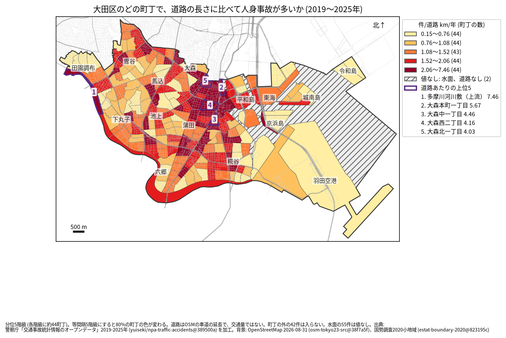
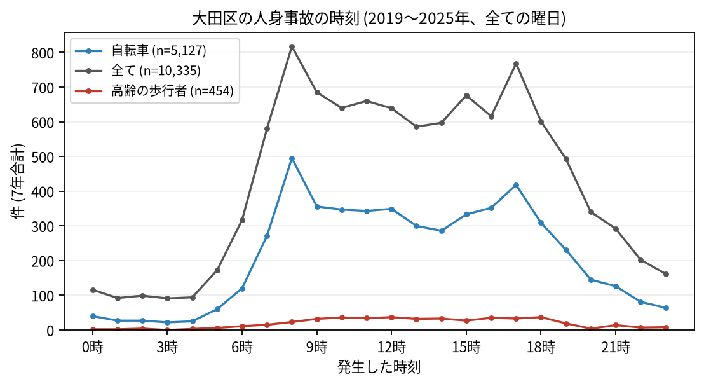

# 住民のための報告: 大田区で、いつ、どこで事故が起きているか

## 問い

大田区に住む人が、自分の町で、いつ、どんな事故に気をつければよいか。2019〜2025 年の警察記録の人身事故から調べました。

## 結論

- 大田区では 7 年で 10,335 件の人身事故があり、72 人が亡くなりました。年に 1,279〜1,637 件で、2019 年より増えています。
- 町ごと: 道路 1 km あたりの事故が多いのは、大森本町一丁目 (年 5.675 件)、大森中一丁目 (4.464 件)、大森西二丁目 (4.156 件)、大森北一丁目 (4.03 件) です。表の 1 位の多摩川河川敷（上流） (7.46 件) は、道路が 0.134 km と短く、7 件の事故で値が大きくなりました。件数そのものが最も多いのは大森西二丁目 (7 年で 218 件)、次が羽田空港三丁目 (189 件) でした ([towns.csv](../outputs/towns.csv))。

色は分位 5 階級で、各色に約 44 の町が入ります。等間隔の階級にすると 79.5% の町の色が変わるので、色の差より、自分の町が上の階級か下の階級かを見てください。

- 時間: 事故は朝 8 時台 (817 件) が最も多く、夕方 17 時台 (768 件) が次に多い時間です。自転車が関わる事故も 8 時台 (495 件) と 17 時台 (418 件) に多く、高齢の歩行者が関わる事故は 12 時台と 18 時台 (各 37 件) が最も多い時間でした ([summary.txt](../outputs/summary.txt))。

- 誰が: 自転車が関わる事故が全体の 49.6% で、最も多い区分です。自転車に乗る人は、車やトラックとの事故 (2,355 件) に加え、自転車だけの事故 (転倒や物への衝突、1,343 件) にも気をつけてください。歩行者が関わる事故は 14.7% です。
- 亡くなった人: 72 人のうち 31 人が歩行者で、そのうち 23 人が 65 歳以上でした。死亡事故の 28 件は 19〜5 時台に起きています。暗い時間に大通りを渡るときは特に注意が要ります。

## データ

警察庁「交通事故統計情報のオープンデータ」を加工した `yuiseki/npa-traffic-accidents` 版 `389500a` の本票、大田区の 10,335 件 (2019〜2025 年のファイル)。町の境界は 2020 年国勢調査の小地域 (221 単位)、道路は OpenStreetMap 2026-08-31。詳しくは [共通の報告](../report.md)。

## 方法

事故の地点を町丁の境界に入れて数え、町丁の中の車道の長さ (OSM) と 7 年で割りました。区の境界の近くで町丁の外に落ちた 42 件は町の値に入っていません。羽田沖の水面調査区に落ちた 55 件 ([analysis.json](../outputs/analysis.json)) は数えましたが、町ではないので値を付けていません。時刻は事故の起きた時で、7 年の合計です。

## 確かめていないこと

- 道路の長さは、通る車や人の数ではありません。大森の値が高いのは、人と車が多いためかもしれません。
- 自分の町の事故が少なくても、物損事故やヒヤリハットはこのデータにありません。
- 事故の位置の精度は分かりません。町の境界の近くの事故は、隣の町に数えられている可能性があります。
