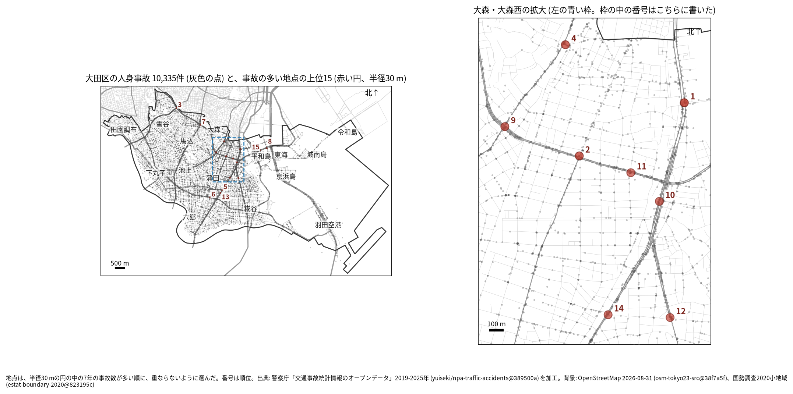
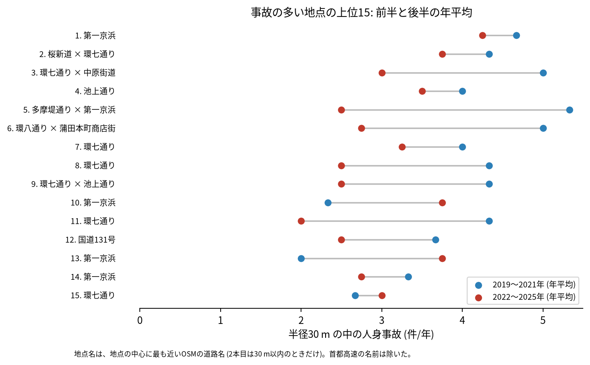
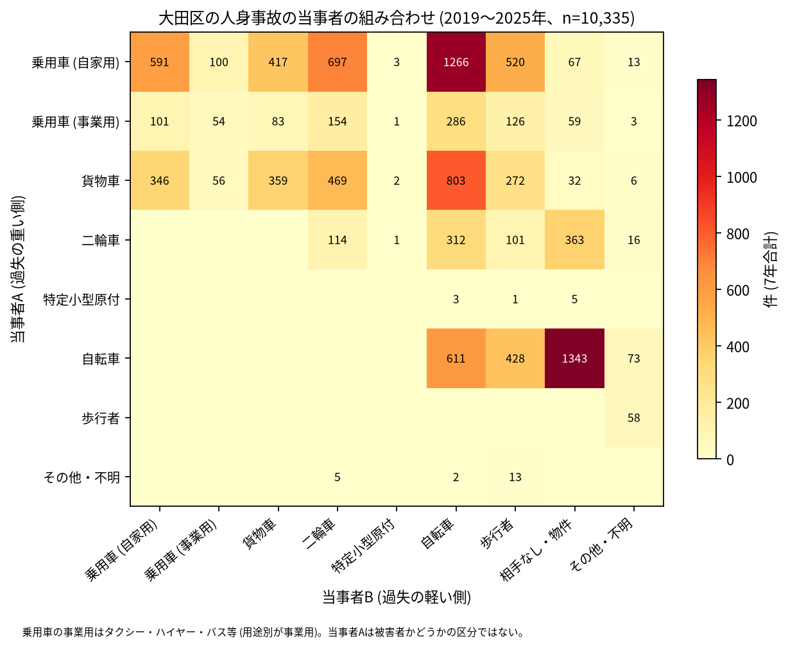

# 道路安全診断のための報告: 大田区で事故の集まる地点

## 問い

大田区で 2019〜2025 年の人身事故が集まる地点はどこで、そこでは誰と誰の事故が多いか。現地診断の候補を選ぶ材料にします。

## 結論

- 半径 30 m の円の中の 7 年の件数で選んだ上位 15 地点は、20〜31 件です。15 のうち 8 は大森の周り (大森本町、大森西、大森北、大森東、大森中と、隣の中央二丁目。第一京浜、環七通り、池上通り、国道 131 号) にあり、地図の右の拡大図に入れました。ほかは蒲田 (第一京浜、環八通り)、上池台と南馬込 (環七通り)、東海と平和島 (環七通り) です。

| 順位 | 近い道路 (OSM) | 町丁 | 件数 | 前半 件/年 | 後半 件/年 | 交差点内 | 信号あり | 多い組み合わせ (A × B) |
|---:|---|---|---:|---:|---:|---:|---:|---|
| 1 | 第一京浜 | 大森本町一丁目 | 31 | 4.67 | 4.25 | 21 | 25 | 自転車 × 相手なし・物件 |
| 2 | 桜新道 × 環七通り | 大森西二丁目 | 28 | 4.33 | 3.75 | 22 | 25 | 乗用車 (自家用) × 自転車 |
| 3 | 環七通り × 中原街道 | 上池台一丁目 | 27 | 5.00 | 3.00 | 24 | 24 | 貨物車 × 自転車 |
| 4 | 池上通り | 大森北一丁目 | 26 | 4.00 | 3.50 | 13 | 11 | 自転車 × 相手なし・物件 |
| 5 | 多摩堤通り × 第一京浜 | 東蒲田二丁目 | 26 | 5.33 | 2.50 | 19 | 23 | 乗用車 (自家用) × 自転車 |
| 6 | 環八通り × 蒲田本町商店街 | 蒲田本町一丁目 | 26 | 5.00 | 2.75 | 19 | 20 | 乗用車 (自家用) × 二輪車 |
| 7 | 環七通り | 南馬込一丁目 | 25 | 4.00 | 3.25 | 19 | 3 | 乗用車 (自家用) × 貨物車 |
| 8 | 環七通り | 東海二丁目 | 23 | 4.33 | 2.50 | 17 | 0 | 貨物車 × 自転車 |
| 9 | 環七通り × 池上通り | 中央二丁目 | 23 | 4.33 | 2.50 | 15 | 20 | 貨物車 × 二輪車 |
| 10 | 第一京浜 | 大森西二丁目 | 22 | 2.33 | 3.75 | 12 | 18 | 乗用車 (自家用) × 自転車 |

前半は 2019〜2021 年、後半は 2022〜2025 年。11〜15 位と、歩行者、自転車、夜の件数は [hotspots.csv](../outputs/hotspots.csv) にあります。道路名は地点の中心に最も近い OSM の道路名で、2 本目は 1 本目と交わる向き (30 度以上) の道のうち最も近いもので、30 m 以内のときだけ書きました (首都高速の名前は除いた)。2 本目を書いていない地点は、交わる道の名前が 30 m より遠いか、名前の無い道です。

- 続いているか: 上位 15 は全て前半と後半の両方に事故があります。5 位 (5.33 から 2.50 件/年)、6 位 (5.00 から 2.75 件/年)、11 位 (4.33 から 2.00 件/年)、3 位 (5.00 から 3.00 件/年) は後半に減り、13 位 (2.00 から 3.75 件/年) と 10 位 (2.33 から 3.75 件/年) は増えました。上位は 7 年合計で選んだので、後半が下がって見えやすい (平均への回帰) ことに注意してください。

- 大森西二丁目には 2 位、10 位、11 位の 3 地点があります。10 位と 11 位は第一京浜と環七通りの近くで、2 本の道の交わる所の事故が 2 つの円に分かれている可能性があります。
- 組み合わせ: 当事者 A が乗用車か貨物車で B が自転車の事故は 2,355 件です。自転車の単独 (相手なし・物件) が 1,343 件、自転車どうしが 611 件、自転車と歩行者 (自転車が A) が 428 件ありました。上位 1〜3 位の多い組み合わせには、どれも自転車が入ります。事業用の乗用車 (タクシー、ハイヤー、バスなど) は 867 件で当事者 A です ([summary.txt](../outputs/summary.txt))。

- 半径と首都高速を変えると: 20 m の上位 15 の中心が、30 m の上位 15 の中心から 30 m 以内にあるのは 12 地点、50 m では 10 地点でした。首都高速 (1 号羽田線、湾岸線など) の事故 216 件を除いても 15 地点とも残り、上位 15 の円の中に首都高速の事故は 0 件でした ([analysis.json](../outputs/analysis.json))。上位の地点は地上の道路の事故で、高架の事故は混ざっていません。

## データ

警察庁「交通事故統計情報のオープンデータ」を加工した `yuiseki/npa-traffic-accidents` 版 `389500a` の本票、大田区 (`市区町村コード` 111) の 10,335 件。道路名は OpenStreetMap 2026-08-31 (`osm-tokyo23-src-2026-08` 版 `38f7a5f`)。詳しくは [共通の報告](../report.md)。

## 方法

事故の点を EPSG:6677 (メートル) に変換し、半径 30 m の円の中の件数が最も多い事故の点を中心に選び、その円の事故を除いて次を選ぶ手順を 15 回くり返しました。30 m はコード表の「交差点付近」(交差点の側端から 30 m 以内) の幅です。首都高速を除いた読みは `路線コード` 5000〜5499 の事故を除いて同じ手順で選びました。信号ありは `信号機` が 3 灯式、押ボタン式、歩車分式の点灯。組み合わせは当事者 A (過失の重い側) と B の種別で、乗用車は `用途別` で事業用と自家用に分けました。

## 確かめていないこと

- 交通量で割っていません。件数の多い交差点が、車の多さに比べて危険かは分かりません。
- 事故の型 (出会い頭、右折、追突)、違反の種類、重傷と軽傷の区別は、このデータにありません。現地で確かめてください。
- 位置の精度は分かりません。数十 m のずれで地点の件数は変わります。
- 7 位と 8 位は信号ありが少ない (3 件、0 件) のに交差点内が多い地点です。環七通りの立体交差や側道の事故かもしれませんが、地点ごとには確かめていません。
- 偶然でもこの程度の集まりが生まれるか (順位の有意さ) は調べていません。
