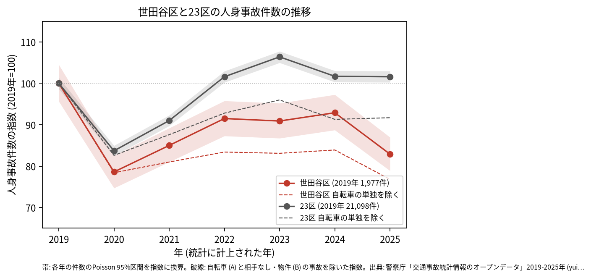
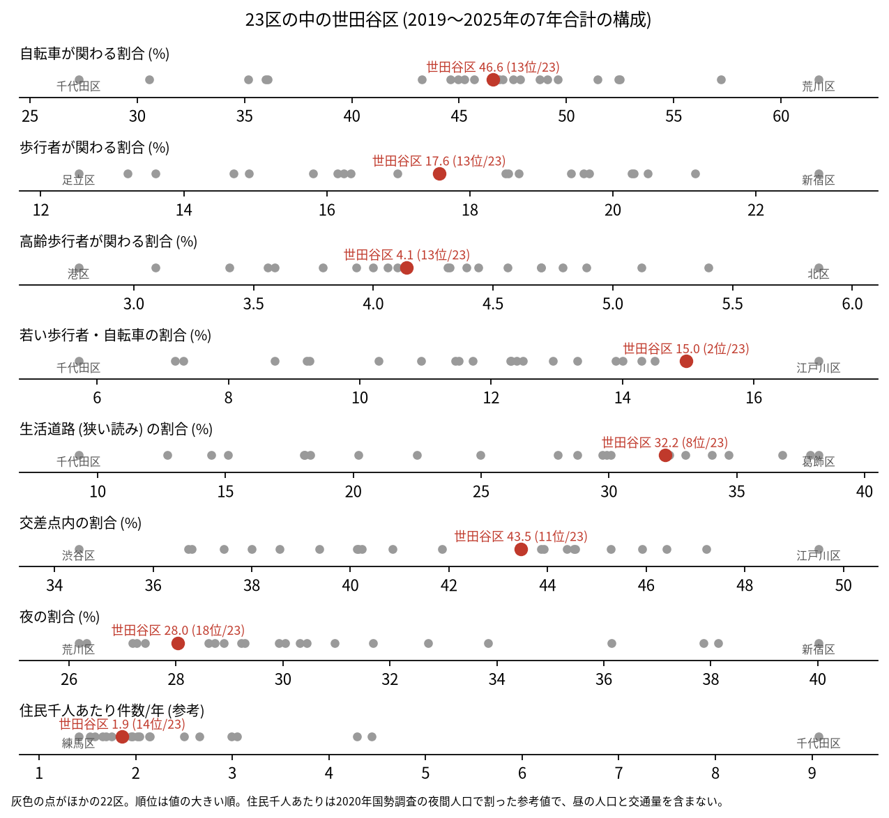
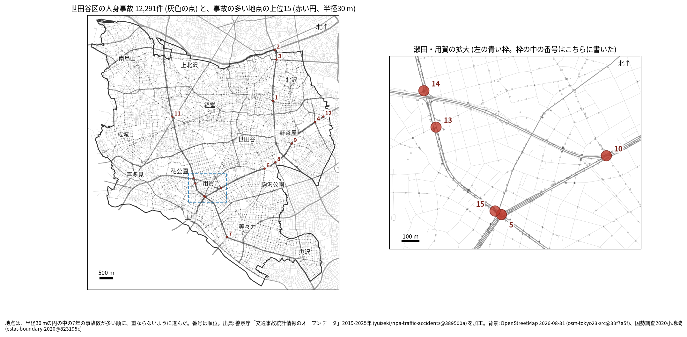
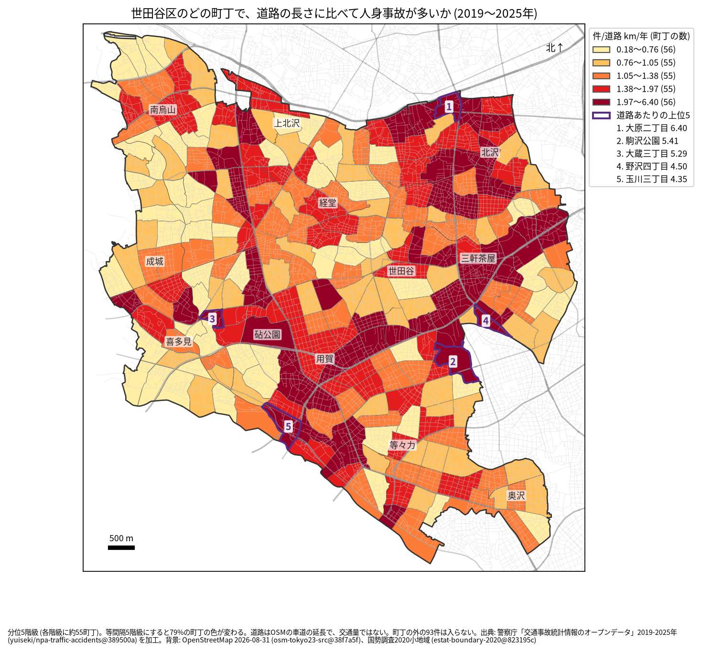
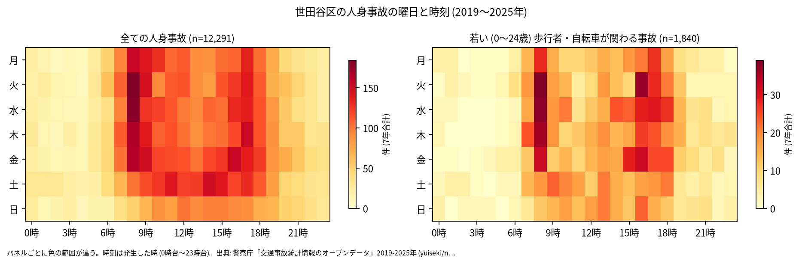
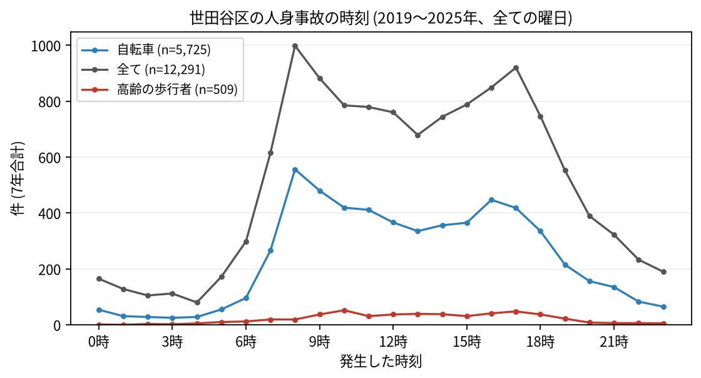
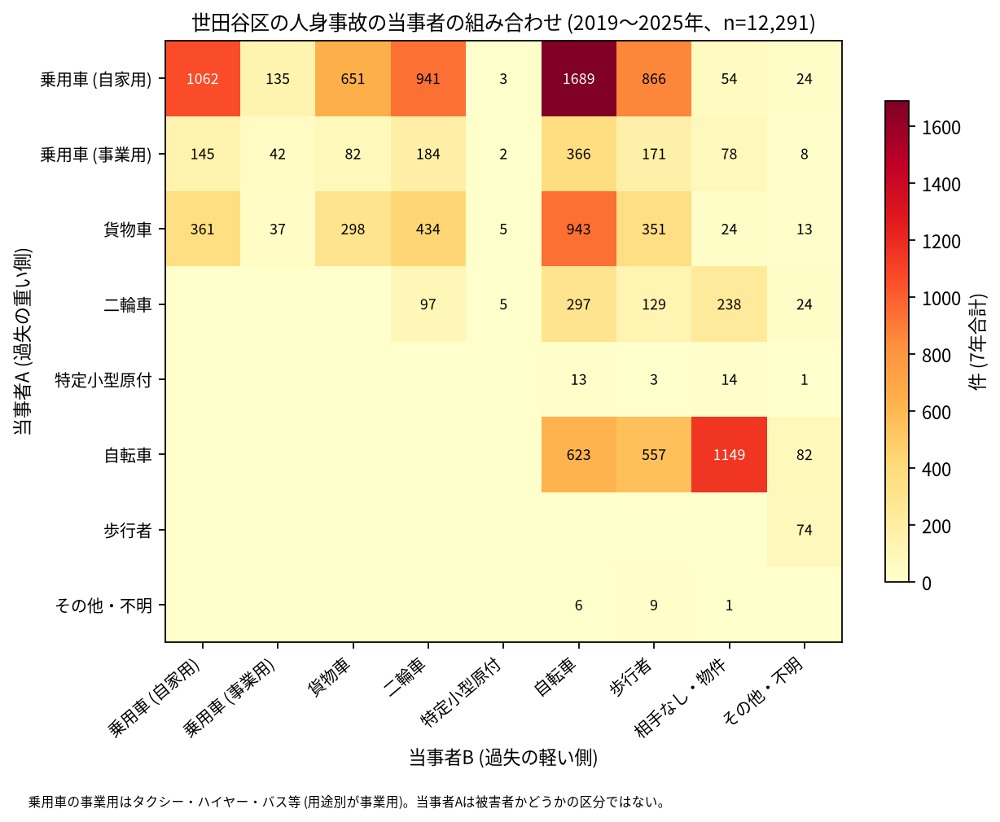

# 世田谷区の交通事故 2019〜2025 年: 図で読む要点

## 問い

2019〜2025 年の警察記録の人身事故で、世田谷区の事故はいつ、どこで、誰が関わって起きているか。

## 結論

### 要点

| # | 要点 | 数字 | 図 |
|---:|---|---|---|
| 1 | 件数は 2020 年に減り、2024 年まで戻りきらず、2025 年は 2019 年より減った。23 区全体は 2022 年に 2019 年の水準へ戻った | 7 年で 12,291 件、死者 52 人、負傷者 13,747 人。指数 (2019 年=100) は 2020 年 78.6、2025 年 82.9 (23 区は 101.6) ([yearly.csv](outputs/yearly.csv)、[summary.txt](outputs/summary.txt)) | [図 1](#図-1-件数の推移) |
| 2 | 若い歩行者と自転車の関わる事故の割合が 23 区で高く、生活道路の割合は中ほどより上 | 若い (0〜24 歳) 歩行者・自転車 15.0% (23 区の 2 位)、生活道路 狭い読み 32.2% (8 位)、交差点内 43.5% (11 位) ([wards.csv](outputs/wards.csv)、[analysis.json](outputs/analysis.json)) | [図 2](#図-2-23-区の中の世田谷区) |
| 3 | 集まる場所は環七通りと環八通りの交差点と、玉川通りの沿道 | 事故の多い地点の上位 15 のうち、最も近い道が環八通りの地点が 6、環七通りが 3。道路あたりの上位は大原二丁目 (6.404 件/道路 km/年) ([hotspots.csv](outputs/hotspots.csv)、[towns.csv](outputs/towns.csv)、[summary.txt](outputs/summary.txt)) | [図 3](#図-3-事故の集まる地点)、[図 4](#図-4-町丁ごとの事故) |
| 4 | 事故の半分に自転車が関わる | 46.6%。車やトラックが当事者 A で自転車が B の事故が 2,998 件、自転車の単独 (相手なし・物件) が 1,149 件 ([summary.txt](outputs/summary.txt)) | [図 6](#図-6-誰と誰の事故か) |
| 5 | 死亡事故は歩行者と貨物車に偏る | 50 件で 52 人。亡くなった人の種別で歩行者が 24 件 (65 歳以上が 10 人)。当事者 A が貨物車の事故が 21 件、0〜5 時台が 12 件 ([summary.txt](outputs/summary.txt)) | [表 1](#表-1-死亡事故) |

### 読み手ごとに知るべきこと

| 読み手 | 結論 | 検討する材料 | 詳しく |
|---|---|---|---|
| 区の交通安全担当 | 生活道路の法定速度 30 km/h (2026-09-01 から) が当たるのは事故の 32.2〜43.4% (読み方による)。若い歩行者と自転車の割合が 23 区で 2 位 | 環七と環八の交差点、生活道路、若い自転車、貨物車と歩行者の死亡事故 | [municipality.md](reports/municipality.md) |
| 学校と PTA | 若い (0〜24 歳) 歩行者と自転車の事故は 1,840 件。最も多いのは 8 時台 (203 件) で、次が 16 時台 (185 件)。朝の登校の時間にも多い | 学校の円の中で、平日 7〜8 時台と 14〜17 時台の点が並ぶ道 | [school-pta.md](reports/school-pta.md) |
| 道路安全診断 | 上位は環七通り × 梅丘通り (59 件)、環七通り × 甲州街道 (55 件)、環七通り × 井ノ頭通り (43 件)。瀬田・用賀の環八通りと玉川通りに 5 地点が集まる | 後半に増えた 10 位と 15 位、前半より減った 4 位、高速道路の高架の下の地点 | [road-safety-auditor.md](reports/road-safety-auditor.md) |
| 住民 | 道路あたりで多いのは大原二丁目 (年 6.404 件/道路 km)、駒沢公園 (5.406 件)、大蔵三丁目 (5.295 件)。朝 8 時台と夕方 17 時台が山 | 自分の町の色、朝の自転車、自転車の単独事故 | [resident.md](reports/resident.md) |

### 図 1: 件数の推移

2020 年の落ち込み (78.6) は 23 区全体 (83.7) より深い。23 区は 2022 年に 101.6 まで戻ったが、世田谷区は 2024 年の 92.9 が最も高い。2025 年の 95% 区間 (1,559.6〜1,719.3 件) は 2019 年 (1,890.8〜2,066.1 件) と重ならないので、2025 年は 2019 年より減ったと書ける。2024 年の区間 (1,753.9〜1,923.0 件) は 2019 年と重なる。図の凡例は、世田谷区の破線の 2025 年の端 (76.8) を隠している。

### 図 2: 23 区の中の世田谷区

赤い点が世田谷区。若い歩行者・自転車 (2 位) と生活道路 (8 位) が高く、夜 (28.0%、18 位) が低い。自転車 (46.6%)、歩行者 (17.6%)、高齢の歩行者 (4.1%) はどれも 13 位で中ほど。住民千人あたり (1.86 件/年、14 位) は昼の人口を含まない参考値。

### 図 3: 事故の集まる地点

半径 30 m の円の中の 7 年の件数で選んだ上位 15 (28〜59 件)。番号は順位で、瀬田・用賀の 5 地点は右の拡大図に番号を書いた。

| 順位 | 近い道路 (OSM) | 町丁 | 件数 | 前半 件/年 | 後半 件/年 |
|---:|---|---|---:|---:|---:|
| 1 | 環七通り × 梅丘通り | 代田三丁目 | 59 | 9.33 | 7.75 |
| 2 | 環七通り × 甲州街道 | 大原二丁目 | 55 | 9.33 | 6.75 |
| 3 | 環七通り × 井ノ頭通り | 大原二丁目 | 43 | 5.67 | 6.5 |
| 4 | 鮫洲大山線 × 玉川通り | 池尻三丁目 | 36 | 7.0 | 3.75 |
| 5 | 環八通り × 玉川通り | 瀬田二丁目 | 35 | 4.33 | 5.5 |

前半は 2019〜2021 年、後半は 2022〜2025 年。1 位の 2 本目の名前は、OSM では「梅丘通り;主要生活道路405号線」と 2 つの名前を並べた値で、ここでは前の名前だけを書いた。半径を 20 m にすると上位 15 のうち 12 地点、50 m では 14 地点が残る。6〜15 位は [hotspots.csv](outputs/hotspots.csv)。

### 図 4: 町丁ごとの事故

町丁の事故数を、OSM の車道の延長と 7 年で割った値。紫の枠が上位 5 (大原二丁目、駒沢公園、大蔵三丁目、野沢四丁目、玉川三丁目)。駒沢公園は人口 1 人の公園の町丁で、値は道路 1.295 km の上の 49 件による。分位と等間隔で 79% の町丁の色が変わるので、色の細かい差は読まない。道路の長さは交通量ではない。

### 図 5: いつ起きるか

全体は平日の朝 8 時台 (7 年で 998 件) と夕方 17 時台 (920 件) に山がある。若い歩行者と自転車は 8 時台 (203 件) が最多で、次が 16 時台 (185 件)。

自転車は 8 時台 (556 件) と 9 時台 (480 件)、高齢の歩行者は 10 時台 (52 件) が最多。

### 図 6: 誰と誰の事故か

最も多いのは自家用の乗用車 (A) と自転車 (B) の 1,689 件、次が自転車の単独 (相手なし・物件) の 1,149 件、自家用の乗用車どうしの 1,062 件。当事者 A は過失の重い側で、被害者とは限らない。

### 表 1: 死亡事故

| 亡くなった人 | 件数 | 特徴 |
|---|---:|---|
| 歩行者 | 24 | 65 歳以上が 10 人 |
| 二輪車 | 11 | ほかに二輪車どうしで 2 人が亡くなった事故が 1 件 |
| 自転車 | 9 | |
| 補充票の人 | 5 | 当事者 A と B のどちらでもない人 |

50 件のうち、当事者 A が貨物車の事故が 21 件、0〜5 時台が 12 件で、高速道路の死亡事故は無い ([summary.txt](outputs/summary.txt))。全件は [deaths.csv](outputs/deaths.csv)。

### 読み方で変わる答え

| 読み方 | 主 | 別の読み方 |
|---|---|---|
| 世田谷区の事故 | `市区町村コード` 112 の 12,291 件 | 点が区の面に入る事故。両方に当てはまるのは 12,198 件 |
| 生活道路 | 狭い読み 32.2% (8 位) | 広い読み 43.4% (9 位) |
| 件数の推移 | 全ての人身事故 | 自転車 (A) と相手なし・物件 (B) の事故を除くと、2025 年の指数は世田谷区 76.8、23 区 91.7。この事故は世田谷区で 2019 年 78 件から 2025 年 179 件 ([yearly.csv](outputs/yearly.csv)、[analysis.json](outputs/analysis.json)) |
| 地点の半径 | 30 m | 20 m で 12 地点、50 m で 14 地点が残る |
| 高速道路の事故 | 含める | 除くと 14 地点が残る。高速道路の事故は区で 220 件 (首都高速 132 件、高速自動車国道 88 件)、上位 15 の円には 7 件 ([analysis.json](outputs/analysis.json)、[summary.txt](outputs/summary.txt)) |
| 町丁の階級 | 分位 5 階級 | 等間隔で 79% の町丁の色が変わる |

高速道路の事故が載る町丁は 30 あり、多いのは砧公園 (24 件)、喜多見三丁目 (16 件)、上馬二丁目 (14 件)、大蔵五丁目 (14 件) ([towns.csv](outputs/towns.csv))。計画に書いた外の知識 (東名は砧と大蔵、首都高速 3 号渋谷線は池尻から用賀の玉川通りの上、中央道は烏山) と場所は合うが、町丁ごとに首都高速と高速自動車国道を分けては数えていない。

## データ

- 人身事故: 警察庁「交通事故統計情報のオープンデータ」を加工した `yuiseki/npa-traffic-accidents` 版 `389500aae5cec45f1311163f70db6a5f05867838` (配布元の取得 2026-10-02) の本票。年はファイルの年 (統計に計上された年)。世田谷区 12,291 件、23 区 144,716 件。位置の無い行は 0。物損事故は含まない。
- 区の面と人口: `yuiseki/jp-admin-2026-09` 版 `e6c87b1`。町丁: 2020 年国勢調査の小地域 `yuiseki/estat-boundary-2020` 版 `823195c` (277 町丁、943,664 人)。学校 108 校と道路: OpenStreetMap 2026-08-31、`yuiseki/osm-tokyo23-src-2026-08` 版 `38f7a5f`。
- 道具: DuckDB 2.0.0 (spatial)、matplotlib、`analysis-visualize` の `cjk_font.py`、`classify_map.py`、`context_map.py`。スクリプトは台東区の型 (2026-11-03 の版) の写し。
- 出典の表示: 警察庁ウェブサイト (https://www.npa.go.jp/publications/statistics/koutsuu/opendata/index_opendata.html) の交通事故統計情報のオープンデータを加工して作成。国勢調査の小地域境界と人口、OpenStreetMap (© OpenStreetMap contributors) を加工して使用。

## 方法

- 読み方は結果を見る前に [計画](EXPERIMENT_PLAN.md) で固定し、実行は [記録](EXPERIMENT_TRACKER.md) に残した。読み方、区画、判断の規則は台東区と同じ。生活道路は `車道幅員` が 01、02、11 (狭い読み)、広い読みは 14、17 を足す。歩行者や自転車が関わるかは当事者 A と B の両方で見て、1 件を 1 回数えた。
- 年齢はデータの年齢層で読む。若い人は 01 (0〜24 歳)、高齢の人は 65 (65〜74 歳) と 75 (75 歳以上)。
- 高速道路は `路線コード` 4000〜5499 (高速自動車国道と首都高速)。
- 距離は EPSG:6677 (メートル) で測った。町丁の道路あたりの上位 5 には、道路が 0.5 km より短い町丁を数えない (世田谷区には無い)。地点は、半径 30 m の中の件数が最も多い点を中心に選び、その円の事故を除いて次を選ぶ手順を 15 回くり返した。地点の名前は、中心に最も近い道と、それと 30 度以上の向きで交わる道のうち最も近い道で、どちらも 30 m 以内のときだけ書く。
- 地図は `analysis-visualize` の map-context に合わせ、地名と道路を重ね、凡例を地図の外に置き、強調した単位に番号を付けた。描いた町丁の数 (277) を分析の数と照らし、文字の重なりと、地名や番号が円や学校の印を隠す重なりは、3 枚の地図で 0 件 (地名 3 つと拡大図の番号 2 つの位置を直した後)。背景の道路 (OGC:CRS84) と町丁 (JGD2000) の差は、線の幅より小さいとして変換せずに重ねた。
- 関門: 予測と回帰をしないので、評価の分け方と残差の確認は要らない。単位の間の相関を結論にしないので、Moran's I と格子の掃引は省いた。推移は 23 区全体を基準にし、年の件数に Poisson の 95% 区間を付けた。対策の効果は推定していない。
- 再実行は [README.md](README.md)。数値は [outputs/](outputs/) の CSV、来歴は [analysis.json](outputs/analysis.json)。

## 確かめていないこと

- 交通量、昼の人口、区を通る車の数で割っていない。環七と環八の交差点の件数の多さは、車の多さかもしれない。
- 位置の精度は分からない。30 m の地点と町丁の境界の近くの事故は、数十 m のずれで入れ替わる。高速道路の事故は高架の下の道と同じ位置に載る。
- 事故の型 (出会い頭、追突)、重傷と軽傷の区別、物損事故、ヒヤリハットは、このデータに無い。
- 0〜24 歳より細かい年齢は無く、小学生だけは数えられない。若い人の割合が高い理由 (大学や高校の多さなど) は調べていない。
- 地点の上位は 7 年で選び、同じ 7 年で前半と後半を比べたので、後半が下がって見えやすい (平均への回帰)。
