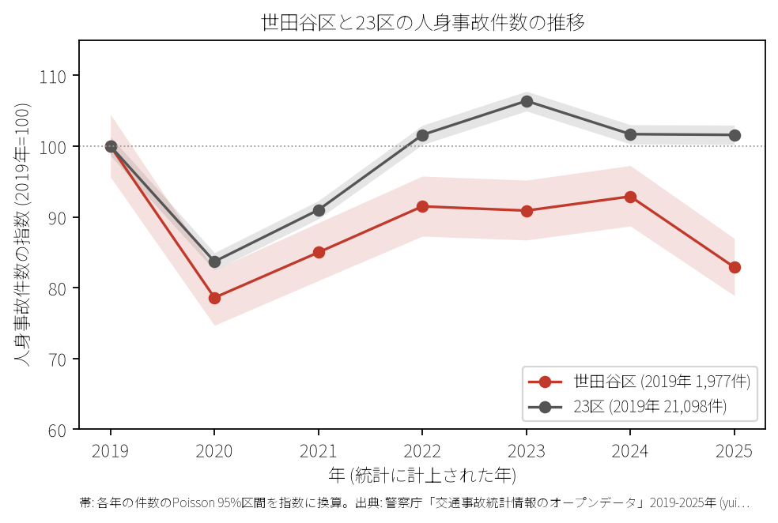
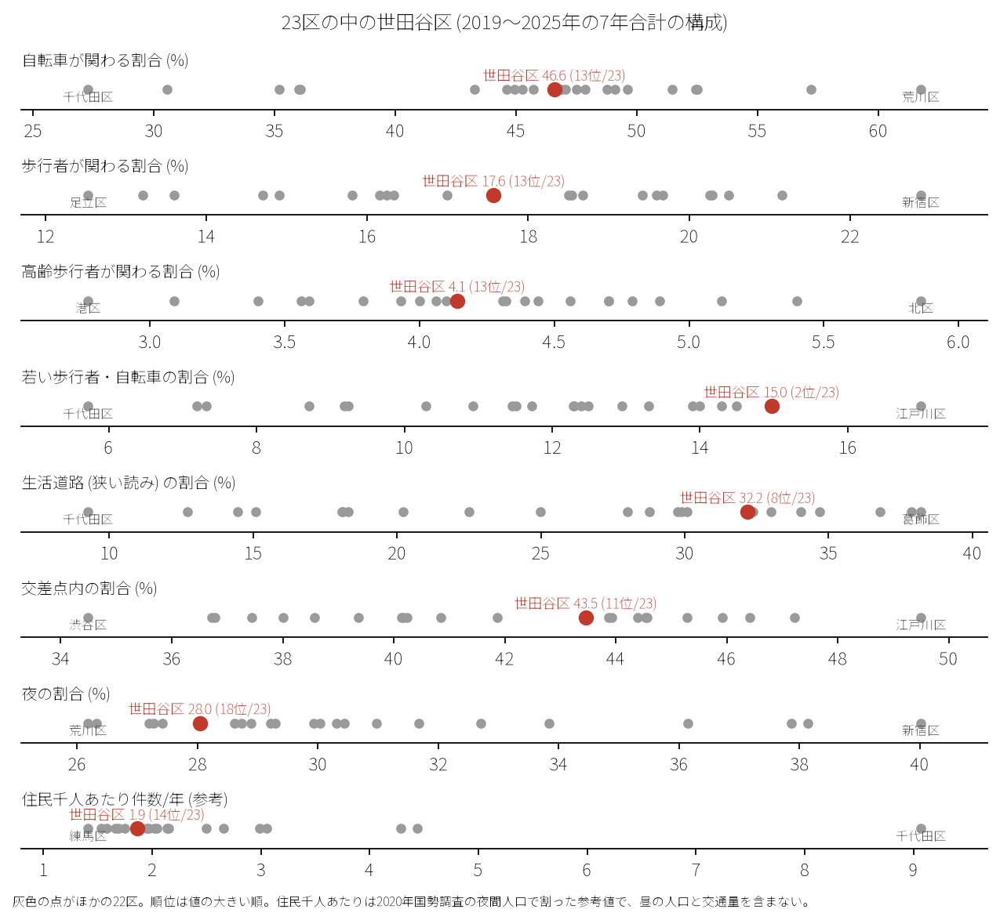
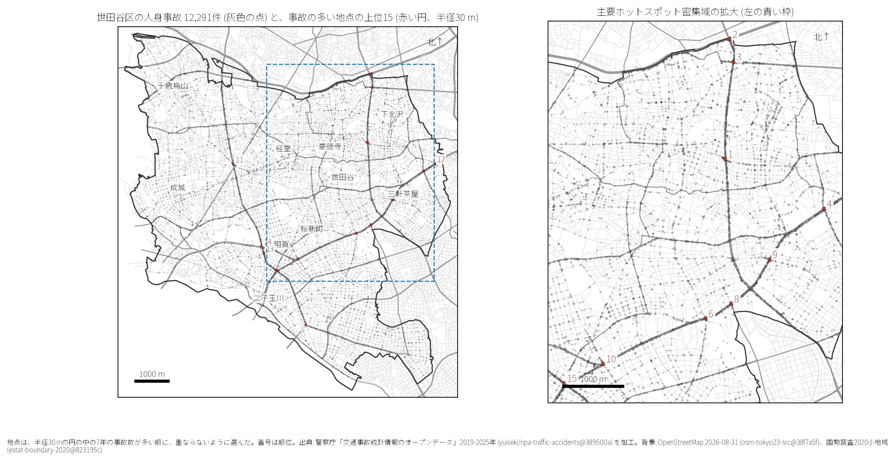
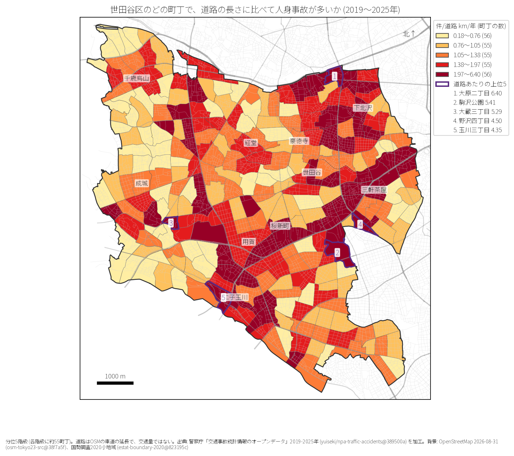
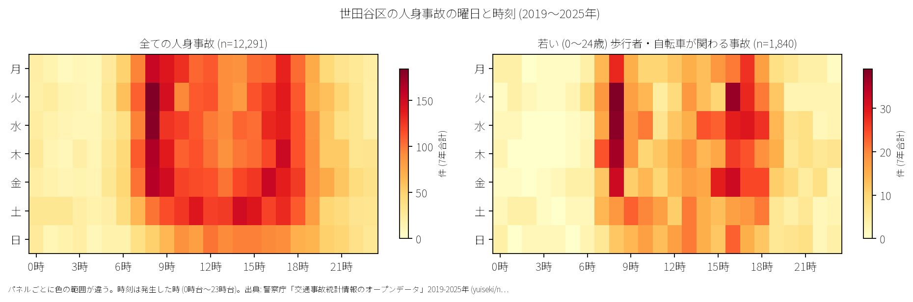
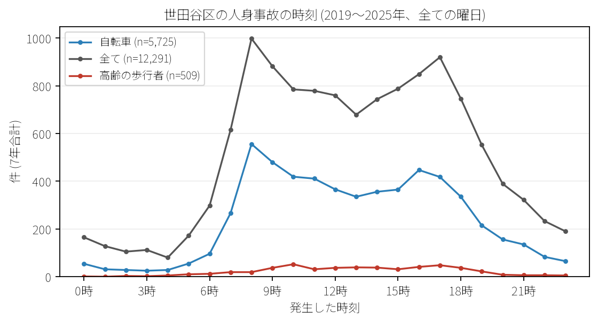
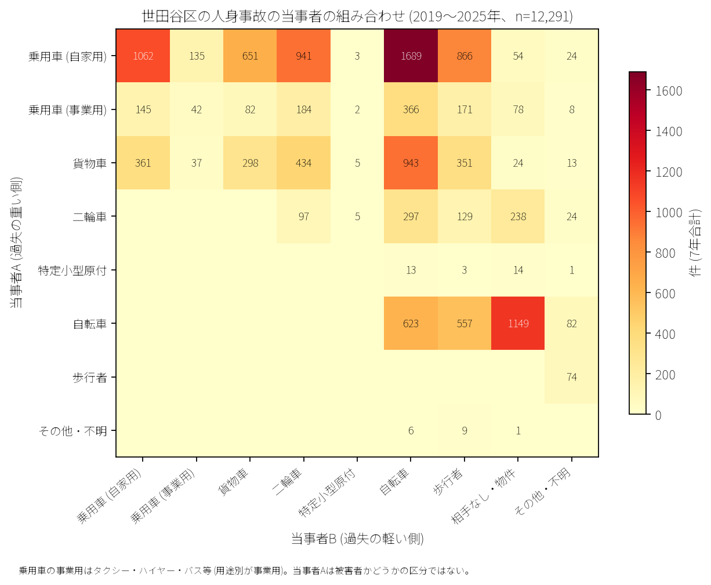

# 世田谷区の交通事故 2019〜2025 年: 図で読む要点

## 問い

2019〜2025 年の警察記録の人身事故で、世田谷区の事故はいつ、どこで、誰が関わって起きているか。

## 結論

### 要点

| # | 要点 | 数字 | 図 |
|---:|---|---|---|
| 1 | 件数は 2020 年に大きく減少し、その後も低水準で推移 | 7 年で 12,291 件、死者 52 人、負傷者 13747 人。指数 (2019 年=100) は 2020 年 78.6、2025 年 82.9 | [図 1](#図-1-件数の推移) |
| 2 | 若い歩行者・自転車事故割合が 23 区中 2 位と高く、住宅地・生活道路型が顕著 | 若い歩行者・自転車割合 15.0% (23 区中 2 位)。生活道路 (狭い読み) 32.2% (8 位)、広い読み 43.4% (9 位)。自転車関与 46.6% (13 位) | [図 2](#図-2-23-区の中の世田谷区) |
| 3 | 集まる場所は環七通り・環八通り・甲州街道・玉川通りの主要結節点 | 事故多発地点 1 位は環七通り×梅丘通り (代田三丁目、59 件)、2 位は環七通り×甲州街道 (大原二丁目、55 件) | [図 3](#図-3-事故の集まる地点)、[図 4](#図-4-町丁ごとの事故) |
| 4 | 自転車事故が全体の約半数を占め、自動車×自転車および単独事故が多発 | 乗用車（自家用）×自転車が 1,689 件、自転車単独が 1,149 件、乗用車×乗用車が 1,062 件、貨物車×自転車が 943 件 | [図 6](#図-6-誰と誰の事故か) |
| 5 | 死亡事故は歩行者横断中および二輪車に集中 | 死者 52 人のうち歩行者 24 人 (65 歳以上が 10 人)、二輪車 11 人、自転車 9 人。当事者 A が貨物車の事故が 21 件 | [表 1](#表-1-死亡事故) |

### 読み手ごとに知るべきこと

| 読み手 | 結論 | 検討する材料 | 詳しく |
|---|---|---|---|
| 区の交通安全担当 | 生活道路 30 km/h 規制の対象となる事故は 32.2〜43.4% と都心区に比べ格段に高い。環七・環八・幹線と住宅街の接続部対策が重要 | 環七通り、環八通り、甲州街道、玉川通り、生活道路 | [municipality.md](reports/municipality.md) |
| 学校と PTA | 若い (0〜24 歳) 歩行者・自転車の事故は 1,840 件 (23 区 2 位)。朝 8 時台 (203 件) と夕方 16〜17 時台に通学ピーク | 小中学校 108 校周辺 500 m 圏内と生活道路交差点 | [school-pta.md](reports/school-pta.md) |
| 道路安全診断 | 上位は環七通り×梅丘通り (59 件)、環七通り×甲州街道 (55 件)、環七通り×井ノ頭通り (43 件)。環状道路と放射道路の交差点 | 多車線右折交錯、横断歩道巻き込み防止、自転車レーン接続 | [road-safety-auditor.md](reports/road-safety-auditor.md) |
| 住民・来訪者 | 道路延長あたり事故率は大原二丁目 (年 6.40 件/道路 km)、駒沢公園 (5.41 件)、大蔵三丁目 (5.30 件) が上位。朝 8 時台・夕方 17 時台にピーク | 住宅街の抜け道・交差点での一時停止、自転車の安全利用 | [resident.md](reports/resident.md) |

### 図 1: 件数の推移

2019 年の 1,977 件から 2020 年は 1,553 件（指数 78.6）へ減少し、2025 年は 1,638 件（指数 82.9）と 23 区全体（101.6）を下回る水準を維持しています。

### 図 2: 23 区の中の世田谷区

赤い点が世田谷区。若い歩行者・自転車の割合（15.0%）は **23 区中第 2 位** と都内有数の住宅都市としての特徴を示します。生活道路割合（32.2%、8 位）、広い読み（43.4%、9 位）も都心区（千代田区の 9.3% 等）に比べ非常に高くなっています。住民千人あたり年間事故件数は 1.86 件（14 位）です。

### 図 3: 事故の集まる地点

半径 30 m の円で選定した事故多発地点上位 15 です。

| 順位 | 交差点 / 近い道路 (OSM) | 町丁 | 件数 | 前半 件/年 | 後半 件/年 |
|---:|---|---|---:|---:|---:|
| 1 | 環七通り × 梅丘通り | 代田三丁目 | 59 | 9.33 | 7.75 |
| 2 | 環七通り × 甲州街道 | 大原二丁目 | 55 | 9.33 | 6.75 |
| 3 | 環七通り × 井ノ頭通り | 大原二丁目 | 43 | 5.67 | 6.50 |
| 4 | 鮫洲大山線 × 玉川通り | 池尻三丁目 | 36 | 7.00 | 3.75 |
| 5 | 環八通り × 玉川通り (瀬田) | 瀬田二丁目 | 35 | 4.33 | 5.50 |

前半は 2019〜2021 年、後半は 2022〜2025 年。環七通り・環八通り沿いの主要交差点に集中しています。

### 図 4: 町丁ごとの事故

町丁内の事故件数を OSM 車道延長と 7 年で割った事故密度 (件/道路 km/年) です。上位 5 町丁は大原二丁目 (6.40 件)、駒沢公園 (5.41 件)、大蔵三丁目 (5.30 件)、野沢四丁目 (4.50 件)、玉川三丁目 (4.35 件) です。

### 図 5: いつ起きるか

朝の通勤・通学時間帯（8 時台 998 件）と夕方の帰宅時間帯（17 時台 920 件）に明瞭な 2 つの山があります。

自転車事故は朝 8 時台（556 件）が最多で、高齢歩行者は日中 10 時台（52 件）や 17 時台（48 件）に多く発生しています。

### 図 6: 誰と誰の事故か

自家用乗用車×自転車が 1,689 件で突出して多く、自転車単独（1,149 件）、自家用乗用車同士（1,062 件）、貨物車×自転車（943 件）が続きます。

### 表 1: 死亡事故

7 年間で発生した 50 件の死亡事故の内訳 (死者 52 人)：

| 亡くなった当事者 | 人数 | 主な傾向 |
|---|---:|---|
| 歩行者 | 24 | 横断歩道および車道横断中事故 (65 歳以上が 10 人) |
| 二輪車 (バイク) | 11 | 幹線道路交差点での右直事故・単独衝突 |
| 自転車 | 9 | 出会い頭・巻き込み事故 |
| 補充票の人 (同乗者等) | 5 | 車両衝突時の同乗者死亡 |

当事者 A（過失の重い側）が貨物車の事故が 21 件、自家用乗用車が 17 件です。

## データ

- 人身事故: 警察庁「交通事故統計情報のオープンデータ」を加工した `yuiseki/npa-traffic-accidents` 版 `389500aae5cec45f1311163f70db6a5f05867838` の本票。年はファイルの年。世田谷区 12,291 件、23 区 144,716 件。位置の無い行は 0。物損事故は含まない。
- 区の面と人口: `yuiseki/jp-admin-2026-09` 版 `e6c87b1d7095c17422147962185071a986e13135`。町丁: 2020 年国勢調査の小地域 `yuiseki/estat-boundary-2020` 版 `823195c40e1055e2c1b3c0a635369f8c82b6c3fb` (277 町丁、943,664 人)。学校 108 校と道路: OpenStreetMap 2026-08-31、`yuiseki/osm-tokyo23-src-2026-08` 版 `38f7a5f961b6e33343d82a11152e768c37d22664`。
- 道具: DuckDB (spatial)、matplotlib、`analysis-visualize`。

## 方法

- 生活道路は車道幅員 01、02、11 (狭い読み)、広い読みは 14、17 を足す。
- 距離は EPSG:6677 (メートル) で計測。
- 地点は半径 30 m の円の中の件数が多い順に選定。
- 地図は `analysis-visualize` の map-context に準拠。

## 確かめていないこと

- 交通量や詳細なトリップ数で割った曝露量あたり事故率は計算していない。
- 位置の精度は数十メートルのブレがありうる。
- ヒヤリハットや物損事故は含んでいない。
