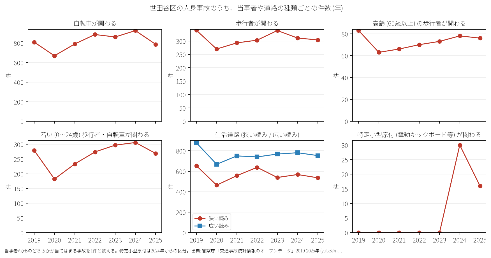

# 区の交通安全担当のための報告: 世田谷区の交通事故の傾向

## 問い

世田谷区の人身事故は 2019〜2025 年にどう推移し、23 区の中でどんな特徴があり、施策をどこに向ける材料になるか。

## 結論

- 件数: 7 年で 12,291 件、死者 52 人、負傷者 13,747 人です。2020 年に 1,553 件 (2019 年を 100 として 78.6) まで減少し、2024 年は 1,837 件 (92.9)、2025 年は 1,638 件 (82.9) です。

- 23 区の中の位置: 世田谷区は若い歩行者・自転車事故の割合が 15.0% で 23 区中 2 位と極めて高いのが特徴です。生活道路 (狭い読み) の割合は 32.2% で 8 位、広い読みで 43.4% (9 位) です。自転車関与割合は 46.6% (13 位) です。

- 施策への読み方: 2026-09-01 からの生活道路法定速度 30 km/h 規制は、世田谷区の事故の 32.2〜43.4% に該当し、都心区に比べて直接的な対象事故のボリュームが格段に大きいです。住宅地内の生活道路と環七・環八・主要放射道路の結節部が重点対策箇所となります。

- 死亡事故: 7 年間で 52 人が亡くなりました。歩行者 24 人、二輪車 11 人、自転車 9 人です。歩行者のうち 65 歳以上が 10 人でした。過失の重い当事者 A が貨物車の事故が 21 件発生しています。

- 人口あたり: 住民千人あたり年間件数は 1.86 件で 23 区中 14 位と中位です。

## データ

警察庁「交通事故統計情報」本票 2019〜2025 年。世田谷区は `市区町村コード` 112 の 12,291 件、23 区は 144,716 件。区の人口は 2020 年国勢調査 (943,664 人)。詳しくは [共通の報告](../report.md)。

## 方法

当事者 A か B のどちらかが当てはまる事故を 1 件と計上。生活道路は `車道幅員` で判定。

## 確かめていないこと

- ゾーン 30 導入区域やスクールゾーン対策の因果効果は推定していません。
