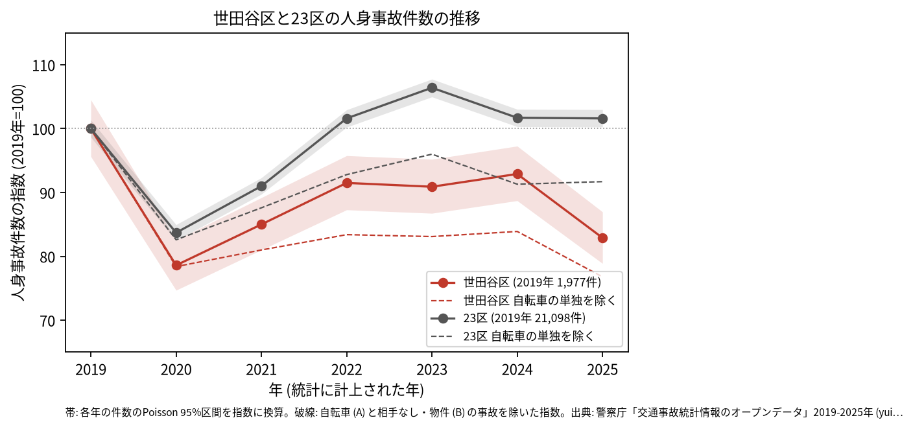
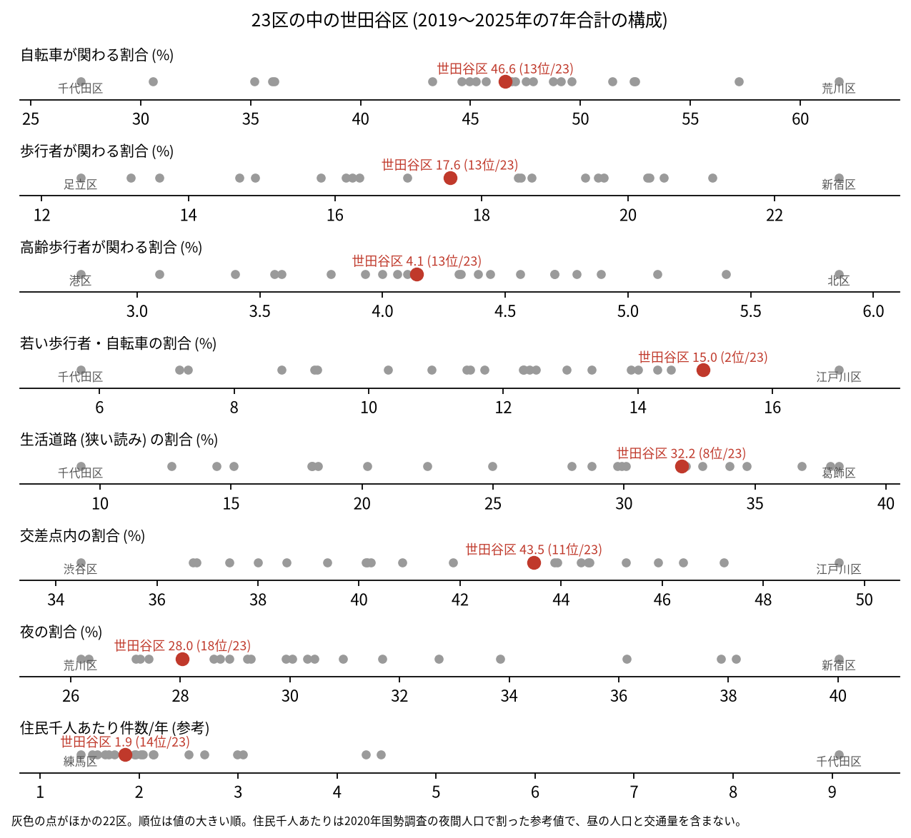
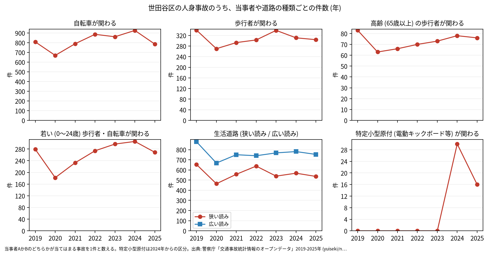

# 区の交通安全担当のための報告: 世田谷区の交通事故の傾向

## 問い

世田谷区の人身事故は 2019〜2025 年にどう推移し、23 区の中でどんな特徴があり、施策をどこに向ける材料になるか。

## 結論

- 件数: 7 年で 12,291 件、死者 52 人、負傷者 13,747 人です。2020 年に 1,553 件 (2019 年を 100 として 78.6) まで減り、23 区全体 (83.7) より大きく下がりました。23 区全体は 2022 年に 101.6 まで戻りましたが、世田谷区は 2024 年の 1,837 件 (92.9) が最も高く、2025 年は 1,638 件 (82.9) です。2025 年の 95% 区間 (1,559.6〜1,719.3 件) は 2019 年の区間 (1,890.8〜2,066.1 件) と重ならないので、2025 年は 2019 年より減ったと言えます。

- 23 区の中の位置: 若い (0〜24 歳) 歩行者と自転車が関わる割合は 15.0% で 23 区の 2 位です。生活道路 (狭い読み) の割合は 32.2% で 8 位、広い読みでは 43.4% で 9 位です。交差点内の割合は 43.5% で 11 位、夜の割合は 28.0% で 18 位です。自転車 (46.6%)、歩行者 (17.6%)、高齢の歩行者 (4.1%) が関わる割合は、どれも 13 位で 23 区の中ほどです。

- 施策への読み方: 2026-09-01 からの生活道路の法定速度 30 km/h は、世田谷区の事故のうち 32.2〜43.4% (読み方による) に当たります。一方、事故の多い地点の上位は環七通り、環八通り、玉川通りの交差点に並びます (地点は [道路安全診断の報告](road-safety-auditor.md))。これは効果の予測ではなく、どの道路で事故が起きているかの構成です。
- 区分ごとの推移: 自転車が関わる事故は 2019 年 808 件、2020 年 669 件、2024 年 926 件、2025 年 786 件です。自転車 (A) と相手なし・物件 (B) の事故は 2019 年 78 件から 2025 年 179 件に増えていて、これを除いた 2025 年の指数は 76.8 です (23 区は 91.7)。特定小型原付 (電動キックボードなど) が関わる事故は、区分のできた 2024 年に 30 件、2025 年に 16 件でした。

- 死亡事故: 50 件で 52 人が亡くなりました。亡くなった人の種別で数えると、歩行者 24 件、二輪車 11 件 (ほかに二輪車どうしで 2 人が亡くなった事故が 1 件)、自転車 9 件、補充票の人 (当事者 A と B のどちらでもない人) 5 件です。亡くなった歩行者 24 人のうち 10 人が 65 歳以上でした。当事者 A (過失の重い側) が貨物車の事故が 21 件、0〜5 時台に起きた事故が 12 件です。高速道路の死亡事故はありません。

| 年 | 当事者 A | 当事者 B | 時 |
|---|---|---|---:|
| 2019 | 貨物車 | 歩行者 (55〜64 歳) | 15 |
| 2019 | 貨物車 | 歩行者 (55〜64 歳) | 11 |
| 2019 | 貨物車 | 歩行者 (45〜54 歳) | 10 |
| 2019 | 貨物車 | 歩行者 (75 歳以上) | 13 |
| 2020 | 貨物車 | 歩行者 (0〜24 歳) | 13 |
| 2021 | 貨物車 | 歩行者 (75 歳以上) | 8 |
| 2022 | 貨物車 | 歩行者 (75 歳以上) | 22 |
| 2023 | 貨物車 | 歩行者 (55〜64 歳) | 16 |
| 2023 | 貨物車 | 歩行者 (65〜74 歳) | 10 |
| 2023 | 貨物車 | 歩行者 (0〜24 歳) | 13 |
| 2025 | 貨物車 | 歩行者 (55〜64 歳) | 17 |

表は、当事者 A が貨物車で B が歩行者の死亡事故 11 件 ([summary.txt](../outputs/summary.txt)) の抜き出しで、亡くなったのはどれも歩行者です。50 件の全ては [deaths.csv](../outputs/deaths.csv) にあります。50 件は少なく、偏りを傾向と断定できる数ではありません。

- 人口あたり: 2020 年の住民千人あたりの年の件数は 1.86 件で 23 区の 14 位ですが、分母に昼の人口や区を通る車が入らないため、区の比較の主な指標にしていません。

## データ

警察庁「交通事故統計情報のオープンデータ」を加工した `yuiseki/npa-traffic-accidents` 版 `389500a` の本票。世田谷区は `市区町村コード` 112 の 12,291 件、23 区は 144,716 件。年はファイルの年 (統計に計上された年)。区の人口は 2020 年国勢調査 (`jp-admin-2026-09` 版 `e6c87b1`)。詳しくは [共通の報告](../report.md)。

## 方法

区分は、当事者 A か B のどちらかが当てはまる事故を 1 件と数えました。生活道路は `車道幅員` で決め、狭い読み (5.5 m 未満の単路と、小と小の交差点) と、広い読み (5.5 m 未満の道とより広い道の交差点も含む) を並べました。年の区間は件数の Poisson の 95% 区間 (Garwood) です。23 区の順位は 7 年合計の割合の大きい順です。

## 確かめていないこと

- 2020 年の減り方が 23 区より大きい理由と、2022 年以降に 23 区ほど戻らない理由は調べていません。
- 若い歩行者と自転車の割合が高い理由 (学校や大学の多さ、通学の自転車など) は調べていません。
- 区の施策 (ゾーン 30、自転車の通行帯など) の効果は推定していません。割合の順位は施策の評価ではありません。
- 重傷と軽傷の区別、物損事故は、このデータにありません。
