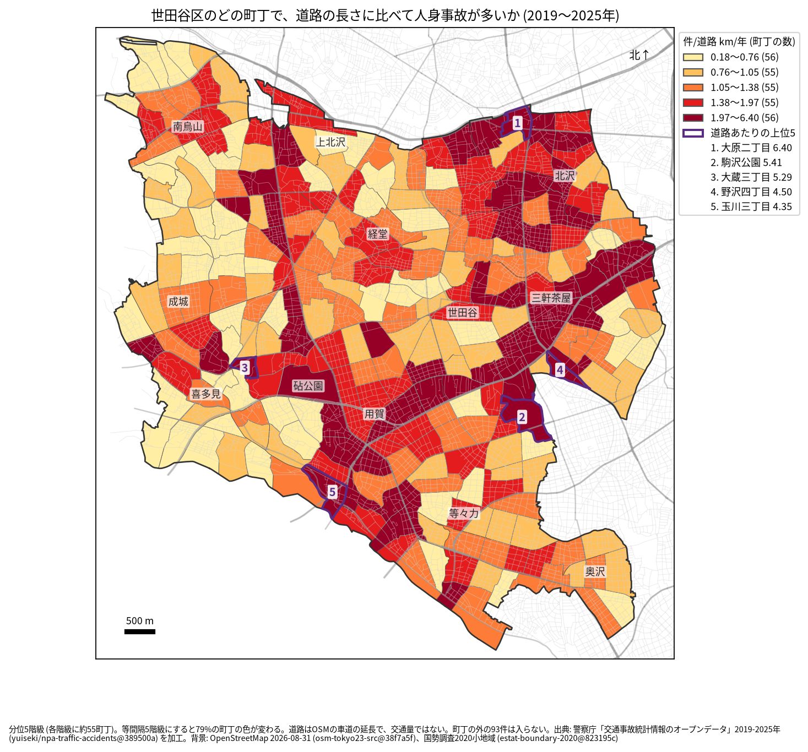
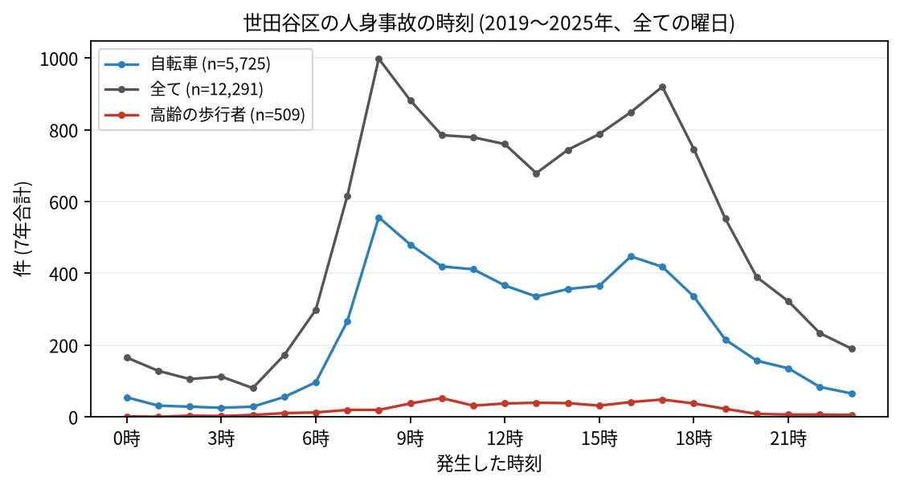

# 住民のための報告: 世田谷区で、いつ、どこで事故が起きているか

## 問い

世田谷区に住む人が、自分の町で、いつ、どんな事故に気をつければよいか。2019〜2025 年の警察記録の人身事故から調べました。

## 結論

- 世田谷区では 7 年で 12,291 件の人身事故があり、52 人が亡くなりました。年に 1,553〜1,977 件です。
- 町ごと: 道路 1 km あたりの事故が多いのは、大原二丁目 (年 6.404 件)、駒沢公園 (5.406 件)、大蔵三丁目 (5.295 件)、野沢四丁目 (4.5 件)、玉川三丁目 (4.347 件) です。件数そのものが最も多いのも大原二丁目 (7 年で 194 件) で、瀬田四丁目 (182 件)、玉川三丁目 (170 件) が続きます。環七通りの沿道 (大原、代田、野沢) と、玉川通りの沿道 (池尻、三軒茶屋、上馬、用賀、瀬田) に色の濃い町が並びます。

色は分位 5 階級で、各色に約 55 の町が入ります。等間隔の階級にすると 79% の町の色が変わるので、色の差より、自分の町が上の階級か下の階級かを見てください。駒沢公園の町 (人口 1 人) の値は、道路 1.295 km の上の 49 件によるもので、公園の中より町の縁の道路の事故とみられます (地点ごとには確かめていません)。

- 時間: 事故は朝 8 時台 (7 年で 998 件) と夕方 17 時台 (920 件) に山があります。自転車が関わる事故は 8 時台 (556 件) と 9 時台 (480 件) に多く、高齢の歩行者が関わる事故は 10 時台 (52 件) が最も多い時間でした。

- 誰が: 自転車が関わる事故が全体の 46.6% で、最も多い区分です。自転車に乗る人は、車やトラックとの事故 (2,998 件) に加え、自転車だけの事故 (転倒や物への衝突、1,149 件) にも気をつけてください。歩行者が関わる事故は 17.6% です。
- 亡くなった人: 亡くなった人の種別で数えると、歩行者が 24 件と最も多く、亡くなった歩行者のうち 10 人が 65 歳以上でした。

## データ

警察庁「交通事故統計情報のオープンデータ」を加工した `yuiseki/npa-traffic-accidents` 版 `389500a` の本票、世田谷区の 12,291 件 (2019〜2025 年のファイル)。町の境界は 2020 年国勢調査の小地域 (277 町丁)、道路は OpenStreetMap 2026-08-31。詳しくは [共通の報告](../report.md)。

## 方法

事故の地点を町丁の境界に入れて数え、町丁の中の車道の長さ (OSM) と 7 年で割りました。区の境界の近くで町丁の外に落ちた 93 件は町の値に入っていません。時刻は事故の起きた時で、7 年の合計です。

## 確かめていないこと

- 道路の長さは、通る車や人の数ではありません。環七通りや玉川通りの沿道の値が高いのは、車が多いためかもしれません。
- 高速道路の事故は、高架の下の町に数えられています (砧公園 24 件、喜多見三丁目 16 件など)。
- 自分の町の事故が少なくても、物損事故やヒヤリハットはこのデータにありません。
- 事故の位置の精度は分かりません。町の境界の近くの事故は、隣の町に数えられている可能性があります。
