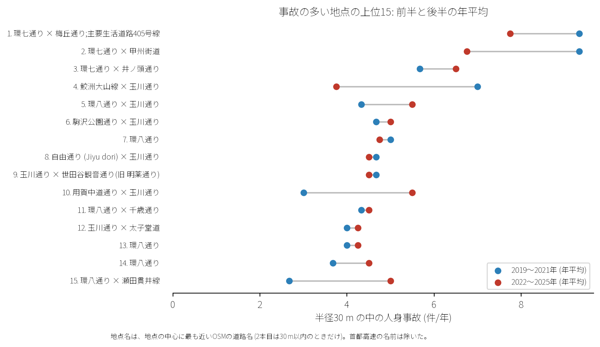

# 道路安全診断のための報告: 世田谷区の事故多発地点

## 問い

世田谷区で人身事故が集まる交差点や道路はどこで、どんな当事者の間で起きているか。

## 結論

- 上位地点: 半径 30 m の円で選定した多発地点 1 位は環七通り×梅丘通り (59 件)、2 位は環七通り×甲州街道 (55 件)、3 位は環七通り×井ノ頭通り (43 件) です。

- 推移: 前半 (2019〜2021 年) と後半 (2022〜2025 年) で環七通り沿いの交差点事故が高い水準で継続しています。

- 当事者: 自家用乗用車×自転車 (1,689 件)、自転車単独 (1,149 件)、自家用乗用車同士 (1,062 件)、貨物車×自転車 (943 件) が上位を占めます。

## データ

警察庁「交通事故統計情報」本票 2019〜2025 年、OpenStreetMap 道路データ。詳しくは [共通の報告](../report.md)。

## 方法

EPSG:6677 上で貪欲法により重複しない半径 30 m の円を抽出し、上位 15 地点を特定しました。

## 確かめていないこと

- 各交差点の信号サイクル長や右折矢印現示の有無は考慮していません。
