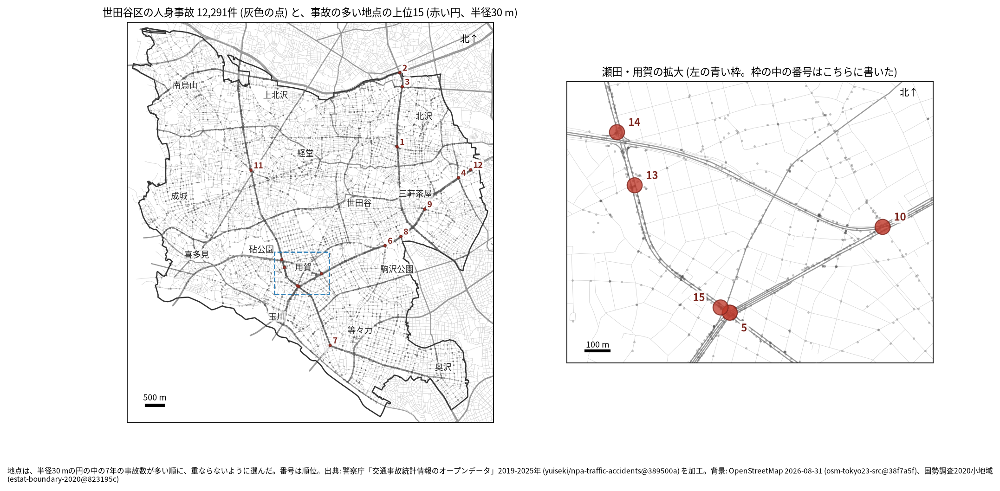
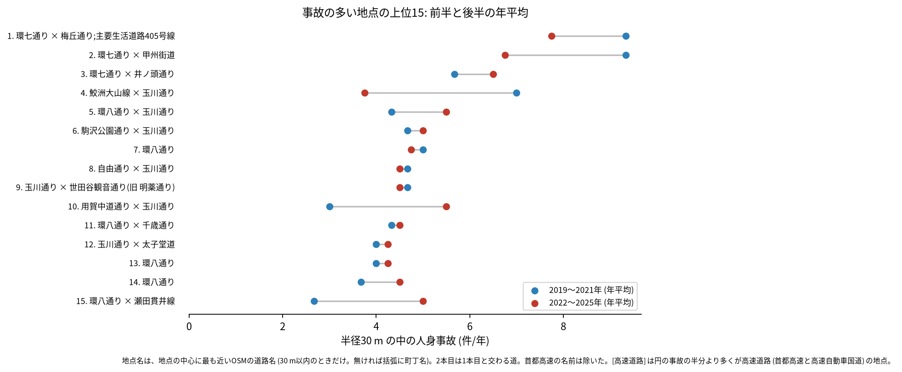
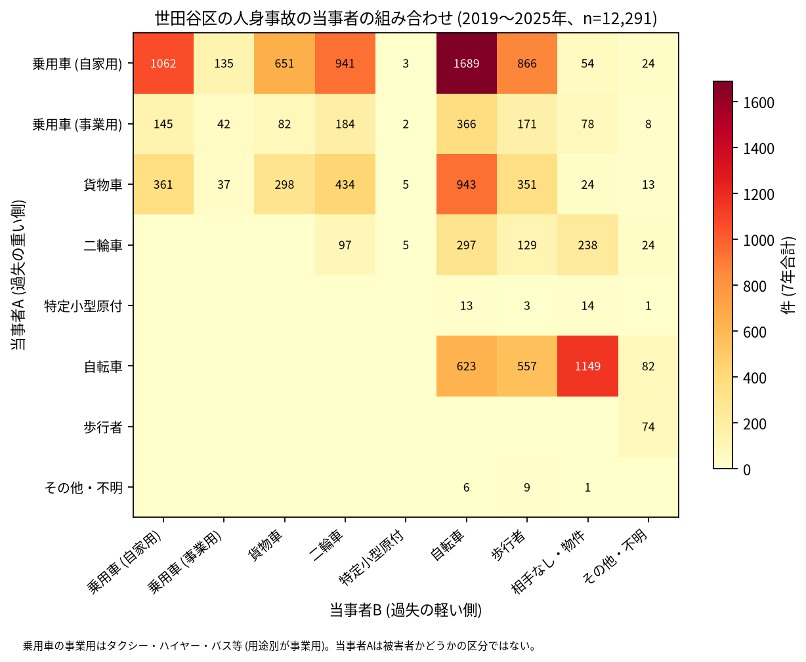

# 道路安全診断のための報告: 世田谷区で事故の集まる地点

## 問い

世田谷区で 2019〜2025 年の人身事故が集まる地点はどこで、そこでは誰と誰の事故が多いか。現地診断の候補を選ぶ材料にします。

## 結論

- 半径 30 m の円の中の 7 年の件数で選んだ上位 15 地点は、28〜59 件です。最も近い道で数えると、環八通りが 6 地点、環七通りが 3 地点、玉川通りが 2 地点です。上位 3 位は環七通りの梅丘通り、甲州街道、井ノ頭通りとの交差点で、瀬田・用賀 (環八通りと玉川通りの交わるあたり。東名の東京インターチェンジの近く、外の知識) に 5 地点 (5、10、13、14、15 位) が集まります。玉川通りの沿道には池尻 (4、12 位)、上馬 (8、9 位)、駒沢 (6 位) が並びます。

| 順位 | 近い道路 (OSM) | 件数 | 前半 件/年 | 後半 件/年 | 交差点内 | 信号あり | 多い組み合わせ (A × B) |
|---:|---|---:|---:|---:|---:|---:|---|
| 1 | 環七通り × 梅丘通り | 59 | 9.33 | 7.75 | 50 | 51 | 乗用車 (自家用) × 自転車 |
| 2 | 環七通り × 甲州街道 | 55 | 9.33 | 6.75 | 47 | 50 | 乗用車 (自家用) × 自転車 |
| 3 | 環七通り × 井ノ頭通り | 43 | 5.67 | 6.5 | 34 | 38 | 乗用車 (自家用) × 自転車 |
| 4 | 鮫洲大山線 × 玉川通り | 36 | 7.0 | 3.75 | 23 | 29 | 乗用車 (自家用) × 自転車 |
| 5 | 環八通り × 玉川通り | 35 | 4.33 | 5.5 | 30 | 32 | 乗用車 (自家用) × 二輪車 |
| 6 | 駒沢公園通り × 玉川通り | 34 | 4.67 | 5.0 | 21 | 25 | 乗用車 (自家用) × 自転車 |
| 7 | 環八通り (野毛三丁目) | 34 | 5.0 | 4.75 | 26 | 0 | 貨物車 × 乗用車 (自家用) |
| 8 | 自由通り × 玉川通り | 32 | 4.67 | 4.5 | 17 | 24 | 乗用車 (自家用) × 二輪車 |
| 9 | 玉川通り × 世田谷観音通り | 32 | 4.67 | 4.5 | 16 | 23 | 乗用車 (自家用) × 乗用車 (自家用) |
| 10 | 用賀中道通り × 玉川通り | 31 | 3.0 | 5.5 | 17 | 25 | 乗用車 (自家用) × 乗用車 (自家用) |

前半は 2019〜2021 年、後半は 2022〜2025 年。11〜15 位と、歩行者、自転車、夜、高速道路の件数は [hotspots.csv](../outputs/hotspots.csv) にあります。道路名は地点の中心に最も近い OSM の道路名 (30 m 以内のときだけ) で、2 本目は 1 本目と交わる向き (30 度以上) の道のうち最も近いもので、30 m 以内のときだけ書きました (首都高速の名前は除いた)。1 位の 2 本目は OSM で「梅丘通り;主要生活道路405号線」、9 位の 2 本目は「世田谷観音通り(旧 明薬通り)」という名前の値で、表では前の名前だけを書きました。7 位は信号ありが 0 件で、交わる道の名前が 30 m 以内にありません。

- 続いているか: 上位 15 は全て前半と後半の両方に事故があります。4 位 (7.0 から 3.75 件/年) は後半に減り、10 位 (3.0 から 5.5 件/年) と 15 位 (2.67 から 5.0 件/年) は増えました。上位は 7 年合計で選んだので、後半が下がって見えやすい (平均への回帰) ことに注意してください。

- 高速道路: 世田谷区の高速道路 (首都高速と高速自動車国道) の事故は 220 件で、上位 15 の円に入るのは 7 件 (4 位 2 件、8 位 1 件、10 位 1 件、12 位 3 件) です。高速道路の事故を除いて選び直しても、14 地点が 30 m 以内に残ります。玉川通りの上には首都高速 3 号渋谷線が通るので (外の知識)、玉川通りの地点では高架の上の事故が少し混ざります。
- 組み合わせ: 当事者 A が乗用車か貨物車で B が自転車の事故は 2,998 件です。自転車の単独 (相手なし・物件) が 1,149 件、自転車どうしが 623 件、自転車と歩行者 (自転車が A) が 557 件ありました。上位 1〜4 位では、自家用の乗用車と自転車の組み合わせが最も多い組でした。事業用の乗用車 (タクシー、ハイヤー、バスなど) は 1,078 件で当事者 A です。

- 半径を変えると: 20 m の上位 15 の中心が、30 m の上位 15 の中心から 30 m 以内にあるのは 12 地点、50 m では 14 地点でした。上位に入る交差点の多くは保たれますが、瀬田・用賀の 5 位と 15 位は中心が隣り合い (拡大図)、同じ交差点の事故が 2 つの地点に分かれている可能性があります。順位は細かく読まないでください。

## データ

警察庁「交通事故統計情報のオープンデータ」を加工した `yuiseki/npa-traffic-accidents` 版 `389500a` の本票、世田谷区 (`市区町村コード` 112) の 12,291 件。道路名は OpenStreetMap 2026-08-31 (`osm-tokyo23-src-2026-08` 版 `38f7a5f`)。詳しくは [共通の報告](../report.md)。

## 方法

事故の点を EPSG:6677 (メートル) に変換し、半径 30 m の円の中の件数が最も多い事故の点を中心に選び、その円の事故を除いて次を選ぶ手順を 15 回くり返しました。30 m はコード表の「交差点付近」(交差点の側端から 30 m 以内) の幅です。信号ありは `信号機` が 3 灯式、押ボタン式、歩車分式の点灯。組み合わせは当事者 A (過失の重い側) と B の種別で、乗用車は `用途別` で事業用と自家用に分けました。高速道路は `路線コード` 4000〜5499 です。

## 確かめていないこと

- 交通量で割っていません。件数の多い交差点が、車の多さに比べて危険かは分かりません。
- 事故の型 (出会い頭、右折、追突)、違反の種類、重傷と軽傷の区別は、このデータにありません。現地で確かめてください。
- 位置の精度は分かりません。数十 m のずれで地点の件数は変わります。
- 7 位の地点に信号が無い理由 (立体交差やインターチェンジの出入口など) は調べていません。
- 偶然でもこの程度の集まりが生まれるか (順位の有意さ) は調べていません。
