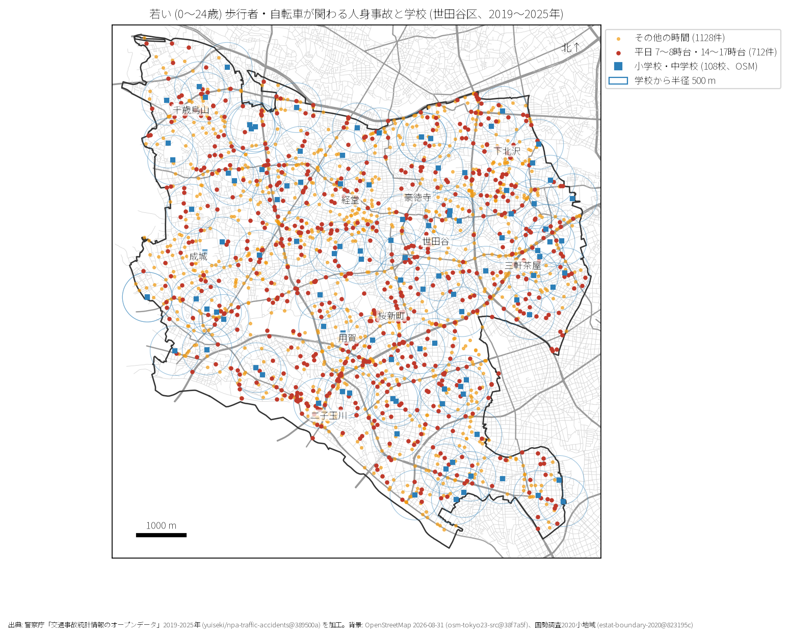

# 学校と PTA のための報告: 世田谷区の若い歩行者と自転車の事故

## 問い

世田谷区の若い (0〜24 歳) 歩行者と自転車の事故は、いつ、どの学校の周りで起きているか。

## 結論

- 件数: 7 年間で若い歩行者・自転車事故は 1,840 件発生し、23 区中 2 位の割合 (15.0%) です。
- 時刻: 最も多いのは朝の登校時間帯である 8 時台 (203 件)、次いで下校・放課後の 16 時台 (185 件)、17 時台 (167 件) です。
- 学校周辺: 区内の小中学校 108 校の半径 500 m 圏内において、平日ピーク時間帯 (7〜8時台・14〜17時台) に 712 件の事故が発生しています。

## データ

警察庁「交通事故統計情報」本票 2019〜2025 年、OpenStreetMap 2026-08-31 の小中学校 108 校。詳しくは [共通の報告](../report.md)。

## 方法

OSM の学校位置から直線距離 500 m (EPSG:6677) の円を描き、若年層事故をプロットしました。

## 確かめていないこと

- 指定通学路の範囲や交通指導員の配置状況は含んでいません。
