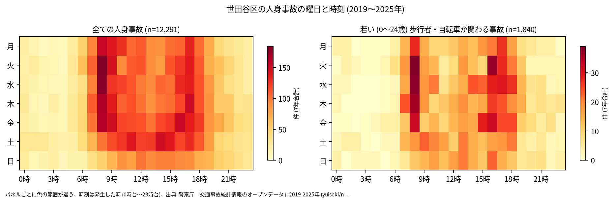
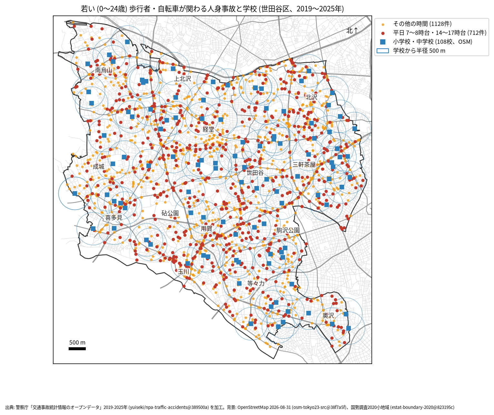

# 学校と PTA のための報告: 学校の周りの若い歩行者と自転車の事故

## 問い

世田谷区の学校の周り (半径 500 m) で、若い歩行者と自転車が関わる人身事故は、いつ、どこで起きているか。通学路の合同点検で見る場所と時間を選ぶ材料にします。

## 結論

- このデータで子どもだけを数えることはできません。年齢は年齢層で、最も若い区分が 0〜24 歳です。この報告の「若い」は 0〜24 歳で、高校生、大学生、若い社会人を含みます。
- 世田谷区で、若い歩行者か自転車が関わる人身事故は 7 年で 1,840 件 (全体の 15.0%、23 区で 2 位) でした。年では 182 件 (2020 年) から 306 件 (2024 年) です。
- 時間: 曜日を問わず多いのは 8 時台 (203 件)、16 時台 (185 件)、17 時台 (167 件) です。平日 (月〜金) に限ると、8 時台 173 件、16 時台 145 件、17 時台 134 件、18 時台 109 件でした。朝の登校の時間に最も多く、下校から夕方の時間帯にも多く起きています。

- 場所: 学校から 500 m の円の中の件数が多いのは、二子玉川小学校 60 件、笹原小学校 49 件、三田国際学園中学校・代沢小学校・瀬田小学校の 44 件です。円は重なるので、学校ごとの件数は足せません。環八通りや玉川通りに近い学校は、区全体の事故が多い道に円がかかるため、件数が大きくなります。

| 学校 (OSM の名前) | 500 m 以内の若い歩行者・自転車 | うち平日 7〜8 時台 | うち平日 14〜17 時台 |
|---|---:|---:|---:|
| 世田谷区立二子玉川小学校 | 60 | 8 | 14 |
| 世田谷区立笹原小学校 | 49 | 7 | 12 |
| 三田国際学園中学校 | 44 | 6 | 11 |
| 世田谷区立代沢小学校 | 44 | 8 | 11 |
| 世田谷区立瀬田小学校 | 44 | 6 | 11 |
| 世田谷区立千歳台小学校 | 42 | 4 | 13 |
| 世田谷区立希望丘小学校 | 39 | 6 | 11 |

108 校の全ては [schools.csv](../outputs/schools.csv) にあります。

赤い点 (平日の 7〜8 時台と 14〜17 時台、712 件) が、通学の時間に近い事故です。点検では、学校の円の中で赤い点が並ぶ道を、通学路の地図と重ねて見ることを勧めます。

- 1 つの学校の円の中で 7 年に起きた平日の朝 (7〜8 時台) の若い人の事故は、上の表の学校で 4〜8 件です。件数が少ないので、学校の順位より、点の位置を手がかりにしてください。

## データ

警察庁「交通事故統計情報のオープンデータ」を加工した `yuiseki/npa-traffic-accidents` 版 `389500a` の本票、世田谷区の 12,291 件 (2019〜2025 年のファイル)。学校は OpenStreetMap 2026-08-31 (`osm-tokyo23-src-2026-08` 版 `38f7a5f`) の、名前が「小学校」「中学校」で終わる 108 校 (「旧」で始まる閉校した学校は除く。世田谷区には無い)。私立の学校 (名前が「私立」で始まるものなど) を含みます。詳しくは [共通の報告](../report.md)。

## 方法

当事者 A か B が歩行者か自転車 (駆動補助機付を含む) で、その同じ当事者の年齢層が 0〜24 歳の事故を数えました。学校の位置は OSM の面の重心 (名前ごとに平均) で、円は直線 500 m (EPSG:6677 で測った) です。時刻は発生した時、平日は月曜から金曜で、祝日は分けていません。

## 確かめていないこと

- 小学生か、通学中かは分かりません。被害者か加害者かも区別していません (当事者 A は過失の重い側)。
- 学校の位置は校門ではなく、500 m は道のりではありません。通学路の線とは重ねていません。
- 高校と大学は学校の点に入れていません。若い人の事故の多さが高校生や大学生の通学によるかは調べていません。
- ヒヤリハットと物損事故は入っていません。点検では、学校が集めている危険な場所の情報と合わせて使ってください。
