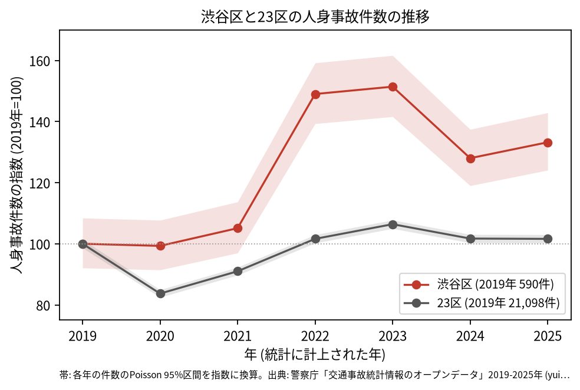
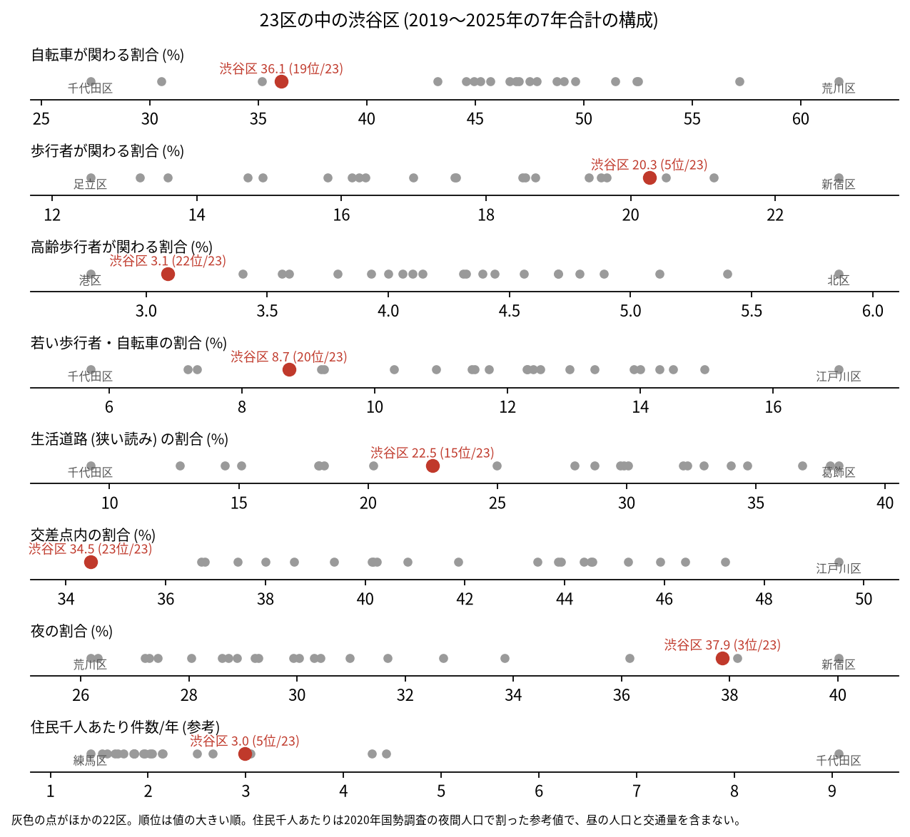
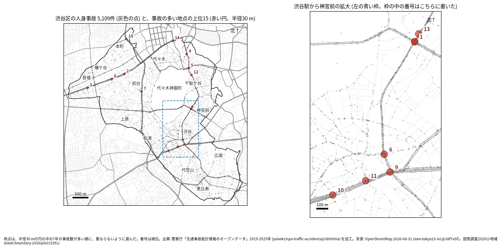
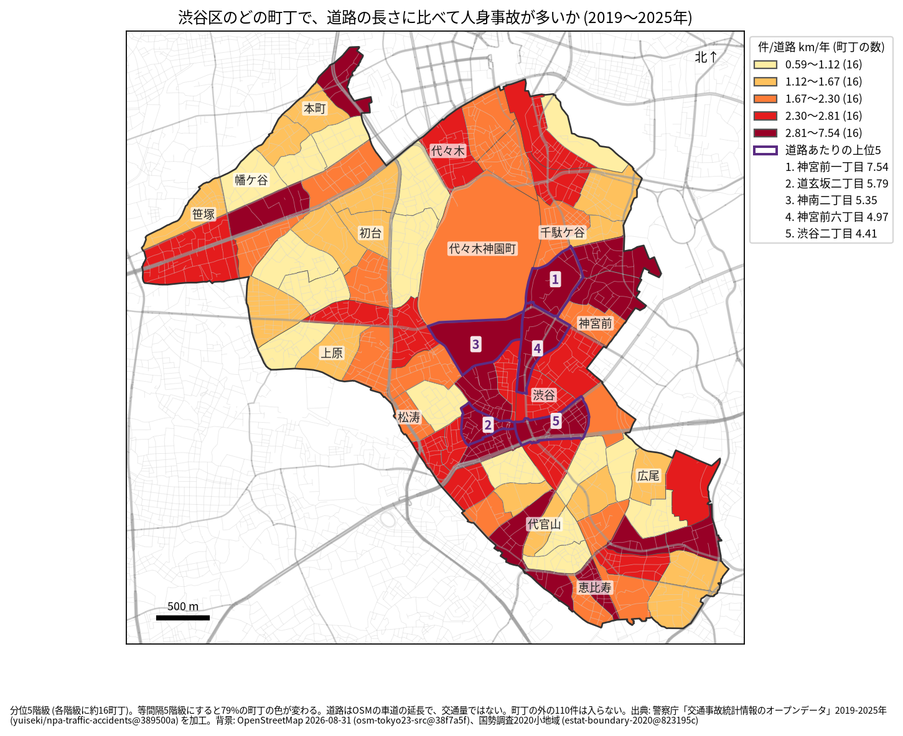
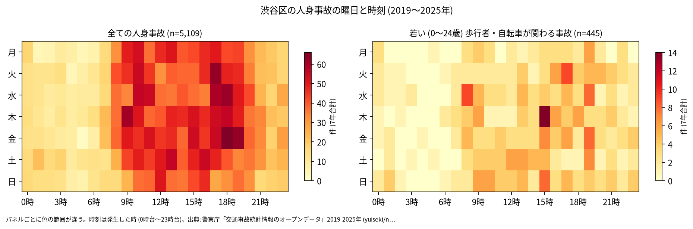
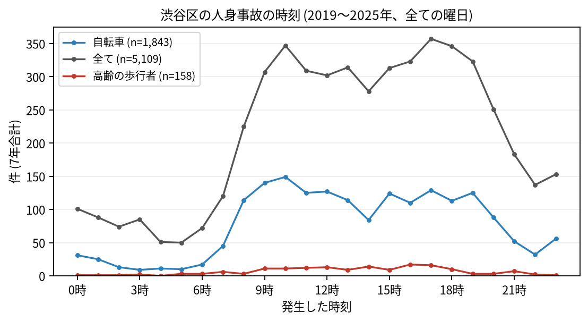
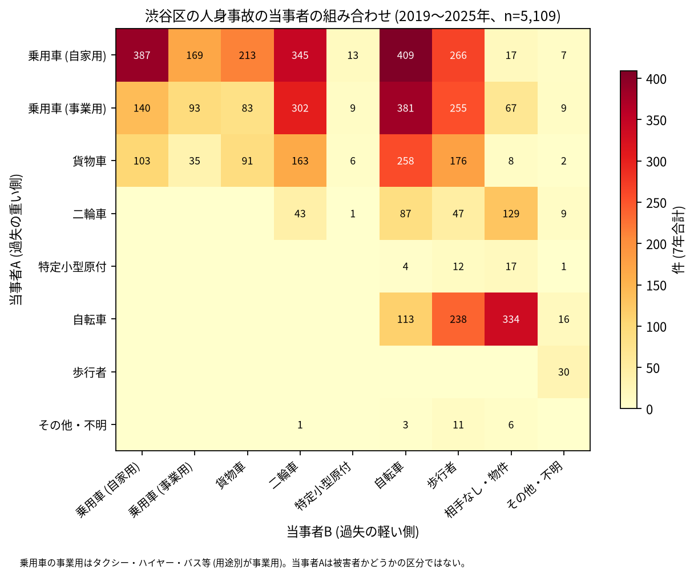

# 渋谷区の交通事故 2019〜2025 年: 図で読む要点

## 問い

2019〜2025 年の警察記録の人身事故で、渋谷区の事故はいつ、どこで、誰が関わって起きているか。

## 結論

### 要点

| # | 要点 | 数字 | 図 |
|---:|---|---|---|
| 1 | 件数は 2022 年に跳ね上がり、2025 年も 2019 年より多い。23 区全体はほぼ 2019 年の水準 | 7 年で 5,109 件、死者 23 人、負傷者 5,713 人。指数 (2019 年=100) は 2022 年 149.0、2025 年 133.2、23 区の 2022 年は 101.6 ([yearly.csv](outputs/yearly.csv)、[summary.txt](outputs/summary.txt)) | [図 1](#図-1-件数の推移) |
| 2 | 交差点内の事故の割合は 23 区で最も低く、夜の割合は高い | 交差点内 34.5% (23 位)、夜 37.9% (3 位)、歩行者 20.3% (5 位)、生活道路 22.5% (15 位) ([wards.csv](outputs/wards.csv)、[analysis.json](outputs/analysis.json)) | [図 2](#図-2-23-区の中の渋谷区) |
| 3 | 集まる場所は明治通りと、渋谷駅から神宮前 | 事故の多い地点の上位 15 のうち、最も近い道路が明治通りの地点が 6、甲州街道が 3、玉川通りが 3。道路あたりの上位 5 町丁は神宮前一丁目、道玄坂二丁目、神南二丁目、神宮前六丁目、渋谷二丁目 ([summary.txt](outputs/summary.txt)、[towns.csv](outputs/towns.csv)) | [図 3](#図-3-事故の集まる地点)、[図 4](#図-4-町丁ごとの事故) |
| 4 | 事故の 3 分の 1 に自転車が関わり、事業用の乗用車 (タクシーなど) が当事者 A の事故が多い | 自転車が関わる 36.1%。当事者 A が事業用の乗用車の事故が 1,339 件、車やトラックが A で自転車が B の事故が 1,048 件 ([summary.txt](outputs/summary.txt)) | [図 6](#図-6-誰と誰の事故か) |
| 5 | 死亡事故は歩行者に偏る | 死者 23 人のうち歩行者 14 人 (65 歳以上が 7 人)、二輪車 6 人。0〜5 時台が 7 件 ([summary.txt](outputs/summary.txt)) | [表 1](#表-1-死亡事故) |

### 読み手ごとに知るべきこと

| 読み手 | 結論 | 検討する材料 | 詳しく |
|---|---|---|---|
| 区の交通安全担当 | 2022 年から件数が 2019 年より多い水準にある (2019 年を 100 として 128.0〜151.4)。生活道路の法定速度 30 km/h (2026-09-01 から) が当たるのは事故の 22.5〜31.7% (読み方による) | 2022 年の跳ねの理由、夜の事故、特定小型原付 (2025 年 38 件、23 区で 2 位の割合) | [municipality.md](reports/municipality.md) |
| 学校と PTA | 若い (0〜24 歳) 歩行者と自転車の事故は 445 件。最も多いのは 15 時台 (44 件)、次が 19 時台 (41 件) | 渋谷駅に近い神南小学校の円 (53 件)、平日 14〜17 時台の点が並ぶ道 | [school-pta.md](reports/school-pta.md) |
| 道路安全診断 | 上位は明治通り × 表参道 (44 件)、甲州街道 (本町一丁目、30 件)、甲州街道 (笹塚一丁目、29 件)。首都高速の事故を除いても上位 15 のうち 12 地点が残る | 後半に増えた 1 位と 3 位、26 件のうち 12 件が首都高速の事故の 7 位 (山手通り) | [road-safety-auditor.md](reports/road-safety-auditor.md) |
| 住民 | 道路あたりで多いのは神宮前一丁目 (年 7.54 件/道路 km)、道玄坂二丁目 (5.79 件)。事故は 9 時台から 19 時台まで多く、17 時台が最多 | 自分の町の色、夜の繁華街、自転車の単独事故 | [resident.md](reports/resident.md) |

### 図 1: 件数の推移

2020 年は 23 区全体 (83.7) が大きく減ったのに対し、渋谷区は 99.3 でほぼ減らなかった。2022 年に 879 件 (149.0) へ跳ね、2023 年は 893 件 (151.4)。2022 年の 95% 区間 (821.8〜939.1 件) と 2025 年の区間 (732.0〜842.9 件) は、どちらも 2019 年 (543.3〜639.6 件) と重ならないので、規則により増えたと書く。区の面に入る点で数えても、2021 年の 616 件から 2022 年の 881 件へ跳ねる ([analysis.json](outputs/analysis.json) の `by_year_coded_vs_inside`)。跳ねの理由は調べていない。

### 図 2: 23 区の中の渋谷区

赤い点が渋谷区。交差点内 (34.5%、23 位) が最も低く、夜 (37.9%、3 位)、歩行者 (20.3%、5 位)、特定小型原付 (1.2%、2 位) が高い。自転車 (36.1%、19 位)、高齢の歩行者 (3.1%、22 位)、若い歩行者・自転車 (8.7%、20 位) は低い。住民千人あたり (2.99 件/年、5 位) は昼の人口を含まない参考値。台東区は交差点内 45.9%、自転車 46.9% だった ([台東区の wards.csv](../taito-accident-trends-by-role/outputs/wards.csv))。

### 図 3: 事故の集まる地点

半径 30 m の円の中の 7 年の件数で選んだ上位 15 (21〜44 件)。番号は順位で、渋谷駅から神宮前の 6 地点は右の拡大図に番号を書いた。

| 順位 | 近い道路 (OSM) | 町丁 | 件数 | 前半 件/年 | 後半 件/年 |
|---:|---|---|---:|---:|---:|
| 1 | 明治通り × 表参道 | 神宮前六丁目 | 44 | 5.33 | 7.00 |
| 2 | 甲州街道 | 本町一丁目 | 30 | 5.00 | 3.75 |
| 3 | 甲州街道 | 笹塚一丁目 | 29 | 2.67 | 5.25 |
| 4 | 明治通り × 芝新宿王子線 | 千駄ケ谷五丁目 | 28 | 5.33 | 3.00 |
| 5 | 明治通り × 四谷角筈線 | 千駄ケ谷四丁目 | 27 | 5.00 | 3.00 |

前半は 2019〜2021 年、後半は 2022〜2025 年。半径を 20 m にしても 50 m にしても上位 15 のうち 12 地点が残る。首都高速の事故を除いて選び直しても 12 地点が残る。6〜15 位は [hotspots.csv](outputs/hotspots.csv)。芝新宿王子線と四谷角筈線は、中心から 30 m 以内にある別の OSM の道路の名前で、明治通りと同じ道路の別の名前かどうかは確かめていない。

### 図 4: 町丁ごとの事故

町丁の事故数を、OSM の車道の延長と 7 年で割った値。紫の枠が上位 5 (神宮前一丁目、道玄坂二丁目、神南二丁目、神宮前六丁目、渋谷二丁目)。分位と等間隔で 78.7% の町丁の色が変わるので、色の細かい差は読まない ([town-rate.json](outputs/town-rate.json))。道路の長さは交通量ではない。

### 図 5: いつ起きるか

全体は 9 時台から 19 時台に広く多く、最多は 17 時台 (357 件)。平日に限ると 17 時台 (282 件) と 18 時台 (274 件) が多い。若い歩行者と自転車は 15 時台 (44 件) と 19 時台 (41 件) が多い。

自転車は 10 時台 (149 件) と 9 時台 (140 件)、高齢の歩行者は 16 時台 (17 件) が最多。

### 図 6: 誰と誰の事故か

最も多いのは自家用の乗用車 (A) と自転車 (B) の 409 件、次が自家用の乗用車どうしの 387 件、事業用の乗用車と自転車の 381 件。当事者 A は過失の重い側で、被害者とは限らない。

### 表 1: 死亡事故

| 亡くなった人 | 人数 | 特徴 |
|---|---:|---|
| 歩行者 | 14 | 65 歳以上が 7 人 |
| 二輪車 | 6 | |
| 自転車 | 2 | |
| 補充票の人 | 1 | 当事者 A と B のどちらでもない |

23 件のうち 0〜5 時台が 7 件。亡くなった歩行者 14 人の事故の当事者 A は、自家用の乗用車 6 件、事業用の乗用車 4 件。数が少ないので傾向とは断定しない。全件は [deaths.csv](outputs/deaths.csv)。

### 読み方で変わる答え

| 読み方 | 主 | 別の読み方 |
|---|---|---|
| 渋谷区の事故 | `市区町村コード` 113 の 5,109 件 | 点が区の面に入る事故。両方に当てはまるのは 4,999 件 |
| 生活道路 | 狭い読み 22.5% (15 位) | 広い読み 31.7% (16 位) |
| 地点の半径 | 30 m | 20 m で 12 地点、50 m で 12 地点が残る |
| 地点に首都高速を入れるか | 入れる (台東区と同じ) | 除くと 12 地点が残る。7 位は 26 件のうち 12 件が首都高速 |
| 町丁の階級 | 分位 5 階級 | 等間隔で 78.7% の町丁の色が変わる |

## データ

- 人身事故: 警察庁「交通事故統計情報のオープンデータ」を加工した `yuiseki/npa-traffic-accidents` 版 `389500aae5cec45f1311163f70db6a5f05867838` (配布元の取得 2026-10-02) の本票。2026-11-03 に台東区と同じ SQL で取った東京の本票 205,541 行を使った。年はファイルの年 (統計に計上された年)。渋谷区 5,109 件、23 区 144,716 件。位置の無い行は 0。物損事故は含まない。
- 区の面と人口: `yuiseki/jp-admin-2026-09` 版 `e6c87b1`。町丁: 2020 年国勢調査の小地域 `yuiseki/estat-boundary-2020` 版 `823195c` (80 町丁、243,883 人)。学校 25 校と道路: OpenStreetMap 2026-08-31、`yuiseki/osm-tokyo23-src-2026-08` 版 `38f7a5f`。
- 道具: DuckDB (spatial、版は [analysis.json](outputs/analysis.json))、matplotlib、`analysis-visualize` の `cjk_font.py`、`classify_map.py`、`context_map.py` (2026-11-03)。
- 出典の表示: 警察庁ウェブサイト (https://www.npa.go.jp/publications/statistics/koutsuu/opendata/index_opendata.html) の交通事故統計情報のオープンデータを加工して作成。国勢調査の小地域境界と人口、OpenStreetMap (© OpenStreetMap contributors) を加工して使用。

## 方法

- 読み方は結果を見る前に [計画](EXPERIMENT_PLAN.md) で固定し、実行は [記録](EXPERIMENT_TRACKER.md) に残した。読み方と区画は台東区と同じで、渋谷区では首都高速 (`路線コード` 5000〜5499) の事故を除いた地点の読みを並べた (首都高速 3 号渋谷線と 4 号新宿線が地上の道路の上を通るため。外の知識で、確かめていない)。生活道路は `車道幅員` が 01、02、11 (狭い読み)、広い読みは 14、17 を足す。歩行者や自転車が関わるかは当事者 A と B の両方で見て、1 件を 1 回数えた。23 区の中の順位は、区コード 113 の行を引いて数えた。
- 距離は EPSG:6677 (メートル) で測った。地点は、半径 30 m の中の件数が最も多い点を中心に選び、その円の事故を除いて次を選ぶ手順を 15 回くり返した。
- 計画の後に変えたこと: 2022 年の跳ねを見た後、区の面で数えた年ごとの件数を足した。図では、円の濃さを 0.95 で頭打ちにし、地名の置き場所を 2 つ動かした。値と選び方は変えていない ([記録](EXPERIMENT_TRACKER.md))。
- 地図は `analysis-visualize` の map-context に合わせ、地名と道路を重ね、凡例を地図の外に置き、強調した単位に番号を付けた。描いた町丁の数 (80) を分析の数と照らし、文字の重なりは 3 枚の地図で 0 件。背景の道路 (OGC:CRS84) と町丁 (JGD2000) の差は、線の幅より小さいとして変換せずに重ねた。
- 関門: 予測と回帰をしないので、評価の分け方と残差の確認は要らない。単位の間の相関を結論にしないので、Moran's I と格子の掃引は省いた。推移は 23 区全体を基準にし、年の件数に Poisson の 95% 区間を付けた。対策の効果は推定していない。
- 再実行は [README.md](README.md)。数値は [outputs/](outputs/) の CSV、来歴は [analysis.json](outputs/analysis.json)。

## 確かめていないこと

- 2022 年に件数が跳ねた理由 (人出の戻り、記録の仕方の変化など) は調べていない。区コードと区の面の両方の読み方で跳ねることだけを確かめた。
- 交通量、昼の人口、来訪者の数で割っていない。渋谷駅から神宮前の件数の多さは、人と車の多さかもしれない。
- 位置の精度は分からない。30 m の地点と町丁の境界の近くの事故は、数十 m のずれで入れ替わる。首都高速の事故は高架の下の道路の地点にも入りうる。
- 事故の型 (出会い頭、追突)、重傷と軽傷の区別、物損事故、ヒヤリハットは、このデータに無い。
- 0〜24 歳より細かい年齢は無く、小学生だけは数えられない。
- 地点の上位は 7 年で選び、同じ 7 年で前半と後半を比べたので、後半が下がって見えやすい (平均への回帰)。
