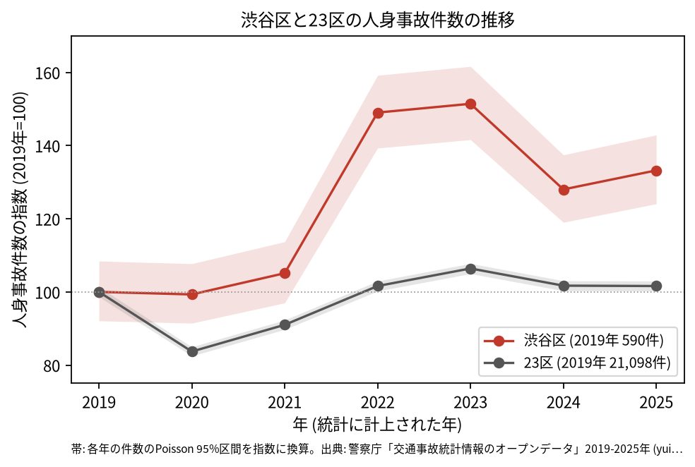
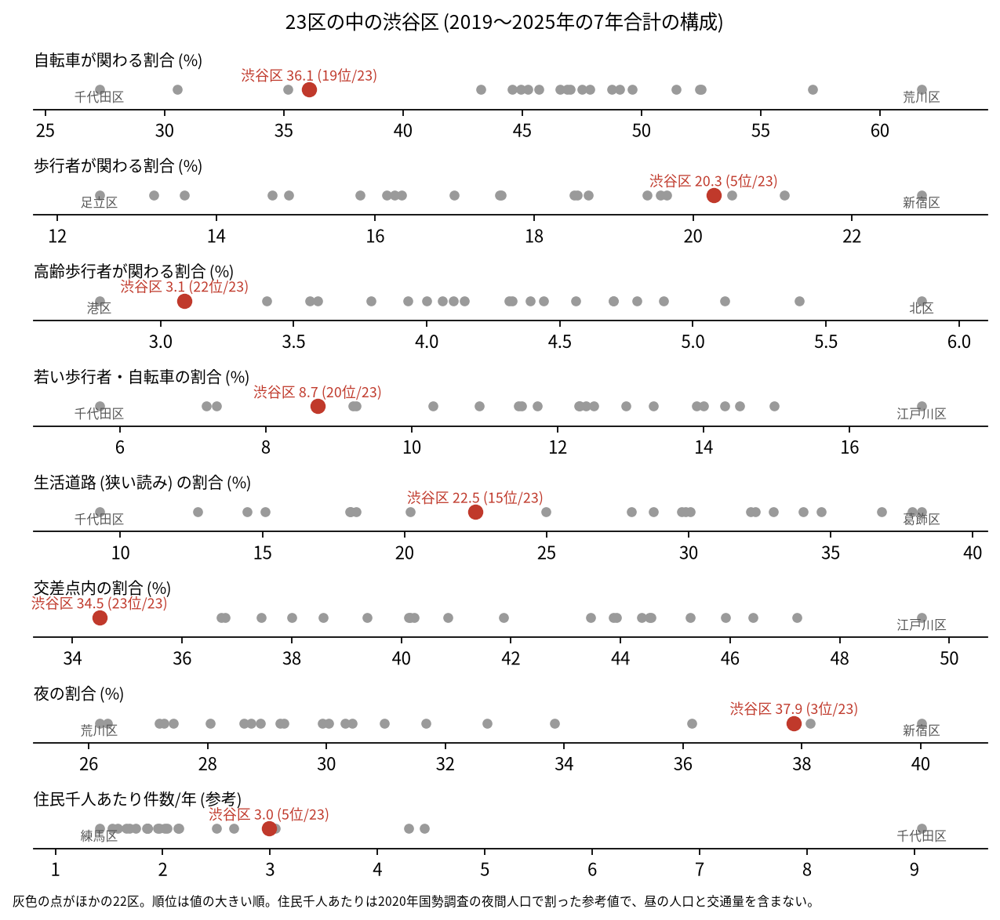
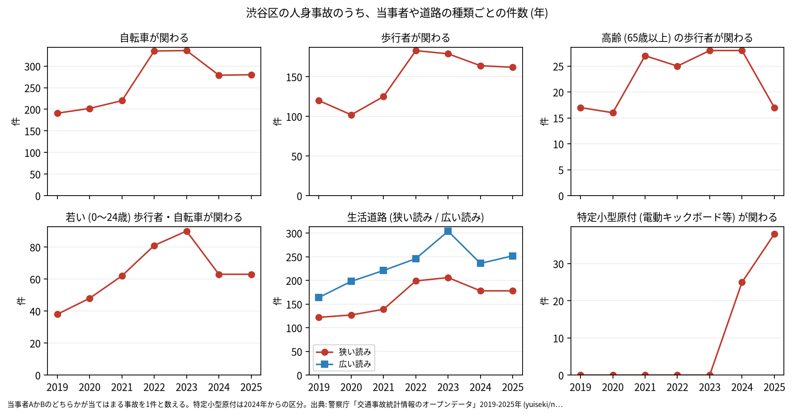

# 区の交通安全担当のための報告: 渋谷区の交通事故の傾向

## 問い

渋谷区の人身事故は 2019〜2025 年にどう推移し、23 区の中でどんな特徴があり、施策をどこに向ける材料になるか。

## 結論

- 件数: 7 年で 5,109 件、死者 23 人、負傷者 5,713 人です。2020 年は 586 件 (2019 年を 100 として 99.3) で、23 区全体 (83.7) のようには減りませんでした。2022 年に 879 件 (149.0)、2023 年に 893 件 (151.4) へ増え、2025 年は 786 件 (133.2) です。2022 年と 2025 年の 95% 区間 (821.8〜939.1 件、732.0〜842.9 件) は 2019 年の区間 (543.3〜639.6 件) と重ならないので、2019 年より増えたと言えます。23 区全体の 2025 年は 101.6 で、ほぼ 2019 年の水準です。

- 2022 年の跳ね: 区の面に入る点で数えても、2021 年の 616 件から 2022 年の 881 件へ増えています ([analysis.json](../outputs/analysis.json))。区コードの付け方だけの違いではありません。理由 (人出の戻り、記録の仕方の変化など) は、このデータでは調べられていません。
- 23 区の中の位置: 渋谷区の事故は、交差点の中の割合が 34.5% で 23 区の 23 位 (最も低い) です。夜の割合は 37.9% で 3 位、歩行者が関わる割合は 20.3% で 5 位、特定小型原付 (電動キックボードなど) は 1.2% で 2 位でした。自転車が関わる割合 (36.1%) は 19 位、高齢の歩行者 (3.1%) は 22 位で低い側です。

- 施策への読み方: 2026-09-01 からの生活道路の法定速度 30 km/h は、渋谷区の事故のうち 22.5% (狭い読み、15 位) から 31.7% (広い読み、16 位) に当たります。件数の多い地点は、明治通り、甲州街道、玉川通りに並びます (地点は [道路安全診断の報告](road-safety-auditor.md))。これは効果の予測ではなく、どの道路で事故が起きているかの構成です。
- 区分ごとの推移: 自転車が関わる事故は 2019 年の 191 件から 2022 年に 335 件、2023 年に 336 件へ増え、2025 年は 280 件です。歩行者が関わる事故も 2019 年の 120 件から 2022 年に 183 件へ増えました。特定小型原付が関わる事故は、区分のできた 2024 年に 25 件、2025 年に 38 件でした。

- 死亡事故: 23 件のうち、亡くなったのは歩行者 14 人、二輪車 6 人、自転車 2 人、補充票の人 1 人です。亡くなった歩行者 14 人のうち 7 人が 65 歳以上でした。歩行者の死亡事故の当事者 A (過失の重い側) は、自家用の乗用車 6 件、事業用の乗用車 4 件です。0〜5 時台に起きた死亡事故は 7 件でした。23 件は少なく、偏りを傾向と断定できる数ではありません。

| 年 | 当事者 A | 亡くなった歩行者の年齢層 | 時 |
|---|---|---|---:|
| 2020 | 乗用車 (自家用) | 65 歳以上 75 歳未満 | 17 |
| 2021 | 乗用車 (事業用) | 65 歳以上 75 歳未満 | 9 |
| 2022 | 二輪車 | 75 歳以上 | 21 |
| 2023 | 二輪車 | 75 歳以上 | 6 |
| 2024 | 乗用車 (事業用) | 75 歳以上 | 18 |
| 2024 | 乗用車 (自家用) | 65 歳以上 75 歳未満 | 17 |
| 2024 | 乗用車 (自家用) | 75 歳以上 | 3 |

表は、65 歳以上の歩行者が亡くなった事故 7 件の抜き出しです。23 件 ([summary.txt](../outputs/summary.txt)) の全ては [deaths.csv](../outputs/deaths.csv) にあります。

- 人口あたり: 2020 年の住民千人あたりの年の件数は 2.99 件で 23 区の 5 位ですが、分母に昼の人口、来訪者、通過する車が入らないため、区の比較の主な指標にしていません。

## データ

警察庁「交通事故統計情報のオープンデータ」を加工した `yuiseki/npa-traffic-accidents` 版 `389500a` の本票。渋谷区は `市区町村コード` 113 の 5,109 件、23 区は 144,716 件。年はファイルの年 (統計に計上された年)。区の人口は 2020 年国勢調査 (`jp-admin-2026-09` 版 `e6c87b1`)。詳しくは [共通の報告](../report.md)。

## 方法

区分は、当事者 A か B のどちらかが当てはまる事故を 1 件と数えました。生活道路は `車道幅員` で決め、狭い読み (5.5 m 未満の単路と、小と小の交差点) と、広い読み (5.5 m 未満の道とより広い道の交差点も含む) を並べました。年の区間は件数の Poisson の 95% 区間 (Garwood) です。23 区の順位は 7 年合計の割合の大きい順で、区コード 113 の行を引いて数えました。

## 確かめていないこと

- 2022 年に件数が増えた理由は調べていません。2020 年に 23 区ほど減らなかった理由も調べていません。
- 区の施策 (ゾーン 30、自転車の通行帯など) の効果は推定していません。割合の順位は施策の評価ではありません。
- 重傷と軽傷の区別、物損事故は、このデータにありません。
