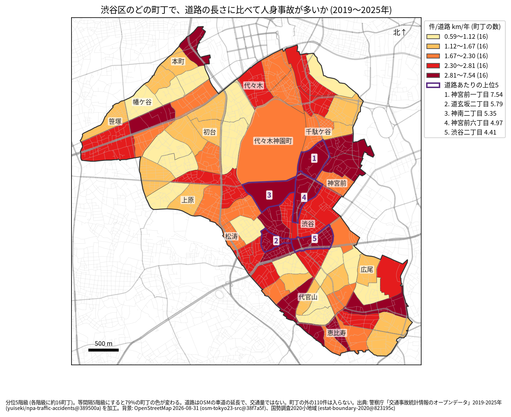
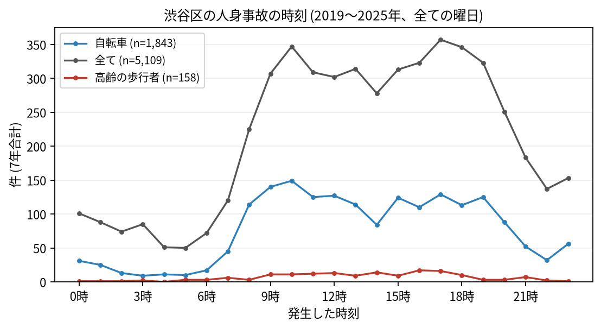

# 住民のための報告: 渋谷区で、いつ、どこで事故が起きているか

## 問い

渋谷区に住む人が、自分の町で、いつ、どんな事故に気をつければよいか。2019〜2025 年の警察記録の人身事故から調べました。

## 結論

- 渋谷区では 7 年で 5,109 件の人身事故があり、23 人が亡くなりました。年に 586〜893 件で、2022 年からは 2019 年より多い年が続いています。
- 町ごと: 道路 1 km あたりの事故が多いのは、神宮前一丁目 (年 7.54 件)、道玄坂二丁目 (5.79 件)、神南二丁目 (5.35 件)、神宮前六丁目 (4.97 件)、渋谷二丁目 (4.41 件) です。件数そのものが最も多いのは渋谷二丁目 (7 年で 253 件) でした。渋谷駅の周りから神宮前、千駄ケ谷にかけてと、甲州街道に沿った幡ケ谷や笹塚に色の濃い町が並びます。

色は分位 5 階級で、各色に 16 の町が入ります。等間隔の階級にすると 78.7% の町の色が変わるので ([town-rate.json](../outputs/town-rate.json))、色の差より、自分の町が上の階級か下の階級かを見てください。神南二丁目は住む人の数が 0 の町で、値は町の中の道路の事故によります。

- 時間: 事故は朝 9 時台から増え、夜 19 時台まで高い水準が続きます。最も多いのは 17 時台 (357 件) です。自転車が関わる事故は 10 時台 (149 件) と 9 時台 (140 件) に多く、高齢の歩行者が関わる事故は 16 時台 (17 件) が最も多い時間でした。事故の 37.9% は夜に起きていて、23 区で 3 番目に高い割合です。

- 誰が: 自転車が関わる事故が全体の 36.1%、歩行者が関わる事故が 20.3% です。自転車に乗る人は、車やトラックとの事故 (1,048 件) に加え、自転車だけの事故 (転倒や物への衝突、334 件) にも気をつけてください。
- 亡くなった人: 23 人のうち 14 人が歩行者で、そのうち 7 人が 65 歳以上でした。

## データ

警察庁「交通事故統計情報のオープンデータ」を加工した `yuiseki/npa-traffic-accidents` 版 `389500a` の本票、渋谷区の 5,109 件 (2019〜2025 年のファイル)。町の境界は 2020 年国勢調査の小地域 (80 町丁)、道路は OpenStreetMap 2026-08-31。詳しくは [共通の報告](../report.md)。

## 方法

事故の地点を町丁の境界に入れて数え、町丁の中の車道の長さ (OSM) と 7 年で割りました。区の境界の近くで町丁の外に落ちた 110 件は町の値に入っていません。時刻は事故の起きた時で、7 年の合計です。

## 確かめていないこと

- 道路の長さは、通る車や人の数ではありません。渋谷駅の周りの値が高いのは、人と車が多いためかもしれません。
- 自分の町の事故が少なくても、物損事故やヒヤリハットはこのデータにありません。
- 事故の位置の精度は分かりません。町の境界の近くの事故は、隣の町に数えられている可能性があります。
