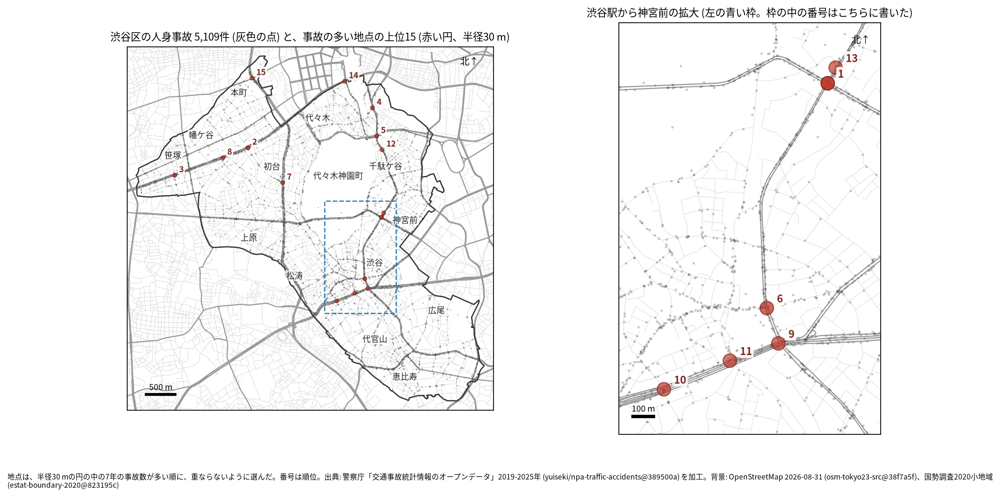
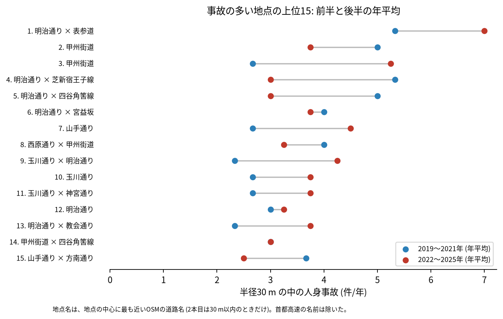
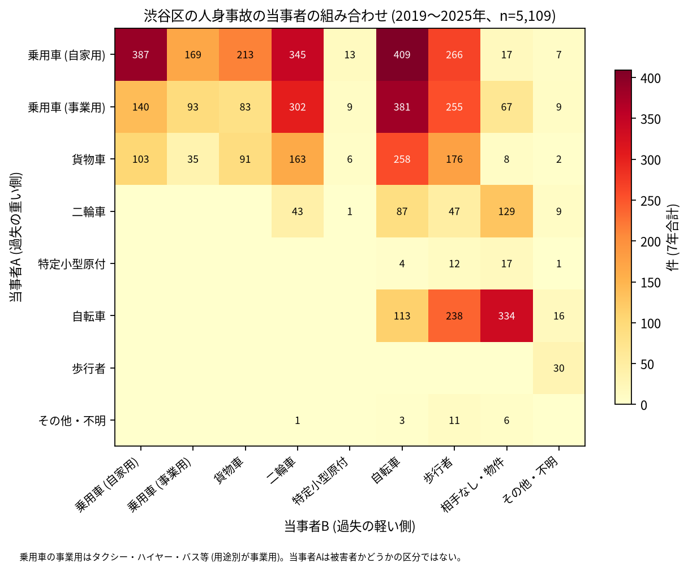

# 道路安全診断のための報告: 渋谷区で事故の集まる地点

## 問い

渋谷区で 2019〜2025 年の人身事故が集まる地点はどこで、そこでは誰と誰の事故が多いか。現地診断の候補を選ぶ材料にします。

## 結論

- 半径 30 m の円の中の 7 年の件数で選んだ上位 15 地点は、21〜44 件です。地点の中心に最も近い道路は、明治通りが 6 地点、甲州街道と玉川通りが 3 地点ずつ、山手通りが 2 地点、西原通りが 1 地点でした ([summary.txt](../outputs/summary.txt))。渋谷駅から神宮前の間に 6 地点が集まります。

| 順位 | 近い道路 (OSM) | 件数 | 前半 件/年 | 後半 件/年 | 交差点内 | 信号あり | 多い組み合わせ (A × B) |
|---:|---|---:|---:|---:|---:|---:|---|
| 1 | 明治通り × 表参道 | 44 | 5.33 | 7.00 | 35 | 41 | 乗用車 (事業用) × 自転車 |
| 2 | 甲州街道 (本町一丁目) | 30 | 5.00 | 3.75 | 19 | 20 | 乗用車 (自家用) × 乗用車 (自家用) |
| 3 | 甲州街道 (笹塚一丁目) | 29 | 2.67 | 5.25 | 11 | 18 | 乗用車 (自家用) × 乗用車 (自家用) |
| 4 | 明治通り × 芝新宿王子線 | 28 | 5.33 | 3.00 | 19 | 24 | 乗用車 (自家用) × 歩行者 |
| 5 | 明治通り × 四谷角筈線 | 27 | 5.00 | 3.00 | 20 | 26 | 乗用車 (事業用) × 自転車 |
| 6 | 明治通り × 宮益坂 | 27 | 4.00 | 3.75 | 21 | 25 | 乗用車 (事業用) × 歩行者 |
| 7 | 山手通り (元代々木町) | 26 | 2.67 | 4.50 | 7 | 10 | 乗用車 (自家用) × 乗用車 (自家用) |
| 8 | 西原通り × 甲州街道 | 25 | 4.00 | 3.25 | 11 | 17 | 乗用車 (自家用) × 貨物車 |
| 9 | 玉川通り × 明治通り | 24 | 2.33 | 4.25 | 18 | 20 | 乗用車 (事業用) × 自転車 |
| 10 | 玉川通り (道玄坂一丁目) | 23 | 2.67 | 3.75 | 16 | 16 | 乗用車 (自家用) × 乗用車 (自家用) |

前半は 2019〜2021 年、後半は 2022〜2025 年。11〜15 位と、歩行者、自転車、夜の件数は [hotspots.csv](../outputs/hotspots.csv) にあります。道路名は地点の中心に最も近い OSM の道路名で、2 本目は 30 m 以内のときだけ書きました (首都高速の名前は除いた)。2 本目がないときは町丁の名前を括弧に書きました。芝新宿王子線と四谷角筈線は OSM の別の道路の名前で、明治通りと同じ道路かどうかは確かめていません。

- 首都高速: 上位 15 の地点の事故のうち 26 件が首都高速の事故で、7 位では 26 件のうち 12 件でした ([analysis.json](../outputs/analysis.json))。ほかに 3 位、8 位、10 位にも数件ずつ入っています。首都高速の事故を除いて地点を選び直しても、上位 15 のうち 12 地点は 30 m 以内に残ります。7 位を現地で見るときは、高架の上の事故が多く混ざっていることに注意してください。
- 続いているか: 上位 15 は全て前半と後半の両方に事故があります。1 位 (5.33 から 7.00 件/年) と 3 位 (2.67 から 5.25 件/年) は後半に増え、4 位と 5 位 (5.33、5.00 から 3.00 件/年) は減りました。区全体の件数が 2022 年から増えているので、後半の増加は区全体の増加と分けて読めません。上位は 7 年合計で選んだので、後半が下がって見えやすい (平均への回帰) ことにも注意してください。

- 組み合わせ: 当事者 A が乗用車か貨物車で B が自転車の事故は 1,048 件です。自転車の単独 (相手なし・物件) が 334 件、自転車と歩行者 (自転車が A) が 238 件、自転車どうしが 113 件ありました。事業用の乗用車 (タクシー、ハイヤー、バスなど) が当事者 A の事故は 1,339 件で、1 位、5 位、9 位では事業用の乗用車と自転車が最も多い組でした。

- 半径を変えると: 20 m の上位 15 の中心が、30 m の上位 15 の中心から 30 m 以内にあるのは 12 地点、50 m でも 12 地点でした。上位に入る交差点の多くは保たれますが、順位は細かく読まないでください。

## データ

警察庁「交通事故統計情報のオープンデータ」を加工した `yuiseki/npa-traffic-accidents` 版 `389500a` の本票、渋谷区 (`市区町村コード` 113) の 5,109 件。道路名は OpenStreetMap 2026-08-31 (`osm-tokyo23-src-2026-08` 版 `38f7a5f`)。詳しくは [共通の報告](../report.md)。

## 方法

事故の点を EPSG:6677 (メートル) に変換し、半径 30 m の円の中の件数が最も多い事故の点を中心に選び、その円の事故を除いて次を選ぶ手順を 15 回くり返しました。30 m はコード表の「交差点付近」(交差点の側端から 30 m 以内) の幅です。首都高速は `路線コード` で判定しました (範囲は [共通の報告](../report.md) の方法)。信号ありは `信号機` が 3 灯式、押ボタン式、歩車分式の点灯。組み合わせは当事者 A (過失の重い側) と B の種別で、乗用車は `用途別` で事業用と自家用に分けました。

## 確かめていないこと

- 交通量で割っていません。件数の多い交差点が、車の多さに比べて危険かは分かりません。
- 事故の型 (出会い頭、右折、追突)、違反の種類、重傷と軽傷の区別は、このデータにありません。現地で確かめてください。
- 位置の精度は分かりません。数十 m のずれで地点の件数は変わります。首都高速の事故が高架の下の地点に入っている可能性は、路線コードで数えた分だけを確かめました。
- 偶然でもこの程度の集まりが生まれるか (順位の有意さ) は調べていません。
