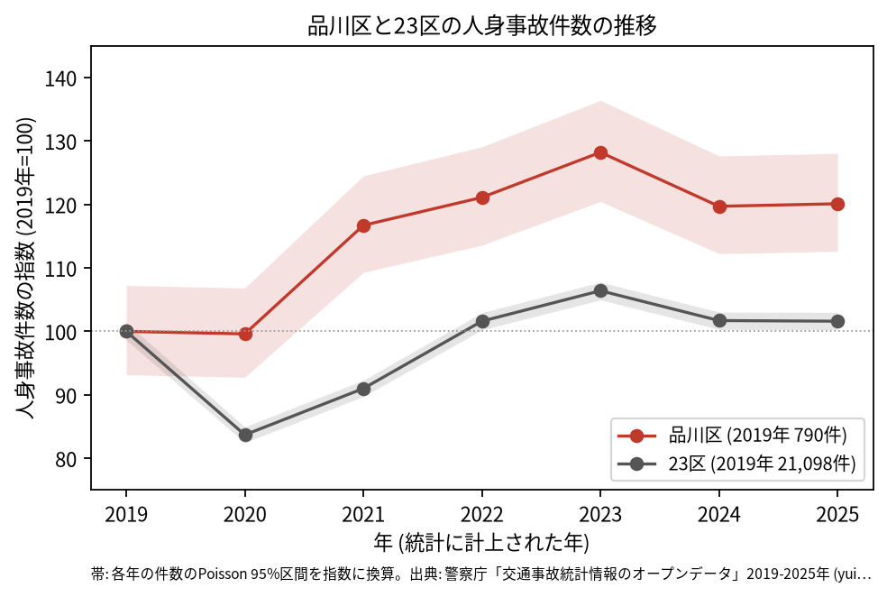
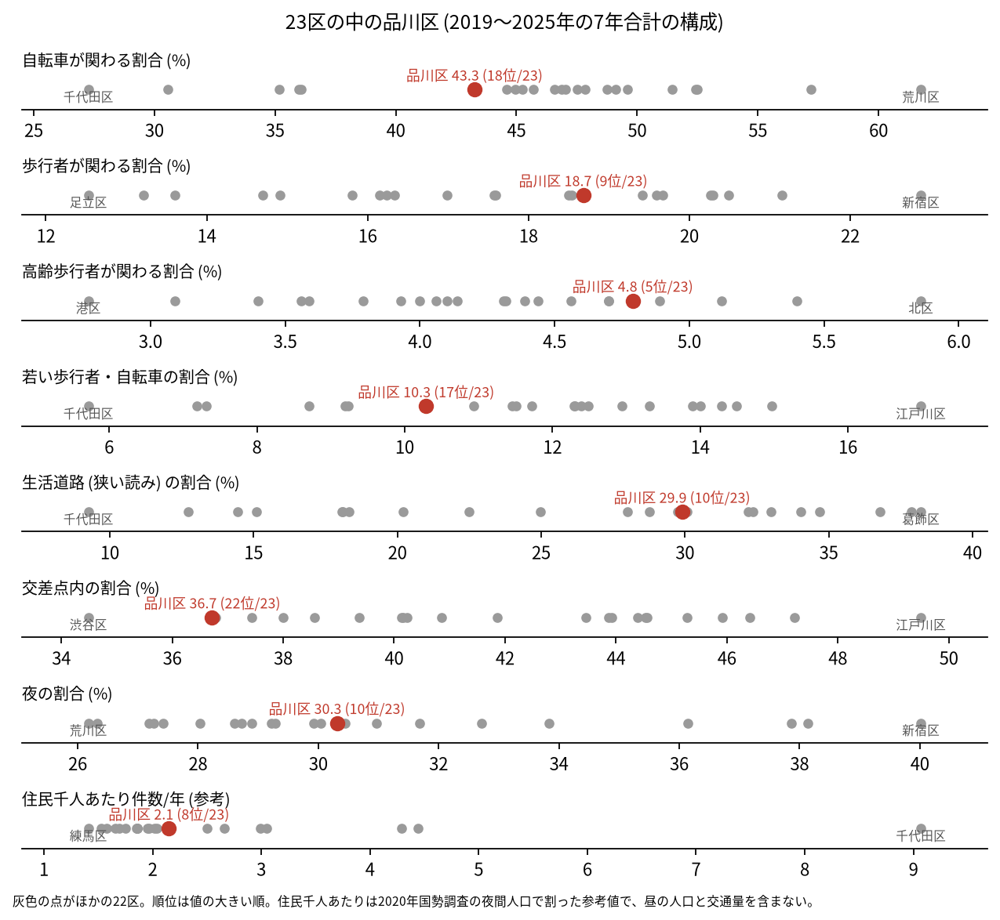
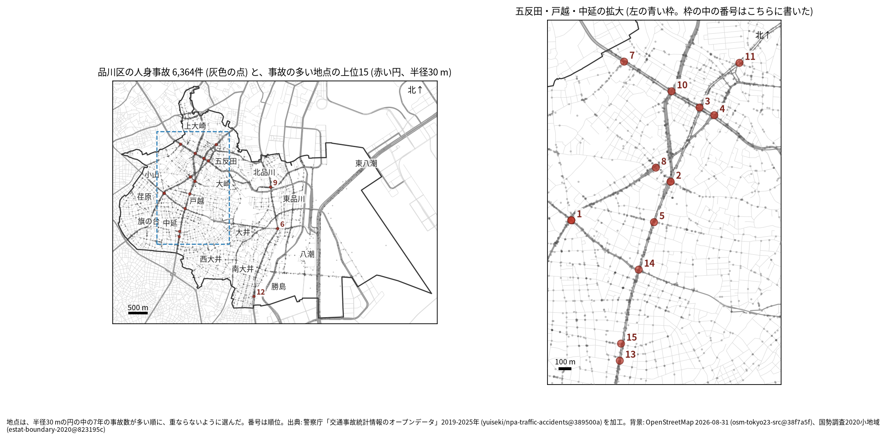
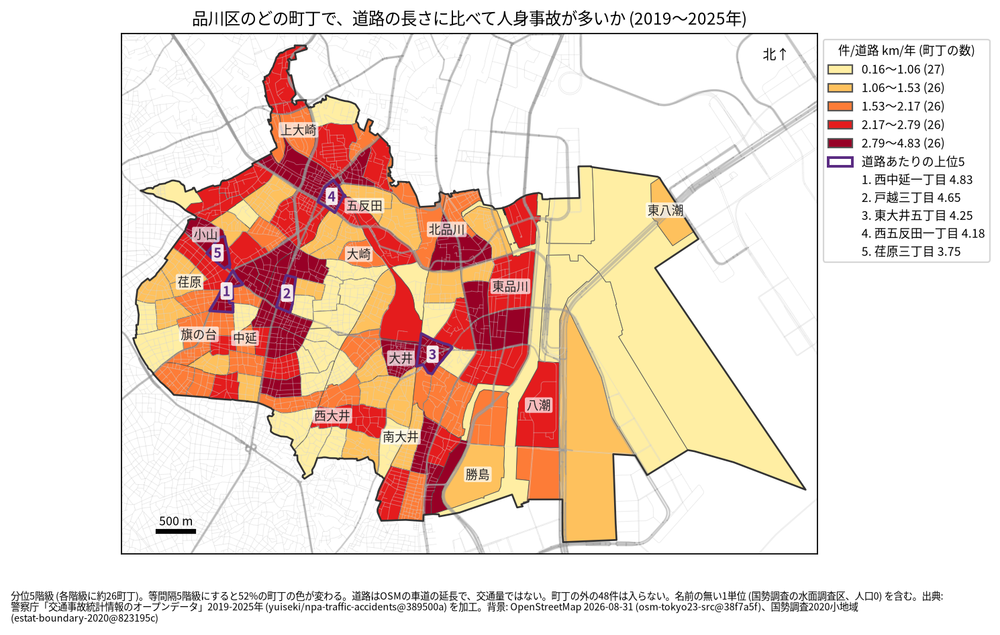
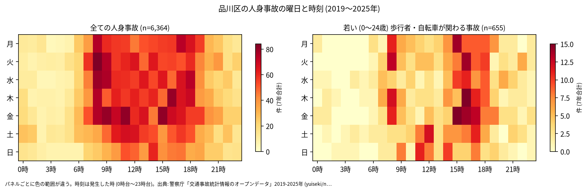
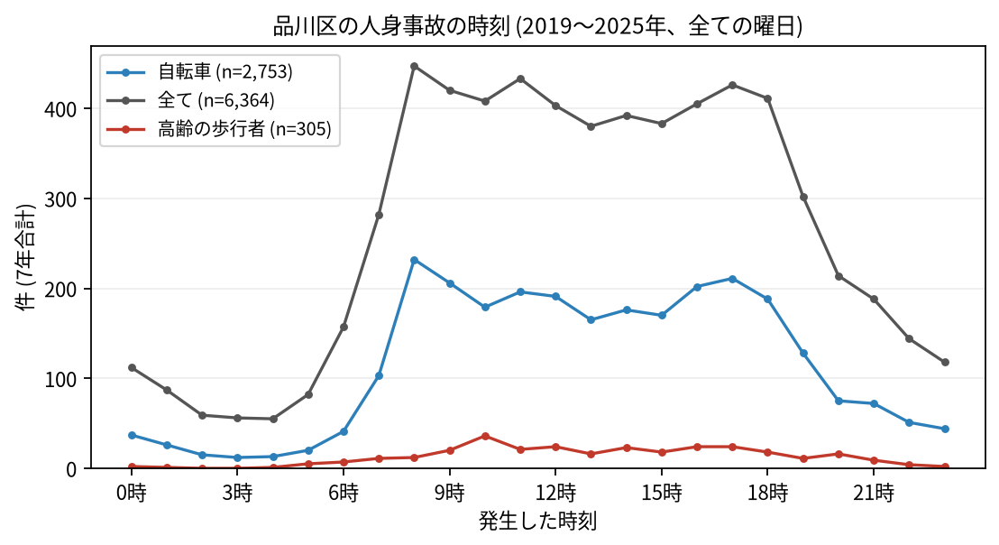
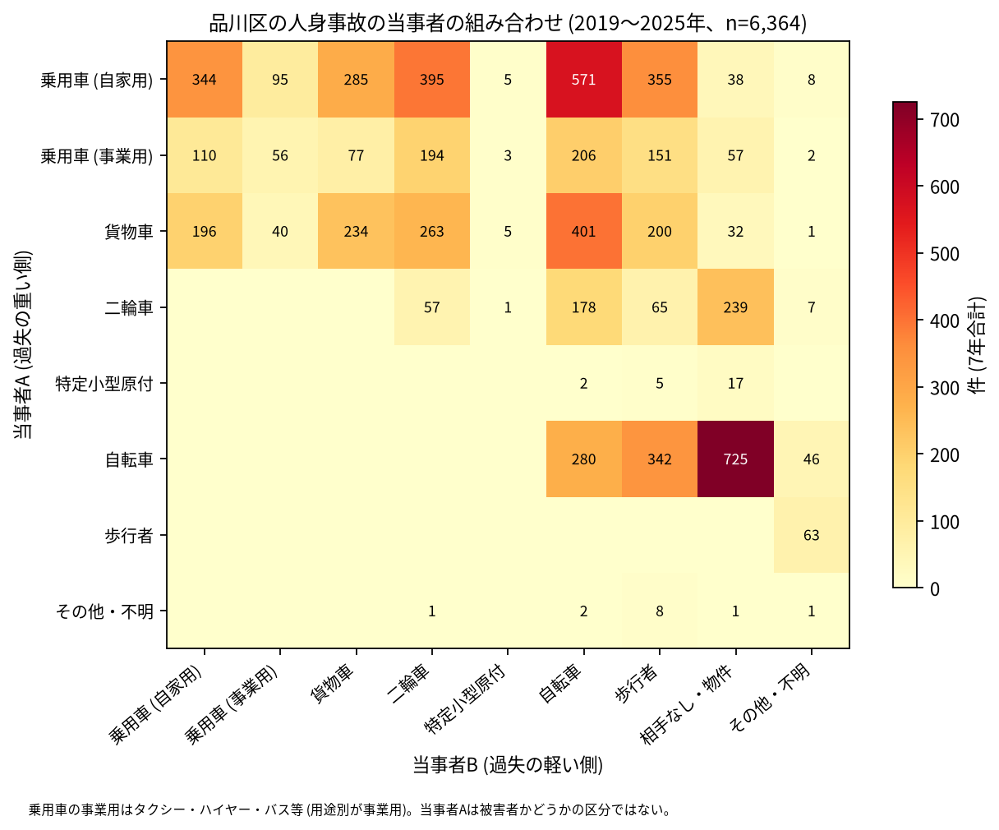

# 品川区の交通事故 2019〜2025 年: 図で読む要点

## 問い

2019〜2025 年の警察記録の人身事故で、品川区の事故はいつ、どこで、誰が関わって起きているか。

## 結論

### 要点

| # | 要点 | 数字 | 図 |
|---:|---|---|---|
| 1 | 件数は 2021 年から増え、2025 年も 2019 年より多い。23 区全体は 2019 年の水準に戻っただけ | 7 年で 6,364 件、死者 19 人、負傷者 6,974 人。指数 (2019 年=100) は 2023 年 128.2、2025 年 120.1。23 区の 2025 年は 101.6 ([yearly.csv](outputs/yearly.csv)、[summary.txt](outputs/summary.txt)) | [図 1](#図-1-件数の推移) |
| 2 | 交差点内の事故の割合は 23 区で低い側にあり、生活道路の割合は中ほどより上 | 交差点内 36.7% (23 区の 22 位)、生活道路 29.9% (10 位)。区道の事故は 7 年で 3,023 件 ([wards.csv](outputs/wards.csv)、[analysis.json](outputs/analysis.json)、[summary.txt](outputs/summary.txt)) | [図 2](#図-2-23-区の中の品川区) |
| 3 | 集まる場所は五反田と、第二京浜と中原街道の戸越から中延 | 事故の多い地点の上位 15 のうち、1〜5、7、8、10、11、13〜15 位が五反田・戸越・中延の拡大図に入る。道路あたりの上位は西中延一丁目 (4.83 件/道路 km/年)、戸越三丁目 (4.65) ([hotspots-map.json](outputs/hotspots-map.json)、[towns.csv](outputs/towns.csv)) | [図 3](#図-3-事故の集まる地点)、[図 4](#図-4-町丁ごとの事故) |
| 4 | 事故の 4 割に自転車が関わり、最も多い組み合わせは自転車の単独 | 43.3%。自転車 (A) と相手なし・物件の事故が 725 件、車やトラックが A で自転車が B の事故が 1,178 件 ([summary.txt](outputs/summary.txt)) | [図 6](#図-6-誰と誰の事故か) |
| 5 | 死亡事故は歩行者と二輪車と、当事者 A が貨物車の事故に偏る | 死亡事故 19 件。亡くなった歩行者 8 人 (65 歳以上が 5 人)、二輪車 5 人。当事者 A が貨物車の事故が 10 件 ([summary.txt](outputs/summary.txt)) | [表 1](#表-1-死亡事故) |

### 読み手ごとに知るべきこと

| 読み手 | 結論 | 検討する材料 | 詳しく |
|---|---|---|---|
| 区の交通安全担当 | 件数は 2019 年より増えた (2025 年の指数 120.1)。自転車が関わる事故が 2019 年の 261 件から 2025 年の 400 件に増えた。生活道路の法定速度 30 km/h (2026-09-01 から) が当たるのは事故の 29.9〜40.2% (読み方による) | 自転車、区道、当事者 A が貨物車の死亡事故 | [municipality.md](reports/municipality.md) |
| 学校と PTA | 若い (0〜24 歳) 歩行者と自転車の事故は 655 件。最も多いのは 16 時台で、朝より下校から夕方が多い | 学校の円の中で、平日 14〜17 時台の点が並ぶ道 | [school-pta.md](reports/school-pta.md) |
| 道路安全診断 | 上位は鮫洲大山線 × 中原街道 (39 件、西中延一丁目)、第二京浜 × 百反通り (30 件)、桜田通り × 山手通り (27 件)。五反田の 3、4、7 位は後半に増えた | 五反田の山手通りの交差点、第二京浜の戸越から中延 | [road-safety-auditor.md](reports/road-safety-auditor.md) |
| 住民 | 道路あたりで多いのは西中延一丁目 (年 4.83 件/道路 km)、戸越三丁目 (4.65 件)。事故は 8 時台から 18 時台まで多く、8 時台が最多 | 自分の町の色、朝の自転車、自転車の単独事故 | [resident.md](reports/resident.md) |

### 図 1: 件数の推移

2020 年に 23 区全体は 83.7 まで下がったが、品川区は 99.6 でほぼ変わらず、2021 年から上がった。2019 年の 95% 区間 (735.9〜847.1 件) は 2021〜2025 年のどの年の区間とも重ならないので、増えたと書ける。区の面に入る点で数えても、2019 年 784 件、2023 年 1,005 件、2025 年 945 件で、上がり方は区のコードの付け方によらない ([analysis.json](outputs/analysis.json))。自転車が関わる事故は 2019 年 261 件から 2023 年 462 件、2025 年 400 件。

### 図 2: 23 区の中の品川区

赤い点が品川区。高齢の歩行者 (4.8%、5 位) と生活道路 (29.9%、10 位) が中ほどより上で、交差点内 (36.7%、22 位) が低い。自転車 (43.3%、18 位) と若い歩行者・自転車 (10.3%、17 位) は低い側。住民千人あたり (2.15 件/年、8 位) は昼の人口を含まない参考値。

### 図 3: 事故の集まる地点

半径 30 m の円の中の 7 年の件数で選んだ上位 15 (22〜39 件)。番号は順位で、五反田・戸越・中延の 12 地点は右の拡大図に番号を書いた。左の図に番号があるのは、第一京浜の 6、9、12 位。

| 順位 | 近い道路 (OSM) | 町丁 | 件数 | 前半 件/年 | 後半 件/年 |
|---:|---|---|---:|---:|---:|
| 1 | 鮫洲大山線 × 中原街道 | 西中延一丁目 | 39 | 6.67 | 4.75 |
| 2 | 第二京浜 × 百反通り | 戸越一丁目 | 30 | 6.67 | 2.50 |
| 3 | 桜田通り × 山手通り | 西五反田二丁目 | 27 | 3.00 | 4.50 |
| 4 | 山手通り × 中原街道 | 西五反田一丁目 | 26 | 2.67 | 4.50 |
| 5 | 第二京浜 × 戸越銀座通り | 戸越三丁目 | 26 | 3.33 | 4.00 |

前半は 2019〜2021 年、後半は 2022〜2025 年。半径を 20 m にしても 50 m にしても、上位 15 のうち 13 地点が残る。首都高速の事故 (区で 156 件) は上位 15 の円に 1 件も入らず、首都高速を除いても 15 地点が全て残る。6〜15 位は [hotspots.csv](outputs/hotspots.csv)。道路名は地点に最も近い OSM の名前で、OSM が 1 本の道に付けた 2 つの名前 (環状六号線と山手通り、東京丸子横浜線と中原街道) はまとめた ([記録](EXPERIMENT_TRACKER.md) の R006)。

### 図 4: 町丁ごとの事故

町丁の事故数を、OSM の車道の延長と 7 年で割った値。紫の枠が上位 5 (西中延一丁目、戸越三丁目、東大井五丁目、西五反田一丁目、荏原三丁目)。分位と等間隔で 52% の町丁の色が変わるので、色の細かい差は読まない。道路の長さは交通量ではない。件数そのものが最も多いのは八潮三丁目 (198 件) だが、道路が 23.3 km と長く、道路あたりは 1.21 件。東の運河と海は、名前の無い 1 単位 (国勢調査の水面調査区、人口 0、事故 77 件) として描いた。

### 図 5: いつ起きるか

全体は平日の 8〜18 時台に広く多い。若い歩行者と自転車は 15〜17 時台に寄り、最多は 16 時台 (75 件)。

自転車は 8 時台 (232 件) と 17 時台 (211 件)、高齢の歩行者は 10 時台 (36 件) が最多。

### 図 6: 誰と誰の事故か

最も多いのは自転車の単独 (相手なし・物件) の 725 件、次が自家用の乗用車 (A) と自転車 (B) の 571 件、貨物車と自転車の 401 件。当事者 A は過失の重い側で、被害者とは限らない。

### 表 1: 死亡事故

| 亡くなった人 | 人数 | 特徴 |
|---|---:|---|
| 歩行者 | 8 | 65 歳以上が 5 人 |
| 二輪車 | 5 | |
| 自転車 | 4 | |
| 乗用車 (自家用) | 1 | |
| 補充票の人 | 1 | 当事者 A と B の外の人 |

19 件のうち当事者 A が貨物車の事故が 10 件。0〜5 時台は 3 件。数が少ないので傾向とは断定しない。全件は [deaths.csv](outputs/deaths.csv)。

### 読み方で変わる答え

| 読み方 | 主 | 別の読み方 |
|---|---|---|
| 品川区の事故 | `市区町村コード` 109 の 6,364 件 | 点が区の面に入る事故。両方に当てはまるのは 6,316 件 |
| 生活道路 | 狭い読み 29.9% (10 位) | 広い読み 40.2% (13 位) |
| 地点の半径 | 30 m | 20 m で 13 地点、50 m で 13 地点が残る |
| 首都高速 | 含める | 除いても 15 地点が全て残る |
| 町丁の階級 | 分位 5 階級 | 等間隔で 52% の町丁の色が変わる |

## データ

- 人身事故: 警察庁「交通事故統計情報のオープンデータ」を加工した `yuiseki/npa-traffic-accidents` 版 `389500aae5cec45f1311163f70db6a5f05867838` (配布元の取得 2026-10-02) の本票。年はファイルの年 (統計に計上された年)。品川区 6,364 件、23 区 144,716 件。位置の無い行は 0。物損事故は含まない。
- 区の面と人口: `yuiseki/jp-admin-2026-09` 版 `e6c87b1`。町丁: 2020 年国勢調査の小地域 `yuiseki/estat-boundary-2020` 版 `823195c` (131 町丁、422,488 人)。学校 41 校と道路: OpenStreetMap 2026-08-31、`yuiseki/osm-tokyo23-src-2026-08` 版 `38f7a5f`。
- 道具: DuckDB (spatial)、matplotlib、`analysis-visualize` の `cjk_font.py`、`classify_map.py`、`context_map.py`。版は [analysis.json](outputs/analysis.json) と図ごとの JSON。
- 出典の表示: 警察庁ウェブサイト (https://www.npa.go.jp/publications/statistics/koutsuu/opendata/index_opendata.html) の交通事故統計情報のオープンデータを加工して作成。国勢調査の小地域境界と人口、OpenStreetMap (© OpenStreetMap contributors) を加工して使用。

## 方法

- 型は台東区の分析 ([report.md](../taito-accident-trends-by-role/report.md)) と同じ。読み方は結果を見る前に [計画](EXPERIMENT_PLAN.md) で固定し、実行は [記録](EXPERIMENT_TRACKER.md) に残した。品川区で足した読みは、首都高速 (`路線コード` 5000〜5499) を除いた地点の 1 つ。生活道路は `車道幅員` が 01、02、11 (狭い読み)、広い読みは 14、17 を足す。歩行者や自転車が関わるかは当事者 A と B の両方で見て、1 件を 1 回数えた。
- 距離は EPSG:6677 (メートル) で測った。地点は、半径 30 m の中の件数が最も多い点を中心に選び、その円の事故を除いて次を選ぶ手順を 15 回くり返した。
- 地図は `analysis-visualize` の map-context に合わせ、地名と道路を重ね、凡例を地図の外に置き、強調した単位に番号を付けた。町丁は穴を残して塗り、描いた町丁の数 (131) を分析の数と照らした。文字の重なりと、地名が円や学校の印を隠す重なりは、3 枚の地図で 0 件 (地名 5 つをずらし、町丁の地図で戸越を省いた後)。背景の道路 (OGC:CRS84) と町丁 (JGD2000) の差は、線の幅より小さいとして変換せずに重ねた。
- 関門: 予測と回帰をしないので、評価の分け方と残差の確認は要らない。単位の間の相関を結論にしないので、Moran's I と格子の掃引は省いた。推移は 23 区全体を基準にし、年の件数に Poisson の 95% 区間を付けた。対策の効果は推定していない。
- 再実行は [README.md](README.md)。数値は [outputs/](outputs/) の CSV、来歴は [analysis.json](outputs/analysis.json)。

## 確かめていないこと

- 交通量、昼の人口、来訪者の数で割っていない。五反田などの件数の多さは、人と車の多さかもしれない。
- 件数が 2021 年から増えた理由 (自転車の利用、配達、記録の仕方) は調べていない。
- 位置の精度は分からない。30 m の地点と町丁の境界の近くの事故は、数十 m のずれで入れ替わる。
- 事故の型 (出会い頭、追突)、重傷と軽傷の区別、物損事故、ヒヤリハットは、このデータに無い。
- 0〜24 歳より細かい年齢は無く、小学生だけは数えられない。
- 地点の上位は 7 年で選び、同じ 7 年で前半と後半を比べたので、後半が下がって見えやすい (平均への回帰)。
