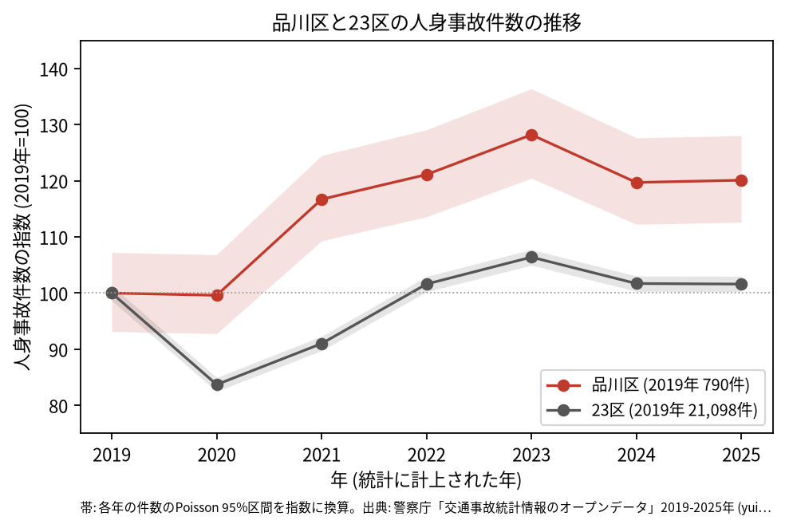
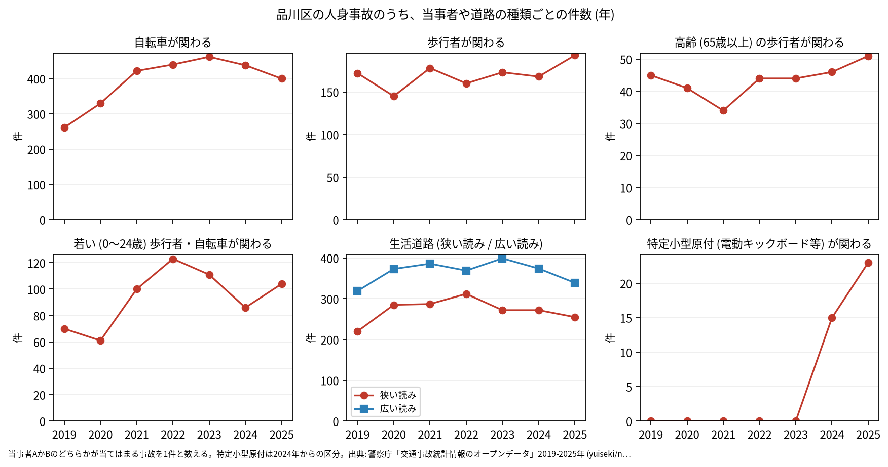
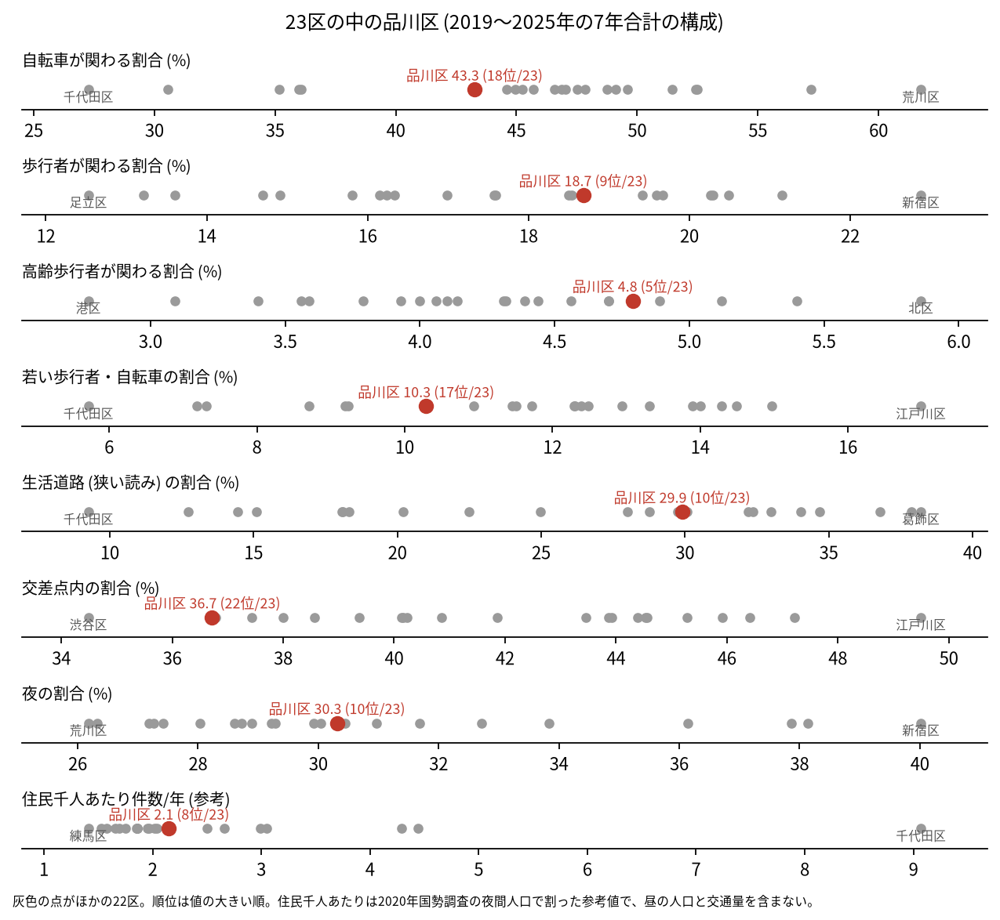

# 区の交通安全担当のための報告: 品川区の交通事故の傾向

## 問い

品川区の人身事故は 2019〜2025 年にどう推移し、23 区の中でどんな特徴があり、施策をどこに向ける材料になるか。

## 結論

- 件数: 7 年で 6,364 件、死者 19 人、負傷者 6,974 人です。2020 年は 787 件 (2019 年を 100 として 99.6) で、23 区全体 (83.7) のようには下がりませんでした。2021 年から上がり、2023 年は 1,013 件 (128.2)、2025 年は 949 件 (120.1) です。2025 年の 95% 区間 (889.6〜1011.4 件) は 2019 年の区間 (735.9〜847.1 件) と重ならないので、2019 年より増えたと言えます。23 区全体の 2025 年は 101.6 です。

- 増えた区分: 自転車が関わる事故は 2019 年の 261 件から 2023 年の 462 件、2025 年の 400 件になりました。23 区全体の自転車は 8,539 件から 10,016 件です ([yearly.csv](../outputs/yearly.csv))。特定小型原付 (電動キックボードなど) が関わる事故は、区分のできた 2024 年に 15 件、2025 年に 23 件でした。区の面に入る点で数えても上がり方は同じで (2019 年 784 件、2025 年 945 件、[analysis.json](../outputs/analysis.json))、区のコードの付け方の変化では説明できません。増えた理由は調べていません。

- 23 区の中の位置: 交差点内の割合は 36.7% で 23 区の 22 位と低く、生活道路 (狭い読み) の割合は 29.9% で 10 位、広い読みでは 40.2% で 13 位です。高齢の歩行者が関わる割合は 4.8% で 5 位、歩行者は 18.7% で 9 位です。自転車が関わる割合 (43.3%) は 18 位、若い歩行者と自転車 (10.3%) は 17 位です。道路の種類では、区道の事故が 7 年で 3,023 件、国道が 1,127 件でした ([summary.txt](../outputs/summary.txt))。

- 施策への読み方: 2026-09-01 からの生活道路の法定速度 30 km/h が当たるのは、品川区の事故のうち 29.9〜40.2% (読み方による) です。事故の集まる地点は、五反田の山手通りの交差点と、第二京浜と中原街道の戸越から中延にあります (地点は [道路安全診断の報告](road-safety-auditor.md))。これは効果の予測ではなく、どの道路で事故が起きているかの構成です。
- 死亡事故: 19 件のうち、亡くなったのは歩行者 8 人、二輪車 5 人、自転車 4 人、乗用車 1 人、補充票の人 1 人です。亡くなった歩行者 8 人のうち 5 人が 65 歳以上でした。当事者 A (過失の重い側) が貨物車の事故が 10 件です。19 件は少なく、偏りを傾向と断定できる数ではありません。

| 年 | 当事者 A | 当事者 B | 亡くなった人 | 時 |
|---|---|---|---|---:|
| 2019 | 貨物車 | 自転車 (65〜74 歳) | 自転車 | 8 |
| 2019 | 貨物車 | 歩行者 (75 歳以上) | 歩行者 | 13 |
| 2020 | 貨物車 | 相手なし・物件 | 補充票の人 | 15 |
| 2020 | 貨物車 | 自転車 (55〜64 歳) | 自転車 | 18 |
| 2020 | 貨物車 | 二輪車 (55〜64 歳) | 二輪車 | 9 |
| 2023 | 貨物車 | 歩行者 (75 歳以上) | 歩行者 | 10 |
| 2024 | 貨物車 | 二輪車 (35〜44 歳) | 二輪車 | 9 |
| 2024 | 貨物車 | 二輪車 (45〜54 歳) | 二輪車 | 7 |
| 2024 | 貨物車 | 歩行者 (65〜74 歳) | 歩行者 | 14 |
| 2025 | 貨物車 | 歩行者 (35〜44 歳) | 歩行者 | 4 |

表は、当事者 A が貨物車の死亡事故 10 件の抜き出しです。19 件 ([summary.txt](../outputs/summary.txt)) の全ては [deaths.csv](../outputs/deaths.csv) にあります。

- 人口あたり: 2020 年の住民千人あたりの年の件数は 2.15 件で 23 区の 8 位ですが、分母に昼の人口、来訪者、通過する車が入らないため、区の比較の主な指標にしていません。

## データ

警察庁「交通事故統計情報のオープンデータ」を加工した `yuiseki/npa-traffic-accidents` 版 `389500a` の本票。品川区は `市区町村コード` 109 の 6,364 件、23 区は 144,716 件。年はファイルの年 (統計に計上された年)。区の人口は 2020 年国勢調査 (`jp-admin-2026-09` 版 `e6c87b1`)。詳しくは [共通の報告](../report.md)。

## 方法

区分は、当事者 A か B のどちらかが当てはまる事故を 1 件と数えました。生活道路は `車道幅員` で決め、狭い読み (5.5 m 未満の単路と、小と小の交差点) と、広い読み (5.5 m 未満の道とより広い道の交差点も含む) を並べました。年の区間は件数の Poisson の 95% 区間 (Garwood) です。23 区の順位は 7 年合計の割合の大きい順です。道路の種類は `路線コード` で分けました。

## 確かめていないこと

- 2020 年に 23 区ほど下がらず、2021 年から増えた理由 (自転車の利用、配達、人出など) は調べていません。
- 区の施策 (ゾーン 30、自転車の通行帯など) の効果は推定していません。割合の順位は施策の評価ではありません。
- 重傷と軽傷の区別、物損事故は、このデータにありません。
