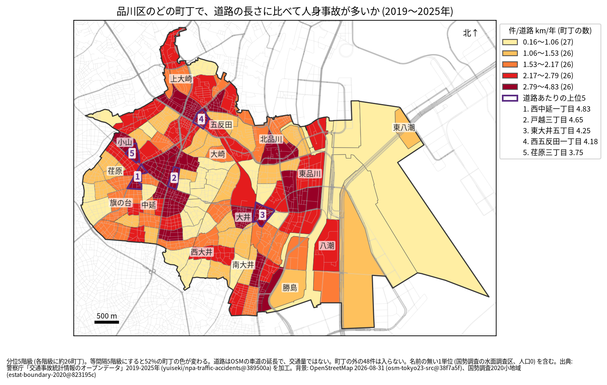
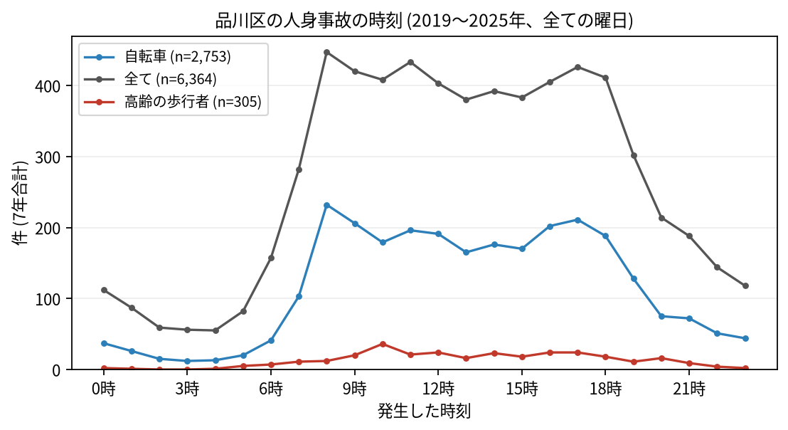

# 住民のための報告: 品川区で、いつ、どこで事故が起きているか

## 問い

品川区に住む人が、自分の町で、いつ、どんな事故に気をつければよいか。2019〜2025 年の警察記録の人身事故から調べました。

## 結論

- 品川区では 7 年で 6,364 件の人身事故があり、19 人が亡くなりました。年に 787〜1,013 件で、2021 年からは 2019 年より多い年が続いています。
- 町ごと: 道路 1 km あたりの事故が多いのは、西中延一丁目 (年 4.83 件)、戸越三丁目 (4.65 件)、東大井五丁目 (4.25 件)、西五反田一丁目 (4.18 件)、荏原三丁目 (3.75 件) です。件数そのものが最も多いのは八潮三丁目 (7 年で 198 件) で、次が西五反田二丁目 (183 件) でした。八潮三丁目は道路が長く (23.3 km)、道路あたりでは 1.21 件です。

色は分位 5 階級で、各色に約 26 の町が入ります。等間隔の階級にすると 52% の町の色が変わるので、色の差より、自分の町が上の階級か下の階級かを見てください。東の運河と海は、名前の無い 1 単位 (国勢調査の水面調査区、人口 0) で、橋や海の上の道路の事故 77 件が入っています。

- 時間: 事故は朝 8 時台から増え、夕方 18 時台まで高い水準が続きます。最も多いのは 8 時台 (447 件) で、11 時台 (433 件)、17 時台 (426 件) が続きます。自転車が関わる事故は 8 時台 (232 件) と 17 時台 (211 件) に多く、高齢の歩行者が関わる事故は 10 時台 (36 件) が最も多い時間でした。

- 誰が: 自転車が関わる事故が全体の 43.3% で、最も多い区分です。自転車に乗る人は、車やトラックとの事故 (1,178 件) に加え、自転車だけの事故 (転倒や物への衝突、725 件) にも気をつけてください。自転車だけの事故は、当事者の組み合わせの中で最も多い組です。歩行者が関わる事故は 18.7% です。
- 亡くなった人: 19 人のうち 8 人が歩行者で、そのうち 5 人が 65 歳以上でした。二輪車の人が 5 人、自転車の人が 4 人です。

## データ

警察庁「交通事故統計情報のオープンデータ」を加工した `yuiseki/npa-traffic-accidents` 版 `389500a` の本票、品川区の 6,364 件 (2019〜2025 年のファイル)。町の境界は 2020 年国勢調査の小地域 (131 町丁)、道路は OpenStreetMap 2026-08-31。詳しくは [共通の報告](../report.md)。

## 方法

事故の地点を町丁の境界に入れて数え、町丁の中の車道の長さ (OSM) と 7 年で割りました。区の境界の近くで町丁の外に落ちた 48 件は町の値に入っていません。時刻は事故の起きた時で、7 年の合計です。

## 確かめていないこと

- 道路の長さは、通る車や人の数ではありません。五反田や戸越の値が高いのは、人と車が多いためかもしれません。
- 自分の町の事故が少なくても、物損事故やヒヤリハットはこのデータにありません。
- 事故の位置の精度は分かりません。町の境界の近くの事故は、隣の町に数えられている可能性があります。
