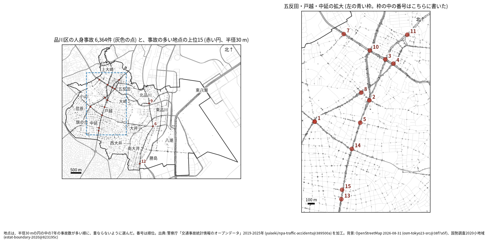
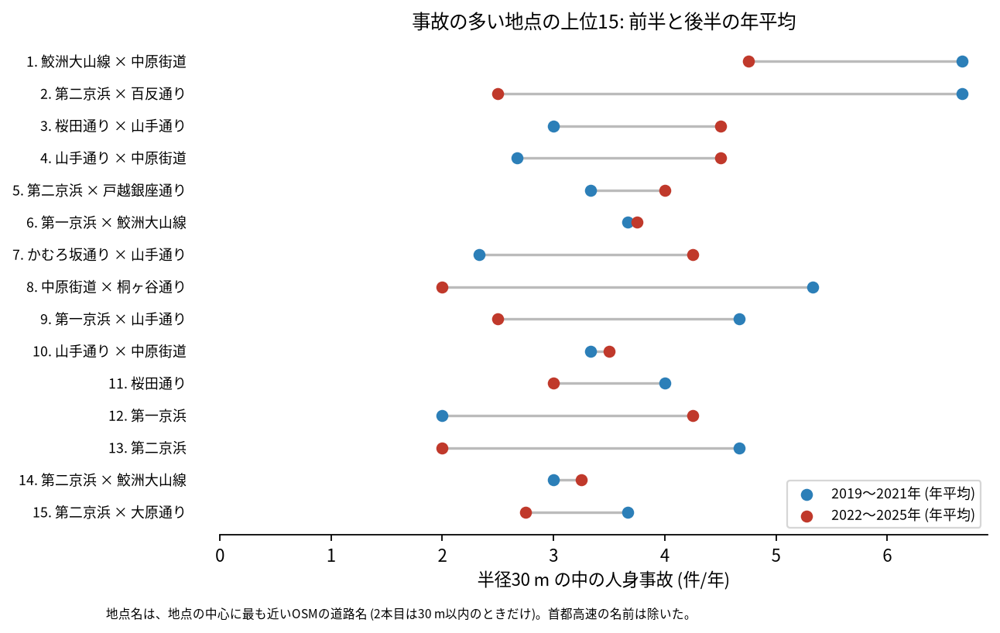
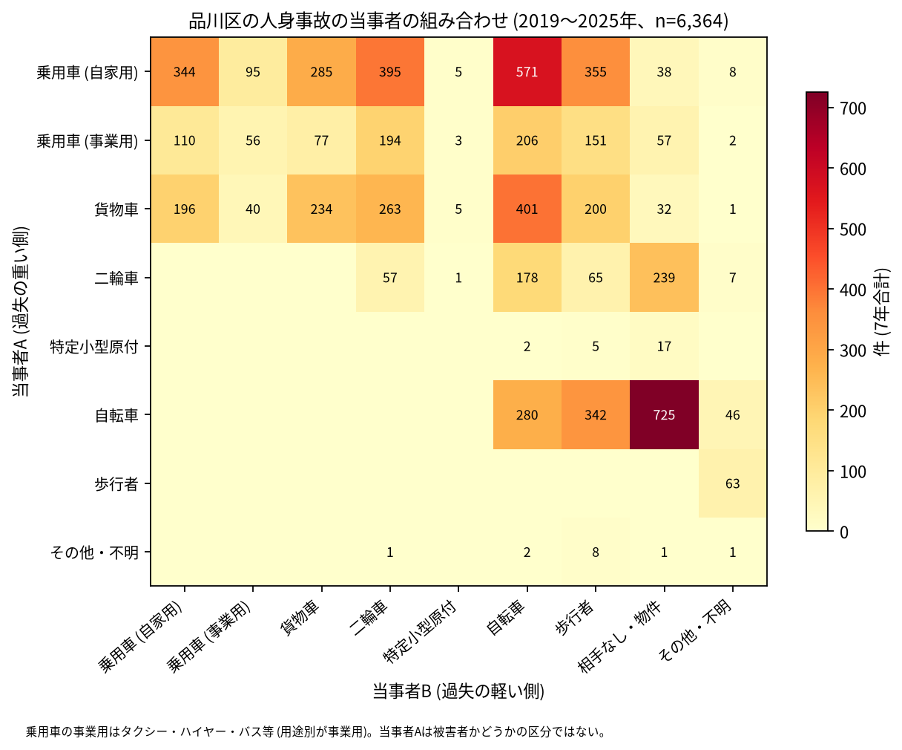

# 道路安全診断のための報告: 品川区で事故の集まる地点

## 問い

品川区で 2019〜2025 年の人身事故が集まる地点はどこで、そこでは誰と誰の事故が多いか。現地診断の候補を選ぶ材料にします。

## 結論

- 半径 30 m の円の中の 7 年の件数で選んだ上位 15 地点は、22〜39 件です。15 のうち 12 は五反田、戸越、中延 (山手通り、桜田通り、中原街道、第二京浜、鮫洲大山線が通る範囲) にあり、残りの 3 つ (6、9、12 位) は第一京浜の南品川、北品川、南大井です。

| 順位 | 近い道路 (OSM) | 町丁 | 件数 | 前半 件/年 | 後半 件/年 | 交差点内 | 信号あり | 多い組み合わせ (A × B) |
|---:|---|---|---:|---:|---:|---:|---:|---|
| 1 | 鮫洲大山線 × 中原街道 | 西中延一丁目 | 39 | 6.67 | 4.75 | 30 | 27 | 乗用車 (自家用) × 自転車 |
| 2 | 第二京浜 × 百反通り | 戸越一丁目 | 30 | 6.67 | 2.50 | 17 | 24 | 乗用車 (自家用) × 二輪車 |
| 3 | 桜田通り × 山手通り | 西五反田二丁目 | 27 | 3.00 | 4.50 | 19 | 24 | 乗用車 (自家用) × 自転車 |
| 4 | 山手通り × 中原街道 | 西五反田一丁目 | 26 | 2.67 | 4.50 | 15 | 20 | 乗用車 (自家用) × 自転車 |
| 5 | 第二京浜 × 戸越銀座通り | 戸越三丁目 | 26 | 3.33 | 4.00 | 12 | 18 | 乗用車 (自家用) × 乗用車 (自家用) |
| 6 | 第一京浜 × 鮫洲大山線 | 南品川三丁目 | 26 | 3.67 | 3.75 | 21 | 22 | 乗用車 (事業用) × 自転車 |
| 7 | かむろ坂通り × 山手通り | 西五反田四丁目 | 24 | 2.33 | 4.25 | 21 | 20 | 乗用車 (自家用) × 自転車 |
| 8 | 中原街道 × 桐ヶ谷通り | 平塚二丁目 | 24 | 5.33 | 2.00 | 17 | 19 | 乗用車 (自家用) × 二輪車 |
| 9 | 第一京浜 × 山手通り | 北品川二丁目 | 24 | 4.67 | 2.50 | 14 | 19 | 貨物車 × 貨物車 |
| 10 | 山手通り × 中原街道 | 西五反田二丁目 | 24 | 3.33 | 3.50 | 21 | 24 | 乗用車 (自家用) × 自転車 |

前半は 2019〜2021 年、後半は 2022〜2025 年。11〜15 位と、歩行者、自転車、夜の件数は [hotspots.csv](../outputs/hotspots.csv) にあります。道路名は地点の中心に最も近い OSM の道路名で、2 本目は 30 m 以内のときだけ書きました (首都高速の名前は除いた)。OSM が 1 本の道に付けた 2 つの名前 (環状六号線と山手通り、東京丸子横浜線と中原街道) はまとめました。まとめる前は、4 位が「環状六号線 × 山手通り」と、1 本の道の名前を 2 つ並べていました ([記録](../EXPERIMENT_TRACKER.md) の R006)。4 位と 10 位は同じ 2 本の道の名前ですが、中心は約 400 m 離れた別の地点です。

- 続いているか: 上位 15 は全て前半と後半の両方に事故があります。2 位 (6.67 から 2.50 件/年)、8 位 (5.33 から 2.00 件/年)、13 位 (4.67 から 2.00 件/年) は後半に減り、五反田の 3 位 (3.00 から 4.50 件/年)、4 位 (2.67 から 4.50 件/年)、7 位 (2.33 から 4.25 件/年) と、第一京浜の 12 位 (2.00 から 4.25 件/年) は増えました。上位は 7 年合計で選んだので、後半が下がって見えやすい (平均への回帰) ことに注意してください。

- 組み合わせ: 当事者 A が乗用車か貨物車で B が自転車の事故は 1,178 件です。自転車の単独 (相手なし・物件) が 725 件、自転車どうしが 280 件、自転車と歩行者 (自転車が A) が 342 件ありました。事業用の乗用車 (タクシー、ハイヤー、バスなど) は 856 件で当事者 A です。

- 半径と首都高速を変えると: 20 m の上位 15 の中心が、30 m の上位 15 の中心から 30 m 以内にあるのは 13 地点、50 m でも 13 地点でした。品川区では首都高速 (`路線コード` 5000〜5499) の事故が 156 件ありますが、上位 15 の円には 1 件も入らず、首都高速を除いて選び直しても 15 地点が全て残ります ([analysis.json](../outputs/analysis.json))。2 位、8 位、10 位の中心は首都高速 2 号目黒線の線から数 m の所にありますが、円の中の事故の路線は首都高速ではありません。

## データ

警察庁「交通事故統計情報のオープンデータ」を加工した `yuiseki/npa-traffic-accidents` 版 `389500a` の本票、品川区 (`市区町村コード` 109) の 6,364 件。道路名は OpenStreetMap 2026-08-31 (`osm-tokyo23-src-2026-08` 版 `38f7a5f`)。詳しくは [共通の報告](../report.md)。

## 方法

事故の点を EPSG:6677 (メートル) に変換し、半径 30 m の円の中の件数が最も多い事故の点を中心に選び、その円の事故を除いて次を選ぶ手順を 15 回くり返しました。30 m はコード表の「交差点付近」(交差点の側端から 30 m 以内) の幅です。信号ありは `信号機` が 3 灯式、押ボタン式、歩車分式の点灯。組み合わせは当事者 A (過失の重い側) と B の種別で、乗用車は `用途別` で事業用と自家用に分けました。首都高速は `路線コード` 5000〜5499 です。

## 確かめていないこと

- 交通量で割っていません。件数の多い交差点が、車の多さに比べて危険かは分かりません。
- 事故の型 (出会い頭、右折、追突)、違反の種類、重傷と軽傷の区別は、このデータにありません。現地で確かめてください。
- 位置の精度は分かりません。数十 m のずれで地点の件数は変わります。五反田の 3 位と 4 位は約 140 m、中延の 13 位と 15 位は約 140 m の間隔で並んでいて、同じ交差点の事故が 2 つの地点に分かれている可能性があります。
- 道路の名前は OSM の名前で、ほかにもまとめるべき別名が残っている可能性があります。
- 偶然でもこの程度の集まりが生まれるか (順位の有意さ) は調べていません。
