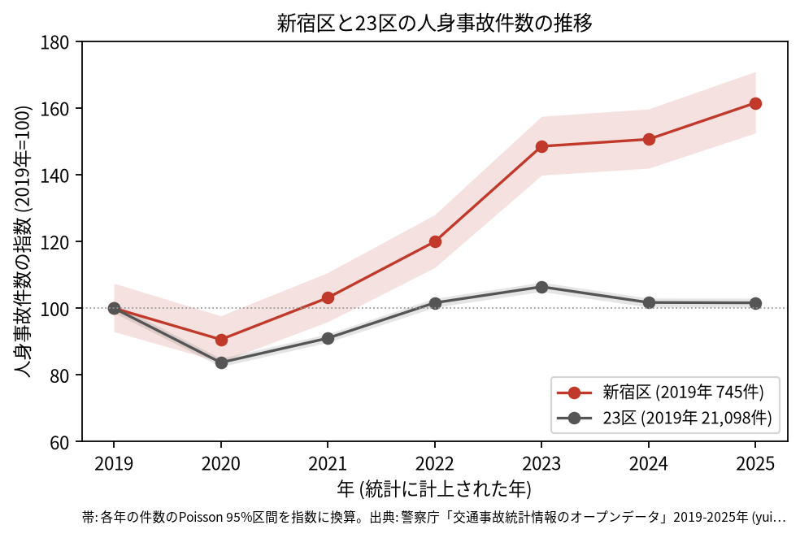
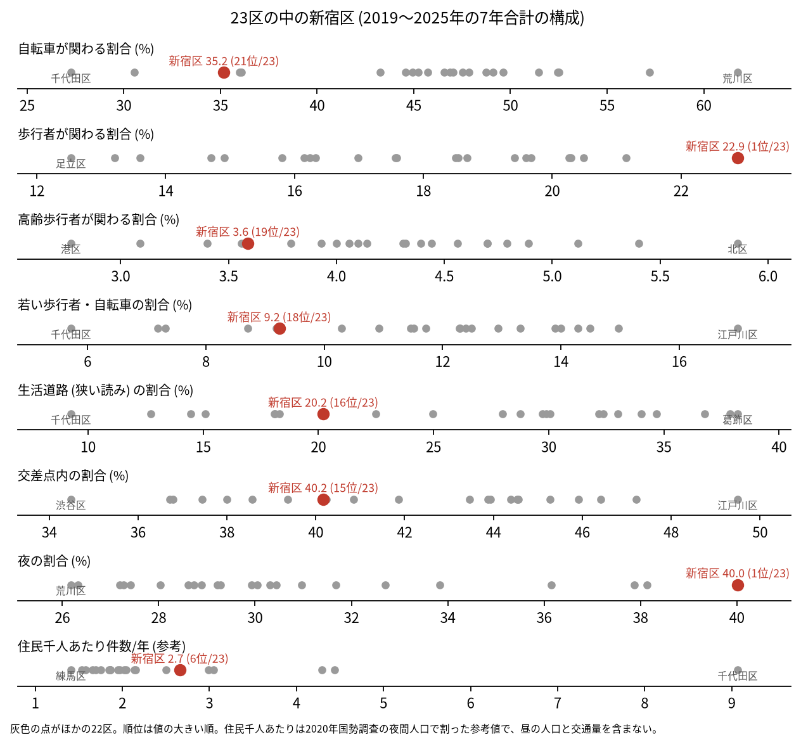
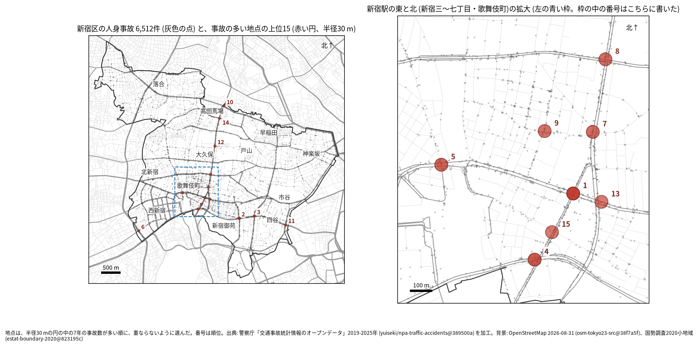
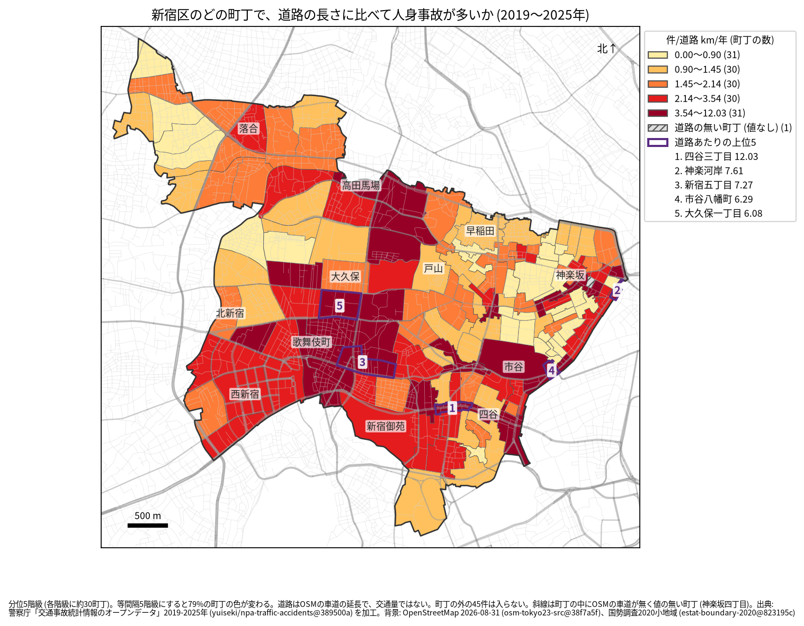
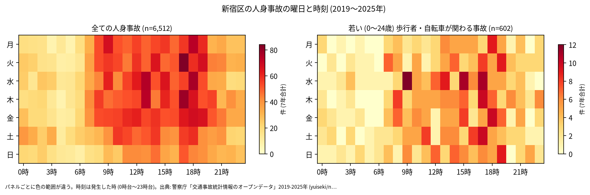
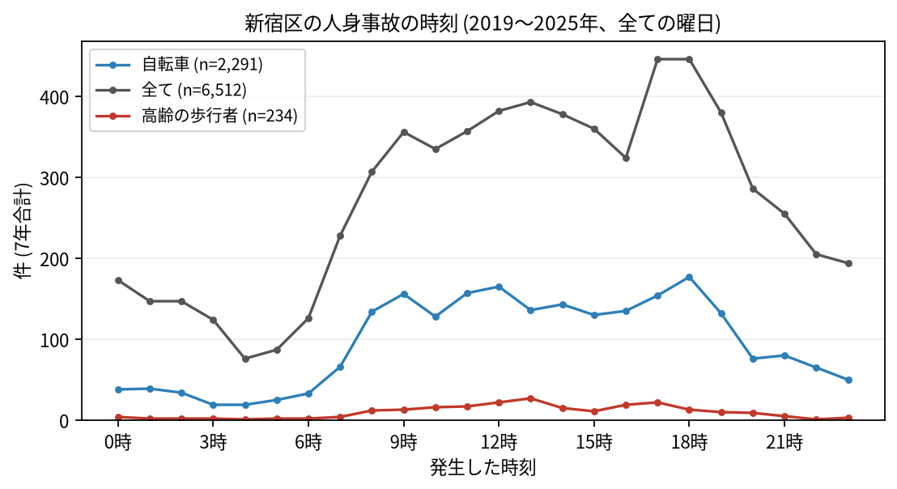
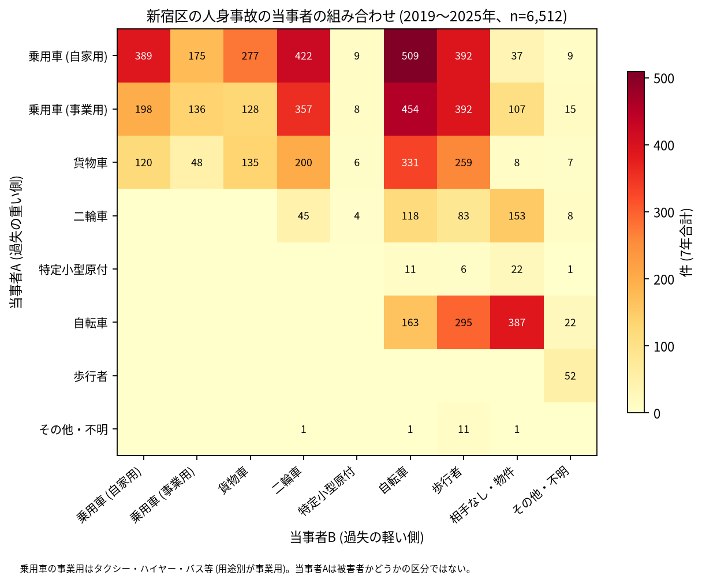

# 新宿区の交通事故 2019〜2025 年: 図で読む要点

## 問い

2019〜2025 年の警察記録の人身事故で、新宿区の事故はいつ、どこで、誰が関わって起きているか。

## 結論

### 要点

| # | 要点 | 数字 | 図 |
|---:|---|---|---|
| 1 | 件数は 2020 年に減った後、2022 年から増え続け、2025 年は 2019 年より増えた。23 区全体はほぼ横ばい | 7 年で 6,512 件、死者 32 人、負傷者 7,245 人。指数 (2019 年=100) は 2020 年 90.6、2025 年 161.5。23 区全体の 2025 年は 101.6 ([yearly.csv](outputs/yearly.csv)、[summary.txt](outputs/summary.txt)) | [図 1](#図-1-件数の推移) |
| 2 | 歩行者が関わる割合と夜の割合が、23 区で最も高い。自転車の割合は低い | 歩行者 22.9% (23 区の 1 位)、夜 40.0% (1 位)、自転車 35.2% (21 位) ([wards.csv](outputs/wards.csv)、[analysis.json](outputs/analysis.json)) | [図 2](#図-2-23-区の中の新宿区) |
| 3 | 集まる場所は新宿駅の東と北、それに新宿通りの四谷 | 事故の多い地点の上位 15 のうち 8 が新宿駅の東と北 (新宿三〜七丁目、歌舞伎町、西新宿七丁目)、2 位、3 位、11 位が新宿通り。道路あたりの 1 位は四谷三丁目 (年 12.03 件/道路 km) ([hotspots.csv](outputs/hotspots.csv)、[hotspots-map.json](outputs/hotspots-map.json)、[towns.csv](outputs/towns.csv)) | [図 3](#図-3-事故の集まる地点)、[図 4](#図-4-町丁ごとの事故) |
| 4 | 乗用車が当事者 A の事故が多く、事業用 (タクシーなど) も多い | 当事者 A が自家用の乗用車 2,219 件、事業用の乗用車 1,795 件。自家用の乗用車 (A) と自転車 (B) が 509 件、事業用の乗用車と自転車が 454 件 ([summary.txt](outputs/summary.txt)) | [図 6](#図-6-誰と誰の事故か) |
| 5 | 死亡事故は歩行者と貨物車に偏る | 死者 32 人のうち歩行者 20 人 (65 歳以上が 8 人)。当事者 A が貨物車の事故が 14 件、0〜5 時台が 10 件 ([summary.txt](outputs/summary.txt)) | [表 1](#表-1-死亡事故) |

### 読み手ごとに知るべきこと

| 読み手 | 結論 | 検討する材料 | 詳しく |
|---|---|---|---|
| 区の交通安全担当 | 件数は 2025 年に 2019 年の 161.5% まで増えた (指数 161.5)。生活道路の法定速度 30 km/h (2026-09-01 から) が当たるのは事故の 20.2〜32.4% (読み方による) | 増えた理由の確かめ、新宿駅の周りの幹線の交差点、夜の歩行者 | [municipality.md](reports/municipality.md) |
| 学校と PTA | 若い (0〜24 歳) 歩行者と自転車の事故は 602 件。最も多いのは 17 時台 (53 件) で、朝より夕方が多い | 学校の円の中で、平日 14〜17 時台の点が並ぶ道 | [school-pta.md](reports/school-pta.md) |
| 道路安全診断 | 上位は明治通り × 靖国通り (47 件)、新宿通り × 甲州街道 (45 件)、新宿通り × 外苑東通り (39 件) | 後半に大きく増えた 6 位と 13 位、歩行者の多い 9 位 (歌舞伎町) | [road-safety-auditor.md](reports/road-safety-auditor.md) |
| 住民 | 道路あたりで多いのは四谷三丁目 (年 12.03 件/道路 km)、神楽河岸 (7.61 件)、新宿五丁目 (7.27 件)。事故の 40.0% が夜 | 自分の町の色、夕方 17〜18 時台、夜に大通りを渡るとき | [resident.md](reports/resident.md) |

### 図 1: 件数の推移

2020 年の落ち込み (90.6) は 23 区全体 (83.7) より浅い。2022 年から 23 区全体を大きく上回り、2025 年の 95% 区間 (1,136〜1,273 件) は 2019 年 (692.5〜800.5 件) と重ならないので、増えたと書ける。23 区全体の 2025 年 (21,151〜21,726 件) は 2019 年 (20,814〜21,385 件) と重なる。増えた理由は調べていない。警察署等コードごとに数えると、主な 4 つのコード (435〜438) のどれでも 2019 年より 2025 年が多く、1 つの署の記録だけが増えたのではない ([analysis.json](outputs/analysis.json))。

### 図 2: 23 区の中の新宿区

赤い点が新宿区。歩行者 (22.9%) と夜 (40.0%) が 23 区で 1 位、自転車 (35.2%、21 位)、高齢の歩行者 (3.6%、19 位)、若い歩行者・自転車 (9.2%、18 位) が低い。生活道路 (狭い読み 20.2%、16 位) と交差点内 (40.2%、15 位) は中ほど。台東区は歩行者 19.4%、夜 31.0% ([台東区の wards.csv](../taito-accident-trends-by-role/outputs/wards.csv))。住民千人あたり (2.66 件/年、6 位) は昼の人口を含まない参考値。

### 図 3: 事故の集まる地点

半径 30 m の円の中の 7 年の件数で選んだ上位 15 (25〜47 件)。番号は順位で、新宿駅の東と北の 8 地点は右の拡大図に番号を書いた。

| 順位 | 近い道路 (OSM) | 町丁 | 件数 | 前半 件/年 | 後半 件/年 |
|---:|---|---|---:|---:|---:|
| 1 | 明治通り × 靖国通り | 新宿五丁目 | 47 | 5.67 | 7.50 |
| 2 | 新宿通り × 甲州街道 | 四谷四丁目 | 45 | 6.00 | 6.75 |
| 3 | 新宿通り × 外苑東通り | 四谷三丁目 | 39 | 5.33 | 5.75 |
| 4 | 甲州街道 × 明治通り | 新宿三丁目 | 37 | 5.00 | 5.50 |
| 5 | 小滝橋通り × 靖国通り | 西新宿七丁目 | 33 | 4.67 | 4.75 |

前半は 2019〜2021 年、後半は 2022〜2025 年。半径を 20 m にすると上位 15 のうち 10 地点、50 m では 12 地点が残る。6〜15 位は [hotspots.csv](outputs/hotspots.csv)。

### 図 4: 町丁ごとの事故

町丁の事故数を、OSM の車道の延長と 7 年で割った値。紫の枠が上位 5 (四谷三丁目、神楽河岸、新宿五丁目、市谷八幡町、大久保一丁目)。分位と等間隔で 79% の町丁の色が変わるので、色の細かい差は読まない。斜線の神楽坂四丁目は、中に OSM の車道が無く値が無い。道路の長さは交通量ではない。

### 図 5: いつ起きるか

全体は平日の昼から夕方に多く、17 時台と 18 時台が最多 (446 件ずつ)。若い歩行者と自転車も夕方に寄り、最多は 17 時台 (53 件)。

自転車は 18 時台 (177 件)、高齢の歩行者は 13 時台 (27 件) が最多。

### 図 6: 誰と誰の事故か

最も多いのは自家用の乗用車 (A) と自転車 (B) の 509 件、次が事業用の乗用車と自転車の 454 件、自家用の乗用車と二輪車の 422 件。事業用の乗用車 (A) と歩行者 (B) は 392 件。当事者 A は過失の重い側で、被害者とは限らない。

### 表 1: 死亡事故

| 亡くなった人 | 人数 | 特徴 |
|---|---:|---|
| 歩行者 | 20 | 65 歳以上が 8 人 |
| 二輪車 | 7 | |
| 自転車 | 3 | |
| 乗用車 (自家用) | 1 | |
| 貨物車 | 1 | |

32 件のうち当事者 A が貨物車の事故が 14 件、事業用の乗用車が 8 件、0〜5 時台が 10 件。数が少ないので傾向とは断定しない。全件は [deaths.csv](outputs/deaths.csv)。

### 読み方で変わる答え

| 読み方 | 主 | 別の読み方 |
|---|---|---|
| 新宿区の事故 | `市区町村コード` 104 の 6,512 件 | 点が区の面に入る事故。両方に当てはまるのは 6,467 件、面だけに入るのは 122 件 |
| 生活道路 | 狭い読み 20.2% (16 位) | 広い読み 32.4% (15 位) |
| 地点の半径 | 30 m | 20 m で 10 地点、50 m で 12 地点が残る |
| 町丁の階級 | 分位 5 階級 | 等間隔で 79% の町丁の色が変わる |

## データ

- 人身事故: 警察庁「交通事故統計情報のオープンデータ」を加工した `yuiseki/npa-traffic-accidents` 版 `389500aae5cec45f1311163f70db6a5f05867838` (配布元の取得 2026-10-02) の本票。東京の本票 (205,541 行) は 2026-11-03 に台東区と同じ SQL で取ったもの。年はファイルの年 (統計に計上された年)。新宿区 6,512 件、23 区 144,716 件。位置の無い行は 0。物損事故は含まない。
- 区の面と人口: `yuiseki/jp-admin-2026-09` 版 `e6c87b1`。町丁: 2020 年国勢調査の小地域 `yuiseki/estat-boundary-2020` 版 `823195c` (154 行を `KEY_CODE` で 153 町丁にまとめた。349,385 人)。学校 39 校と道路: OpenStreetMap 2026-08-31、`yuiseki/osm-tokyo23-src-2026-08` 版 `38f7a5f`。
- 道具: DuckDB 2.0.0 (spatial)、matplotlib、`analysis-visualize` の `cjk_font.py`、`classify_map.py`、`context_map.py` (2026-11-03)。
- 出典の表示: 警察庁ウェブサイト (https://www.npa.go.jp/publications/statistics/koutsuu/opendata/index_opendata.html) の交通事故統計情報のオープンデータを加工して作成。国勢調査の小地域境界と人口、OpenStreetMap (© OpenStreetMap contributors) を加工して使用。

## 方法

- 読み方は結果を見る前に [計画](EXPERIMENT_PLAN.md) で固定し、実行は [記録](EXPERIMENT_TRACKER.md) に残した。計画は台東区の計画を写し、区の名前と区コードだけを直した (区どうしを比べられるように)。生活道路は `車道幅員` が 01、02、11 (狭い読み)、広い読みは 14、17 を足す。歩行者や自転車が関わるかは当事者 A と B の両方で見て、1 件を 1 回数えた。
- 距離は EPSG:6677 (メートル) で測った。地点は、半径 30 m の中の件数が最も多い点を中心に選び、その円の事故を除いて次を選ぶ手順を 15 回くり返した。
- 結果を見た後に変えたこと: 町丁の中に車道の無い神楽坂四丁目は値を NoData にし、境界のファイルで 2 行に分かれた山吹町を 1 つの町丁にまとめた。推移の増加が 1 つの警察署の記録によるかを見るため、警察署等コードごとの年の件数を足した。図の縦軸、円の濃さ、地名と番号の位置を直した。どれも読み方と区画の規則は変えていない ([記録](EXPERIMENT_TRACKER.md) の R007、R009、R010)。
- 地図は `analysis-visualize` の map-context に合わせ、地名と道路を重ね、凡例を地図の外に置き、強調した単位に番号を付けた。描いた町丁の数 (153) を分析の数と照らし、文字の重なりは 3 枚の地図で 0 件 (直した後)。背景の道路 (OGC:CRS84) と町丁 (JGD2000) の差は、線の幅より小さいとして変換せずに重ねた。
- 関門: 予測と回帰をしないので、評価の分け方と残差の確認は要らない。単位の間の相関を結論にしないので、Moran's I と格子の掃引は省いた。推移は 23 区全体を基準にし、年の件数に Poisson の 95% 区間を付けた。対策の効果は推定していない。
- 再実行は [README.md](README.md)。数値は [outputs/](outputs/) の CSV、来歴は [analysis.json](outputs/analysis.json)。

## 確かめていないこと

- 2022 年からの増加の理由 (人出の戻り、記録の仕方の変化、ほかの理由) は調べていない。警察署等コードの割り振りの変化も確かめていない。
- 交通量、昼の人口、繁華街の人出で割っていない。新宿駅の周りの件数の多さと、歩行者と夜の割合の高さは、人と車の多さかもしれない。
- 位置の精度は分からない。30 m の地点と町丁の境界の近くの事故は、数十 m のずれで入れ替わる。
- 事故の型 (出会い頭、追突)、重傷と軽傷の区別、物損事故、ヒヤリハットは、このデータに無い。
- 0〜24 歳より細かい年齢は無く、小学生だけは数えられない。大学生もこの区分に入るが、区の大学の多さとの関係は確かめていない。
- 地点の上位は 7 年で選び、同じ 7 年で前半と後半を比べた。新宿区は全体の件数が後半に増えているので、地点ごとの増加を地点に固有の変化と読まない。
