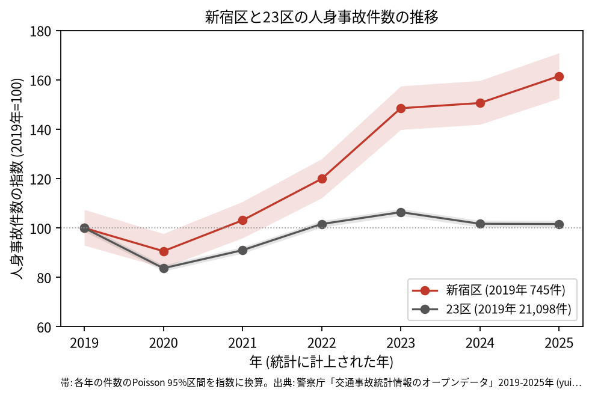
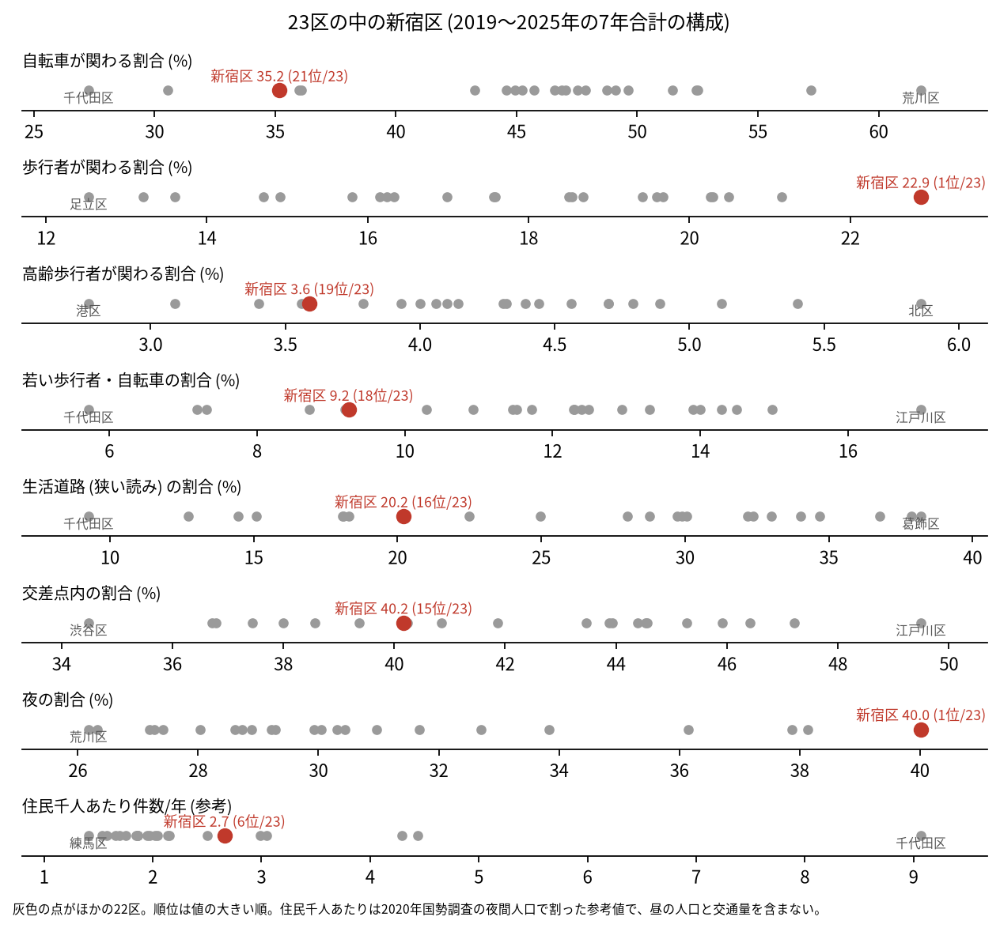
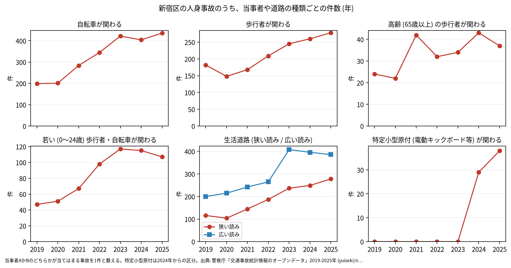

# 区の交通安全担当のための報告: 新宿区の交通事故の傾向

## 問い

新宿区の人身事故は 2019〜2025 年にどう推移し、23 区の中でどんな特徴があり、施策をどこに向ける材料になるか。

## 結論

- 件数: 7 年で 6,512 件、死者 32 人、負傷者 7,245 人です。2020 年に 675 件 (2019 年を 100 として 90.6) まで減りましたが、23 区全体 (83.7) ほどは下がりませんでした。2022 年から増え続け、2023 年 1,106 件 (148.5)、2025 年 1,203 件 (161.5) です。2025 年の 95% 区間 (1,136〜1,273 件) は 2019 年の区間 (692.5〜800.5 件) と重ならないので、2019 年より増えたと言えます。同じ 2025 年の 23 区全体は 101.6 で、2019 年と区間が重なります。

- 増えた理由は、このデータでは分かりません。警察署等コードごとに数えると、主な 4 つのコードの 2019 年と 2025 年は、435 が 144 件と 234 件、436 が 278 件と 459 件、437 が 103 件と 214 件、438 が 188 件と 283 件で、どれも増えています ([analysis.json](../outputs/analysis.json))。1 つの署の記録の変化だけでは説明できません。人出の戻り、記録の仕方、ほかの理由のどれかは確かめていません。
- 23 区の中の位置: 新宿区の事故は、歩行者と夜に寄っています。歩行者が関わる割合は 22.9% で 23 区の 1 位、夜の割合は 40.0% で 1 位です。自転車が関わる割合は 35.2% で 21 位、高齢の歩行者は 3.6% で 19 位、若い歩行者と自転車は 9.2% で 18 位と低い側です。生活道路 (狭い読み) の割合は 20.2% で 16 位、広い読みで 32.4% で 15 位、交差点内は 40.2% で 15 位です。特定小型原付が関わる割合は 1.0% で 3 位でした。

- 施策への読み方: 2026-09-01 からの生活道路の法定速度 30 km/h は、新宿区の事故のうち 20.2〜32.4% (読み方による) に当たります。件数の多い地点は、新宿駅の東と北 (明治通り、靖国通り、甲州街道) と新宿通りの四谷の幹線の交差点です (地点は [道路安全診断の報告](road-safety-auditor.md))。これは効果の予測ではなく、どの道路で事故が起きているかの構成です。
- 区分ごとの推移: 歩行者が関わる事故は 2019 年 182 件から 2025 年 278 件、自転車が関わる事故は 199 件から 436 件、夜の事故は 319 件から 526 件になりました。特定小型原付 (電動キックボードなど) が関わる事故は、区分のできた 2024 年に 29 件、2025 年に 38 件でした。

- 死亡事故: 32 件のうち、亡くなったのは歩行者 20 人、二輪車 7 人、自転車 3 人、乗用車と貨物車の 1 人ずつです。亡くなった歩行者 20 人のうち 8 人が 65 歳以上でした。当事者 A (過失の重い側) が貨物車の事故が 14 件、事業用の乗用車が 8 件、0〜5 時台に起きた事故が 10 件です。32 件は少なく、偏りを傾向と断定できる数ではありません。

| 年 | 当事者 A | 当事者 B | 亡くなった人 | 時 |
|---|---|---|---|---:|
| 2019 | 貨物車 | 歩行者 (35〜44 歳) | 歩行者 | 1 |
| 2024 | 貨物車 | 歩行者 (0〜24 歳) | 歩行者 | 3 |
| 2024 | 貨物車 | 歩行者 (55〜64 歳) | 歩行者 | 1 |
| 2025 | 貨物車 | 歩行者 (75 歳以上) | 歩行者 | 0 |
| 2025 | 貨物車 | 歩行者 (25〜34 歳) | 歩行者 | 2 |

表は、貨物車と歩行者の、0〜5 時台の死亡事故 5 件の抜き出しです。32 件 ([summary.txt](../outputs/summary.txt)) の全ては [deaths.csv](../outputs/deaths.csv) にあります。

- 人口あたり: 2020 年の住民千人あたりの年の件数は 2.66 件で 23 区の 6 位ですが、分母に昼の人口、繁華街の人出、通過する車が入らないため、区の比較の主な指標にしていません。

## データ

警察庁「交通事故統計情報のオープンデータ」を加工した `yuiseki/npa-traffic-accidents` 版 `389500a` の本票。新宿区は `市区町村コード` 104 の 6,512 件、23 区は 144,716 件。年はファイルの年 (統計に計上された年)。区の人口は 2020 年国勢調査 (`jp-admin-2026-09` 版 `e6c87b1`)。詳しくは [共通の報告](../report.md)。

## 方法

区分は、当事者 A か B のどちらかが当てはまる事故を 1 件と数えました。生活道路は `車道幅員` で決め、狭い読み (5.5 m 未満の単路と、小と小の交差点) と、広い読み (5.5 m 未満の道とより広い道の交差点も含む) を並べました。年の区間は件数の Poisson の 95% 区間 (Garwood) です。23 区の順位は 7 年合計の割合の大きい順です。警察署等コードごとの件数は、推移の結果を見た後に足しました。

## 確かめていないこと

- 2022 年からの増え方の理由 (人出、記録の仕方、警察署等コードの割り振りなど) は調べていません。
- 区の施策 (ゾーン 30、自転車の通行帯など) の効果は推定していません。割合の順位は施策の評価ではありません。
- 重傷と軽傷の区別、物損事故は、このデータにありません。
