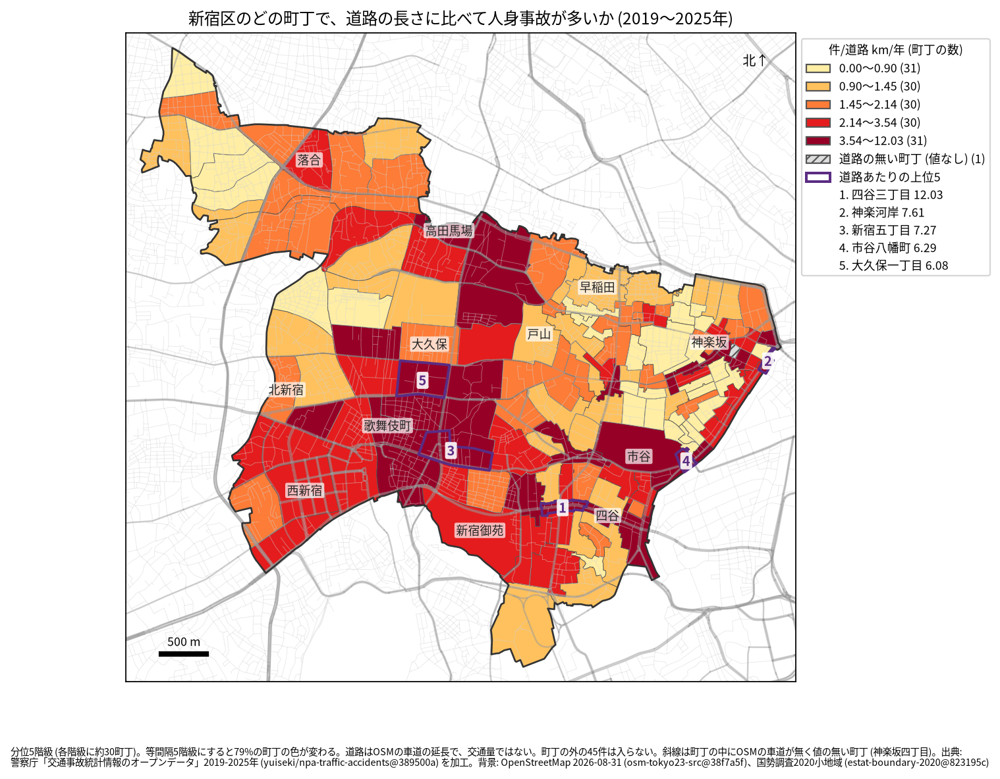
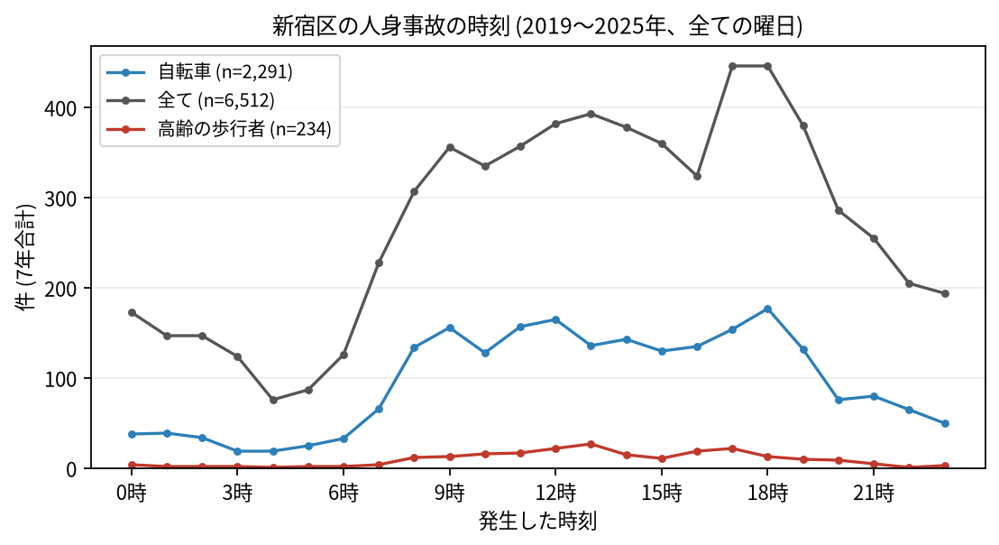

# 住民のための報告: 新宿区で、いつ、どこで事故が起きているか

## 問い

新宿区に住む人が、自分の町で、いつ、どんな事故に気をつければよいか。2019〜2025 年の警察記録の人身事故から調べました。

## 結論

- 新宿区では 7 年で 6,512 件の人身事故があり、32 人が亡くなりました。年に 675〜1,203 件で、2022 年から増え続けています。
- 町ごと: 道路 1 km あたりの事故が多いのは、四谷三丁目 (年 12.03 件)、神楽河岸 (7.61 件)、新宿五丁目 (7.27 件)、市谷八幡町 (6.29 件)、大久保一丁目 (6.08 件) です。件数そのものが多いのは新宿三丁目 (7 年で 234 件)、新宿五丁目 (228 件)、歌舞伎町二丁目 (220 件) でした。歌舞伎町二丁目では 220 件のうち 124 件に歩行者が関わっています。

色は分位 5 階級で、各色に約 30 の町が入ります。等間隔の階級にすると 79% の町の色が変わるので、色の差より、自分の町が上の階級か下の階級かを見てください。四谷三丁目、神楽河岸、市谷八幡町は町の中の道路が短く、少ない件数でも値が大きくなります。たとえば神楽河岸は 7 年で 27 件、道路は 0.507 km です ([towns.csv](../outputs/towns.csv))。四谷三丁目には、事故の多い地点の 3 位 (新宿通り × 外苑東通り) があります。斜線の神楽坂四丁目は、町の中に車道の記録が無く、値を出していません。

- 時間: 事故は朝 7 時台から増え、夜 19 時台まで高い水準が続きます。最も多いのは 17 時台と 18 時台 (446 件ずつ) です。自転車が関わる事故は 18 時台 (177 件) に、高齢の歩行者が関わる事故は 13 時台 (27 件) に最も多く起きています。事故の 40.0% は夜に起きていて、23 区で最も高い割合です。

- 誰が: 歩行者が関わる事故は全体の 22.9% で、23 区で最も高い割合です。自転車が関わる事故は 35.2% です。自転車に乗る人は、車やトラックとの事故 (1,294 件) に加え、自転車だけの事故 (転倒や物への衝突、387 件) にも気をつけてください。
- 亡くなった人: 32 人のうち 20 人が歩行者で、そのうち 8 人が 65 歳以上でした。死亡事故の 10 件は 0〜5 時台に起きています。夜に大通りを渡るときは特に注意が要ります。

## データ

警察庁「交通事故統計情報のオープンデータ」を加工した `yuiseki/npa-traffic-accidents` 版 `389500a` の本票、新宿区の 6,512 件 (2019〜2025 年のファイル)。町の境界は 2020 年国勢調査の小地域 (153 町丁)、道路は OpenStreetMap 2026-08-31。詳しくは [共通の報告](../report.md)。

## 方法

事故の地点を町丁の境界に入れて数え、町丁の中の車道の長さ (OSM) と 7 年で割りました。区の境界の近くで町丁の外に落ちた 45 件は町の値に入っていません。時刻は事故の起きた時で、7 年の合計です。夜は本票の `昼夜` の区分 (夜) です。

## 確かめていないこと

- 道路の長さは、通る車や人の数ではありません。新宿駅の周りの値が高いのは、人と車が多いためかもしれません。
- 自分の町の事故が少なくても、物損事故やヒヤリハットはこのデータにありません。
- 事故の位置の精度は分かりません。町の境界の近くの事故は、隣の町に数えられている可能性があります。
