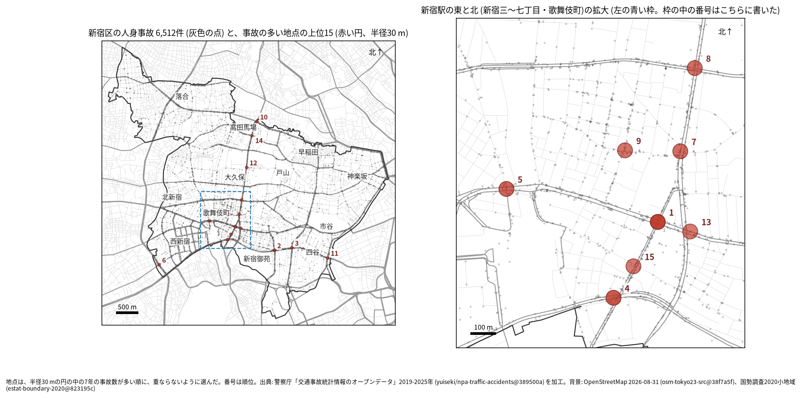
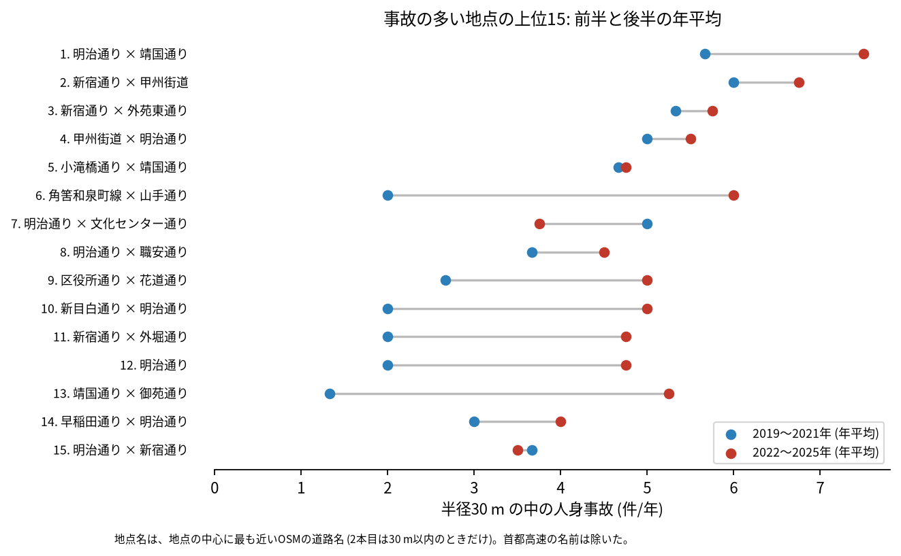
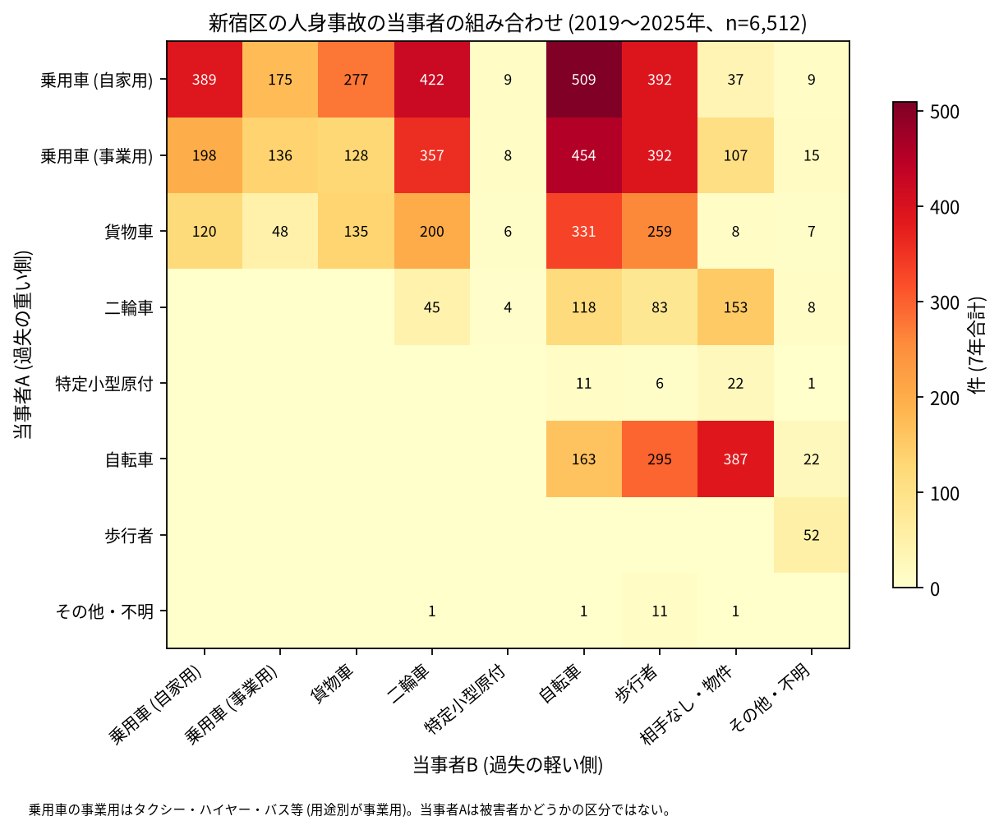

# 道路安全診断のための報告: 新宿区で事故の集まる地点

## 問い

新宿区で 2019〜2025 年の人身事故が集まる地点はどこで、そこでは誰と誰の事故が多いか。現地診断の候補を選ぶ材料にします。

## 結論

- 半径 30 m の円の中の 7 年の件数で選んだ上位 15 地点は、25〜47 件です。15 のうち 8 は新宿駅の東と北 (新宿三〜七丁目、歌舞伎町、西新宿七丁目。明治通り、靖国通り、甲州街道が交わる範囲) にあり、ほかは新宿通りの四谷 (2 位、3 位、11 位)、西新宿四丁目 (山手通り)、明治通りの北側の戸山と西早稲田です。

| 順位 | 近い道路 (OSM) | 件数 | 前半 件/年 | 後半 件/年 | 交差点内 | 信号あり | 多い組み合わせ (A × B) |
|---:|---|---:|---:|---:|---:|---:|---|
| 1 | 明治通り × 靖国通り | 47 | 5.67 | 7.50 | 39 | 43 | 乗用車 (事業用) × 自転車 |
| 2 | 新宿通り × 甲州街道 | 45 | 6.00 | 6.75 | 39 | 43 | 乗用車 (事業用) × 自転車 |
| 3 | 新宿通り × 外苑東通り | 39 | 5.33 | 5.75 | 30 | 38 | 乗用車 (自家用) × 二輪車 |
| 4 | 甲州街道 × 明治通り | 37 | 5.00 | 5.50 | 26 | 27 | 乗用車 (自家用) × 二輪車 |
| 5 | 小滝橋通り × 靖国通り | 33 | 4.67 | 4.75 | 27 | 33 | 乗用車 (事業用) × 二輪車 |
| 6 | 角筈和泉町線 × 山手通り | 30 | 2.00 | 6.00 | 24 | 26 | 乗用車 (自家用) × 二輪車 |
| 7 | 明治通り × 文化センター通り | 30 | 5.00 | 3.75 | 26 | 24 | 乗用車 (事業用) × 歩行者 |
| 8 | 明治通り × 職安通り | 29 | 3.67 | 4.50 | 23 | 25 | 乗用車 (自家用) × 自転車 |
| 9 | 区役所通り × 花道通り | 28 | 2.67 | 5.00 | 11 | 15 | 乗用車 (事業用) × 歩行者 |
| 10 | 新目白通り × 明治通り | 26 | 2.00 | 5.00 | 19 | 23 | 乗用車 (自家用) × 二輪車 |

前半は 2019〜2021 年、後半は 2022〜2025 年。11〜15 位と、歩行者、自転車、夜の件数は [hotspots.csv](../outputs/hotspots.csv) にあります。道路名は地点の中心に最も近い OSM の道路名で、2 本目は 30 m 以内のときだけ書きました (首都高速の名前は除いた)。多い組み合わせは、地点の中で最も多い組ですが、件数は 1 地点で 3〜10 件で、ほかの組と大きくは離れていません。

- 歌舞伎町の 9 位: 28 件のうち歩行者が関わる事故が 19 件、夜が 22 件で、上位 15 の中で歩行者の件数が最も多い地点です。交差点内は 28 件のうち 11 件です。
- 続いているか: 上位 15 は全て前半と後半の両方に事故があります。6 位 (2.00 から 6.00 件/年)、13 位 (1.33 から 5.25 件/年)、10 位から 12 位 (2.00 から 4.75〜5.00 件/年) は後半に大きく増え、7 位 (5.00 から 3.75 件/年) は減りました。新宿区は区全体の件数が後半に増えているので、地点ごとの増加を、その地点に固有の変化とは読めません。上位は 7 年合計で選んだので、前半と後半の差には平均への回帰も混ざります。

- 組み合わせ: 当事者 A が乗用車か貨物車で B が自転車の事故は 1,294 件です。自転車の単独 (相手なし・物件) が 387 件、自転車どうしが 163 件、自転車と歩行者 (自転車が A) が 295 件ありました。事業用の乗用車 (タクシー、ハイヤー、バスなど) は 1,795 件で当事者 A で、自家用の乗用車 (2,219 件) に次ぎます。国道は 20 号 (甲州街道と新宿通り) だけで、432 件です ([analysis.json](../outputs/analysis.json))。

- 半径を変えると: 20 m の上位 15 の中心が、30 m の上位 15 の中心から 30 m 以内にあるのは 10 地点、50 m では 12 地点でした。上位に入る交差点の多くは保たれますが、新宿駅の東と北では地点が近く並び、隣り合う地点が 1 つにまとまったり分かれたりします。順位は細かく読まないでください。

## データ

警察庁「交通事故統計情報のオープンデータ」を加工した `yuiseki/npa-traffic-accidents` 版 `389500a` の本票、新宿区 (`市区町村コード` 104) の 6,512 件。道路名は OpenStreetMap 2026-08-31 (`osm-tokyo23-src-2026-08` 版 `38f7a5f`)。詳しくは [共通の報告](../report.md)。

## 方法

事故の点を EPSG:6677 (メートル) に変換し、半径 30 m の円の中の件数が最も多い事故の点を中心に選び、その円の事故を除いて次を選ぶ手順を 15 回くり返しました。30 m はコード表の「交差点付近」(交差点の側端から 30 m 以内) の幅です。信号ありは `信号機` が 3 灯式、押ボタン式、歩車分式の点灯。組み合わせは当事者 A (過失の重い側) と B の種別で、乗用車は `用途別` で事業用と自家用に分けました。

## 確かめていないこと

- 交通量で割っていません。件数の多い交差点が、車の多さに比べて危険かは分かりません。
- 事故の型 (出会い頭、右折、追突)、違反の種類、重傷と軽傷の区別は、このデータにありません。現地で確かめてください。
- 位置の精度は分かりません。数十 m のずれで地点の件数は変わります。12 位は、2 本目の道路 (新宿コズミック通り) が 62 m 離れているので、交差点の事故かどうかは地図で確かめてください。
- 偶然でもこの程度の集まりが生まれるか (順位の有意さ) は調べていません。
