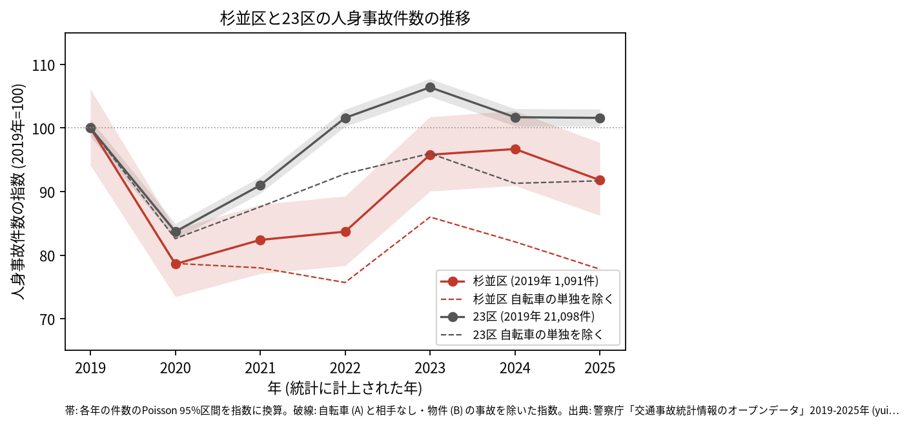
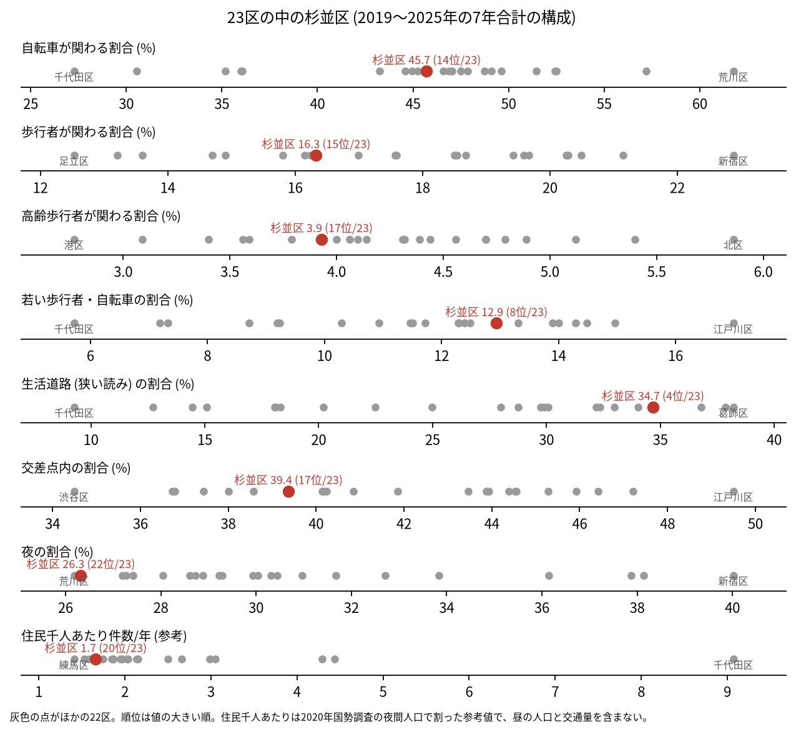
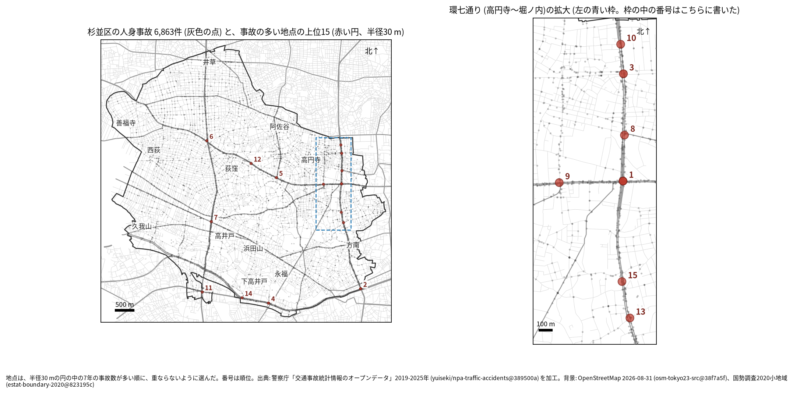
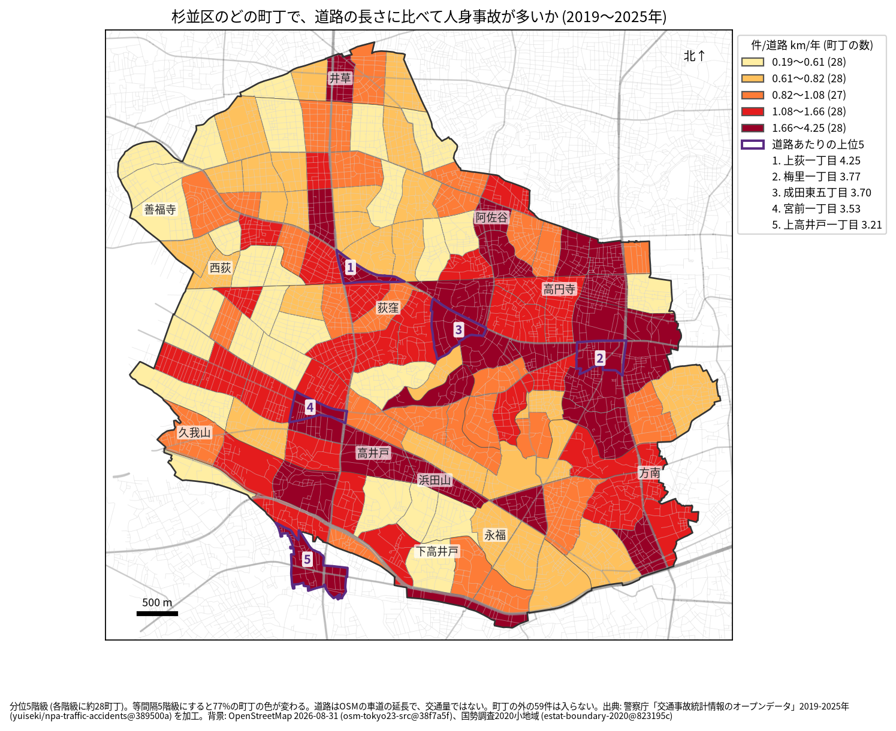
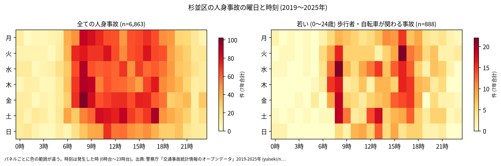
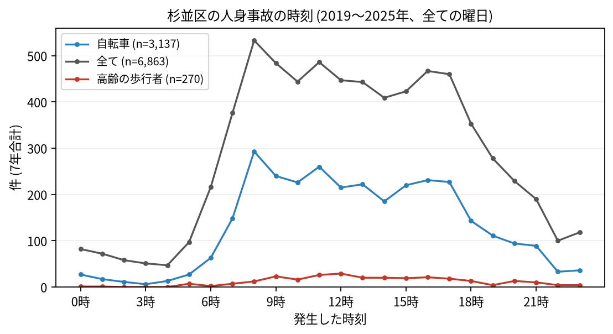
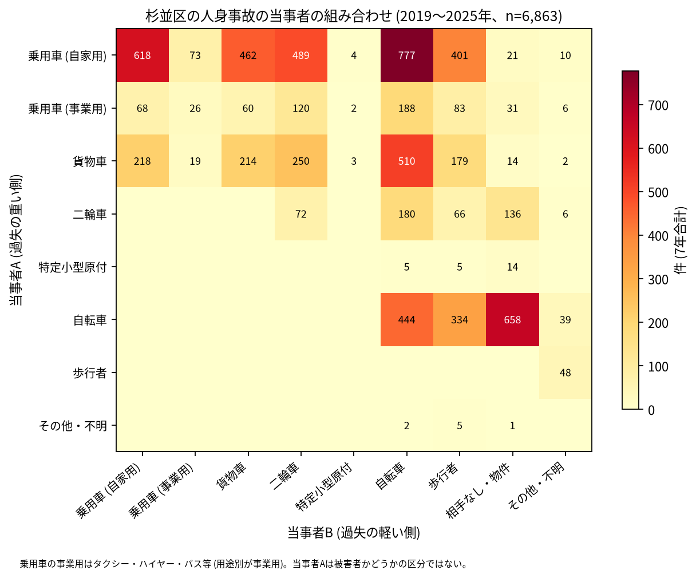

# 杉並区の交通事故 2019〜2025 年: 図で読む要点

## 問い

2019〜2025 年の警察記録の人身事故で、杉並区の事故はいつ、どこで、誰が関わって起きているか。

## 結論

### 要点

| # | 要点 | 数字 | 図 |
|---:|---|---|---|
| 1 | 件数は 2020 年に減り、2020〜2022 年は 2019 年より少なかった。2023 年からは 2019 年と区別できない | 7 年で 6,863 件、死者 34 人、負傷者 7,784 人。指数 (2019 年=100) は 2020 年 78.6、2025 年 91.8 ([yearly.csv](outputs/yearly.csv)、[summary.txt](outputs/summary.txt)) | [図 1](#図-1-件数の推移) |
| 2 | 生活道路の事故の割合が 23 区で高い | 生活道路 34.7% (23 区の 4 位)、広い読み 47.7% (4 位)。交差点内は 39.4% (17 位) ([wards.csv](outputs/wards.csv)、[analysis.json](outputs/analysis.json)) | [図 2](#図-2-23-区の中の杉並区) |
| 3 | 事故の集まる地点は環七通りと青梅街道に並ぶ | 上位 15 地点のうち、最も近い道が環七通りの地点が 6、青梅街道が 4。1 位は青梅街道 × 環七通り (47 件)、2 位は環七通り × 甲州街道 (46 件) ([hotspots.csv](outputs/hotspots.csv)、[summary.txt](outputs/summary.txt)) | [図 3](#図-3-事故の集まる地点)、[図 4](#図-4-町丁ごとの事故) |
| 4 | 事故の半分近くに自転車が関わる | 45.7%。乗用車 (自家用) が A で自転車が B の事故が 777 件、自転車の単独 (相手なし・物件) が 658 件 ([summary.txt](outputs/summary.txt)) | [図 6](#図-6-誰と誰の事故か) |
| 5 | 死亡事故は歩行者と二輪車が多い | 死亡事故 33 件のうち、亡くなった人が歩行者の事故 14 件 (65 歳以上 8 件)、二輪車 11 件。0〜5 時台が 11 件 ([summary.txt](outputs/summary.txt)) | [表 1](#表-1-死亡事故) |

### 読み手ごとに知るべきこと

| 読み手 | 結論 | 検討する材料 | 詳しく |
|---|---|---|---|
| 区の交通安全担当 | 生活道路の法定速度 30 km/h (2026-09-01 から) が当たるのは事故の 34.7〜47.7% (読み方による) で、23 区の 4 位 | 生活道路、環七通りと青梅街道の交差点、自転車 | [municipality.md](reports/municipality.md) |
| 学校と PTA | 若い (0〜24 歳) 歩行者と自転車の事故は 888 件。最も多いのは 8 時台 (106 件) で、次が 16 時台 (96 件) | 学校の円の中で、平日の朝と下校の時間の点が並ぶ道 | [school-pta.md](reports/school-pta.md) |
| 道路安全診断 | 上位は青梅街道 × 環七通り (47 件)、環七通り × 甲州街道 (46 件)、高円寺南四丁目の環七通り (30 件) | 環七通りの高円寺から堀ノ内の 7 地点、後半に増えた 10 位と 5 位 | [road-safety-auditor.md](reports/road-safety-auditor.md) |
| 住民 | 道路あたりで多いのは上荻一丁目 (年 4.25 件/道路 km)、梅里一丁目 (3.77 件)。事故は 8 時台が最多 | 自分の町の色、朝の通勤と通学の時間、自転車の単独事故 | [resident.md](reports/resident.md) |

### 図 1: 件数の推移

2020 年の落ち込み (78.6) は 23 区全体 (83.7) より深く、23 区が 2022 年に 2019 年の水準 (101.6) に戻ったのに対し、杉並区は 83.7 だった。2025 年の 95% 区間 (940.9〜1066.0 件) は 2019 年 (1027.2〜1157.7 件) と重なるので、減少とは書かない。

### 図 2: 23 区の中の杉並区

赤い点が杉並区。生活道路 (4 位) と若い歩行者・自転車 (12.9%、8 位) が高く、夜 (26.3%、22 位) と交差点内 (17 位) が低い。住民千人あたり (1.66 件/年、20 位) は昼の人口を含まない参考値。

### 図 3: 事故の集まる地点

半径 30 m の円の中の 7 年の件数で選んだ上位 15 (23〜47 件)。番号は順位で、環七通りの高円寺から堀ノ内の 7 地点は右の拡大図に番号を書いた。

| 順位 | 近い道路 (OSM) | 町丁 | 件数 | 前半 件/年 | 後半 件/年 |
|---:|---|---|---:|---:|---:|
| 1 | 青梅街道 × 環七通り | 梅里一丁目 | 47 | 7.67 | 6.00 |
| 2 | 環七通り × 甲州街道 | 和泉一丁目 | 46 | 8.33 | 5.25 |
| 3 | 環七通り | 高円寺南四丁目 | 30 | 4.33 | 4.25 |
| 4 | 甲州街道 × 桜上水商店街 | 下高井戸一丁目 | 30 | 4.67 | 4.00 |
| 5 | 青梅街道 × 中杉通り | 成田東五丁目 | 28 | 2.67 | 5.00 |

前半は 2019〜2021 年、後半は 2022〜2025 年。半径を 20 m にすると上位 15 のうち 10 地点、50 m では 13 地点が残る。6〜15 位は [hotspots.csv](outputs/hotspots.csv)。

### 図 4: 町丁ごとの事故

町丁の事故数を、OSM の車道の延長と 7 年で割った値。紫の枠が上位 5 (上荻一丁目、梅里一丁目、成田東五丁目、宮前一丁目、上高井戸一丁目)。分位と等間隔で 77% の町丁の色が変わるので、色の細かい差は読まない。道路の長さは交通量ではない。

### 図 5: いつ起きるか

全体は平日の 7〜17 時台に広く多く、最多は 8 時台 (533 件)。若い歩行者と自転車は 8 時台 (106 件) と 16 時台 (96 件) に山がある。

自転車は 8 時台 (293 件)、高齢の歩行者は 12 時台 (29 件) が最多。

### 図 6: 誰と誰の事故か

最も多いのは自家用の乗用車 (A) と自転車 (B) の 777 件、次が自転車の単独 (相手なし・物件) の 658 件、自家用の乗用車どうしの 618 件。当事者 A は過失の重い側で、被害者とは限らない。

### 表 1: 死亡事故

| 亡くなった人 | 事故の数 | 特徴 |
|---|---:|---|
| 歩行者 | 14 | 65 歳以上が 8 件 |
| 二輪車 | 11 | |
| 自転車 | 7 | |
| 当事者 A、B 以外 (補充票の人) | 1 | |

33 件 (死者 34 人) のうち 0〜5 時台が 11 件。当事者 A は自家用の乗用車が 13 件、貨物車が 12 件。数が少ないので傾向とは断定しない。全件は [deaths.csv](outputs/deaths.csv)。

### 読み方で変わる答え

| 読み方 | 主 | 別の読み方 |
|---|---|---|
| 杉並区の事故 | `市区町村コード` 115 の 6,863 件 | 点が区の面に入る事故。両方に当てはまるのは 6,804 件 |
| 生活道路 | 狭い読み 34.7% (4 位) | 広い読み 47.7% (4 位) ([wards.csv](outputs/wards.csv)) |
| 件数の推移 | 全ての人身事故 | 自転車 (A) と相手なし・物件 (B) の事故を除くと、2025 年の指数は杉並区 77.8、23 区 91.7。この事故は杉並区で 2019 年 18 件から 2025 年 167 件に増えた (記録のされ方の変化かは確かめていない) ([yearly.csv](outputs/yearly.csv)) |
| 地点の半径 | 30 m | 20 m で 10 地点、50 m で 13 地点が残る ([analysis.json](outputs/analysis.json)) |
| 首都高速の事故 | 含める | 除くと 15 地点のうち 14 が残る。首都高速の事故は区で 108 件、上位 15 の円には 4 件 ([analysis.json](outputs/analysis.json)) |
| 町丁の階級 | 分位 5 階級 | 等間隔で 77% の町丁の色が変わる ([town-rate-quantile.json](outputs/town-rate-quantile.json)) |

## データ

- 人身事故: 警察庁「交通事故統計情報のオープンデータ」を加工した `yuiseki/npa-traffic-accidents` 版 `389500aae5cec45f1311163f70db6a5f05867838` (配布元の取得 2026-10-02) の本票。年はファイルの年 (統計に計上された年)。杉並区 6,863 件、23 区 144,716 件。位置の無い行は 0。物損事故は含まない。
- 区の面と人口: `yuiseki/jp-admin-2026-09` 版 `e6c87b1`。町丁: 2020 年国勢調査の小地域 `yuiseki/estat-boundary-2020` 版 `823195c` (139 町丁、591,108 人)。学校 68 校と道路: OpenStreetMap 2026-08-31、`yuiseki/osm-tokyo23-src-2026-08` 版 `38f7a5f`。
- 道具: DuckDB (spatial、版は [analysis.json](outputs/analysis.json))、matplotlib、`analysis-visualize` の `cjk_font.py`、`classify_map.py`、`context_map.py`。
- 出典の表示: 警察庁ウェブサイト (https://www.npa.go.jp/publications/statistics/koutsuu/opendata/index_opendata.html) の交通事故統計情報のオープンデータを加工して作成。国勢調査の小地域境界と人口、OpenStreetMap (© OpenStreetMap contributors) を加工して使用。

## 方法

- 台東区の分析 ([../taito-accident-trends-by-role/](../taito-accident-trends-by-role/README.md)) と同じスクリプトと読み方を使い、区コード、区の名前、町丁の検査値、図の地名と拡大の範囲だけを直した。読み方は結果を見る前に [計画](EXPERIMENT_PLAN.md) で固定し、実行は [記録](EXPERIMENT_TRACKER.md) に残した。生活道路は `車道幅員` が 01、02、11 (狭い読み)、広い読みは 14、17 を足す。歩行者や自転車が関わるかは当事者 A と B の両方で見て、1 件を 1 回数えた。
- 年齢はデータの年齢層で読む。若い人は 01 (0〜24 歳)、高齢の人は 65 (65〜74 歳) と 75 (75 歳以上)。
- 距離は EPSG:6677 (メートル) で測った。町丁の道路あたりの上位 5 には、道路が 0.5 km より短い町丁を数えない (杉並区には無い)。地点は、半径 30 m の中の件数が最も多い点を中心に選び、その円の事故を除いて次を選ぶ手順を 15 回くり返した。地点の名前は、中心に最も近い道と、それと 30 度以上の向きで交わる道のうち最も近い道 (どちらも 30 m 以内のときだけ)。
- 地図は `analysis-visualize` の map-context に合わせ、地名と道路を重ね、凡例を地図の外に置き、強調した単位に番号を付けた。描いた町丁の数 (139) を分析の数と照らし、文字の重なりと、地名や番号が円や学校の印を隠す重なりは、3 枚の地図で 0 件 (1 回目に学校の印を隠した地名 2 つの位置を直した後)。背景の道路 (OGC:CRS84) と町丁 (JGD2000) の差は、線の幅より小さいとして変換せずに重ねた。
- 関門: 予測と回帰をしないので、評価の分け方と残差の確認は要らない。単位の間の相関を結論にしないので、Moran's I と格子の掃引は省いた。推移は 23 区全体を基準にし、年の件数に Poisson の 95% 区間を付けた。対策の効果は推定していない。
- 再実行は [README.md](README.md)。数値は [outputs/](outputs/) の CSV、来歴は [analysis.json](outputs/analysis.json)。

## 確かめていないこと

- 交通量、昼の人口、通過する車の数で割っていない。環七通りと青梅街道の件数の多さは、車の多さかもしれない。
- 生活道路の割合が高い理由 (区の道路網に占める細い道の長さなど) は調べていない。
- 位置の精度は分からない。30 m の地点と町丁の境界の近くの事故は、数十 m のずれで入れ替わる。
- 事故の型 (出会い頭、追突)、重傷と軽傷の区別、物損事故、ヒヤリハットは、このデータに無い。
- 0〜24 歳より細かい年齢は無く、小学生だけは数えられない。
- 地点の上位は 7 年で選び、同じ 7 年で前半と後半を比べたので、後半が下がって見えやすい (平均への回帰)。
- 中央自動車道とみられる路線コード (4000 番台) の事故は、型の区分で首都高速に入らず「その他」に数えられ、首都高速を除いた読み方でも残る (記録の R010。路線の名前は確かめていない)。
