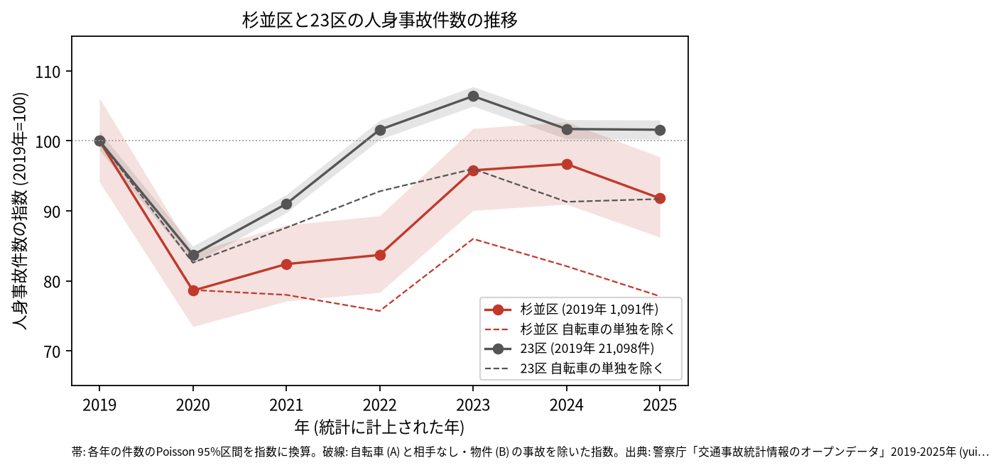
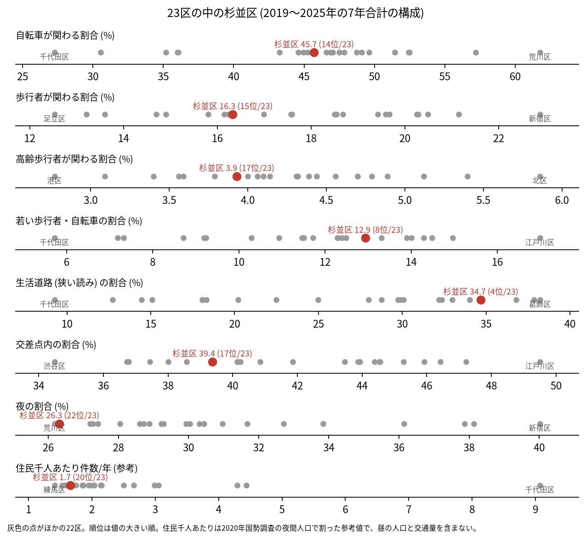
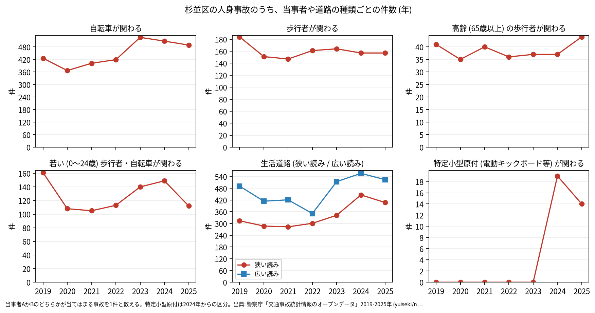

# 区の交通安全担当のための報告: 杉並区の交通事故の傾向

## 問い

杉並区の人身事故は 2019〜2025 年にどう推移し、23 区の中でどんな特徴があり、施策をどこに向ける材料になるか。

## 結論

- 件数: 7 年で 6,863 件、死者 34 人、負傷者 7,784 人です。2020 年に 858 件 (2019 年を 100 として 78.6) まで減り、23 区全体 (83.7) より大きく下がりました。2020〜2022 年の 95% 区間は、どの年も 2019 年の区間 (1027.2〜1157.7 件) より下にあります。2023 年は 1,045 件 (95.8)、2024 年は 1,055 件 (96.7)、2025 年は 1,002 件 (91.8) で、2025 年の区間 (940.9〜1066.0 件) は 2019 年と重なるので、2019 年より減ったとは言えません。

- 23 区の中の位置: 杉並区の事故は、生活道路に多く寄っています。生活道路 (狭い読み) の割合は 34.7% で 23 区の 4 位、広い読みでも 47.7% で 4 位です。交差点内の割合は 39.4% で 17 位、夜の割合は 26.3% で 22 位です。若い歩行者と自転車が関わる割合は 12.9% で 8 位、高齢の歩行者は 3.9% で 17 位、自転車が関わる割合 (45.7%) は 14 位です。

- 施策への読み方: 2026-09-01 からの生活道路の法定速度 30 km/h が当たる道の事故は、杉並区の事故のうち 34.7〜47.7% (読み方による) で、23 区の中で高い側です。一方で、事故の多い地点の上位は環七通り、青梅街道、環八通り、甲州街道の交差点に並びます (地点は [道路安全診断の報告](road-safety-auditor.md))。これは効果の予測ではなく、どの道路で事故が起きているかの構成です。
- 区分ごとの推移: 自転車が関わる事故は 2023 年に 526 件で、2019 年 (426 件) より多い年が 2023〜2025 年に続きました。生活道路 (狭い読み) の事故も 2024 年に 446 件、2025 年に 407 件で、2019 年 (314 件) を上回りました。特定小型原付 (電動キックボードなど) が関わる事故は、区分のできた 2024 年に 19 件、2025 年に 14 件でした。

- 自転車の単独の事故: 自転車 (A) と相手なし・物件 (B) の事故は、2019 年の 18 件から 2025 年の 167 件に増えました。23 区でも同じ時期に 1,035 件から 3,039 件に増えていて、記録のされ方の変化かは確かめていません。この事故を除くと、2025 年の指数は 77.8 (23 区は 91.7) です。
- 死亡事故: 33 件 (死者 34 人) のうち、亡くなった人が歩行者の事故は 14 件、二輪車 11 件、自転車 7 件です。歩行者の 14 件のうち 8 件が 65 歳以上でした。当事者 A (過失の重い側) は自家用の乗用車が 13 件、貨物車が 12 件で、0〜5 時台に起きた事故が 11 件です。33 件は少なく、偏りを傾向と断定できる数ではありません。全件は [deaths.csv](../outputs/deaths.csv) にあります ([summary.txt](../outputs/summary.txt))。
- 人口あたり: 2020 年の住民千人あたりの年の件数は 1.66 件で 23 区の 20 位ですが、分母に昼の人口や通過する車が入らないため、区の比較の主な指標にしていません。

## データ

警察庁「交通事故統計情報のオープンデータ」を加工した `yuiseki/npa-traffic-accidents` 版 `389500a` の本票。杉並区は `市区町村コード` 115 の 6,863 件、23 区は 144,716 件。年はファイルの年 (統計に計上された年)。区の人口は 2020 年国勢調査 (`jp-admin-2026-09` 版 `e6c87b1`)。詳しくは [共通の報告](../report.md)。

## 方法

区分は、当事者 A か B のどちらかが当てはまる事故を 1 件と数えました。生活道路は `車道幅員` で決め、狭い読み (5.5 m 未満の単路と、小と小の交差点) と、広い読み (5.5 m 未満の道とより広い道の交差点も含む) を並べました。年の区間は件数の Poisson の 95% 区間 (Garwood) です。23 区の順位は 7 年合計の割合の大きい順です。

## 確かめていないこと

- 生活道路の割合が高い理由 (区の道路網に占める細い道の長さ、幹線の少なさなど) は調べていません。
- 区の施策 (ゾーン 30、自転車の通行帯など) の効果は推定していません。割合の順位は施策の評価ではありません。
- 重傷と軽傷の区別、物損事故は、このデータにありません。
