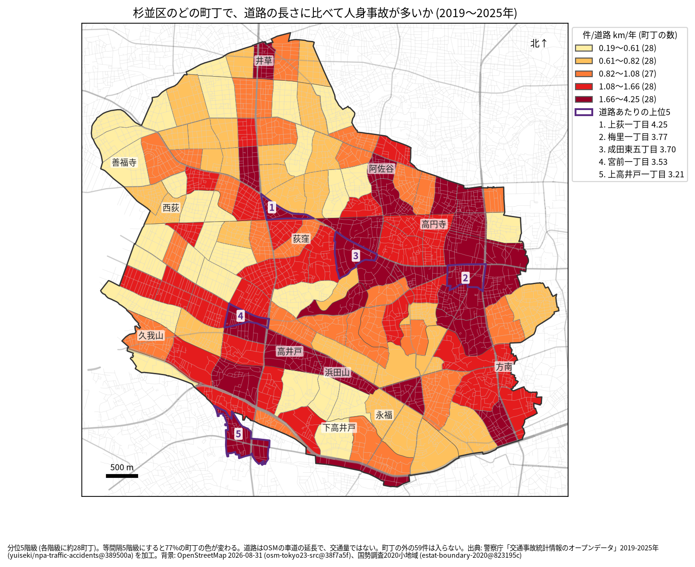
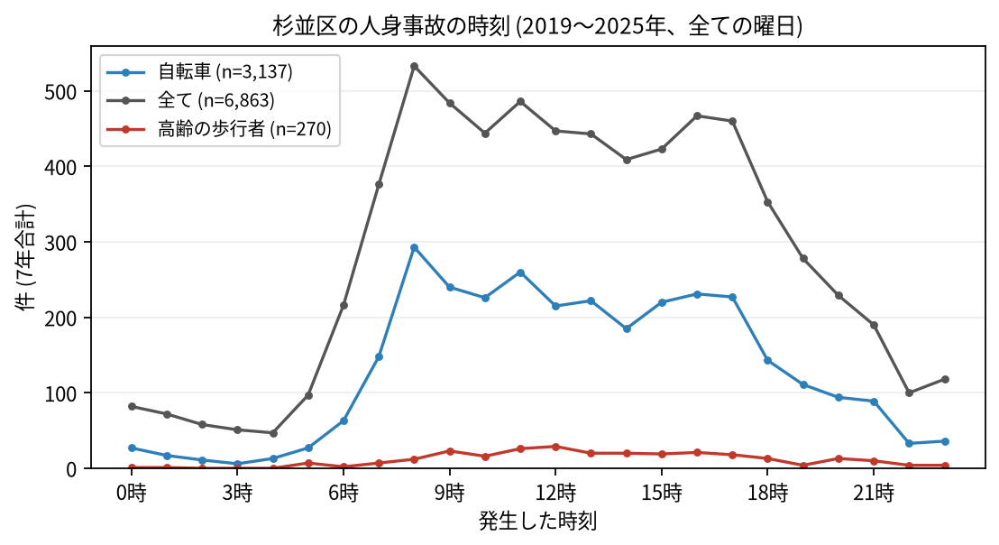

# 住民のための報告: 杉並区で、いつ、どこで事故が起きているか

## 問い

杉並区に住む人が、自分の町で、いつ、どんな事故に気をつければよいか。2019〜2025 年の警察記録の人身事故から調べました。

## 結論

- 杉並区では 7 年で 6,863 件の人身事故があり、34 人が亡くなりました。年に 858〜1,091 件です。
- 町ごと: 道路 1 km あたりの事故が多いのは、上荻一丁目 (年 4.25 件)、梅里一丁目 (3.77 件)、成田東五丁目 (3.70 件)、宮前一丁目 (3.53 件)、上高井戸一丁目 (3.21 件) です。件数そのものが最も多いのは和泉一丁目 (7 年で 193 件) でした。上位 5 町丁のうち、上荻一丁目を除く 4 町丁は、事故の多い地点の上位 15 (幹線の交差点) を含む町です ([hotspots.csv](../outputs/hotspots.csv))。

色は分位 5 階級で、各色に約 28 の町が入ります。等間隔の階級にすると 77% の町の色が変わるので、色の差より、自分の町が上の階級か下の階級かを見てください。

- 時間: 事故は朝 7 時台から増え、8 時台 (533 件) が最も多く、17 時台まで高い水準が続きます。自転車が関わる事故も 8 時台 (293 件) が最も多く、高齢の歩行者が関わる事故は 12 時台 (29 件) が最も多い時間でした。

- 誰が: 自転車が関わる事故が全体の 45.7% です。自転車に乗る人は、車やトラックとの事故 (1,475 件) に加え、自転車だけの事故 (転倒や物への衝突、658 件) にも気をつけてください。歩行者が関わる事故は 16.3% です。
- 亡くなった人: 死亡事故 33 件のうち 14 件で歩行者が亡くなり、そのうち 8 件は 65 歳以上の人でした。二輪車の人が亡くなった事故も 11 件あります。死亡事故の 11 件は 0〜5 時台に起きています ([summary.txt](../outputs/summary.txt))。

## データ

警察庁「交通事故統計情報のオープンデータ」を加工した `yuiseki/npa-traffic-accidents` 版 `389500a` の本票、杉並区の 6,863 件 (2019〜2025 年のファイル)。町の境界は 2020 年国勢調査の小地域 (139 町丁)、道路は OpenStreetMap 2026-08-31。詳しくは [共通の報告](../report.md)。

## 方法

事故の地点を町丁の境界に入れて数え、町丁の中の車道の長さ (OSM) と 7 年で割りました。区の境界の近くで町丁の外に落ちた 59 件は町の値に入っていません。時刻は事故の起きた時で、7 年の合計です。

## 確かめていないこと

- 道路の長さは、通る車や人の数ではありません。幹線の沿いの町の値が高いのは、車が多いためかもしれません。
- 自分の町の事故が少なくても、物損事故やヒヤリハットはこのデータにありません。
- 事故の位置の精度は分かりません。町の境界の近くの事故は、隣の町に数えられている可能性があります。
