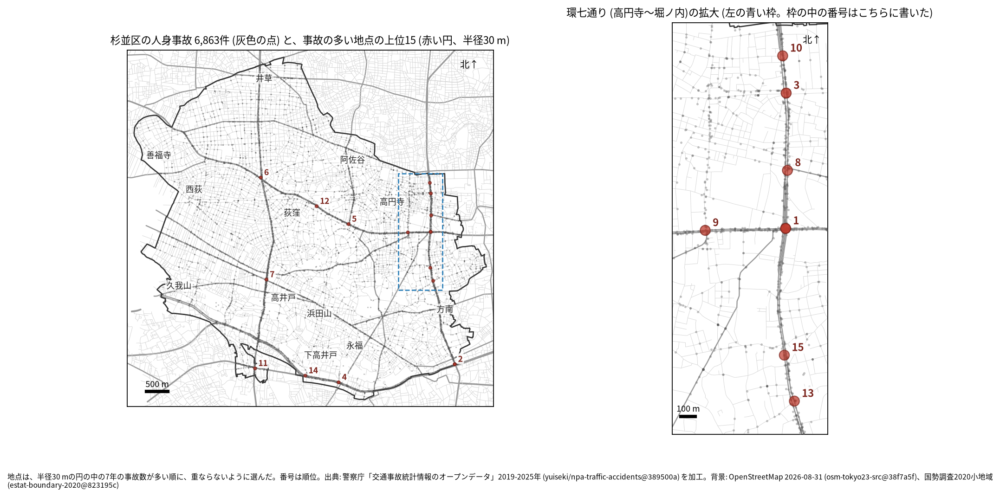
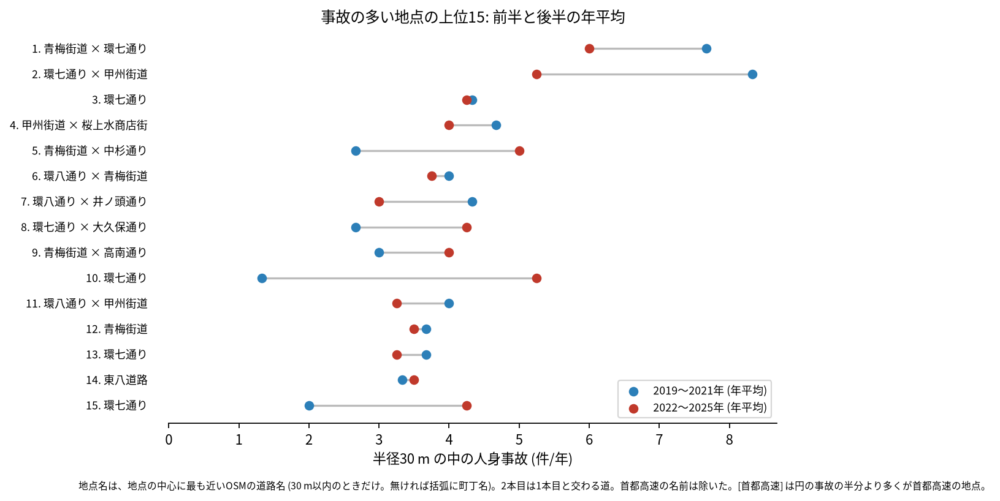
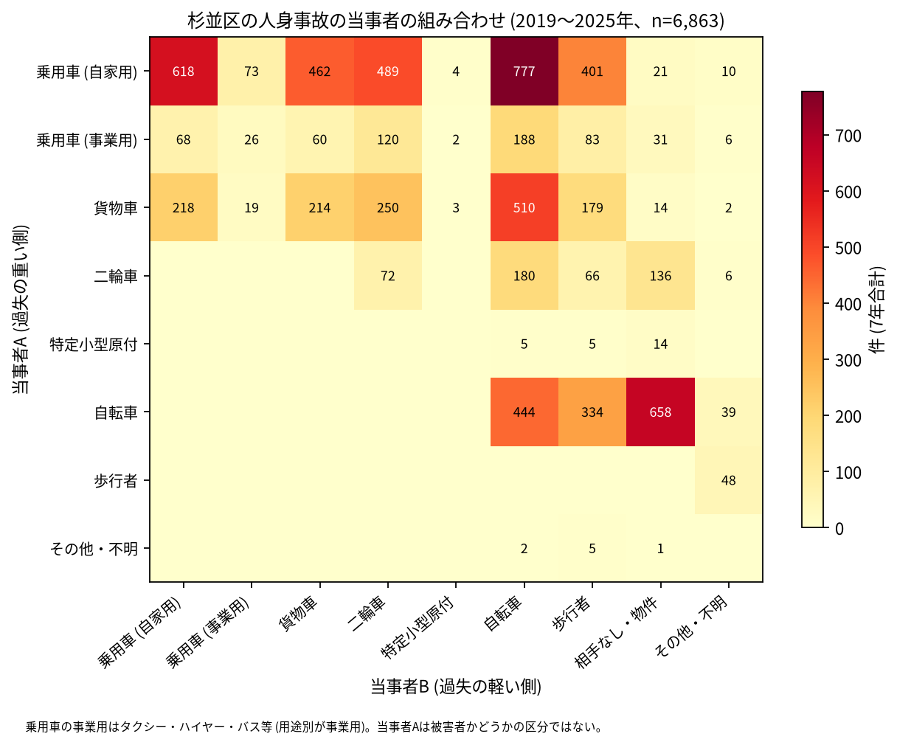

# 道路安全診断のための報告: 杉並区で事故の集まる地点

## 問い

杉並区で 2019〜2025 年の人身事故が集まる地点はどこで、そこでは誰と誰の事故が多いか。現地診断の候補を選ぶ材料にします。

## 結論

- 半径 30 m の円の中の 7 年の件数で選んだ上位 15 地点は、23〜47 件です。最も近い道が環七通りの地点が 6、青梅街道が 4、環八通りが 3 です。環七通りでは、高円寺北二丁目から堀ノ内二丁目までに 7 地点が並びます (拡大図)。

| 順位 | 近い道路 (OSM) | 件数 | 前半 件/年 | 後半 件/年 | 交差点内 | 信号あり | 多い組み合わせ (A × B) |
|---:|---|---:|---:|---:|---:|---:|---|
| 1 | 青梅街道 × 環七通り | 47 | 7.67 | 6.00 | 41 | 43 | 乗用車 (自家用) × 自転車 |
| 2 | 環七通り × 甲州街道 | 46 | 8.33 | 5.25 | 37 | 39 | 乗用車 (自家用) × 自転車 |
| 3 | 環七通り | 30 | 4.33 | 4.25 | 16 | 19 | 乗用車 (自家用) × 貨物車 |
| 4 | 甲州街道 × 桜上水商店街 | 30 | 4.67 | 4.00 | 13 | 16 | 乗用車 (自家用) × 貨物車 |
| 5 | 青梅街道 × 中杉通り | 28 | 2.67 | 5.00 | 18 | 20 | 自転車 × 相手なし・物件 |
| 6 | 環八通り × 青梅街道 | 27 | 4.00 | 3.75 | 16 | 19 | 乗用車 (自家用) × 乗用車 (自家用) |
| 7 | 環八通り × 井ノ頭通り | 25 | 4.33 | 3.00 | 15 | 19 | 乗用車 (自家用) × 貨物車 |
| 8 | 環七通り × 大久保通り | 25 | 2.67 | 4.25 | 16 | 21 | 貨物車 × 歩行者 |
| 9 | 青梅街道 × 高南通り | 25 | 3.00 | 4.00 | 16 | 19 | 乗用車 (自家用) × 自転車 |
| 10 | 環七通り | 25 | 1.33 | 5.25 | 0 | 0 | 乗用車 (自家用) × 貨物車 |

前半は 2019〜2021 年、後半は 2022〜2025 年。11〜15 位と、歩行者、自転車、夜の件数は [hotspots.csv](../outputs/hotspots.csv) にあります。道路名は地点の中心に最も近い OSM の道路名 (30 m 以内のときだけ) で、2 本目は 1 本目と交わる向き (30 度以上) の道のうち最も近いもので、30 m 以内のときだけ書きました (首都高速の名前は除いた)。3 位と 10 位は、交わる道が 30 m 以内に無い環七通りの地点です。10 位の 25 件は、交差点内も信号ありも 0 件でした。

- 続いているか: 上位 15 は全て前半と後半の両方に事故があります。10 位 (1.33 から 5.25 件/年)、5 位 (2.67 から 5.00 件/年)、15 位 (2.00 から 4.25 件/年) は後半に増え、2 位 (8.33 から 5.25 件/年) と 1 位 (7.67 から 6.00 件/年) は減りました。上位は 7 年合計で選んだので、後半が下がって見えやすい (平均への回帰) ことに注意してください。

- 組み合わせ: 当事者 A が乗用車か貨物車で B が自転車の事故は 1,475 件です。自転車の単独 (相手なし・物件) が 658 件、自転車どうしが 444 件、自転車と歩行者 (自転車が A) が 334 件ありました。上位 1 位と 2 位では、自家用の乗用車と自転車の組み合わせが最も多い組でした ([summary.txt](../outputs/summary.txt))。

- 半径を変えると: 20 m の上位 15 の中心が、30 m の上位 15 の中心から 30 m 以内にあるのは 10 地点、50 m では 13 地点でした。環七通りの並んだ地点は、半径でまとまり方が変わりえます。順位は細かく読まないでください ([analysis.json](../outputs/analysis.json))。
- 首都高速: 区の事故のうち首都高速 (路線コードの首都高速の範囲。区の南の端の 4 号新宿線とみられるが、路線は確かめていない) の事故は 108 件で、上位 15 の円に入るのは 4 位と 14 位の 2 件ずつです。首都高速を除いて選び直しても、15 地点のうち 14 が残ります ([analysis.json](../outputs/analysis.json))。

## データ

警察庁「交通事故統計情報のオープンデータ」を加工した `yuiseki/npa-traffic-accidents` 版 `389500a` の本票、杉並区 (`市区町村コード` 115) の 6,863 件。道路名は OpenStreetMap 2026-08-31 (`osm-tokyo23-src-2026-08` 版 `38f7a5f`)。詳しくは [共通の報告](../report.md)。

## 方法

事故の点を EPSG:6677 (メートル) に変換し、半径 30 m の円の中の件数が最も多い事故の点を中心に選び、その円の事故を除いて次を選ぶ手順を 15 回くり返しました。30 m はコード表の「交差点付近」(交差点の側端から 30 m 以内) の幅です。信号ありは `信号機` が 3 灯式、押ボタン式、歩車分式の点灯。組み合わせは当事者 A (過失の重い側) と B の種別で、乗用車は `用途別` で事業用と自家用に分けました。

## 確かめていないこと

- 交通量で割っていません。件数の多い交差点が、車の多さに比べて危険かは分かりません。
- 事故の型 (出会い頭、右折、追突)、違反の種類、重傷と軽傷の区別は、このデータの集計に入れていません。10 位の単路の事故がどんな型かは、現地で確かめてください。
- 位置の精度は分かりません。数十 m のずれで地点の件数は変わります。
- 中央自動車道とみられる路線の事故は、首都高速の区分に入っていません (共通の報告の「確かめていないこと」)。
- 偶然でもこの程度の集まりが生まれるか (順位の有意さ) は調べていません。
