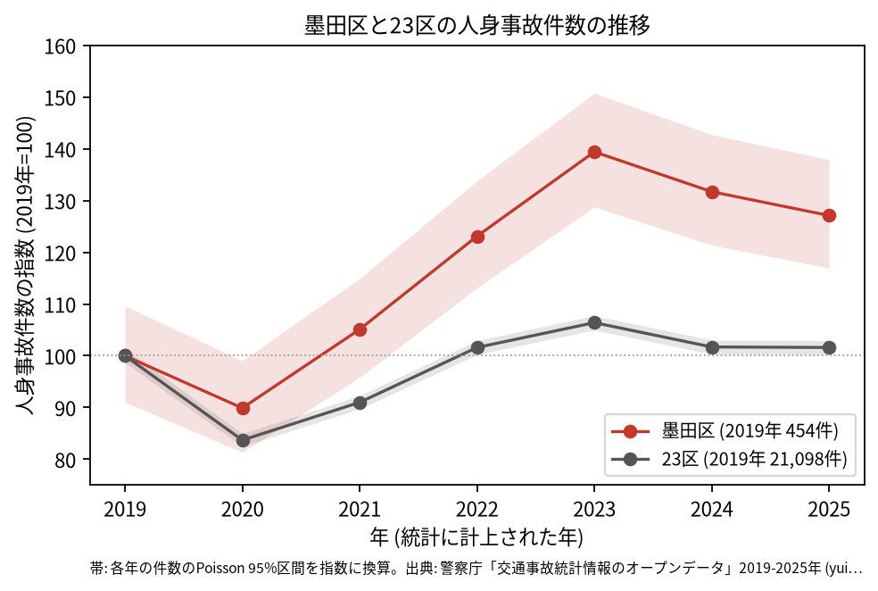
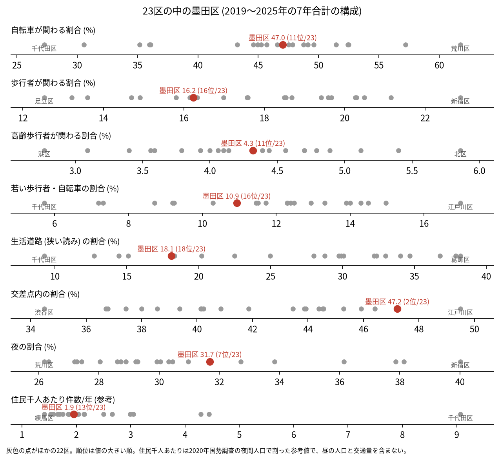
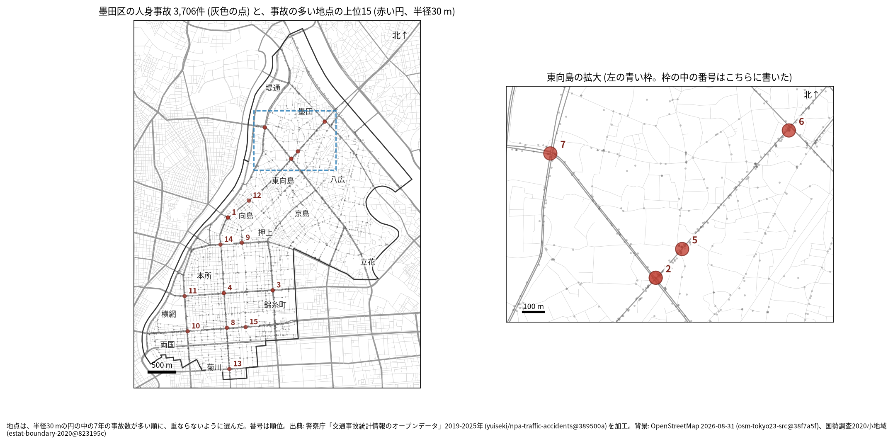
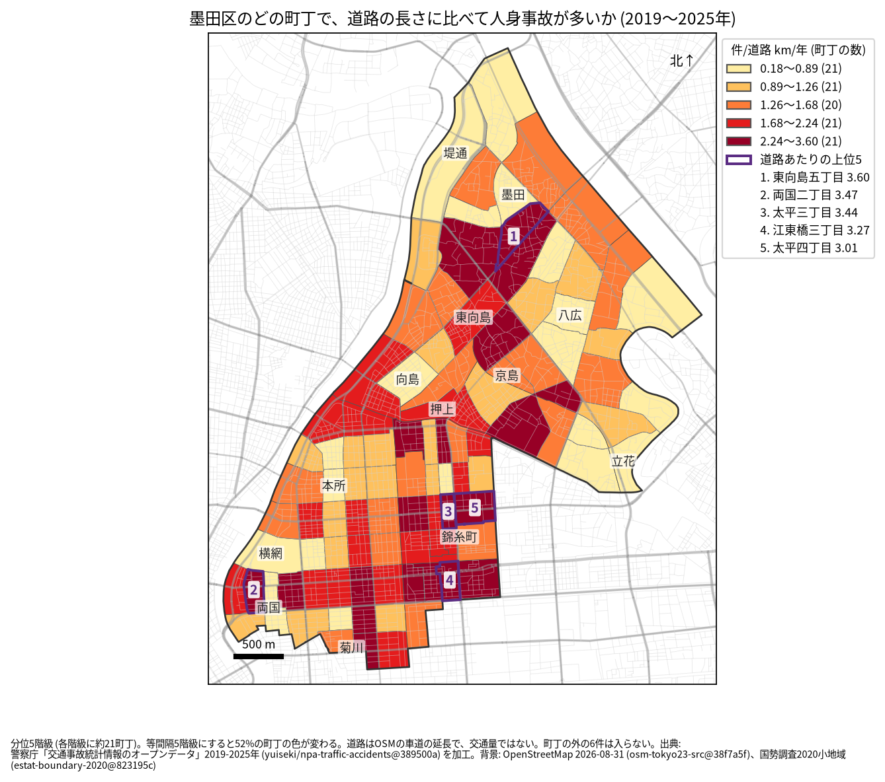
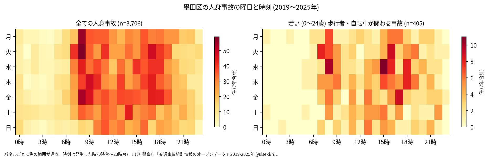
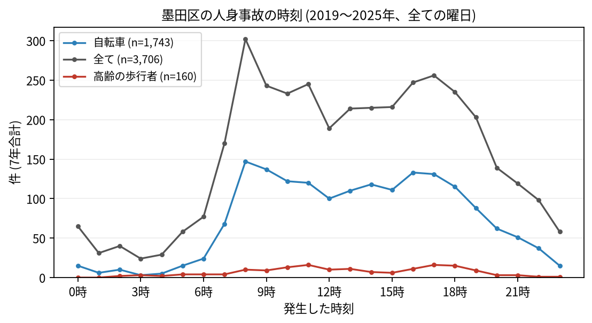
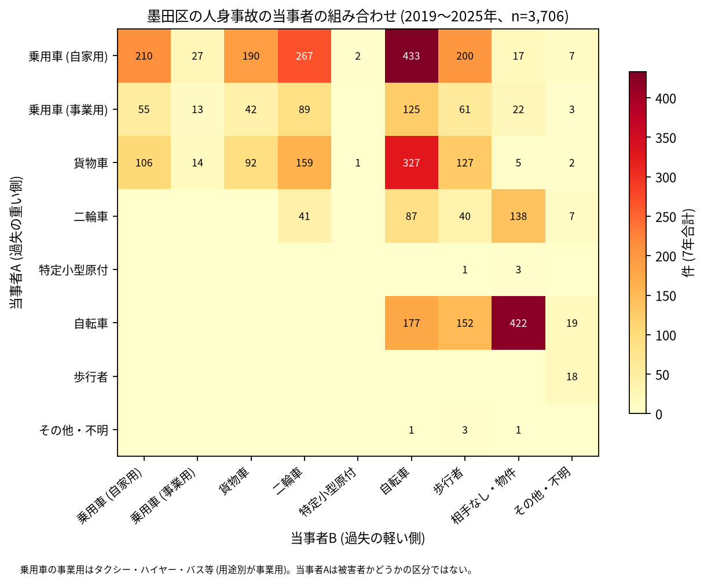

# 墨田区の交通事故 2019〜2025 年: 図で読む要点

## 問い

2019〜2025 年の警察記録の人身事故で、墨田区の事故はいつ、どこで、誰が関わって起きているか。

## 結論

### 要点

| # | 要点 | 数字 | 図 |
|---:|---|---|---|
| 1 | 件数は 2022 年から増え、2025 年も 2019 年より多い。23 区全体はほぼ 2019 年の水準 | 7 年で 3,706 件、死者 19 人、負傷者 4,086 人。指数 (2019 年=100) は 2023 年 139.4、2025 年 127.1。23 区全体の 2025 年は 101.6 ([yearly.csv](outputs/yearly.csv)、[summary.txt](outputs/summary.txt)) | [図 1](#図-1-件数の推移) |
| 2 | 事故は幹線の交差点に寄り、生活道路は少なめ | 交差点内 47.2% (23 区の 2 位)、生活道路 18.1% (18 位) ([wards.csv](outputs/wards.csv)、[analysis.json](outputs/analysis.json)) | [図 2](#図-2-23-区の中の墨田区) |
| 3 | 集まる場所は、北の水戸街道 (向島、東向島) と、南の蔵前橋通りと京葉道路 (両国、錦糸町の周り) | 上位 1 位は水戸街道 × 三ツ目通り (36 件)。道路あたりの上位 5 町丁は東向島五丁目、両国二丁目、太平三丁目、江東橋三丁目、太平四丁目 ([hotspots.csv](outputs/hotspots.csv)、[towns.csv](outputs/towns.csv)) | [図 3](#図-3-事故の集まる地点)、[図 4](#図-4-町丁ごとの事故) |
| 4 | 事故の半分に自転車が関わり、自転車の単独事故が多い | 47.0%。車やトラックが当事者 A で自転車が B の事故が 885 件、自転車の単独 (相手なし・物件) が 422 件 ([summary.txt](outputs/summary.txt)) | [図 6](#図-6-誰と誰の事故か) |
| 5 | 死亡事故は二輪車と歩行者と、貨物車に偏る | 死亡事故 19 件。亡くなったのは二輪車 7 人、歩行者 6 人 (65 歳以上 4 人)、自転車 4 人。当事者 A が貨物車の事故が 10 件 ([summary.txt](outputs/summary.txt)) | [表 1](#表-1-死亡事故) |

### 読み手ごとに知るべきこと

| 読み手 | 結論 | 検討する材料 | 詳しく |
|---|---|---|---|
| 区の交通安全担当 | 件数は 2022 年から増え、2025 年の 95% 区間 (530.9〜626.1 件) は 2019 年 (413.2〜497.7 件) と重ならない。生活道路の法定速度 30 km/h (2026-09-01 から) が当たるのは事故の 18.1〜31.5% (読み方による) | 増えた区分 (自転車、区道)、幹線の交差点、二輪車と貨物車の死亡事故 | [municipality.md](reports/municipality.md) |
| 学校と PTA | 若い (0〜24 歳) 歩行者と自転車の事故は 405 件。最も多いのは 8 時台と 16 時台 (各 40 件) で、朝の登校の時間にも多い | 学校の円の中で、平日 7〜8 時台と 14〜17 時台の点が並ぶ道 | [school-pta.md](reports/school-pta.md) |
| 道路安全診断 | 上位は水戸街道 × 三ツ目通り (36 件)、明治通り × 水戸街道 (32 件)、蔵前橋通り × 四ツ目通り (28 件)、蔵前橋通り × 三ツ目通り (28 件) | 後半に増えた 3 位と 7 位、上位に多い自転車と二輪車の事故 | [road-safety-auditor.md](reports/road-safety-auditor.md) |
| 住民 | 道路あたりで多いのは東向島五丁目 (年 3.60 件/道路 km)、両国二丁目 (3.47 件)、太平三丁目 (3.44 件)。事故は朝 8 時台が最多 (302 件) で、夕方 16〜18 時台も多い | 自分の町の色、朝の自転車、水戸街道と蔵前橋通りを渡るとき | [resident.md](reports/resident.md) |

### 図 1: 件数の推移

2020 年の落ち込み (89.9) は 23 区全体 (83.7) より浅い。2022 年 (123.1) から 23 区全体 (101.6) との差が開き、2023 年 (139.4) が最も多い。2022〜2025 年の各年の 95% 区間は 2019 年の区間 (413.2〜497.7 件) と重ならないので、増えたと書ける。区の面に入る点で数えても、年ごとの件数はほぼ同じ (2023 年はコード 633 件、面 632 件、[analysis.json](outputs/analysis.json))。

### 図 2: 23 区の中の墨田区

赤い点が墨田区。交差点内 (2 位) と夜 (31.7%、7 位) が高く、生活道路 (18 位) と若い歩行者・自転車 (10.9%、16 位) が低め。自転車 (11 位) と高齢の歩行者 (4.3%、11 位) は中ほど。住民千人あたり (1.95 件/年、13 位) は昼の人口を含まない参考値。

### 図 3: 事故の集まる地点

半径 30 m の円の中の 7 年の件数で選んだ上位 15 (16〜36 件)。番号は順位で、東向島の 4 地点 (2、5、6、7 位) は右の拡大図に番号を書いた。

| 順位 | 近い道路 (OSM) | 町丁 | 件数 | 前半 件/年 | 後半 件/年 |
|---:|---|---|---:|---:|---:|
| 1 | 水戸街道 × 三ツ目通り | 向島二丁目 | 36 | 5.33 | 5.00 |
| 2 | 明治通り × 水戸街道 | 東向島四丁目 | 32 | 4.33 | 4.75 |
| 3 | 蔵前橋通り × 四ツ目通り | 太平三丁目 | 28 | 2.33 | 5.25 |
| 4 | 蔵前橋通り × 三ツ目通り | 石原四丁目 | 28 | 4.67 | 3.50 |
| 5 | 水戸街道 | 東向島五丁目 | 27 | 4.00 | 3.75 |

前半は 2019〜2021 年、後半は 2022〜2025 年。半径を 20 m にすると上位 15 のうち 12 地点、50 m でも 12 地点が残る。首都高速の事故 (区で 103 件) は上位 15 の円に 1 件も入らず、首都高速を除いても 15 地点が全て残る ([analysis.json](outputs/analysis.json))。6〜15 位は [hotspots.csv](outputs/hotspots.csv)。

### 図 4: 町丁ごとの事故

町丁の事故数を、OSM の車道の延長と 7 年で割った値。紫の枠が上位 5 (東向島五丁目、両国二丁目、太平三丁目、江東橋三丁目、太平四丁目)。分位と等間隔で 52% の町丁の色が変わるので、色の細かい差は読まない。道路の長さは交通量ではない。

### 図 5: いつ起きるか

全体は平日の朝 8 時台が最も多く (302 件)、夕方 16〜18 時台にも山がある。若い歩行者と自転車は 8 時台と 16 時台 (各 40 件) が最多。

自転車は 8 時台 (147 件)、高齢の歩行者は 11 時台と 17 時台 (各 16 件) が最多。

### 図 6: 誰と誰の事故か

最も多いのは自家用の乗用車 (A) と自転車 (B) の 433 件、次が自転車の単独 (相手なし・物件) の 422 件、貨物車と自転車の 327 件。当事者 A は過失の重い側で、被害者とは限らない。

### 表 1: 死亡事故

| 亡くなった人 | 人数 | 特徴 |
|---|---:|---|
| 二輪車 | 7 | |
| 歩行者 | 6 | 65 歳以上が 4 人 |
| 自転車 | 4 | |
| 乗用車 (自家用) | 1 | |
| 補充票の人 (当事者 A、B の外) | 1 | |

19 件のうち当事者 A が貨物車の事故が 10 件、0〜5 時台が 6 件。数が少ないので傾向とは断定しない。全件は [deaths.csv](outputs/deaths.csv)。

### 読み方で変わる答え

| 読み方 | 主 | 別の読み方 |
|---|---|---|
| 墨田区の事故 | `市区町村コード` 107 の 3,706 件 | 点が区の面に入る事故。両方に当てはまるのは 3,700 件 |
| 生活道路 | 狭い読み 18.1% (18 位) | 広い読み 31.5% (17 位) |
| 地点の半径 | 30 m | 20 m で 12 地点、50 m で 12 地点が残る |
| 首都高速の事故 | 含める | 除いても 15 地点が残る |
| 町丁の階級 | 分位 5 階級 | 等間隔で 52% の町丁の色が変わる |

## データ

- 人身事故: 警察庁「交通事故統計情報のオープンデータ」を加工した `yuiseki/npa-traffic-accidents` 版 `389500aae5cec45f1311163f70db6a5f05867838` (配布元の取得 2026-10-02) の本票。年はファイルの年 (統計に計上された年)。墨田区 3,706 件、23 区 144,716 件。位置の無い行は 0。物損事故は含まない。
- 区の面と人口: `yuiseki/jp-admin-2026-09` 版 `e6c87b1`。町丁: 2020 年国勢調査の小地域 `yuiseki/estat-boundary-2020` 版 `823195c` (104 町丁、272,085 人)。学校 36 校と道路: OpenStreetMap 2026-08-31、`yuiseki/osm-tokyo23-src-2026-08` 版 `38f7a5f`。
- 道具: DuckDB (spatial、版は [analysis.json](outputs/analysis.json))、matplotlib、`analysis-visualize` の `cjk_font.py`、`classify_map.py`、`context_map.py`。
- 出典の表示: 警察庁ウェブサイト (https://www.npa.go.jp/publications/statistics/koutsuu/opendata/index_opendata.html) の交通事故統計情報のオープンデータを加工して作成。国勢調査の小地域境界と人口、OpenStreetMap (© OpenStreetMap contributors) を加工して使用。

## 方法

- 型は [台東区の分析](../taito-accident-trends-by-role/report.md) と同じ。読み方は結果を見る前に [計画](EXPERIMENT_PLAN.md) で固定し、実行は [記録](EXPERIMENT_TRACKER.md) に残した。生活道路は `車道幅員` が 01、02、11 (狭い読み)、広い読みは 14、17 を足す。歩行者や自転車が関わるかは当事者 A と B の両方で見て、1 件を 1 回数えた。
- 距離は EPSG:6677 (メートル) で測った。地点は、半径 30 m の中の件数が最も多い点を中心に選び、その円の事故を除いて次を選ぶ手順を 15 回くり返した。墨田区では、首都高速 (6 号向島線、7 号小松川線) の高架の事故が下の道路の円に混ざりうるため、`路線コード` 5000〜5499 を除いた 30 m の読みを、流す前に並べる読みとして足した。
- 地図は `analysis-visualize` の map-context に合わせ、地名と道路を重ね、凡例を地図の外に置き、強調した単位に番号を付けた。描いた町丁の数 (104) を分析の数と照らし、文字の重なりと、地名が円や学校の印を隠す重なりは、3 枚の地図で 0 件 (1 回目に学校の四角を隠した地名 3 つの位置を直した)。背景の道路 (OGC:CRS84) と町丁 (JGD2000) の差は、線の幅より小さいとして変換せずに重ねた。
- 関門: 予測と回帰をしないので、評価の分け方と残差の確認は要らない。単位の間の相関を結論にしないので、Moran's I と格子の掃引は省いた。推移は 23 区全体を基準にし、年の件数に Poisson の 95% 区間を付けた。対策の効果は推定していない。
- 再実行は [README.md](README.md)。数値は [outputs/](outputs/) の CSV、来歴は [analysis.json](outputs/analysis.json)。

## 確かめていないこと

- 2022 年から増えた理由は調べていない。区の面で数えても同じように増えるので、区のコードの付け方の変化では説明しにくいが、記録の仕方の変化、自転車の利用の増加、人出の変化のどれかは分からない。
- 交通量、昼の人口、観光客の数で割っていない。錦糸町駅と押上 (東京スカイツリー) の周りの人出は、このデータでは測れない。
- 位置の精度は分からない。30 m の地点と町丁の境界の近くの事故は、数十 m のずれで入れ替わる。
- 事故の型 (出会い頭、追突)、重傷と軽傷の区別、物損事故、ヒヤリハットは、このデータに無い。
- 0〜24 歳より細かい年齢は無く、小学生だけは数えられない。
- 地点の上位は 7 年で選び、同じ 7 年で前半と後半を比べたので、後半が下がって見えやすい (平均への回帰)。墨田区では区全体が後半に増えているので、地点の後半の増え方は区全体の増え方と分けて読めない。
