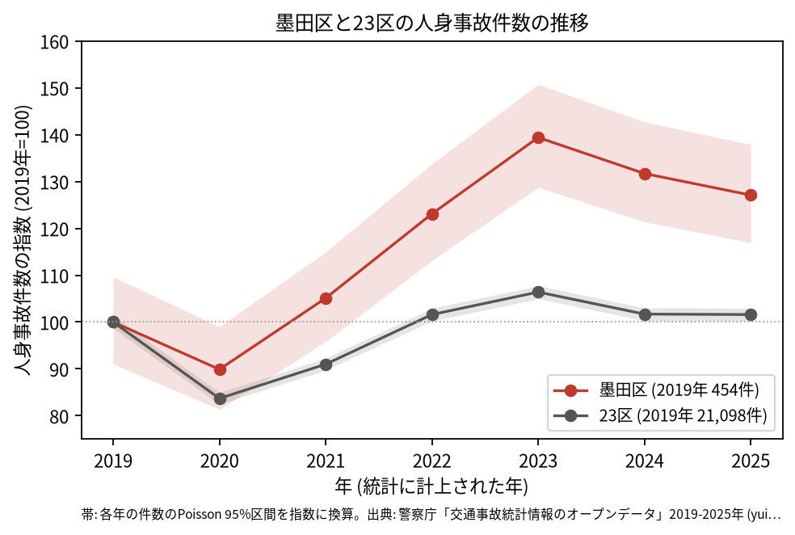
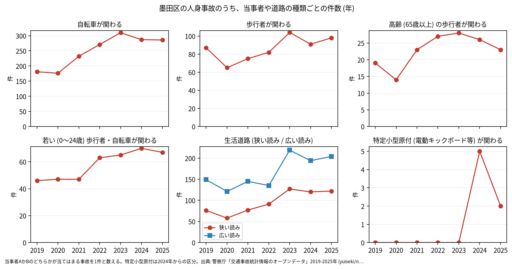
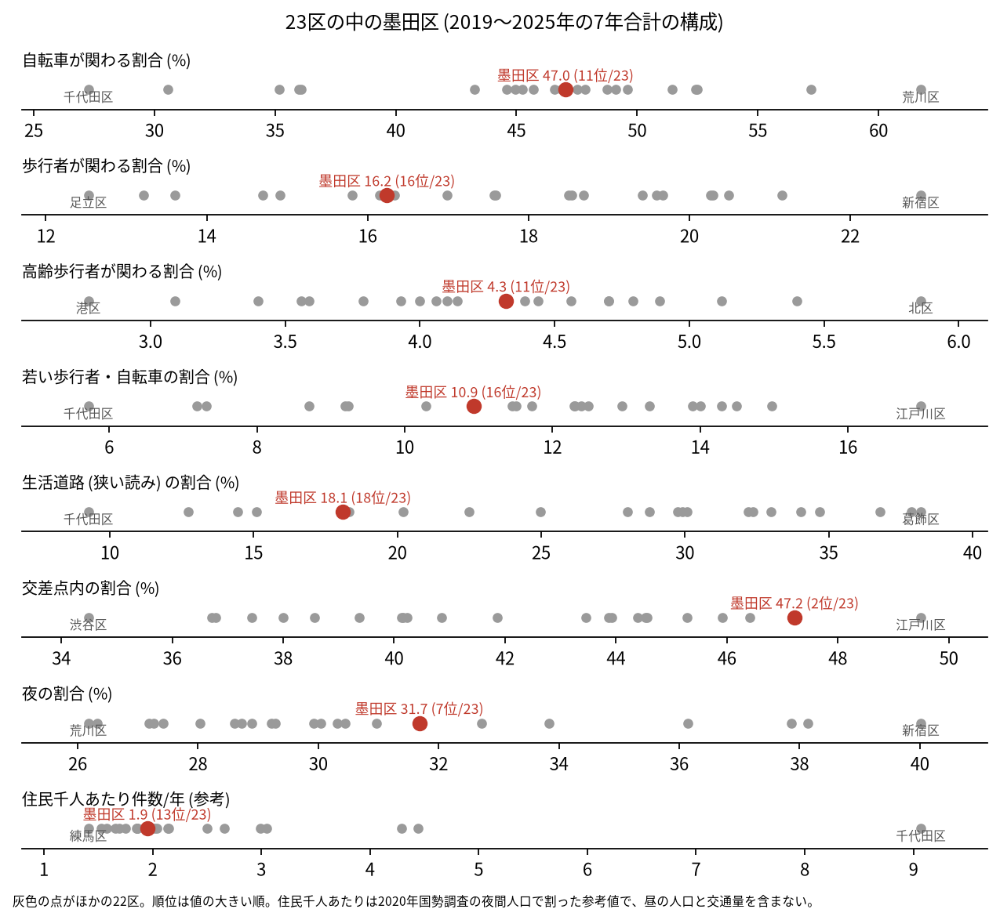

# 区の交通安全担当のための報告: 墨田区の交通事故の傾向

## 問い

墨田区の人身事故は 2019〜2025 年にどう推移し、23 区の中でどんな特徴があり、施策をどこに向ける材料になるか。

## 結論

- 件数: 7 年で 3,706 件、死者 19 人、負傷者 4,086 人です。2020 年に 408 件 (2019 年を 100 として 89.9) まで減りましたが、23 区全体 (83.7) ほどは下がりませんでした。2022 年から増え、2023 年は 633 件 (139.4)、2025 年は 577 件 (127.1) です。2022〜2025 年の各年の 95% 区間は 2019 年の区間 (413.2〜497.7 件) と重ならないので、2019 年より増えたと言えます。23 区全体の 2025 年は 101.6 で、ほぼ 2019 年の水準です。

- 増え方の中身: 自転車が関わる事故は 2019 年の 181 件から 2023 年の 310 件、2025 年の 286 件へ増えました ([yearly.csv](../outputs/yearly.csv))。路線で見ると、区道の事故が 2019 年の 189 件から 2025 年の 274 件へ増えています ([route_class.csv](../outputs/route_class.csv))。区の面に入る点で数えても年ごとの件数はほぼ同じ (2023 年はコード 633 件、面 632 件) なので、区のコードの付け方の違いでは説明しにくい増え方です ([analysis.json](../outputs/analysis.json))。増えた理由は調べていません。

- 23 区の中の位置: 墨田区の事故は、幹線の交差点に寄っています。交差点内の割合は 47.2% で 23 区の 2 位、夜の割合は 31.7% で 7 位です。生活道路 (狭い読み) の割合は 18.1% で 18 位、広い読みでも 31.5% で 17 位です。自転車が関わる割合 (47.0%) は 11 位、高齢の歩行者 (4.3%) は 11 位、若い歩行者と自転車 (10.9%) は 16 位です。

- 施策への読み方: 2026-09-01 からの生活道路の法定速度 30 km/h は、墨田区の事故のうち 18.1〜31.5% (読み方による) に当たります。件数の多い地点は、水戸街道 (向島、東向島) と、蔵前橋通りと京葉道路 (両国、錦糸町の周り) の交差点です (地点は [道路安全診断の報告](road-safety-auditor.md))。これは効果の予測ではなく、どの道路で事故が起きているかの構成です。
- 特定小型原付 (電動キックボードなど) が関わる事故は、区分のできた 2024 年に 5 件、2025 年に 2 件でした。
- 死亡事故: 19 件のうち、亡くなったのは二輪車 7 人、歩行者 6 人、自転車 4 人、乗用車 1 人、補充票の人 1 人です。亡くなった歩行者 6 人のうち 4 人が 65 歳以上でした。当事者 A (過失の重い側) が貨物車の事故が 10 件、0〜5 時台に起きた事故が 6 件です。19 件は少なく、偏りを傾向と断定できる数ではありません。

| 年 | 当事者 A | 当事者 B | 亡くなった人 | 時 |
|---|---|---|---|---:|
| 2021 | 貨物車 | 歩行者 (75 歳以上) | 歩行者 | 19 |
| 2022 | 貨物車 | 歩行者 (75 歳以上) | 歩行者 | 3 |
| 2023 | 貨物車 | 歩行者 (75 歳以上) | 歩行者 | 3 |
| 2023 | 貨物車 | 歩行者 (45〜54 歳) | 歩行者 | 2 |
| 2024 | 貨物車 | 歩行者 (55〜64 歳) | 歩行者 | 20 |
| 2019 | 貨物車 | 自転車 (65 歳以上、75 歳未満) | 自転車 | 2 |
| 2023 | 貨物車 | 自転車 (75 歳以上) | 自転車 | 15 |
| 2023 | 貨物車 | 自転車 (75 歳以上) | 自転車 | 13 |
| 2025 | 貨物車 | 自転車 (35〜44 歳) | 自転車 | 11 |

表は、当事者 A が貨物車で、歩行者か自転車が亡くなった 9 件の抜き出しです。19 件 ([summary.txt](../outputs/summary.txt)) の全ては [deaths.csv](../outputs/deaths.csv) にあります。

- 人口あたり: 2020 年の住民千人あたりの年の件数は 1.95 件で 23 区の 13 位ですが、分母に昼の人口、観光客、通過する車が入らないため、区の比較の主な指標にしていません。

## データ

警察庁「交通事故統計情報のオープンデータ」を加工した `yuiseki/npa-traffic-accidents` 版 `389500a` の本票。墨田区は `市区町村コード` 107 の 3,706 件、23 区は 144,716 件。年はファイルの年 (統計に計上された年)。区の人口は 2020 年国勢調査 (`jp-admin-2026-09` 版 `e6c87b1`)。詳しくは [共通の報告](../report.md)。

## 方法

区分は、当事者 A か B のどちらかが当てはまる事故を 1 件と数えました。生活道路は `車道幅員` で決め、狭い読み (5.5 m 未満の単路と、小と小の交差点) と、広い読み (5.5 m 未満の道とより広い道の交差点も含む) を並べました。年の区間は件数の Poisson の 95% 区間 (Garwood) です。23 区の順位は 7 年合計の割合の大きい順です。路線は `路線コード` の範囲で国道、都道、区道、首都高速に分けました。

## 確かめていないこと

- 2022 年から増えた理由 (記録の仕方、自転車の利用、人出の変化など) は調べていません。
- 区の施策 (ゾーン 30、自転車の通行帯など) の効果は推定していません。割合の順位は施策の評価ではありません。
- 重傷と軽傷の区別、物損事故は、このデータにありません。
