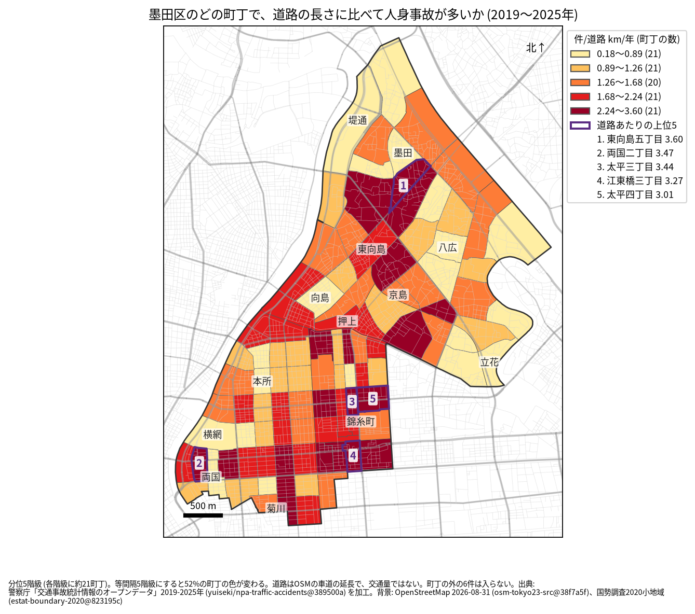
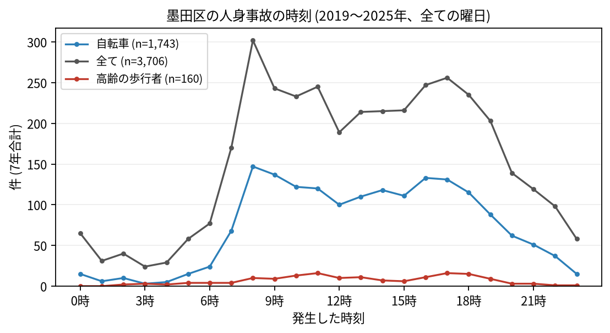

# 住民のための報告: 墨田区で、いつ、どこで事故が起きているか

## 問い

墨田区に住む人が、自分の町で、いつ、どんな事故に気をつければよいか。2019〜2025 年の警察記録の人身事故から調べました。

## 結論

- 墨田区では 7 年で 3,706 件の人身事故があり、19 人が亡くなりました。年に 408〜633 件で、2022 年から多くなっています。
- 町ごと: 道路 1 km あたりの事故が多いのは、東向島五丁目 (年 3.60 件)、両国二丁目 (3.47 件)、太平三丁目 (3.44 件)、江東橋三丁目 (3.27 件)、太平四丁目 (3.01 件) です。件数そのものが最も多いのも東向島五丁目 (7 年で 103 件) で、江東橋四丁目 (99 件)、東向島二丁目 (97 件) が続きます。水戸街道の通る東向島から向島と、錦糸町の周り (太平、江東橋) と両国に、色の濃い町が並びます。

色は分位 5 階級で、各色に約 21 の町が入ります。等間隔の階級にすると 52% の町の色が変わるので、色の差より、自分の町が上の階級か下の階級かを見てください。

- 時間: 事故は朝 8 時台が最も多く (302 件)、夕方の 16 時台 (247 件) と 17 時台 (256 件) にも山があります。自転車が関わる事故は 8 時台 (147 件) と 9 時台 (137 件) に多く、高齢の歩行者が関わる事故は 11 時台と 17 時台 (各 16 件) が最も多い時間でした。

- 誰が: 自転車が関わる事故が全体の 47.0% で、最も多い区分です。自転車に乗る人は、車やトラックとの事故 (885 件) に加え、自転車だけの事故 (転倒や物への衝突、422 件) にも気をつけてください。歩行者が関わる事故は 16.2% です。
- 亡くなった人: 19 人のうち 7 人が二輪車、6 人が歩行者 (そのうち 4 人が 65 歳以上)、4 人が自転車でした。

## データ

警察庁「交通事故統計情報のオープンデータ」を加工した `yuiseki/npa-traffic-accidents` 版 `389500a` の本票、墨田区の 3,706 件 (2019〜2025 年のファイル)。町の境界は 2020 年国勢調査の小地域 (104 町丁)、道路は OpenStreetMap 2026-08-31。詳しくは [共通の報告](../report.md)。

## 方法

事故の地点を町丁の境界に入れて数え、町丁の中の車道の長さ (OSM) と 7 年で割りました。区の境界の近くで町丁の外に落ちた 6 件は町の値に入っていません ([analysis.json](../outputs/analysis.json))。時刻は事故の起きた時で、7 年の合計です。

## 確かめていないこと

- 道路の長さは、通る車や人の数ではありません。錦糸町や両国の値が高いのは、人と車が多いためかもしれません。
- 自分の町の事故が少なくても、物損事故やヒヤリハットはこのデータにありません。
- 事故の位置の精度は分かりません。町の境界の近くの事故は、隣の町に数えられている可能性があります。
